# M01：UART 异步串行通信

## 本章目标与前置知识

在 M00 的软件/外设/引脚结构、电平参考、时序、位序与周期换算基础上，理解 UART 接线、硬件字符帧、异步接收和时间计算，能够分析常见配置与接收问题。

按普通非反相、两端逻辑电平兼容的 MCU UART 场景逐步讲解，示例为纸面推演；实际电平、时钟来源、位序与分频公式以器件手册和配置为准。

## 内容入口与编写范围

- M01-01：接线、基础帧结构、8N1 和数据位顺序。首轮正文、示例及附答案自测已整理，独立应用与间隔回忆另见进度。
- M01-02：波特率、位时间、帧耗时、有效吞吐率及分频误差。首轮正文、计算示例与附答案自测已整理；独立练习与间隔回忆另见进度。
- M01-03：异步采样、时钟误差与参数匹配。首轮正文、波形、自测与正式 P004 验收完成；实际容差的适用边界已说明，间隔复测待后续。
- M01-04：UART/USART、收发方式与常见故障。已整理轮询/中断、DMA 请求与通道使能、缓冲边界和分层排错，配机制图及附答案自测。本章首轮内容已覆盖，学习验收与间隔复测见进度文件。

教材覆盖状态与学习者掌握程度分开记录，具体表现见 [学习进度](../学习进度.md) 和 [练习进度](../练习进度.md)。

## M01-01：接线与基础帧结构

### 1. 接线与适用条件

TX 是发送输出，RX 是接收输入。两端电平兼容、普通非反相逻辑电平 UART 的基本双向接线为：

```text
A 的 TX ─────→ B 的 RX
A 的 RX ←───── B 的 TX
A 的 GND ───── B 的 GND
```

共同参考地使两端能依据相容的电平条件判定信号。是否允许直接接线需要核对输出电平、输入门限与耐受条件，不能仅凭接口名称或供电电压判断。

两个方向各用独立数据线，具备同时收发能力；实际程序未必同时发送。异步 UART 没有共享时钟线，两端各用内部计时硬件，约定相容的发送节奏与帧格式。当前不展开流控、隔离或半双工特殊配置。

### 2. 帧组成与 8N1

```text
空闲 → 起始位 → 数据位 → 可选校验位 → 停止位 → 后续帧或空闲
```

在普通非反相 UART 中，空闲为高电平，起始位为低电平，停止位为高电平；可选校验位位于数据之后、停止位之前，用于简单的数据检查，具体奇偶规则后续讲解。

8N1 的 8 表示八数据位，N 表示没有校验位（None），1 表示一个停止位，另有一个起始位。每个字节的帧长度为 1+8+0+1=10 个位时间；连续三个字节共 30 个位时间，不计帧前后或帧间额外空闲。

这里的一帧是承载一个字节的 UART 硬件字符帧；完整应用数据包可能由多个字节组成，其边界在 M06 进一步学习。

### 2.1 空闲、起始位、停止位：逻辑值与明确电平

以下为 UART 正常启用、非反相、逻辑侧使用 0/3.3 V 的示例。起始与停止位属于 UART 字符帧；经 RS232 或 RS485 收发器传输时，逻辑含义保持一致，线路电压表示由相应接口决定。

| 状态 | UART 帧逻辑值 | 本例逻辑侧电压 | 时间含义 |
|---|---|---|---|
| 空闲 | 1 | 高电平，约 3.3 V | 当前没有发送字符帧，可持续较长时间 |
| 起始位 | 0 | 低电平，约 0 V | 一帧开始，普通异步 UART 中占一个位时间 |
| 停止位 | 1 | 高电平，约 3.3 V | 帧末的规定区间，8N1 中占一个位时间 |

起始位使普通非反相信号从空闲高电平变为低电平，接收端据此识别新帧起点。停止位结束后，若暂时没有下一帧，TX 继续保持空闲高电平；若连续发送，下一帧可紧接停止位开始，不要求额外插入一个空闲位。停止位与空闲虽然电平相同，但前者属于帧内固定长度区间，后者是帧外等待状态，不能只靠电平变化区分。[Microchip 异步帧说明](https://developerhelp.microchip.com/xwiki/bin/view/products/mcu-mpu/8bit-pic/peripherals/eusart-ausart/)

下面的对照图第一行是本节 UART 逻辑侧。0–20 µs 是起始位，180–200 µs 是停止位，200 µs 后 TX 继续保持逻辑 1；另外两行的电气转换分别见 M02 与 M03。

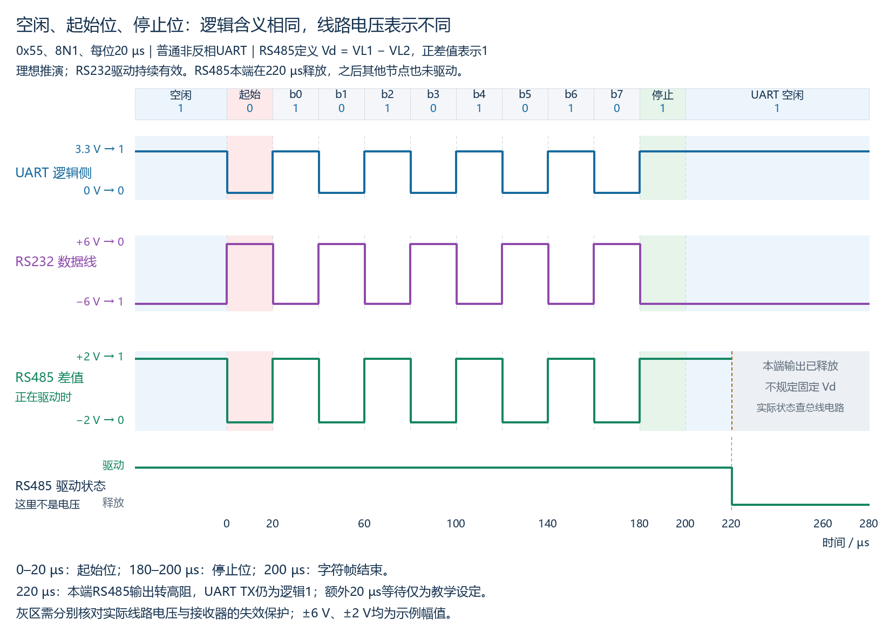

**停止位表示字符帧结束，不是“将发送引脚改为高阻”的命令。**UART TX 的空闲逻辑值，与外部 RS485 驱动器是否继续驱动总线，是不同的状态。

**复习自测：**

1. 本例空闲、起始位和停止位分别为逻辑几、电压约多少？空闲与停止位虽然都为高，时间含义有什么区别？
2. 8N1、每位 20 µs、帧从 0 µs 开始。停止位在哪段时间，下一帧最早何时开始？停止位结束后一直保持高，能否认定还在发送新的数据字节？

**参考答案（对应上面题号）：**

1. 空闲为 1/约3.3 V，起始位为 0/约0 V，停止位为 1/约3.3 V；停止位是帧内规定区间，空闲是帧外等待状态。
2. 停止位在 180–200 µs，下一帧最早在 200 µs 开始；持续高电平可以只是空闲，不能认定有新的字节，需结合后续起始位与完整帧时序。

### 3. 数据位的时间顺序

本节采用 LSB first，八个数据位按 b0～b7 发送；解码时把收到的各位放回相应位位置。芯片可能有其他选项，应核对器件和配置。

**纸面示例：**程序发送 0x55，其 b7～b0 为 01010101，8N1 在线上的排列为：

```text
起始位 │ b0 b1 b2 b3 b4 b5 b6 b7 │ 停止位
   0   │  1  0  1  0  1  0  1  0 │   1
```

正常接收后，接收硬件将八个数据位还原成 0x55，软件读取该数据字节；起始、停止位不属于字节的数据内容。

下面给出同一字节的实际电平形状，位时间取 20 µs。蓝线是线路上的 0/1 电平；细竖线划分各位的时间槽，竖线本身不是额外的时钟信号；三角形表示理想接收模型的采样时刻。图为精确绘制的教学示意，并非硬件测量。

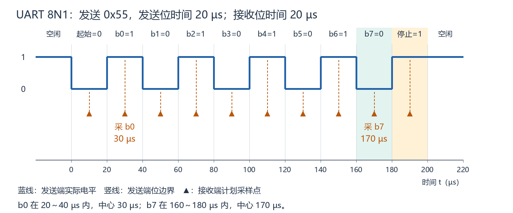

若接收时间顺序是 1、1、0、0、0、1、0、1，按 b0～b7 放回位置后，b7～b0 为 10100011，得到 0xA3。不能把时间序列直接当成从最高位开始书写的二进制数。

每个时间槽对应一位。相邻位相同时电平可以不跳变，停止位与后续空闲也可能连续为高；读波形应结合时间与帧结构，不能只数电平边沿。

### 4. 复习自测与参考答案

**复习自测：**

1. 上述两端电平兼容场景中，A 的 TX、RX 分别接 B 的哪个引脚？共同参考地解决什么问题？
2. 8N1 的三个字符分别表示什么？一帧共占多少个位时间？
3. 连续发送五个 8N1 字节，无额外空闲，共占多少个位时间？
4. 仅数据位按时间为 0、1、1、0、1、0、0、1，LSB first 时恢复为哪个十六进制字节？
5. 能否按波形跳变次数计算帧位数？起始位是否属于收到的数据字节？

**参考答案（对应上面题号）：**

1. A TX→B RX，A RX←B TX；共同参考地提供相容的电压判定参考。直接连接仍需满足器件电平与耐受条件。
2. 八数据位、无校验位、一个停止位；另有一个起始位，共十个位时间。
3. 5×10=50 个位时间，不计题设排除的额外空闲。
4. 数据放回位位置后 b7～b0 为 10010110，得到 0x96。
5. 不能，相邻相同位可不跳变，应按时间槽和帧格式解读。起始位用于帧识别，不属于八个数据位。

## M01-02：波特率与时间计算

### 1. 波特率、线路比特率与数据字节吞吐率

波特率表示每秒传输的码元（符号）数，单位 baud；比特率表示每秒传输的位数，单位 bit/s。本节的普通二进制 UART 每码元承载一位，因此两者数值相同；其他通信方式可能每码元承载多位，不能将定义等同。

大写 B 表示字节，小写 b 或 bit 表示位。八位数据字节在 8N1 中占十个位时间，因为还需起始位与停止位。这里的数据字节吞吐率按 UART 八个数据位计算，不等于应用协议的净业务数据吞吐率。

### 2. 位时间、帧耗时与连续传输

设实际波特率为 R，本节假定它恰为题设数值，位时间固定。8N1 连续发送没有额外空闲、流控等待或重传时：

```text
位时间 Tbit = 1/R 秒
单帧耗时 Tframe = 10/R 秒
连续 n 个数据字节耗时 = 10n/R 秒
理想数据字节吞吐率 = R/10 B/s
```

每帧的起始/停止位已经计入十位，不应另外再加一次。若有额外空闲或等待，总耗时增加，平均数据字节吞吐率降低。格式改变时，应按新的帧位数重新计算。

**数学推演示例：**9600 baud、8N1，位时间为 1/9600 s≈104.17 µs，单帧耗时为 10/9600 s≈1.0417 ms；理想连续吞吐率为 9600/10=960 B/s。

19200 baud、8N1，位时间约 52.0833 µs，连续四字节耗时为 40/19200 s≈2.0833 ms，理想吞吐率为 1920 B/s。按两位小数写为 52.08 µs、2.08 ms；按整数粗略估算可写约 52 µs、约 2 ms，需说明近似精度。

1 s=1000 ms=10^6 µs。优先保留中间精度或直接用总位数除以 R，最终再按要求四舍五入；避免先把位时间粗略取整后反复累加。

从已知位时间反推波特率时，先将时间换为秒，再取倒数 R=1/Tbit。可用数据字节数/总耗时（秒）核对平均吞吐率；在连续 8N1 条件下，它应与 R/10 一致。

若完整 8N1 帧的十个采样值各对应一个位中心，相邻中心相隔 Tbit，则首末中心相隔九个位时间，整帧仍占十个位时间。计算帧占用时间应使用帧边界或完整位数，不能用首末位中心差直接代替。

### 3. 时间与吞吐率复习自测及参考答案

**复习自测：**

1. 普通二进制 UART 的波特率与线路比特率为何数值相同？是否意味着其他通信方式也一定相同？
2. 实际波特率 4800 baud、8N1，位时间是多少 µs？
3. 在第 2 题条件下，连续发送两个字节、无额外空闲，耗时多少 ms？理想数据字节吞吐率是多少 B/s？
4. 额外软件等待会如何影响总传输耗时和平均吞吐率？它是否一定改变 UART 单个位时间？

**参考答案（对应上面题号）：**

1. 本节每码元承载一位，因此码元数/s 与线路位数/s 数值相同。其他方式每码元可能承载多位，不能等同定义。
2. 1/4800 s≈208.33 µs。
3. 总耗时为 20/4800 s≈4.17 ms，理想数据字节吞吐率为 4800/10=480 B/s；已计入每帧的起始/停止位。
4. 额外等待使总耗时增加、平均吞吐率降低。若 UART 实际计时时钟和配置不变，等待只增加字节间空闲，并不改变已发送各位的时间。

### 4. 分频参数与实际波特率误差

软件设定目标波特率后，硬件需要从实际输入时钟生成每位的节奏。若分频寄存器只允许整数，目标速率可能无法精确实现，因此要计算实际速率及偏差。

本节采用某类 AVR USART 普通异步模式的公式作为明确示例：

```text
实际波特率 R实际 = f / [16(N+1)]
理想寄存器值 N理想 = f / (16R目标) − 1
带符号误差 = (R实际 − R目标) / R目标 × 100%
```

f 单位为 Hz，指该公式使用的实际输入时钟；N 对应该模式的整数波特率寄存器值，需在器件允许范围内。16 与 N+1 来自该硬件模式，不能套用于所有 MCU，也不表示一个机器周期必定含 16 个时钟周期。具体公式、时钟来源、寄存器范围和模式应查目标器件手册。[Microchip 的 AVR USART 时钟与波特率发生器说明](https://developerhelp.microchip.com/xwiki/bin/view/products/mcu-mpu/8-bit-avr/structure/usart-intro/)给出了相应硬件背景；模式公式见本章资料入口。

**选值步骤：**先算理想 N，再取其相邻有效整数，分别代入实际速率公式，比较与目标的偏差大小。不能只截断小数；实际速率与 N+1 成倒数关系，直接将理想 N 四舍五入也不替代实际误差比较。

**数学推演示例：**f=16 MHz、目标 9600 baud，理想 N≈103.1667。

| 候选 N | 实际波特率（baud） | 带符号误差 |
|---|---:|---:|
| 103 | 9615.38 | +0.16% |
| 104 | 9523.81 | −0.79% |

N=103 的误差幅度更小，因此选 103。正误差表示实际偏快，负误差表示实际偏慢。百分比的分母是目标值；选值时比较误差幅度，报告结果时保留符号。

另一例：f=8 MHz、目标 57600 baud，N=7 时实际为 62500 baud、误差约 +8.51%；N=8 时实际约 55555.56 baud、误差约 −3.55%，后者更接近目标。此时目标值与实际值不同，计算实际位时间、帧耗时和吞吐率应使用实际波特率。

**精度与边界：**计算误差时保留中间精度，最终再按要求舍入。上述计算假定 f 已准确给定，只分析整数分频产生的偏差；实际时钟源本身也可能存在误差。一个端点相对目标的误差不足以独立判定通信必然成功或失败，后续还需结合另一个端点的实际速率、帧格式与接收采样条件。

### 5. 分频与误差复习自测及参考答案

以下计算均限定公式 R=f/[16(N+1)]，候选值有效，并忽略输入时钟误差。

**复习自测：**

1. f=18.432 MHz、目标 115200 baud，理想 N、应选整数 N、实际波特率及误差分别是多少？
2. 实际 9700 baud、目标 9600 baud，带符号百分比误差是多少？它表示偏快还是偏慢？
3. 配置目标为 9600 baud，已知实际为 9700 baud，8N1 单帧耗时应使用哪个速率计算？结果约多少 µs？
4. 能否将本节的 16(N+1) 套到所有 UART？仅知道一个端点的分频误差，能否直接判断通信可靠性？

**参考答案（对应上面题号）：**

1. N理想=18432000/(16×115200)−1=9，选 N=9；实际为 115200 baud，误差 0%。
2. (9700−9600)/9600×100%≈+1.04%，表示实际偏快。
3. 使用实际 9700 baud；单帧为 10/9700 s≈1030.93 µs，不额外再加起始/停止位。
4. 均不能。分频公式取决于器件和模式；可靠性还需要分析双方实际速率、帧配置与接收采样条件等。

## M01-03：异步接收采样与参数匹配（波形图解）

### 1. 先区分线路波形与接收采样点

发送端决定线路每一位持续多久，接收端依据自己的时钟决定何时读取线路。两端不共享时钟线；普通非反相场景中，接收器通过空闲高到起始低的变化确认起始位并对齐该帧，再按本地节奏读取后续位。实际硬件可能在位中心附近过采样和多数表决，具体以器件手册为准。

下图采用精确识别起始边沿 t=0、无抖动、每位单点采样的理想模型。发送 0x55、8N1、LSB first，发送端和接收端位时间均为 20 µs。


读图时，先看时间轴和位边界，再沿三角形的虚线向上找到读取的电平：

- 起始位占 0～20 µs；它用于对齐，排在 b0 前面。
- b0 占 20～40 µs，中心是 30 µs，即 1.5×20 µs。
- b7 占 160～180 µs，中心是 170 µs，即 8.5×20 µs。
- 停止位占 180～200 µs。图中整个帧为 200 µs，时间从起始边沿计算。

通式中 T 必须代入当前题设：起始中心 0.5T、b0 中心 1.5T、b7 中心 8.5T、停止中心 9.5T。若 T=100 µs，b0/b7 为 150/850 µs；若 T=20 µs，则为 30/170 µs。示例数值不替代变量和题设。

### 2. 只改变接收端位时间，采样点就会移动

保持发送波形不变，接收端本地位时间改为 22 µs，仍在 t=0 对齐。接收器按自己的计时安排 b0 在 1.5×22=33 µs、b7 在 8.5×22=187 µs 读取线路。

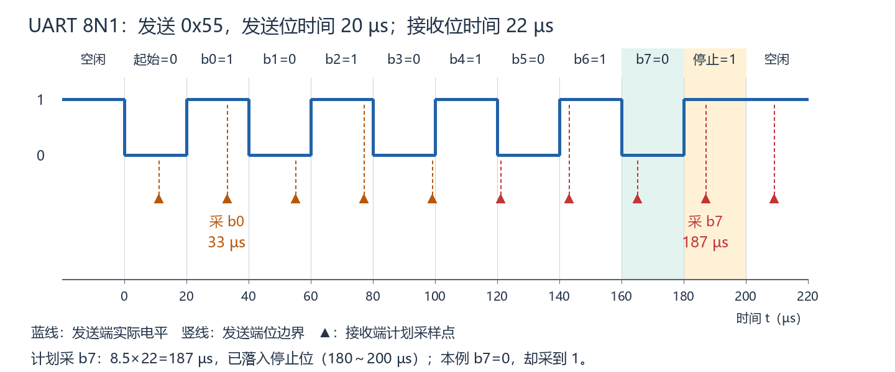

图中的细竖线和蓝色线路波形与上一张相同，变化的是接收采样点。187 µs 已超过 b7 的结束边界 180 µs，落入停止位。接收器仍将该次读取当成 b7：本例真正 b7=0，而停止位=1，所以这个数据位读错。

发送端与接收端每个位时间相差 2 µs。起始对齐后，计划采样与理想中心的偏差为：b0 的 1.5×2=3 µs，b7 的 8.5×2=17 µs。差距随帧内位置累积，使后面的采样更容易越过位边界。

相邻相同位不一定有边沿，不能依赖每个数据位的跳变重新对齐；每个新字符帧的起始位重新提供对齐参考。越过边界可能读错，但若邻位与原位电平相同，某一次读值可能碰巧相同；此处特意选 0x55，使 b7=0、停止位=1，便于看到错误。本模型只解释机制，不作为所有 UART 的通用容差判据。

### 3. 有偏移，不一定立即读错

仍保持发送端每位 20 µs，只将接收端改为 21 µs。在相同理想模型中，计划采 b7 的时刻为 8.5×21=178.5 µs，比发送端中心 170 µs 晚 8.5 µs，但仍在 b7 的 160～180 µs 内，因此此点读取到正确的 b7=0。

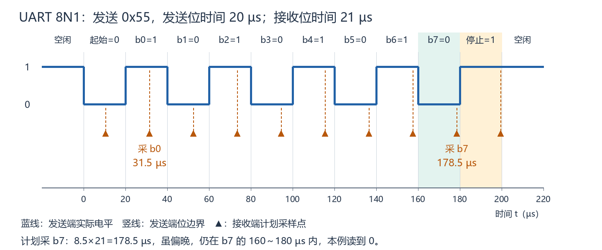

位中心附近通常离两侧变化边界更远，留给计时偏差的空间更大。这个例子说明要结合实际采样位置判断影响，不能把“双方速率存在偏差”直接等同于“每个数据位都会读错”。真实硬件还需考虑起始检测误差、抖动、信号边沿、过采样判定和帧格式；不能据此宣称任意 UART 都允许 5% 的误差。

### 4. 图解复习自测与参考答案

**复习自测：**

1. 第一张图的 b0、b7 各占哪个时间槽？中心各是多少？
2. 第二张图仅接收端位时间变为 22 µs。计划的 b7 采样点在哪里，实际读取哪一位的电平？
3. 接收端位时间变化，会不会自动改变发送端的位边界？图中细竖线是否表示两端共用的时钟线？
4. 接收端位时间为 21 µs 时，计划采 b7 在哪里？存在计时偏差是否意味着本例的 b7 一定读错？

**参考答案（对应上面题号）：**

1. b0 为 20～40 µs，中心 30 µs；b7 为 160～180 µs，中心 170 µs。边界处不作为稳定采样点。
2. 8.5×22=187 µs，落入发送端停止位的 180～200 µs 时间槽；本例读取到 1，却将它放入原本为 0 的 b7 位置。
3. 不会，发送端仍按自己的时钟保持每位 20 µs。细竖线只是图上的时间槽边界，不是实际时钟信号。
4. 178.5 µs，仍在发送端 b7 的 160～180 µs 内，本例理想单点模型读到正确的 0。存在偏差不等于每一位必错，也不能据此得出所有硬件通用容差。

本节图解与学习者独立应用的验收分别记录。实际器件容差、帧参数匹配与过采样细节后续继续学习。

### 5. 每个新帧重新对齐

起始位提供的是本帧时间参考，不会使两端时钟变得完全相同。每个新字符帧重新确认起始位，能限制计时偏差跨帧累积；帧内仍按接收端本地节奏采样，偏差过大仍可能读错。

下图连续发送两帧 0x55、8N1，发送位时间 20 µs、接收位时间 21 µs。第二帧起始边沿为 200 µs，上半图在该边沿重新对齐；下半图假设一直沿旧节奏计时，用来说明差别，并非标准 UART 行为。两图均为精确起始对齐、无抖动、单点采样的理想推演。

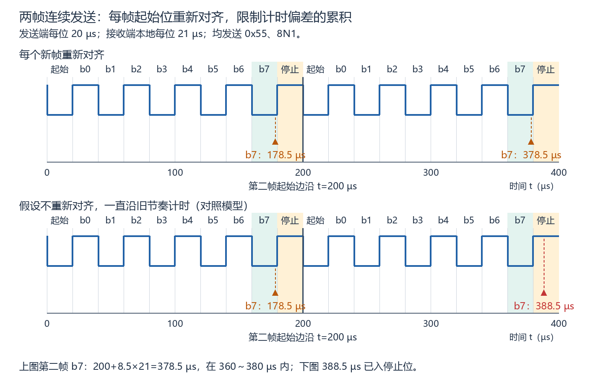

第二帧 b7 占 360～380 µs。上图计划采样为 200+8.5×21=378.5 µs，在 b7 内；下图为 (10+8.5)×21=388.5 µs，已进入停止位。每帧重新对齐不等于每帧正确，不能把帧内偏移也当作已经消除。

**常见误区：将“每帧重新对齐”理解成“每帧所有计时误差都被消除”。**重新对齐重新确定从哪个起始边沿开始安排采样，并不自动修改本地时钟或分频设置。若本地位时间仍与发送端不同，偏移会在新帧内部再次累积。

前面的 22 µs 波形本身就是反例：t=0 已准确对齐，但发送端每位 20 µs、接收端每位 22 µs，b7 的计划采样仍为 187 µs，越过本帧 b7 的结束边界 180 µs。起点正确，并不保证后面的每个采样点都正确。

### 6. 同一目标设置与双方实际速率

软件都设置 9600 baud，只说明目标一致。波特率发生器整数分频与实际时钟源偏差，仍可能使双方的真实速率不同。接收采样需要比较发送端实际位时间与接收端本地节奏，而不能只查看设置字符串。

给定实际速率的纸面例子：甲组 A=9696 baud、B=9504 baud，分别相对 9600 偏快/偏慢 1%；乙组 A=B=9696 baud，虽然都相对目标偏快 1%，双方节奏却一致。只比较速率时，乙组更匹配；这并不单独证明电平、接线和帧格式等全部条件都满足。

接收容差与实际速率、帧长度、采样机制等有关，时钟源与波特率发生器两类误差都应考虑；数值限值应查目标器件手册，不能套用一个通用百分比。参见 [Microchip 异步接收工作范围说明](https://onlinedocs.microchip.com/oxy/GUID-D1D9CFB7-99CD-47B6-A15F-EF7DD17F80A7-en-US-6/GUID-222B5D66-B038-4BDA-B87B-5D38BB12FC4F.html)。

### 7. 逐帧对齐与实际速率自测及参考答案

**复习自测：**

1. 起始位重新对齐消除的是两端频率差，还是重新提供该帧的时间参考？是否保证本帧所有数据都正确？
2. 上述两帧理想图中，第二帧重新对齐后的 b7 采样时刻为何要加 200 µs？
3. 两端都设置同一目标波特率，能否直接证明实际位时间一致？

**参考答案（对应上面题号）：**

1. 重新提供本帧时间参考，限制偏差跨帧累积，不消除频率差，也不保证本帧全部正确。
2. 第二帧起始边沿的绝对时刻为 200 µs；8.5×21 是相对此帧起始边沿的时间，因此绝对时刻为 378.5 µs。
3. 不能；实际时钟源与发生器分频都可能带来偏差，需比较双方实际速率并核对器件容差与配置。

### 8. 奇偶校验与帧格式匹配

校验位是根据数据位计算的一位检查信息，位于数据之后、停止位之前。N 表示没有校验位，E 表示偶校验（Even），O 表示奇校验（Odd）。

- 偶校验：让数据位与校验位中的 1 总数成为偶数。
- 奇校验：让数据位与校验位中的 1 总数成为奇数。
- 计数不包括起始位和停止位，校验位本身可以是 0 或 1，取决于数据与校验方式。

例如 0x03=00000011，有两个 1；偶校验取 P=0，奇校验取 P=1。8E1/8O1 均为一个起始位、八个数据位、一个校验位、一个停止位，共 11 位时间；每位 20 µs 时完整帧为 220 µs。[Microchip 奇偶校验说明](https://onlinedocs.microchip.com/oxy/GUID-3E14380F-9711-4707-8991-A4DB432DDBE5-en-US-6/GUID-0E513134-A72C-4F19-A8EA-7558C1FE7357.html)给出了同样的计算规则。

**波形例子：**双方实际位时间都为 20 µs，精确识别起始 t=0；发送端采用 8E1、LSB first，发送 0x03。接收端错误地配置为 8N1。

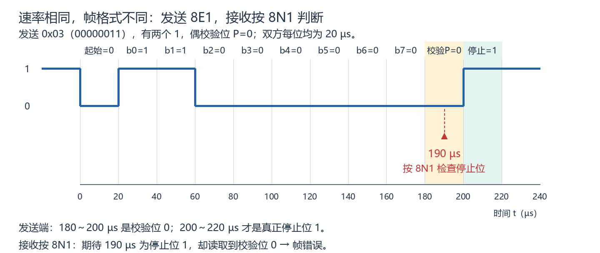

发送端校验 P=0 占 180～200 µs，真正停止位占 200～220 µs。接收端按 8N1 认为第十个位时间应该是停止位，在 190 µs 读取到 0，可报告帧错误（Frame Error，常见简称 FE）。此接收配置没有启用校验，故本例是停止位检查失败，不是偶校验计算失败。实际标志、缓冲和软件处理规则以器件为准。[Microchip 接收错误标志说明](https://onlinedocs.microchip.com/oxy/GUID-173AD72D-41FE-4760-A93C-7078A02BD908-en-US-7.1.1/GUID-7B4385C0-7B06-44CC-B8BC-07E8CDDB8721.html)给出停止位读成 0 时置 FE 的器件示例。

若图中接收器也设为 8E1，会把 190 µs 读取解释为校验位，按匹配的帧结构检查后面的停止位。这个例子说明同速率不保证格式匹配；不将所有格式不匹配都描述成必然产生相同错误。UART 数据位数、校验方式、停止位要求和位序等应依据双方配置核对。

### 9. 奇偶校验与帧匹配自测及参考答案

**复习自测：**

1. 0x01=00000001 的偶/奇校验位分别是什么？计数是否包括起始与停止位？
2. 8O1 共占几个位时间？实际每位 25 µs 时完整帧耗时多少？
3. 上图按 8N1 接收时，190 µs 实际落在哪个位上？为何出现帧错误？

**参考答案（对应上面题号）：**

1. 数据中一个 1，偶校验 P=1，奇校验 P=0；计数只含数据与校验位。
2. 1+8+1+1=11 个位时间；11×25=275 µs。
3. 落在发送端校验位 P=0 上；接收端按 8N1 期待停止位为 1，读到 0，故停止位检查失败。

### 10. 奇偶校验能发现什么，不能保证什么（波形图解）

接收器按收到的数据位与收到的校验位检查奇偶性。校验位在发送时生成，接收发生错误后，它不会自动变成适配错误数据的新校验位。

以下双方均为 8E1、每位 20 µs，起始和停止位正常；原数据为 0x03，发送 P=0。图中阶梯线表示接收器判定出的位序列，用于比较逻辑结果；不是噪声实测，也不表示真实干扰必然持续整个位时间。

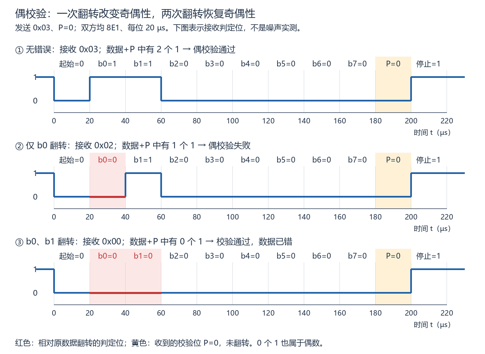

1. 无错误：收到 0x03，数据中两个 1，P=0，总计两个 1，偶校验通过。
2. 仅 b0 从 1 翻转为 0：收到 0x02，数据中一个 1，P 仍为 0，总计一个 1，偶校验失败。
3. b0、b1 都从 1 翻转为 0：收到 0x00，P 仍为 0，总计零个 1。零是偶数，校验通过，但数据已错。

**面试要点：奇偶校验通过不能证明数据正确；奇偶校验失败也不能指出具体哪个位错了，因此它本身不能纠正错误。**

在帧边界、位数与配置正确且只发生位翻转的模型下，数据位及校验位中奇数个位翻转会改变奇偶性，可以检测；偶数个位翻转保持奇偶性，会漏检。这里的“奇数/偶数”指翻转位的数量，与选择奇校验或偶校验是不同概念。校验位本身的翻转也计入此数量；起始与停止位不属于这个奇偶校验范围。[Microchip 对单校验位检测能力的说明](https://www.microchip.com/en-us/about/media-center/blog/2025/lx4580-serial-interfaces-and-bus-error-management)解释了奇数位错误可检、偶数位错误漏检及不能定位纠错的限制。

### 11. 校验能力自测及参考答案

**复习自测：**假定帧位置正常、双方校验配置匹配，只有题目指定的位翻转。

1. 发送 0x03、偶校验 P=0；仅 b0 翻转、P 不变，是否检测到奇偶校验错误？
2. 同一发送数据，b0 与 b1 都翻转、P 不变，是否检测到奇偶校验错误？数据是否仍正确？
3. 数据位都正确，仅 P 从 0 翻转为 1，能否发现？发现后能否仅凭校验失败确定是 P 出错？

**参考答案（对应上面题号）：**

1. 能。收到 0x02、P=0，总计一个 1，不满足偶校验。
2. 不能。收到 0x00、P=0，总计零个 1，仍满足偶校验；数据已错。
3. 能发现：数据仍有两个 1，加 P=1 为三个 1，不满足偶校验。但仅凭失败不能确定 P 出错，因为单个数据位翻转也能产生失败。

### 12. 过采样与多数表决（波形图解）

此前用“每位在中心读一次”的理想模型说明接收时序。若短暂干扰恰好覆盖这个点，单次读取可能判错。因此，一些 UART 接收硬件以比位速率更快的本地节奏观察信号，再选位中心附近的多个值判定。

**16 倍过采样**表示本地采样节奏为本地配置位速率的 16 倍。若本地位时间为 T，采样间隔为 T/16；一位仍耗时 T，线路数据速率不会因此变成 16 倍。采样由 UART 硬件完成，不需要 CPU 为每个采样点执行读引脚函数。

**过采样倍数与参与表决的点数不同。**一种实现取中心附近的三个值，两个或三个为 1 就判 1，两个或三个为 0 就判 0；不是把整个位时间内的 16 个观察值全部投票。不同器件可能支持 8 倍、16 倍，或在多数表决与单点判定间选择，具体看手册。[Microchip ATmega8A 手册 §24.8](https://ww1.microchip.com/downloads/en/DeviceDoc/en590320.pdf)给出正常模式 16 倍过采样及中心三点表决的器件示例。

下图放大 20～40 µs 的 b0，应为 1；本地位时间 20 µs，采样间隔 1.25 µs。为清楚展示原理，指定三点为 28.75、30、31.25 µs，即理想中心前后各一个间隔。此相位是教学推演，不是所有芯片固定的实际采样时刻；真实起始检测有离散采样相位，编号和具体时刻以器件为准。蓝线为假想接收电平，脉冲是假设输入，不是实测噪声。

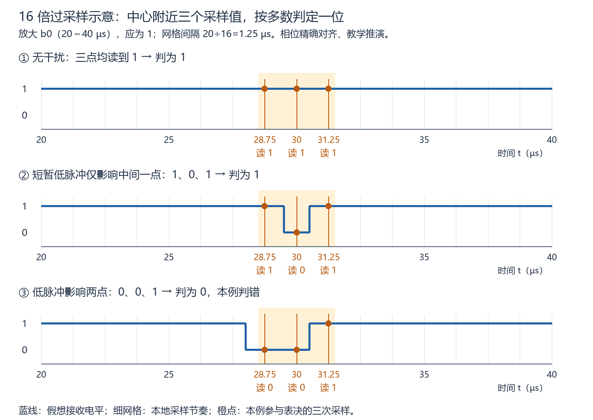

1. 无干扰：三个值为 1、1、1，判 1。
2. 低脉冲在 29.5～30.5 µs：只影响中间点，读到 1、0、1，仍判 1。如果只读 30 µs，就会判成 0。
3. 低脉冲在 28～30.5 µs：影响前两点，读到 0、0、1，判 0，本例数据位判错。多数表决只有在多数采样值正确时才能保留正确判定，不能消除全部干扰。

多数表决和奇偶校验作用不同：前者用于形成某个位的判定，后者检查收到的数据位与 P 是否满足奇偶关系。前者对部分采样受扰有帮助，后者能发现某些已经形成的位错误；两者都不保证所有通信结果正确。

**多数表决不自动修正双方的位速率差。**三个点仍由本地时钟安排；当采样窗口因帧内计时偏差整体移入下一位时，多个值可能一致地读到下一位，表决无法据此恢复原位。

实际 UART 容差还取决于帧长度、过采样与判定模式、起始检测相位及芯片实现。实际速率误差需要结合时钟源误差与分频误差分析；不能仅凭某一理想波形中的 5% 位时间差，得出所有 UART 都允许 5% 的结论，也不能把某款器件的推荐单端误差当作双方速率差的统一上限。[Microchip 异步接收误差容限说明](https://onlinedocs.microchip.com/oxy/GUID-7056F141-DF07-46C5-A4B8-97EB46E9B945-en-US-12/GUID-3FD21524-1116-412C-8139-B7FBEA62950A.html)列出了随帧长度与模式变化的器件数据；本阶段不要求推导容限公式。

### 13. 过采样自测及参考答案

**复习自测：**

1. 本地位时间 40 µs，16 倍过采样的采样间隔是多少？线路一位是否只持续这个间隔？
2. 期望数据位为 1，三次读到 1、1、0，多数表决得到什么？若改为 0、0、1 呢？
3. 如果三个采样点因时钟误差都落入下一位，多数表决能保证恢复本位吗？

**参考答案（对应上面题号）：**

1. 40/16=2.5 µs；线路一位仍为 40 µs，采样间隔与位时间不同。
2. 1、1、0 判 1，本例正确；0、0、1 判 0，本例错误。结果服从多数读值。
3. 不能。多个采样点可能都读取下一位；多数表决不会自动改变本地位时间或恢复正确采样位置。

## M01-04：UART/USART、软件收发方式与常见故障（编写中）

### 1. UART 与 USART：名称描述能力，配置决定当前模式

UART 是 Universal Asynchronous Receiver/Transmitter，强调异步收发。USART 多一个 S，指 Universal Synchronous/Asynchronous Receiver/Transmitter，支持同步与异步模式。典型 USART 同步模式会使用 CK/XCK 等时钟引脚，异步模式仍使用双方本地时钟和起始位。

因此，看见代码或引脚名 USART1_TX，不代表当前线路一定使用同步传输。USART1 若配置为异步 8N1，仍可按此前 UART 模型与兼容的异步设备通信，不因名字增加共享时钟线。具体模式、引脚和可选能力以芯片手册为准；此处不展开同步模式帧细节。[Microchip USART 结构说明](https://developerhelp.microchip.com/xwiki/bin/view/products/mcu-mpu/8-bit-avr/structure/usart-intro/)给出同时支持同步/异步及同步时钟引脚的示例。

### 2. 接收硬件与 CPU 的分工

在时钟、引脚和接收器均配置启用，信号和帧正常、缓冲有空间的前提下：

```text
RX 电平 → UART 硬件采样/还原位 → 字节进入硬件接收缓冲
        → 接收状态表明有数据可读
        → CPU 读取接收数据寄存器 → 字节进入 C 变量/软件缓冲
```

硬件接收缓冲与 C 变量不是同一处存储。CPU 正在计算，不等于 UART 停止采样；UART 已收到一个字节，也不等于某个 C 变量自动更新。本节先分析正常单字节接收，DMA 后续学习。

“接收就绪”指存在可读取的数据。手册可能叫 RXC、RXNE 或 FIFO 非空等，具体标志语义和清除方式不同；不能套用统一名称与寄存器写法。本节概念函数 `uart_rx_ready()` 表示查询有无数据，`uart_read_data()` 表示取数据。[Microchip 接收完成标志与中断说明](https://onlinedocs.microchip.com/oxy/GUID-74F8229E-4C43-4FA0-BE7D-1AA303C6F8A4-en-US-6/GUID-CF2D0C3E-D9F7-476A-A8A7-C926AD8C4596.html)说明了 RXC 表示未读数据及接收中断使能条件的器件例子。

### 3. 轮询：主循环主动检查

以下为 C 风格概念伪代码，函数没有绑定实际 SDK，不是完整 MCU 驱动，未进行编译或硬件运行。假设接收初始化已完成、正常单字节且软件及时保存数据。

```c
while (1) {
    if (uart_rx_ready()) {
        last_byte = uart_read_data();
    }
    do_other_work();
}
```

CPU 执行到 `if` 时才检查；有数据就取，没有就继续其他工作。若字节在 `do_other_work()` 期间进入 UART 缓冲，本轮尚未读取，等下次检查后才能进入 `last_byte`。

轮询不必永远原地等待。本例循环中有其他任务；另一种阻塞写法 `while (!uart_rx_ready()) {}` 会持续查询直到数据可读。两者都属于主动检查，区别是是否在等待期间安排其他工作。轮询适合简单、检查频率能够满足接收需要的场景；不能由名称推断一定丢数据。

### 4. 中断：满足使能条件后，CPU 转入处理函数

中断允许外设在接收事件发生后请求 CPU 服务。需要接收器、相应外设中断以及 CPU 的中断控制均正确启用，且没有被屏蔽。CPU 响应后暂时离开当前执行流程，运行中断服务程序 ISR（Interrupt Service Routine），结束后返回被打断的流程。

```c
/* C 风格概念伪代码；不是具体芯片的中断入口声明。 */
void UART_RX_IRQHandler(void) {
    if (uart_rx_ready()) {
        last_byte = uart_read_data();
    }
}
```

ISR 仍是 CPU 执行的软件，不是 UART 外设自动执行的 C 函数。本例单核 CPU 执行 ISR 时，不同时执行被暂停的主循环；UART 硬件采样可继续。共享变量可见性、缓冲保存和错误处理需按真实实现设计，`last_byte` 仅演示一次取数，不能当作保存任意连续字节的方案。

中断响应存在延迟，受屏蔽、优先级、当前执行状态等影响；它不保证事件发生的同一瞬间就读取。ISR 通常只做及时取数、保存及必要状态处理，较耗时的业务处理留给主循环；DMA 与完整软件缓冲留到后续讲解。

### 5. 对照波形：相同硬件接收，CPU 服务时刻不同

图中只有一个正常字节，硬件缓冲有空间；规定 100 µs 字节可读。轮询场景规定下一次检查在 130 µs 并读取；中断场景规定 105 µs 进入 ISR 并读取，115 µs 返回主循环。所有服务时刻是题设，不是芯片固定延迟；接收就绪的 100 µs 也是教学设定，不把完整帧结束时刻当作所有 UART 置标志的固定时刻。

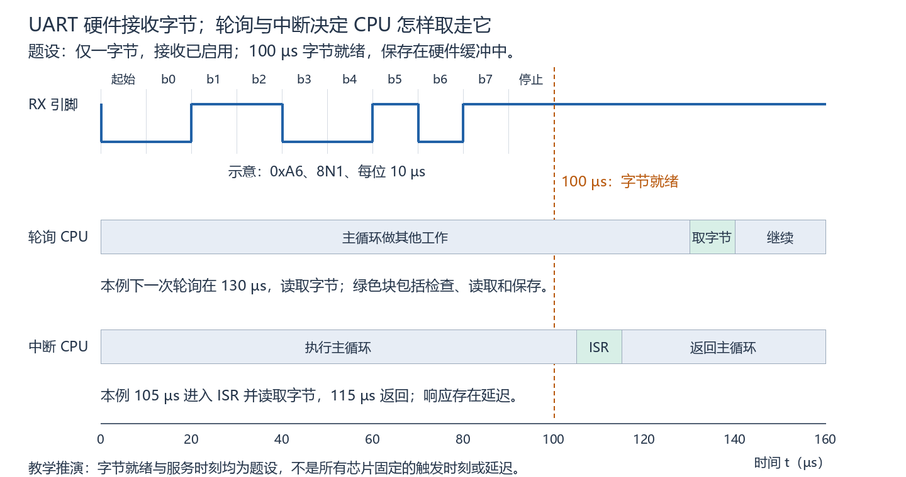

在本例 100 µs，两个场景的 UART 都已接收到字节；轮询尚待主循环检查，中断也尚未进入 ISR。中断场景的 CPU 更早取走数据，但两种方式都没有改变发送端的位时间，也都需要软件读取硬件数据。IRQ 是服务请求，不是数据自动搬进 C 变量。

### 6. UART/USART 与轮询/中断自测及参考答案

**复习自测：**

1. 引脚叫 USART1_TX，外设配置为异步 8N1，是否必须另外连接 CK？
2. 接收启用、硬件缓冲有空间，CPU 正在做计算且没执行读取函数，UART 是否仍能收下字节？C 变量是否因此自动更新？
3. 图中 110 µs 时，轮询场景是否已经读取字节？中断场景的单核 CPU 在执行 ISR 还是主循环？

**参考答案（对应上面题号）：**

1. 不需要因 USART 名称增加 CK；当前是异步模式，按 TX/RX 及信号参考连接，具体引脚见手册。
2. 能在前提满足时接收并存入硬件缓冲；C 变量不会仅因字节到来自动更新，本节需 CPU 执行读取。
3. 轮询尚未读取，题设在 130 µs 读取；中断场景正在 ISR 内，主循环暂时暂停，115 µs 返回。

### 7. DMA：硬件搬运字节，CPU 配置并处理结果

DMA 是 Direct Memory Access（直接存储器访问）。在 UART 接收场景中，可配置 DMA 根据 UART 的接收请求，把接收数据寄存器中的数据搬到 RAM。UART 仍负责线路采样与字节还原；DMA 负责搬数据；CPU 负责设置源/目标地址、搬运数量等，并处理收到的数据。

```text
轮询/中断：UART 接收缓冲 → CPU 执行读取/保存 → RAM
DMA 接收： UART 接收缓冲 → DMA 硬件搬运     → RAM → CPU 后续处理
```

CPU 不必为每个字节执行读取/保存指令；但 DMA 不是让 CPU 完全退出工作，也不是让 UART 线路变快。配置好的 RAM 数组可以接收数据，不需要 CPU 每字节执行数组赋值。DMA 可配合传输完成等中断通知 CPU，所以 DMA 与中断不是互斥选项。[ST DMA 应用说明 AN2548](https://www.st.com/resource/en/application_note/an2548-usart-uart-communication-between-two-stm32-microcontrollers-stmicroelectronics.pdf)介绍了外设到内存搬运、硬件请求及 DMA 服务延迟；具体配置查目标 MCU 手册。

DMA 搬运也有延迟；UART 请求、通道、地址、长度等需正确配置。它不重新判断信号位，也不纠正 UART 已经解出的错误字节。连续数据是否完整保留，还取决于及时搬运、RAM 容量、CPU 处理速度和接收是否持续有效。本阶段不展开循环 DMA 或缓存一致性实现。

**接收使能、DMA 请求使能、DMA 通道使能分别控制什么？**

UART 接收使能控制 UART 是否进行接收。字节进入硬件接收缓冲后，还需要接通搬运路径：

1. **UART 接收 DMA 请求使能：**允许 UART 在接收数据待取时向 DMA 发出内部硬件服务请求，相当于“有字节，请搬走”。这个请求不是 C 函数调用，也不是要求 CPU 执行中断函数。
2. **DMA 通道使能及正确请求映射：**让对应通道能够响应这个 UART 的接收请求；另需正确的源地址、RAM 目标地址、数量和传输配置。具体器件可能使用通道、流或请求选择器，名称和映射规则查手册。

下面假定 UART 接收正常，DMA 地址、数量等其他条件都满足，只展示两个使能条件。图为机制示意，不表示实际时间或固定服务延迟。

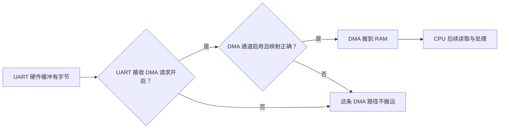

例如，UART 接收开启，但其接收 DMA 请求关闭，即使 DMA 通道已启用，字节仍可以进入 UART 硬件缓冲，却不会由这条请求驱动的 DMA 路径搬入 RAM。若有未读字节、DMA 计数不变且 RAM 未更新，优先查请求是否开启、通道是否启用并正确对应 UART 接收请求；CPU 从 RAM 读取是搬运之后的步骤。

作为具体器件示例，[ST RM0390](https://www.st.com/resource/en/reference_manual/rm0390-stm32f446xx-advanced-armbased-32bit-mcus-stmicroelectronics.pdf)用 USART 的 DMAR 位使能接收 DMA；[ST RM0008](https://www.st.com/resource/en/reference_manual/cd00171190.pdf)说明外设 DMA 请求、通道使能和请求映射。这里理解各配置的作用即可，不要求记忆寄存器位名或通道编号。

**复习自测：**

1. UART 接收已开启、硬件缓冲有空间；DMA 通道、映射、地址和数量均正确，但 UART 接收 DMA 请求关闭。新字节能否进入 UART 硬件缓冲？能否由这条 DMA 路径搬入 RAM？
2. 硬件缓冲有未读字节，DMA 计数未变，目标 RAM 未更新且排除写后覆盖，为什么优先查 DMA 交接，而不是 CPU 是否读取 RAM？列出两项具体检查。

**参考答案（对应上面题号）：**

1. 能进入硬件缓冲；不能由这条 DMA 路径搬入 RAM。UART 接收与 UART 发出 DMA 请求是不同的使能条件。
2. 当前数据尚未搬入 RAM，CPU 读取处于后一步；例如检查 UART 接收 DMA 请求是否开启，以及 DMA 通道是否启用并正确对应 UART 接收请求。它们是优先检查方向，不是已确定的唯一根因。

### 8. 接收溢出：字节到达速度超过取走能力

UART 的硬件缓冲容量有限。先前单字节示例中“CPU 稍后读取”成立，因为缓冲有空间且没有后续字节挤满它。连续接收时，若旧字节未取走而已完成的新字节无处存放，就可能发生接收溢出（Overrun），导致数据丢失。不同芯片可能称 ORE/DOR 等；实际容量、附加移位寄存器能否暂存、丢弃哪个字节以及恢复流程都应查手册。[Microchip 接收错误标志说明](https://onlinedocs.microchip.com/oxy/GUID-173AD72D-41FE-4760-A93C-7078A02BD908-en-US-7.1.1/GUID-7B4385C0-7B06-44CC-B8BC-07E8CDDB8721.html)区分了帧错误、校验错误与接收缓冲满导致的数据溢出。

**下面只用明确的教学等待槽模型，不套用某款芯片的完整缓冲结构：**等待槽只容纳一个已完成字节；满时保留旧字节、丢弃新字节。A、B 分别在 100、200 µs 就绪，线路与帧正确。就绪时刻及后续读写时刻均为题设。

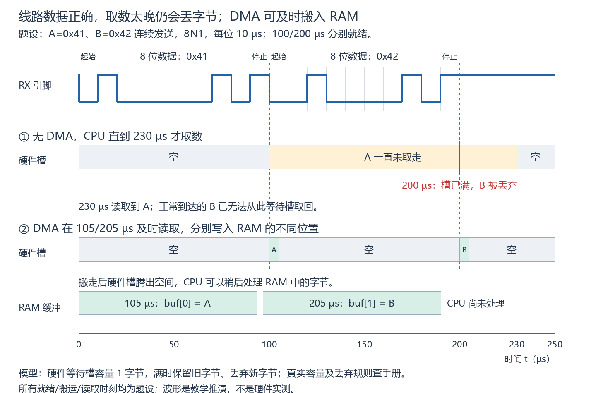

- 未及时取数：100 µs，A 占槽；200 µs，A 仍未取走，B 无处存放，按题设丢弃；230 µs，CPU 读取 A，此时再读也无法取回已经丢弃的 B。
- DMA 及时取数：规定 105 µs 把 A 搬到 `buf[0]`，205 µs 把 B 搬到 `buf[1]`。硬件等待槽及时腾空，RAM 有足够空间保存两字节，CPU 可稍后处理。

**线路位判断正确、帧格式匹配，不保证 CPU 最终拿到全部字节。**帧错误是停止位置检查失败；校验错误是奇偶关系不满足；接收溢出是缓冲和取数问题。中断服务太晚也可能溢出；DMA 服务太晚同样可能溢出，不能把某一种收发方式当作不丢字节的保证。

### 9. 硬件已取走，不代表 RAM 已完整保留

硬件等待槽与软件保存位置有不同的容量限制。假设 UART 没有溢出、DMA 两次搬运都成功，但目标地址始终固定为同一个单字节变量 `last_byte`，A 写入后又被 B 写入覆盖。CPU 在两次写入后读取只能获得 B，无法仅从这个变量恢复 A。

这属于 RAM 保存策略导致的数据覆盖，不能据此断言 UART 已产生硬件 ORE/DOR。实际接收多个字节通常需要正确配置不同的 RAM 保存位置，并管理已存入与已处理的数据；数组不自动拥有无限容量。环形缓冲与完整处理流程留 M06。

### 10. DMA 与缓冲边界自测及参考答案

**复习自测：**

1. DMA 接收时，线路采样/位解码、寄存器到 RAM 的搬运、数据业务处理分别主要由谁完成？
2. 图中无 DMA 的单槽模型里，CPU 230 µs 首次读取能否取回 B？是否可以仅用波特率匹配保证不丢字节？
3. A、B 都被成功搬入同一个 `last_byte` 地址，中间 CPU 未读取；最后能否从此变量获得两个字节？是否必然意味着 UART 硬件溢出？

**参考答案（对应上面题号）：**

1. UART 硬件负责采样/解码；DMA 硬件负责配置好的搬运；CPU 配置并处理收到的数据。
2. 不能，B 在 200 µs 已按题设丢弃；波特率匹配不能保证缓冲足够或取数及时。
3. 不能，B 覆盖 A，最后只能读到 B；这可发生在硬件取数正常的情况下，不足以证明 UART 硬件溢出。

### 11. 分层排错：用观测定位交接位置

“无数据”“乱码”“丢字节”是程序观察到的现象，不直接等于某一个固定原因。先确认本次数据走到了哪一层，再优先检查后面的交接。

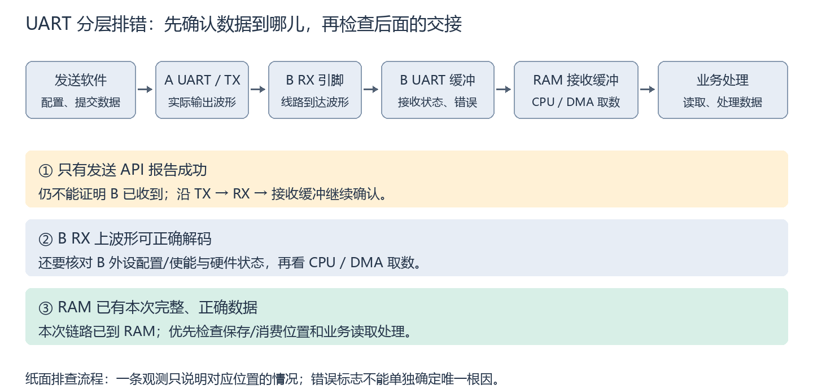

1. **发送软件与 A TX：**核对调用的 UART 实例、发送是否启用、时钟/分频及引脚复用，再看正确 TX 引脚是否实际输出波形。API 报告成功的含义依其契约，不能仅凭它认定 B 已收到。
2. **A TX 到 B RX：**若 A TX 有波形而预期 B RX 没有，优先检查 TX→RX 连接、实际引脚、信号参考地及电平兼容。存在跳变不等于有效电平和位时间均满足接收要求。
3. **B RX 到 B UART 接收缓冲：**若 B RX 上波形可解码但 MCU 没有接收就绪，核对 MCU 的 RX 引脚映射、接收使能、实际 UART 时钟/波特率和帧参数。逻辑分析仪的解码配置与 MCU 配置是两套独立设置，前者解出字节不证明后者已收下。
4. **硬件缓冲到 RAM：**若有未读字节却软件缓冲不更新，优先检查轮询是否执行、ISR 是否进入及读取保存，或 UART DMA 请求、DMA 通道/映射、使能、源/目标地址、数量和状态。若 DMA 剩余计数不变，这是尚未搬运的线索；仍需结合实际实现查因。
5. **RAM 到业务处理：**若 RAM 中已有本次完整、正确数据，优先查读取位置、有效长度、数据是否被覆盖，以及业务函数是否执行。这个观测支持本次数据已走到 RAM，不代表未来所有字节都必然正常。

以上是按观测推定排查优先级，不是仅凭单一现象宣布唯一根因。真实测量可能改变接收状态，例如读取数据寄存器会消费字节；实际调试需按器件语义选择观测方法，本课程仍为纸面分析。

### 12. 区分现象与错误标志

| 现象/标志 | 当前能够说明什么 | 还应核对什么 |
|---|---|---|
| 程序“无数据” | 该程序尚未获得或处理数据 | 从 TX、RX、接收就绪到 CPU/DMA/RAM 逐层确认 |
| 程序显示“乱码” | 显示结果不符合预期 | 先比较原始十六进制字节；核对实际位时间、帧参数与信号电平/质量；若原始字节正确，再查打印格式和字符解释 |
| FE：帧错误 | 接收器按自身配置检查停止位时失败 | 帧位置/格式是否一致，实际位时间是否匹配，信号是否受扰；不能只据 FE 认定必须改校验配置 |
| PE/UPE：校验错误 | 已启用校验时，收到的数据与 P 的奇偶关系不满足 | 校验方式/数据位配置、采样和信号情况；不能仅凭此定位哪个位错了 |
| ORE/DOR：接收溢出 | 该器件报告了接收缓冲/取数相关的溢出条件 | 硬件容量、服务延迟、中断屏蔽、DMA 服务及器件恢复流程 |
| RAM 字节缺失但硬件未报告溢出 | 软件看到的数据不完整，原因尚待定位 | 目标地址/长度、RAM 覆盖、保存与消费速度、业务读取；不能仅凭未见标志保证没有丢失 |

错误标志的名称、发生条件、读取/清除时序以具体芯片为准。[Microchip 接收错误标志](https://onlinedocs.microchip.com/oxy/GUID-173AD72D-41FE-4760-A93C-7078A02BD908-en-US-7.1.1/GUID-7B4385C0-7B06-44CC-B8BC-07E8CDDB8721.html)给出 FE、UPE 与 DOR 的器件定义；它们提供失败类型，不直接给出唯一物理或软件根因。

### 13. 分层排错自测及参考答案

**复习自测：**

1. 发送 API 返回成功，可以立即认定 B 的 C 程序已得到字节吗？下一步可以观察什么？
2. B RX 上有可解码波形，但 MCU 没有接收就绪，能否直接把故障归为 DMA？应先核对哪些配置？
3. RAM 已保存本次完整、正确数据，业务程序仍称“无数据”，应优先查哪一层？
4. FE=1 能否证明两端一定校验方式不一致？给出另外两类可能影响停止检查的因素。

**参考答案（对应上面题号）：**

1. 不能；观察正确实例的 TX 是否有实际波形，以及 B RX 是否接收到该波形，再确认接收和软件取数。
2. 不能，应先查 MCU 的 RX 映射、接收使能、实际 UART 时钟/位速率和帧配置；仪器解码正确不等于 MCU 配置正确。
3. 优先查 RAM 数据保存/消费位置、有效长度与业务读取处理；本次观测已表明数据走到 RAM。
4. 不能。实际位时间偏差造成采样错位、信号电平/噪声干扰都可能使停止检查失败；也应核对完整帧格式。

## 本章复习要点

1. **从引脚到字符帧：**普通非反相逻辑电平 UART 空闲为高、起始为低；8N1 为 1 个起始位、8 个数据位、无校验、1 个停止位，合计 10 位。示例按 LSB first，实际选项查器件；连接需 TX→RX、信号参考地和兼容电平。
2. **从波特率到耗时：**本章二进制 UART 的位时间为 T=1/R；n 位帧耗时 n/R。8N1 连续无间隙发送时，每字节占 10 位，理论数据吞吐率 R/10 B/s；间隙和软件处理会降低实际吞吐率。分频公式依器件，误差为（实际−目标）/目标。
3. **异步接收靠起始对齐和本地计时：**新帧重新确定起点，本地位时间仍可能偏差；帧内偏移可使采样进入别的时间槽。过采样/多数表决可抵御部分干扰，不保证纠正任意时钟误差，不套用通用固定误差上限。
4. **明确各部分职责：**UART 采样并还原字节；轮询与中断均由 CPU 执行取数；DMA 按配置搬到 RAM，CPU 配置并处理结果。UART 接收使能与接收 DMA 请求使能不同，DMA 通道也需有效；DMA 与中断可配合使用。
5. **区分三种失败：**FE 表示停止检查失败；PE/UPE 表示启用校验时奇偶关系不满足；ORE/DOR 是器件定义的接收溢出条件。奇偶校验不能纠错或定位，也不能检出所有错误；RAM 被覆盖可发生在 UART 未溢出时。
6. **用观测确定排查顺序：**按发送软件→A TX→B RX→硬件接收缓冲→CPU/DMA→RAM→业务处理查交接。RAM 尚未更新先查取数/搬运；RAM 已有本次完整正确数据再查业务读取。现象或单个标志不能直接确定唯一根因。

## 资料入口

- [TI：接口电平转换中的 UART 说明](https://www.ti.com/lit/an/scea065b/scea065b.pdf)：两条数据线、收发职责与电平兼容背景；不要求当前学习电平转换电路设计。
- [Microchip：串行帧的组成](https://onlinedocs.microchip.com/oxy/GUID-F5813793-E016-46F5-A9E2-718D8BCED496-en-US-15/GUID-7BA3A2AA-EFBF-4C3A-BB96-17B8A413DE69.html)：具体器件的起始、数据、校验和停止位说明；位序选项以芯片为准。
- [Microchip：EUSART/AUSART 的 8N1 与 LSB first 示例](https://developerhelp.microchip.com/xwiki/bin/view/products/mcu-mpu/8bit-pic/peripherals/eusart-ausart/)：解释普通非反相串行帧的例子，不将所有器件的可选项视为相同。
- [Keysight：比特率与码元速率的区别](https://www.keysight.com/us/en/assets/7018-09093/application-notes/5965-7160.pdf)：定义补充，本课程不展开其中的射频调制。
- [Microchip：USART 入门 TB3216](https://ww1.microchip.com/downloads/en/Appnotes/TB3216-Getting-Started-with-USART-90003216B.pdf)：8N1 十位帧与连续字符速率的器件示例，不要求当前编写驱动。
- [Microchip：AVR USART 波特率发生器](https://onlinedocs.microchip.com/oxy/GUID-80B1922D-872B-40C8-A8A5-0CBE009FD908-en-US-3/GUID-39FC7EB8-6D8E-4659-B343-EEBF4133B2EE.html)：普通异步模式含 16(N+1) 的分频公式，其他模式与芯片需另核对。
- [Microchip：异步起始位与时钟恢复](https://onlinedocs.microchip.com/oxy/GUID-80B1922D-872B-40C8-A8A5-0CBE009FD908-en-US-3/GUID-905AE323-8C73-4699-8E2F-A2CBD4F3D572.html)：起始检测、确认和帧对齐的器件示例。
- [Microchip：异步数据恢复](https://onlinedocs.microchip.com/oxy/GUID-80B1922D-872B-40C8-A8A5-0CBE009FD908-en-US-3/GUID-933461CE-09AE-45E6-8D54-1FB9CA0C114F.html)：位中心附近采样与多数表决示例，不将本课单点模型当成所有硬件的实现。
