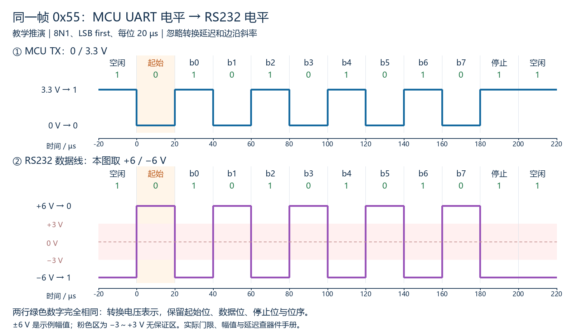
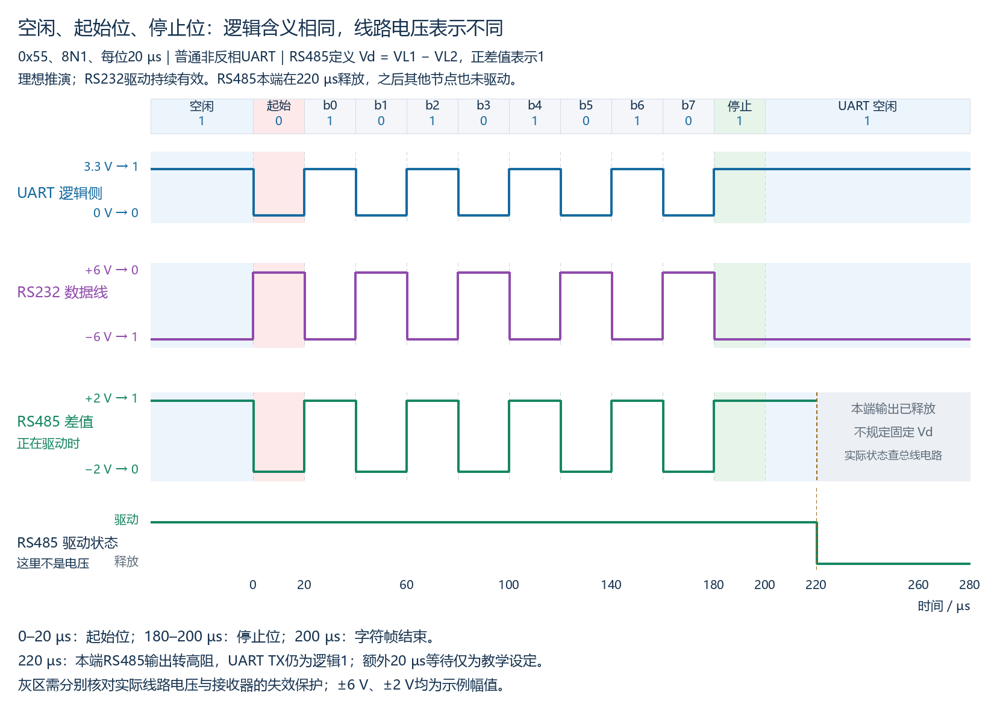
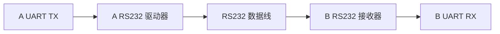
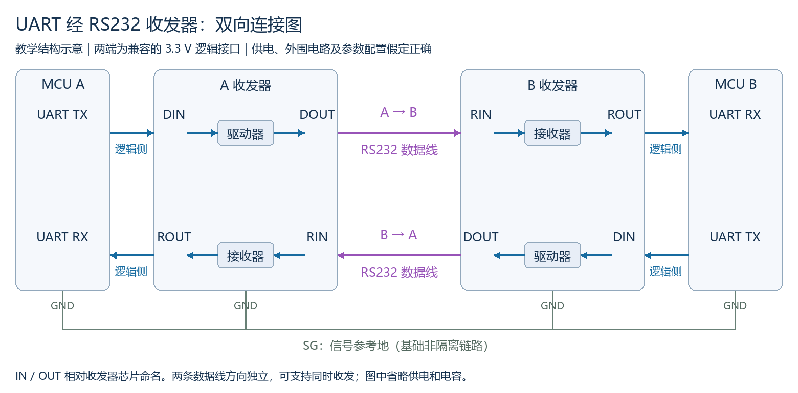
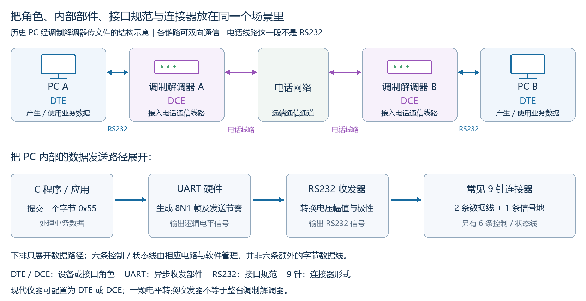
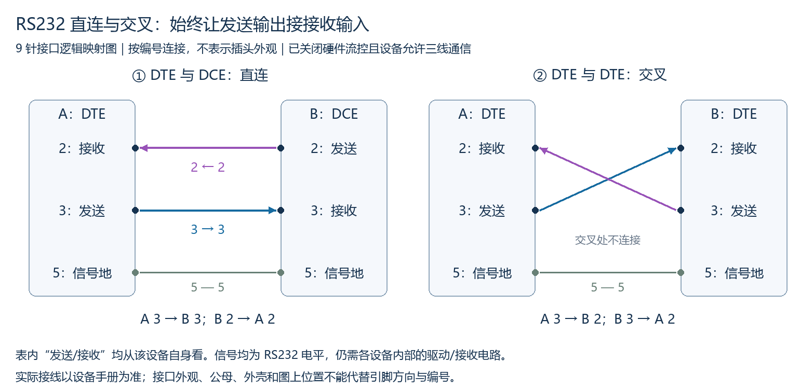
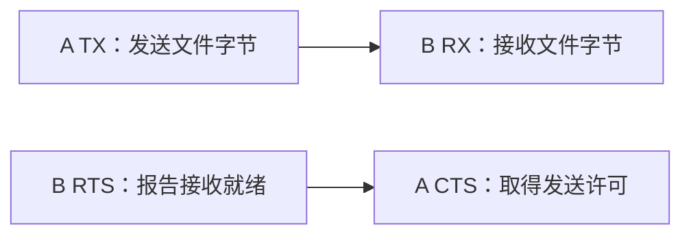
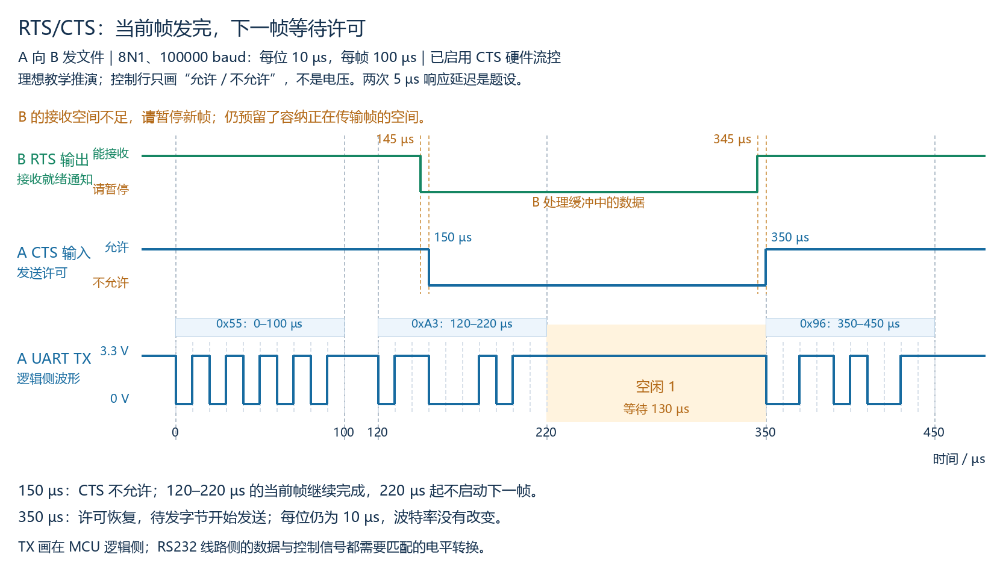
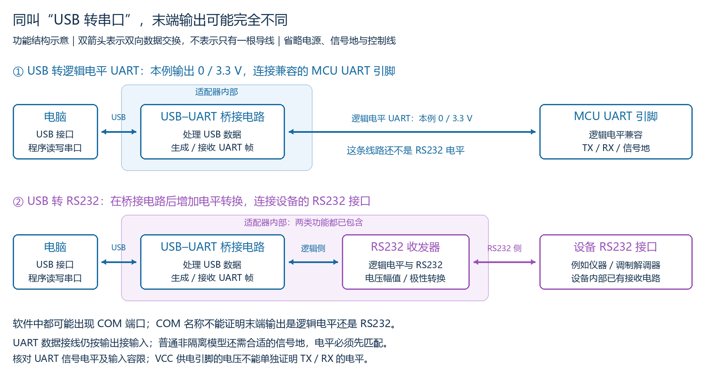

# M02：RS232 电气接口

## 本章目标与前置知识

在 M00 的逻辑电平、信号参考地和单端信号，以及 M01 的 UART 帧与异步采样基础上，理解 UART 怎样通过 RS232 收发器与外部设备连接。学习目标为面试原理与纸面链路分析，暂无硬件实验。

本章按常见异步 UART 经 RS232 数据线通信的场景讲解。RS232 标准还包含信号功能及接口连接等要求，不能把它完整定义成“仅仅规定电压”；当前先学电气接口部分，不展开标准的全部电路。

**通信类型：本课常见的 UART + RS232 双向链路是串行、异步，并具备全双工能力。**

| 分类 | 本课场景的依据 |
|---|---|
| 串行 | 一个方向的数据位按时间先后，通过该方向的数据线逐位传送 |
| 异步 | UART 收发双方按各自时钟和约定波特率工作，依靠起始位对齐，没有随数据传送的共享时钟线 |
| 全双工 | A→B 与 B→A 各有独立数据路径，可以同时发送与接收 |

面试可先说“常见 RS232 串口通信采用异步串行方式，支持全双工”。进一步追问时补充：**异步是这里使用 UART 的通信方式；RS232 标准也定义同步通信使用的定时信号，并非所有 RS232 用法都只能异步。**全双工描述链路能力，程序安排先请求、后回复不改变这项能力。[ADI RS232 信号概览](https://www.analog.com/media/en/technical-documentation/product-selector-card/rs232%20quick%20guide.pdf)列出同步专用的定时信号；[ADI 通信基础](https://www.analog.com/en/resources/technical-articles/fundamentals-of-rs232-serial-communications.html)说明其全双工能力。

## 内容入口与编写范围

- M02-01：UART 与 RS232 的关系、数据线逻辑极性、电平转换与收发器。已整理同帧波形、收发器数据引脚与双向链路，检查及练习表现见进度文件。
- M02-02：设备连接器接线、DTE/DCE、流控及转换器辨析。已整理设备背景、英文全称、九针全貌、直连/交叉连接、RTS/CTS 波形与 USB 转换器结构对照，首轮教学及 P006 累计验收完成；个人独立/提示程度见进度文件。

教材状态为已覆盖，表示本章计划的首轮内容已整理，不表示学习者已通过无提示迁移、间隔复测或硬件验证。

## M02-01：同一个字节，不同的电压表示

### 1. UART 与 RS232 怎样配合

UART 外设把字节组成起始位、数据位、可选校验位及停止位，并按设定节奏发送；接收端 UART 从符合要求的输入信号中还原字节。此前 M01 的普通 MCU UART 示例使用非反相的 0/3.3 V 逻辑电平。

RS232 提供另一种线路信号表示。使用 RS232 收发器后，UART 帧中的逻辑位可以用线路上的正、负电压传递。常见 9600 baud、8N1 配置仍由通信控制器等设置，电平转换本身不把帧改成其他格式。[ADI：RS232 基础](https://www.analog.com/en/resources/technical-articles/fundamentals-of-rs232-serial-communications.html)分别说明 UART 的字符帧职责和线路驱动器/接收器的电平转换职责。

### 2. 数据线的逻辑极性

以下讨论数据线，不把数据位的 0/1 规则直接套到后续控制线的“有效/无效”含义。

| 表示的逻辑位 | 本课 MCU UART 示例 | 本课 RS232 数据线示例 |
|---|---|---|
| 1 | 3.3 V | −6 V |
| 0 | 0 V | +6 V |

电压均相对相应信号参考地；RS232 是单端信号，不是用两根数据线的差值判断这个位。±6 V 只是用于画图的明确幅值，不是所有 RS232 设备的固定输出。

RS232 的经典数据线极性为负电压表示 1（mark）、正电压表示 0（space）；常见标准接收有效区从 −3 V 或 +3 V 向对应方向延伸，−3～+3 V 为无保证区。转换瞬间可以经过该区，但不能把长期停在 0 V 当作 RS232 逻辑 0。驱动输出要求与接收判定要求不同，实际芯片门限、迟滞、失效保护和允许输入范围应查手册。[ADI 电气说明](https://www.analog.com/en/resources/technical-articles/fundamentals-of-rs232-serial-communications.html)

### 3. 对照波形：0x55、8N1、LSB first

本例每位 20 µs，帧在 0 µs 开始、200 µs 结束。图为理想教学推演，忽略传播延迟及实际边沿斜率；下图是发送驱动器转换后的线路波形，不是另一种位序或重新编码的数据。

- 空闲及停止表示 1：上图为 3.3 V，下图为 −6 V。
- 起始位表示 0：上图降到 0 V，下图升到 +6 V。
- b0 表示 1：上图为 3.3 V，下图为 −6 V。后续数据位依相同规则转换。
- 两行绿色的逻辑数字始终相同：数据位仍为 1、0、1、0、1、0、1、0，LSB first 还原为 0x55。不能仅因电压波形上下翻转就把它当成 0xAA。

### 3.1 空闲、起始位与停止位的 RS232 数据线电压

这里讨论正常供电、驱动有效的 UART 经 RS232 传输场景，电压相对信号参考地；±6 V 为本课示例幅值，不是所有设备的固定输出。

| 状态 | UART 帧逻辑值 | RS232 数据线电压 | 本例幅值 |
|---|---|---|---|
| 空闲 | 1 | 负电压，mark 状态 | −6 V |
| 起始位 | 0 | 正电压，space 状态 | +6 V |
| 停止位 | 1 | 负电压，mark 状态 | −6 V |

因此，本例起始位开始时，普通 UART 逻辑侧从高变低，RS232 线路侧从 −6 V 变为 +6 V。停止位时恢复为 −6 V，之后没有下一帧时继续保持负电压。线路电压的上下翻转来自电气表示，起始仍是逻辑 0，停止与空闲仍是逻辑 1。[ADI RS232 数据极性说明](https://www.analog.com/en/resources/technical-articles/fundamentals-of-rs232-serial-communications.html)

这不是 RS232 另加一套字符起始/停止位，而是 UART 字符帧的相应逻辑位经收发器转换后的电压。掉电、驱动关闭或断线等情况不属于这里的正常驱动空闲假设；线路处于 0 V 时不能按本表认定为有效数据逻辑 0。

**复习自测：**

1. 正常驱动的本例 RS232 数据线从空闲 −6 V 变为 +6 V，并保持一个位时间，表示起始位还是停止位？对应逻辑几？
2. 停止位之后线路一直保持 −6 V，能否仅因负电压表示逻辑 1，就把这段时间当作一连串新数据位？

**参考答案（对应上面题号）：**

1. 表示起始位，对应逻辑 0；停止位应为本例 −6 V、逻辑 1。
2. 不能，停止位结束后的持续负电压可以是帧外空闲；接收新字节须结合起始位和完整帧时序，不能仅由一个静态电平认定。

### 4. 收发器连接两种电气接口

只画 A→B 一个数据方向：

其中 A UART TX 到驱动器、接收器到 B UART RX 是兼容的逻辑电平信号；中间线路为 RS232 电平。基础非隔离链路还需合适的信号地连接，图只突出数据方向。若 B 是完整 RS232 设备，接收器通常已在设备内部。

**驱动器**将逻辑电平转换为 RS232 电平；**接收器**将 RS232 电平恢复为 MCU 可接受的逻辑电平；**收发器**通常把这两类电路集成在一颗芯片中。它们按输入信号转换电气表示，不负责像 UART 那样解析字符帧或改写字节。

例如 TI MAX3232 含线路驱动器和接收器，DIN 接逻辑发送输入、DOUT 为 RS232 输出；RIN 接 RS232 输入、ROUT 为送向 UART 的逻辑输出。芯片供电和输出线路电压是不同参数，必须核对所用型号与 MCU 的逻辑电平兼容性。[TI MAX3232 数据手册](https://www.ti.com/lit/ds/symlink/max3232.pdf)

普通 3.3 V MCU RX 不能直接按逻辑电平引脚连接 RS232 输出：正、负电压幅值及极性均不匹配，输入还可能超过 MCU 允许范围。把波特率、帧格式配对，不能代替电平转换；仅在软件中反转位也不能解决电压范围问题。

### 5. 复习自测与参考答案

**复习自测：**

1. 图中 MCU TX 的 b0 为 3.3 V，经过驱动器后线路为 −6 V。经对端接收器转换后，B UART RX 应恢复成逻辑 0 还是 1？为何不会仅因线路电压上下翻转就把 0x55 变成 0xAA？
2. 标准 RS232 设备的 TX 与普通 3.3 V MCU RX 直接连接，两端均为 9600 baud、8N1。能否认定电气连接正确？应补充哪类电路？
3. 本图 RS232 数据线空闲与起始位分别为多少伏？线路长期停在 0 V，能否按本课规则认定为有效逻辑 0？

**参考答案（对应上面题号）：**

1. 恢复为逻辑 1；RS232 的负电压本来就表示 1，接收器再转换为 MCU 的逻辑电平。转换改变电压表示，保留数据位含义和顺序。
2. 不能；还需匹配的 RS232 接收电路，双向通信通常使用兼容的 RS232 收发器。位速率与帧格式匹配不能解决输入电压和极性不匹配。
3. 本例空闲为 −6 V，起始为 +6 V；0 V 位于 RS232 无保证区，不能认定为有效数据逻辑 0。具体芯片在该区的输出行为仍查手册。

### 6. 看清收发器的四类数据引脚

以 TI MAX3232 的一路驱动器和一路接收器为例，下表省略引脚名称中的通道编号。IN/OUT 是相对收发器芯片命名，D 对应 driver（驱动器），R 对应 receiver（接收器）；其他器件的名称和编号查各自手册。

| 引脚 | 相对芯片的方向 | 所属电气侧 | 作用/连接 |
|---|---|---|---|
| DIN | 输入 | 逻辑侧 | 接收本端 MCU UART TX 的信号 |
| DOUT | 输出 | RS232 侧 | 向对端 RS232 接收输入发送信号 |
| RIN | 输入 | RS232 侧 | 接收对端 RS232 发送输出的信号 |
| ROUT | 输出 | 逻辑侧 | 将恢复的逻辑信号送到本端 MCU UART RX |

两条内部路径分别为 DIN→驱动器→DOUT、RIN→接收器→ROUT。ROUT 虽含 OUT，但它的用途是向 MCU 的 RX 提供接收数据；不能把看到的所有 OUT 都当作 MCU 发送通道。[TI MAX3232 引脚功能表](https://www.ti.com/lit/ds/symlink/max3232.pdf)

### 7. 双向链路与信号参考地

下图假设两端各有一颗兼容的收发器，逻辑电平、供电、外围电路及参数配置均正确；只展示一路驱动/接收组合，省略电源与电容。基础非隔离、两根数据线加信号地的模型如下：

- A→B：A UART TX→A DIN→A DOUT→B RIN→B ROUT→B UART RX。
- B→A：B UART TX→B DIN→B DOUT→A RIN→A ROUT→A UART RX。
- 两端信号地建立共同电压参考。SG/GND 不是又一根数据线，也不直接等同于保护地 PE；隔离或特殊接地设计另按电路要求分析。

**线路上的每个方向均为发送输出 DOUT 接接收输入 RIN。**两根数据线承担不同方向，可支持全双工；应用程序仍可以安排先请求后回复。两端 DOUT 接在一起会把两个输出接到同一线，RIN 接在一起则缺少驱动输入的发送输出，均不是本模型的正确数据接法。

这里的链路按收发器引脚作用明确表示；模块或连接器上的 TX/RX 名称可能采用不同参照，后续学习 DTE/DCE 时再依据实际引脚功能判断，不能只凭同名或异名接线。

**复习自测：**

1. 本端 MCU UART RX 应接本端收发器的 DIN、DOUT、RIN、ROUT 中哪一个？本端 UART TX 应接哪一个？
2. 两端各有兼容收发器，要实现双向通信，两条 RS232 数据线分别怎样接？基础非隔离模型还需要哪个参考连接？

**参考答案（对应上面题号）：**

1. UART RX 接 ROUT；UART TX 接 DIN。ROUT 是芯片的逻辑接收输出，DIN 是芯片的逻辑发送输入。
2. A DOUT→B RIN、B DOUT→A RIN；还需合适的信号地连接。两条数据线方向独立，发送输出必须接对端接收输入；具体设备或隔离电路的接地方式查设计资料。

## M02-02：按设备的引脚方向选择连接线

### 1. DTE 与 DCE 的作用

先看具体背景：一台 PC 想通过传统电话线路向远端 PC 传文件。PC 处理文件和业务数据；调制解调器将数字数据转换成适合电话通道传输的信号，并把远端来的信号还原。PC 与本地调制解调器之间可采用 RS232，两个调制解调器之间是电话通信链路。

| 缩写 | 英文全称 | 中文及在上图中的具体对象 |
|---|---|---|
| DTE | Data Terminal Equipment | 数据终端设备：这里是产生或使用文件数据的 PC。Terminal 表示数据通信的终端，Equipment 表示设备 |
| DCE | Data Circuit-Terminating Equipment | 数据电路终接设备：这里是把 PC 接入电话通信线路的调制解调器。Circuit-Terminating 表示通信线路在这台设备处接入/终接 |

DCE 也常写作 Data Communications Equipment（数据通信设备）；本课统一使用 DCE。DTE/DCE 都可以发送与接收，它们区分的是设备/接口角色，不能将其中一个定义成“只能发送”、另一个定义成“只能接收”。[NTIA 通信网络说明](https://its.ntia.gov/umbraco/surface/download/publication?reportNumber=87-211_ocr.pdf)给出终端—DCE—网络—DCE—终端的场景和调制解调器的转换作用；[NI 接口说明](https://knowledge.ni.com/KnowledgeArticleDetails?id=kA00Z000000P9w0SAC&l=en-IE)使用 DTE/DCE 角色选择线缆。

现代仪器或嵌入式设备不一定经过电话调制解调器，但接口仍可能按 DTE 或 DCE 方式分配方向，应查手册。PC 内部可以有 UART 和 RS232 电平转换电路；调制解调器内部也可以有这些部件。一颗 MAX3232 电平转换收发器不等于整台调制解调器，也不能仅由使用了它就判定设备是 DCE。

先理解设备在场景中做什么，再看编号。常见 9 针 D-sub 接口经常被称为 DB9，严格名称为 DE-9；它是连接器形式，不能仅凭外观判断电气接口一定为 RS232。

### 2. 为什么常见接口有九针：完整信号概览

RS232 并不固定只有九个引脚。早期完整接口采用 25 针连接器，常见 PC 的九针实现保留了经常使用的信号。[ADI RS232 基础](https://www.analog.com/en/resources/technical-articles/fundamentals-of-rs232-serial-communications.html)说明标准还包括电气、功能与机械要求，以及 25 针和常见 9 针接口的关系。

下面完整列出常见九针信号，方向以 **DTE（例如 PC）** 为参照。只有 2、3 脚传输串行数据，5 脚提供信号参考地，其余六根是控制/状态信号，并不是六条额外的字节数据线。

| 针号 | 信号及英文全称 | DTE 方向 | 传统 PC—调制解调器场景中的用途 |
|---|---|---|---|
| 1 | DCD — Data Carrier Detect | 输入 | 调制解调器向 PC 报告检测到远端通信载波 |
| 2 | RXD — Received Data | 输入 | PC 接收串行数据 |
| 3 | TXD — Transmitted Data | 输出 | PC 发送串行数据 |
| 4 | DTR — Data Terminal Ready | 输出 | PC 向调制解调器声明终端就绪 |
| 5 | SG — Signal Ground | 参考 | 数据与控制信号的电压参考 |
| 6 | DSR — Data Set Ready | 输入 | 调制解调器向 PC 声明设备就绪 |
| 7 | RTS — Request To Send | 输出 | 请求发送/流控控制；实际握手语义查设备和配置 |
| 8 | CTS — Clear To Send | 输入 | 对端允许本端发送的握手/流控信号 |
| 9 | RI — Ring Indicator | 输入 | 调制解调器向 PC 报告呼叫振铃 |

编号与方向见 [ADI RS232 Quick Guide](https://www.analog.com/media/en/technical-documentation/product-selector-card/rs232%20quick%20guide.pdf)。DTR/DSR 表示设备状态，不自动保证每个字节的接收缓冲都有空间；RTS/CTS 可以用于协调是否继续发送，具体时序在后续展开。控制信号的“有效”含义也不能直接套用数据线的逻辑 0/1 规则。

先前三线模型选出 2、3、5 脚，是为了展示收发数据所需的基本路径，并以两端不要求其他握手信号为前提。需要 RTS/CTS 或 DTR/DSR 等信号的设备，仅连三线可能无法工作。需要知道九针全貌，但当前不要求一次背熟所有针号。

再把其中的数据与地单独拿出来看。以下方向均以**该设备自身**为参照，不将“本机发送”与某些资料从 DTE 视角命名的 TD/RD 标签混在一起。这里假定两端允许三线通信且未启用硬件流控。

| 引脚编号 | DTE 设备中的作用 | DCE 设备中的作用 |
|---|---|---|
| 2 | 本机接收输入 | 本机发送输出 |
| 3 | 本机发送输出 | 本机接收输入 |
| 5 | 信号地 SG | 信号地 SG |

[ADI RS232 Quick Guide](https://www.analog.com/media/en/technical-documentation/product-selector-card/rs232%20quick%20guide.pdf)给出常见 9 针接口的信号编号及 DTE→DCE/DCE→DTE 方向；这里的编号不能照搬到 25 针接口或厂商自定义接口。

### 3. 直连与交叉遵循同一条原则

**本端发送输出接对端接收输入。**直连/交叉描述的是两端连接器的引脚编号怎样对应，不改变这一电气方向原则。

图为逻辑编号映射，不是连接器物理外观；只画三线基础链路。左图 DTE 的 3 脚是输出，DCE 的 3 脚是输入，所以 3→3 就已接成发送→接收；回程是 DCE 2→DTE 2，地为 5—5，这称为直连。

右图两端均为 DTE，3 脚都是输出、2 脚都是输入。A 3→B 2，B 3→A 2，地仍为 5—5，这称为交叉连接；这类连接常称 null modem（零调制解调器）连接。不启用硬件流控时可用最简数据/地连接；需要握手的设备还需相应控制线，不能用三条线概括所有连接方案。

直连线与交叉线不负责电平转换，线缆外观、公母或能否插合也不能代替功能检查。实际接线应先确认电气接口，再按设备手册找输出、输入和信号地；若厂家自定义了编号，应按其功能连接。实体接线时注意手册标明的是插合面还是焊线面，避免观察方向镜像造成编号错误。

### 4. 复习自测与参考答案

**复习自测：**

1. 按上表，一端 DTE、另一端 DCE，关闭硬件流控且允许三线通信。两条数据线及信号地怎样接？为何编号相同也能接成发送→接收？
2. 两端都是 DTE，却使用 2→2、3→3 的直连数据线，有什么问题？应怎样改？
3. 某厂商 9 针 RS232 设备的手册规定 4 脚为本机接收输入。能否仅因接口为 9 针，就认定 4 脚必须按常见表格的功能接线？

**参考答案（对应上面题号）：**

1. DTE 3→DCE 3、DCE 2→DTE 2，5—5。两种角色同号数据引脚的方向相反，因此直连已实现发送输出接接收输入。
2. 3→3 把两个发送输出接在一起，2→2 把两个接收输入接在一起，未建立正确数据路径；改为 A 3→B 2、B 3→A 2，信号地按基础模型相连。
3. 不能，厂商自定义接口应按该设备手册确认功能。连接器形式不保证引脚分配，不能把常见表格当作所有设备的无条件规则。

### 5. UART、RS232 与九针连接器分别是什么

UART 的英文全称为 Universal Asynchronous Receiver/Transmitter，通用异步收发器。在 MCU 中它通常是硬件外设：按配置生成起始/数据/校验/停止位，控制位时间，完成字节与串行位流之间的转换，并在接收时采样和报告相应状态。帧格式是 UART 的一部分配置，不是 UART 的全部含义。[Microchip UART 外设说明](https://www.microchip.com/en-us/products/microcontrollers/8-bit-mcus/peripherals/communication-connectivity/uart)、[Microchip Core16550 功能说明](https://www.microchip.com/en-us/products/fpgas-and-plds/ip-core-tools/core16550)

RS232 是接口规范，规定电压和其他电气条件、信号功能及接口连接等要求；它不等同于 8N1，也不规定程序中的业务数据应是字符串、温度值还是文件内容。[ADI 标准范围说明](https://www.analog.com/en/resources/technical-articles/fundamentals-of-rs232-serial-communications.html)

| 对象 | 在 PC 发送 0x55 场景中做什么 |
|---|---|
| C 程序/应用 | 决定要发送 0x55 及其业务意义 |
| UART | 按配置把字节组成字符帧并按节奏发送 |
| RS232 收发器 | 将逻辑信号与符合 RS232 的线路信号相互转换 |
| 九针连接器及线缆 | 把相应数据、信号地和必要控制/状态信号连接到外部设备 |
| DTE/DCE | 描述设备或接口在这条通信链路中的角色 |

适合面试的准确表达：**UART 负责异步串行数据的收发与帧时序；RS232 定义设备间接口的电气条件、信号功能和连接等规范。常见九针接口是承载这些信号的一种连接器实现。**

**复习自测：**

1. 传统 PC 经调制解调器连接电话线路时，DTE/DCE 各是哪台设备？两种角色能否都发送和接收？
2. 常见九针接口除了发送数据、接收数据与信号地，其余六针主要做什么？RS232 是否必须九针？
3. “UART 只是 8N1 帧格式，RS232 只是九针插头”这句话有什么问题？

**参考答案（对应上面题号）：**

1. PC 是 DTE，调制解调器是 DCE；两者都可以发送和接收。角色不同不等于永久单向。
2. 其余六针主要提供控制/状态/握手信号；RS232 不必使用九针，也有 25 针或其他符合具体设备要求的接口实现。
3. UART 是异步收发部件，帧格式只是其配置的一部分，还负责时序及串并转换；RS232 是接口规范，九针插头只是常见连接器形式，电气与信号功能还需满足规范及设备要求。

### 6. RTS/CTS：接收方来不及处理时，让发送方等待

具体场景：A 正向 B 传文件，B 的 UART 将收到的字节放进接收缓冲，B 的程序再取走处理。如果数据到达得快、程序处理得慢，缓冲会逐渐占满，继续发送可能导致溢出和丢字节。

**硬件流控用额外控制信号告知发送方：现在允许发送，还是先等一等。**本节明确使用现代 UART 的 RTS/CTS“接收就绪”模式，两台设备均按该模式配置；不能直接把这个语义套到所有传统 PC—调制解调器握手过程。

- RTS — Request To Send，字面为“请求发送”。在本节模式中，它是本端向对端报告接收就绪的输出；名字来自历史约定，当前作用以设备模式为准。
- CTS — Clear To Send，可理解为“获准发送”。它是本端的输入，告诉本端发送硬件是否允许继续启动新字符帧。

以 A→B 数据方向为中心，看两条不同用途的路径：

图中按信号功能省略收发器和信号地。实际使用 RS232 时，数据及 RTS/CTS 控制线均经过匹配的电平转换，不能把 MCU 的逻辑侧控制引脚直接接到 RS232 线路电压。

**B 接收空间不足 → B RTS 撤销接收就绪 → A CTS 收到“不允许” → A 的发送硬件等待。**B 处理积压数据、恢复接收空间后，再通过同一控制路径允许 A 继续。B RTS 控制的是 A 向 B 发送，而不是直接控制 B 自己的 TX。反方向同理：A RTS→B CTS 控制 B→A。

若两端都采用前述标准九针 DTE 接口，双向 RTS/CTS 示例连接为：A 3→B 2、B 3→A 2；A 7（RTS）→B 8（CTS）、B 7（RTS）→A 8（CTS）；5—5 为信号地。这是两根数据线、两根流控线加信号地的五线模型；实际设备是否还要求其他握手信号仍查手册。

### 7. 波形：等待下一帧，不把当前数据位拉长

以下是配置了 CTS 发送门控的教学模型，采用“当前帧完整发完，再等待下一帧”的行为。[Microchip TB3156，第 18 页](https://ww1.microchip.com/downloads/en/Appnotes/TB3156-Univ-Asynchronous-Receiver-Transmitter-on-8bit-PIC-90003156A.pdf)给出这种接收就绪模式与当前字符完成机制。实际允许的响应时刻、缓冲阈值和极性按所用 UART 手册确定。

题设：100000 baud、8N1，因此每位 10 µs，一帧 100 µs。A 在 120–220 µs 发送 0xA3；B 在 145 µs 撤销接收就绪，A 在 150 µs 观察到 CTS 不允许。B 在 345 µs 恢复就绪，A 在 350 µs 观察到允许；两次 5 µs 延迟为本例设定的控制路径响应延迟，不是所有电缆或 UART 的固定参数。假定 A 始终有待发字节，恢复许可后立即开始下一帧。

1. 150 µs 位于当前帧中途，A 继续按每位 10 µs 完成该帧，直到 220 µs。
2. 220–350 µs 不启动下一帧；TX 保持空闲 1。这段额外等待为 130 µs。
3. 350 µs 许可恢复，开始下一帧。每位仍为 10 µs，波特率仍为 100000 baud；额外等待降低平均数据吞吐率。

图中两行控制信号的上下位置只表示“允许/不允许”，**不是 MCU 高低电平，也不是 RS232 正负电压**；实际有效极性查器件和电路。底行则是 MCU UART TX 的 0/3.3 V 逻辑侧波形，经过 RS232 驱动器后才成为线路侧的正负电压。

B 应在缓冲完全占满之前发出暂停请求，预留容纳已在传输中及控制生效前可能到达数据的空间。连好 RTS/CTS 还需启用相应 UART 功能并正确设置引脚；否则硬件可能不依据 CTS 暂停。硬件自动 RTS 常依据 UART 接收 FIFO 状态，不自动证明应用程序的 RAM 缓冲也有空间。

一个方向暂时等待，不意味着反方向也必须停止；全双工能力仍由独立收发路径决定。RTS/CTS 也不是共享时钟线，启用流控后本课 UART 通信仍为异步。

### 8. 复习自测与参考答案

**复习自测：**

1. A 向 B 发文件，B 的接收缓冲接近满。按本节接收就绪模式，是谁的 RTS 输出暂停通知，由谁的 CTS 接收？
2. 当前帧在 200–300 µs 发送，A 在 240 µs 观察到 CTS 不允许，到 420 µs 才重新允许。按本节模型，当前帧何时结束，下一帧最早何时开始？波特率配置未变，位时间会变长吗？
3. 能否把“RS232 在任何实现中都只能异步”当作准确结论？本课双向 UART + RS232 的通信类型是什么？

**参考答案（对应上面题号）：**

1. B RTS 输出暂停通知，A CTS 接收并约束 A 的发送。B 在这条数据路径中是接收方。
2. 当前帧在 300 µs 完整结束；420 µs 许可恢复后，若已有待发字节且可立即启动，则下一帧最早在 420 µs 开始。位时间不变，增加的是帧间等待，本例等待 120 µs。
3. 不能，RS232 标准还定义同步通信使用的定时信号；本课常见 UART + RS232 双向链路为串行、异步、具备全双工能力，软件是否同时收发另行安排。

### 9. USB 转逻辑电平 UART 与 USB 转 RS232

具体场景：电脑只有 USB 接口，想与以下两个对象通信：①直接引出普通 3.3 V UART TX/RX 的 MCU；②已经提供标准 RS232 接口的仪器。两种目标使用的电气信号不同，因此不能仅凭“USB 转串口”这一商品简称挑选转换器。

USB — Universal Serial Bus，通用串行总线。USB–UART 桥接电路处理电脑侧的 USB 数据，并在另一侧生成或接收 UART 字符帧。USB 信号不能靠把导线改接到 TX/RX 来变成 UART，转换器内部需要相应硬件。

上图是功能结构示意，双箭头表示可双向交换数据，不表示每段只有一根导线；省略供电、信号地与控制线。实际产品的功能可能分布在不同芯片中，不要求图中每个方框都对应一颗独立芯片。

| 类型 | 功能路径 | 面向的目标接口 |
|---|---|---|
| USB 转逻辑电平 UART | 电脑 USB→USB–UART 桥接→逻辑电平 UART | 电平和输入容限兼容的 MCU UART 引脚；本例使用 0/3.3 V |
| USB 转 RS232 | 电脑 USB→USB–UART 桥接→RS232 电平转换→RS232 线路 | 已有 RS232 电路的仪器或其他设备接口 |

第一类常被称为“USB 转 TTL”。TTL — Transistor-Transistor Logic，晶体管—晶体管逻辑；商品简称中的 TTL 经常泛指逻辑电平串口，实际可能是 3.3 V 或 5 V，不能把简称当作确定的电压或严格逻辑门限规范。这里统一称“逻辑电平 UART”。[FTDI TTL-232R-3V3 产品说明](https://ftdichip.com/products/ttl-232r-3v3/)明确列出 3.3 V UART 信号；[FTDI USB–RS232 功能说明](https://www.ftdichip.com/Support/Documents/DataSheets/Cables/DS_US232R-10_R-100-500.pdf)则包含 UART 桥接后的 RS232 电平转换。

如果目标是直接引出的兼容 3.3 V MCU UART，引脚可按适配器 TX→MCU RX、MCU TX→适配器 RX 连接，基础非隔离模型还需合适的信号地。若使用 USB 转 RS232，不能把它的线路侧输出直接接普通 MCU RX；中间还要通过匹配的 RS232 接收/驱动电路。

如果目标已经提供 RS232 接口，USB 转 RS232 适配器已有相应电平转换；仍须按实际设备的 DTE/DCE、输入/输出功能选择直连或交叉线，不能因电气接口匹配就认定所有针号都可同号连接。若只有 USB 转逻辑电平 UART，也可以在它之后增加兼容的 RS232 收发器，再按前述链路连接设备。

### 10. COM 端口、供电与接口电平分开判断

使用适配器的 VCP 驱动时，电脑可出现 COM4、COM5 等串口入口。VCP — Virtual COM Port，虚拟 COM 端口；电脑程序通过这个入口设置波特率、帧格式、流控，并读写字节。[FTDI VCP 驱动说明](https://ftdichip.com/drivers/vcp%20drivers/)说明 USB 设备可以作为额外 COM 端口供程序使用。

**两类适配器都可能显示 COM 端口，COM 编号不能证明线缆末端的电平。**设置 9600 baud、8N1 不能将逻辑侧电压变成 RS232 正负电压，也不能修正线路侧与普通 MCU 输入不匹配的问题。

核对转换器时，先看目标接口和信号规格，再看实际接线与参数：

1. 目标是普通逻辑电平 UART，还是已转换后的 RS232 接口？
2. 适配器输出规格、接收输入容限是否与目标匹配？逻辑侧 3.3 V/5 V、RS232 侧正负电压不能混用。
3. TX/RX 或各针的功能以什么为参照，是否需要 RTS/CTS 等控制信号？
4. 波特率、帧格式与流控配置是否一致？

VCC 是供电引脚标识，供电电压与 TX/RX 的信号电平是不同参数；仅看到 VCC=5 V 或一个“3.3 V/5 V”跳线，不能自动推断所有数据引脚的输出和允许输入。具体作用必须查模块电路与说明。当前只做纸面分析，不涉及实体供电接线。

### 11. 复习自测与参考答案

**复习自测：**

1. 适配器 A 输出 0/3.3 V UART，适配器 B 输出 RS232 信号。电脑要连接电平兼容的普通 3.3 V MCU UART 引脚，或已有 RS232 接口的仪器，分别优先选择哪个？
2. 手上只有适配器 A，要与上述 RS232 仪器通信，应在 A 与仪器之间补充什么电路？仅设置成相同的 9600 baud、8N1 能否代替这一步？
3. 两种适配器都显示 COM 端口，能否证明它们的线路侧电平相同？看到模块 VCC=5 V，能否直接断定其 TX 信号必为 5 V？

**参考答案（对应上面题号）：**

1. 普通兼容 3.3 V MCU UART 优先选 A；已提供 RS232 接口的仪器优先选 B。之后仍需核对输入容限、输出/输入方向、信号地及必要流控。
2. 补充匹配的 RS232 收发器：逻辑侧连接 A 的 TX/RX，RS232 侧按设备引脚功能连接仪器。相同波特率和帧格式不能代替电平转换。
3. 均不能。COM 是软件访问入口，不确定末端电气接口；VCC 是供电参数，不单独确定 TX/RX 信号规格。

## 本章复习要点与面试表达

1. **分工：**UART 负责字节与串行位流转换、字符帧及时序；RS232 是接口规范，收发器实现逻辑侧与 RS232 线路侧的电气转换。同样的 9600 baud、8N1 不保证电平匹配。
2. **通信类型：**本课 UART + RS232 点对点链路为串行、异步、具备全双工能力；RS232 标准也有同步定时信号。两条独立数据路径的能力与程序先后收发安排分开判断。
3. **数据线电平：**RS232 负电压表示数据 1、正电压表示数据 0；转换后位含义不变。±6 V 是本课示例幅值，不能把供电电压、驱动输出与接收门限当成同一个参数。
4. **设备与引脚：**DTE/DCE 是设备或接口角色，不是永久发送/接收方向。常见九针包含两条数据线、一条信号地和六条控制/状态线；三线模型有不要求其他握手信号的前提。
5. **接线：**先确认电气匹配，再按实际功能将发送输出接接收输入并连接合适的信号参考地。标准接口的直连/交叉例子不能代替厂家自定义针号说明；同为 RS232 不等于能同号直连。
6. **流控与转换器：**本章 RTS/CTS 接收就绪模式通过对端的许可约束发送，当前帧完成后等待下一帧，不改变位时间；实际细节查 UART 手册。USB 转逻辑电平 UART 与 USB 转 RS232 的末端电气接口不同，COM 编号与 VCC 标注不能单独证明信号电平。

**面试表述示例：**

> 常见 RS232 串口通信使用 UART 进行异步串行收发，两条独立数据路径支持全双工。UART 负责帧格式和收发时序，RS232 规范设备间接口的电气条件、信号功能及连接等要求，收发器负责相应电平转换。连接时既要匹配电气接口，也要按设备手册将发送输出接到接收输入，并处理信号地和必要流控；波特率和帧格式一致不能代替这些检查。

## 资料入口

- [ADI：RS232 串行通信基础](https://www.analog.com/en/resources/technical-articles/fundamentals-of-rs232-serial-communications.html)：数据线极性、驱动与接收电平，以及 UART 和收发器的分工；其中年代相关的速率和距离示例不作为无条件通用上限。
- [TI MAX3232 数据手册](https://www.ti.com/lit/ds/symlink/max3232.pdf)：核对逻辑侧/RS232 侧引脚与电气参数。本课不要求背引脚编号或设计供电电路。
- [ADI RS232 Quick Guide](https://www.analog.com/media/en/technical-documentation/product-selector-card/rs232%20quick%20guide.pdf)：核对常见 9 针/25 针编号差异与信号方向。
- [NI：选择直连还是交叉串口线](https://knowledge.ni.com/KnowledgeArticleDetails?id=kA00Z000000P9w0SAC&l=zh-CN)：DTE/DCE 角色及线缆选择。
- [NTIA 通信网络说明](https://its.ntia.gov/umbraco/surface/download/publication?reportNumber=87-211_ocr.pdf)：历史终端、调制解调器及通信网络的设备关系。
- [Microchip UART 外设说明](https://www.microchip.com/en-us/products/microcontrollers/8-bit-mcus/peripherals/communication-connectivity/uart)：核对 UART 是收发部件及其作用。
- [Microchip TB3156](https://ww1.microchip.com/downloads/en/Appnotes/TB3156-Univ-Asynchronous-Receiver-Transmitter-on-8bit-PIC-90003156A.pdf)：第 18 页说明 RTS/CTS 接收就绪模式、当前字符完成与预留接收空间。
- [FTDI TTL-232R-3V3](https://ftdichip.com/products/ttl-232r-3v3/)：逻辑电平 UART 转换器的信号规格示例。
- [FTDI US232R 功能结构](https://www.ftdichip.com/Support/Documents/DataSheets/Cables/DS_US232R-10_R-100-500.pdf)：USB–UART 桥接后包含 RS232 电平转换。
- [FTDI VCP 驱动说明](https://ftdichip.com/drivers/vcp%20drivers/)：虚拟 COM 端口的软件访问方式。
