# M03：RS485 电气接口

## 本章目标与前置知识

在 M00 的电压差、串行与双工方式，M01 的 UART 帧，以及 M02 的收发器职责基础上，理解控制器如何通过 RS485 与外部设备通信。本章面向面试原理、波形与纸面链路分析，暂无硬件实验。

RS485 规定差分驱动器与接收器的电气要求，支持构建多个节点共享线路的通信系统；UART 仍可负责字符帧。RS485 本身不规定必须使用 8N1，也不负责规定设备地址、命令内容和哪个节点何时发送。[TI RS485 设计指南](https://www.ti.com/lit/an/slla272d/slla272d.pdf)、[ADI AN-960](https://www.analog.com/en/resources/app-notes/an-960.html)

**本章常见 UART + 两线 RS485 场景为串行、异步、半双工。**两线指一对差分数据线，两个方向轮流使用这一对线；四线使用两对差分数据线，可构建全双工链路。异步来自此处采用的 UART 方式，不是 RS485 电气标准对所有实现的限制。两个节点的双工结构见 M03-01 第10～12节，多节点共享与地址示例见第13～15节。

教材状态为已覆盖；M03-01～04首轮正文、图示/波形、自测答案及全章复习要点已整理，配套练习见练习进度。教材覆盖不代表学习者已独立掌握全部内容或经过硬件验证。

## 内容入口与编写范围

- M03-01：差分信号、多节点、两线/四线通信。已整理差分/共模与帧状态波形、两线/四线接线、多节点共享与应用地址规则示例，均附自测答案；使能控制与线路设计见后续小节。
- M03-02：发送/接收使能、发送完成和方向切换。首轮正文已整理，含 DE、/RE、发送缓冲/移位硬件、TXE/TC、DMA/函数返回及完整请求/响应波形，各组自测附答案；流程应用题面见练习进度P007。
- M03-03：拓扑、终端、偏置、参考地与共模条件。已整理拓扑、终端、偏置、地电位差/共模波形与隔离概念，各组自测附答案；配套独立场景题面与接线/采样图见[练习进度P008](../练习进度.md)。
- M03-04：UART、RS485、Modbus的层次及基础故障分析。已整理RTU请求、UART波形、共享接收与地址处理、回复路径观察点和基础诊断，各组自测附答案；配套检查记录见练习进度。

## M03-01：两根线共同表示每一个数据位

### 1. 放进一个具体场景

控制器需要向机柜另一端的温度传感器发送一个字节。控制器内部的 UART 生成字符帧，RS485 驱动器将逻辑信号转换为两根线路上的电压；传感器端的 RS485 接收器比较两线电压，恢复逻辑信号，交给本端 UART 接收。


图只展示当前控制器发送的一个方向；电源、参考连接、终端及使能控制省略，后续按章节逐步展开。两根线路共同表示这一方向的每一个位，并非其中一根是发送专线、另一根是接收专线。

### 2. 接收器比较两线电压差

图中用 L1、L2 作为教学标签，在接收端定义：

`Vd = VL1 − VL2`

两线电压相对同一接收端参考地测得。本例将接收器的比较极性约定为：差值足够正时输出逻辑 1，足够负时输出逻辑 0。

| 教学判定范围 | 本例接收逻辑 |
|---|---|
| Vd ≥ +0.2 V | 1 |
| Vd ≤ −0.2 V | 0 |
| 两者之间 | 本课不由这张表作通用判定；具体门限、迟滞与失效保护查器件手册 |

以上要求接收器已使能，输入/共模电压均符合器件工作条件。±0.2 V 用于表示这里采用的有效判定范围，不表示所有芯片的实际翻转门限恰好对称地位于 ±0.2 V。例如 [TI SN65HVD7x 数据手册](https://www.ti.com/lit/gpn/SN65HVD75)说明比较、门限及集成失效保护如何共同决定接收输出。

例如 L1=3.0 V、L2=1.0 V，则 Vd=+2.0 V，本例恢复为 1；L1=1.0 V、L2=3.0 V，则 Vd=−2.0 V，恢复为 0。3.0/1.0 V 只是教学例值，不是 RS485 线路必须固定输出的电压。

这个判断由收发器内部的比较电路完成，输出恢复后的逻辑电平给 UART RX。和 RS232 比较单根数据线对参考地的电压不同，RS485 数据判定着重比较两线差值。

### 3. A/B 名称与判定极性必须查手册

本图的 L1/L2 不是实际设备统一采用的引脚名。实际端子可能标为 A/B、D+/D− 等，厂家命名与逻辑对应可能不同。应根据设备及芯片手册确认差分输入定义、输出真值表和连接关系，不能只背“所有 A 一定表示正、所有 B 一定表示负”。

### 4. 波形：同一个 0x55，线路改用差分表示

本图为 0x55、8N1、LSB first，每位 20 µs，帧从 0 到 200 µs；只考虑一端驱动，忽略边沿斜率与传播延迟。中间两线是在接收端观察到的电压，不是两条独立 UART 字节流。

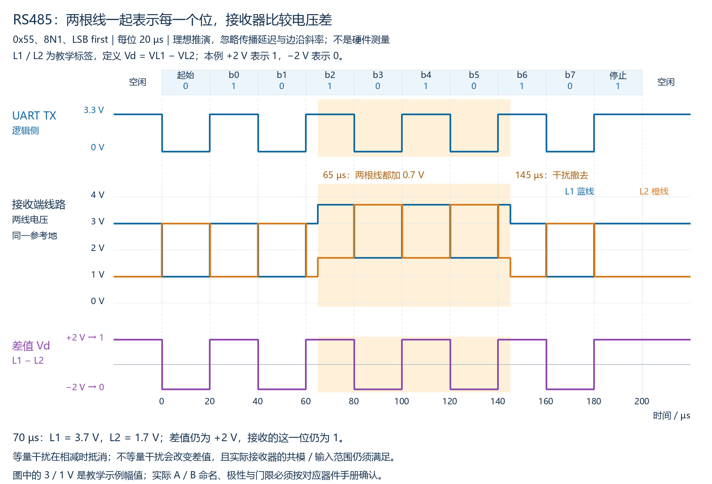

- 上排是发送 UART 的逻辑侧波形；中排蓝线为 L1、橙线为 L2；下排紫线为差值 Vd。
- 起始位为 0，中排 L1=1 V、L2=3 V，下排差值 −2 V；接收器恢复为 0。
- b0 为 1，中排 L1=3 V、L2=1 V，下排差值 +2 V；接收器恢复为 1。
- 后续每个位以相同方式表示，字符帧中的数据仍为 0x55；收发器改变线路信号表示，保持本例的逻辑位含义与顺序。

### 5. 为什么能抵抗部分干扰

65–145 µs，图中两根线均叠加 +0.7 V。对同一时刻相减：

`(VL1 + 0.7) − (VL2 + 0.7) = VL1 − VL2`

例如 70 µs，L1 从 3.0 V 变为 3.7 V，L2 从 1.0 V 变为 1.7 V；差值仍为 +2.0 V，因此这个位仍为 1。紫色差值波形没有因为这次等量抬升而改变。

这里等量、同方向叠加到两线的干扰称为**共模干扰（common-mode noise）**。实际布线与接收器的抗干扰能力还受其他条件影响；[ADI AN-960](https://www.analog.com/en/resources/app-notes/an-960.html)说明差分接收怎样抑制共模噪声。

若两根线受到的干扰不等量，则差值增加 `n1 − n2`，可能减小判定余量甚至改变结果。即使干扰等量，也必须使输入和共模电压保持在接收器允许的工作范围；不能由理想相减推导出“任意大的干扰都能抵消”或“差分通信不需要考虑参考地”。具体共模条件、参考连接、偏置和失效保护在 M03-03 展开。

### 6. 复习自测与参考答案

**复习自测：**

按本节 L1−L2 的极性与判定范围，假定接收器已使能，输入与共模电压均符合工作条件：

1. L1=0.9 V、L2=2.1 V，差值是多少，接收位是 0 还是 1？若两线都叠加 +0.8 V，差值和接收位是否改变？
2. 另一个独立场景，仍从原始 L1=0.9 V、L2=2.1 V 出发，仅 L1 叠加 +1.6 V，L2 不变。差值是多少？接收位是否改变？
3. 一对 RS485 差分数据线是否就是“一根只负责发送，另一根只负责接收”？能否单凭设备都标了 A/B，就断定同名端子一定具有相同极性？

**参考答案（对应上面题号）：**

1. 原差值 0.9−2.1=−1.2 V，判 0。等量干扰后为 1.7−2.9=−1.2 V，仍判 0；此模型内差值与接收位均不变。
2. 新差值为 (0.9+1.6)−2.1=+0.4 V，落入本例判 1 的范围，接收位由 0 变为 1。干扰只加在一根线上，不能等量抵消。
3. 不是，两根线共同表示每一个数据位；发送/接收方向与两线/四线及驱动控制结构有关。A/B 命名不应作为无条件极性规则，应核对手册中的差分定义与真值表。

### 7. 空闲、起始位、停止位：先看 UART 逻辑，再看电气表示

本章采用 UART 字符帧，因此起始与停止的逻辑规则来自 UART：空闲为 1、起始位为 0、停止位为 1。RS485 收发器将这些逻辑值转换成差分电压，不另增加一套 RS485 字符起始/停止位。

以下对照普通非反相 UART 和正常有效驱动下的 RS232、RS485 数据表示。RS485 继续使用本章 L1−L2 的极性约定，正差值表示 1、负差值表示 0；接收器使能且输入/共模条件有效。幅值都是教学示例。

| UART 帧状态 | 逻辑值 | UART 逻辑侧 | RS232 数据线 | RS485 差值（正在驱动） |
|---|---|---|---|---|
| 空闲 | 1 | 高，约3.3 V | 负，本例−6 V | 正，本例+2 V |
| 起始位 | 0 | 低，约0 V | 正，本例+6 V | 负，本例−2 V |
| 停止位 | 1 | 高，约3.3 V | 负，本例−6 V | 正，本例+2 V |

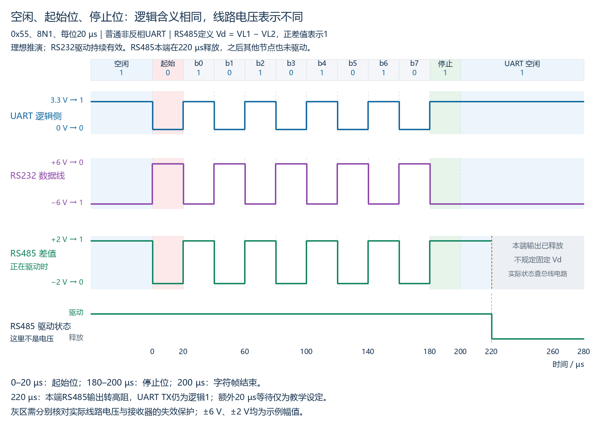

图中 0–20 µs 为起始位，180–200 µs 为停止位；200 µs 后 UART TX 继续保持空闲逻辑 1。发送端 RS485 驱动有效至 220 µs，所以 200–220 µs 仍主动输出本例的正差值 +2 V。额外保持 20 µs 只是本图设定，不是所有硬件统一要求。

停止位与空闲虽然均为逻辑 1，时间含义不同：停止位是帧内规定长度区间，空闲是帧外等待，8N1 的停止位占一个位时间，额外空闲可以没有。帧完整发送不等于外部 RS485 驱动已释放。

### 8. RS485 有两种需要分开的“空闲”

**UART 帧间空闲：**UART TX 没有发送字符帧，正常保持逻辑 1。若本端 RS485 驱动仍启用，该逻辑值仍控制线路差分输出；在本例极性下是正差值。

**总线无人驱动：**所有节点的驱动输出都停止主动驱动，转为高阻（high impedance）。高阻表示输出不再主动规定两线电压，并不表示主动输出逻辑 0，也不等于强制两根线都为 0 V。图中 220 µs 后是这种情况，因此灰区没有画固定差分电压。

UART TX 即使仍为 3.3 V，只要外部 RS485 驱动器已关闭，便不能据此认定线路仍被它驱动为正差值。接收器是否使能又是另一个独立条件。以 [TI SN65HVD7x](https://www.ti.com/lit/gpn/SN65HVD75) 为例，驱动使能关闭时，数据输入不再决定 A/B 输出，两输出均为高阻；具体使能控制在 M03-02 展开。

总线无人驱动时，线路电压由终端、偏置、漏电等实际电路条件决定。无有效偏置等条件下，差值可能接近 0；不能仅凭“UART 空闲应为 1”就断定接收器必输出 1。

- **偏置（biasing）**电路可在无人驱动时建立确定的差分电压。
- **接收器失效保护（failsafe）**是器件在规定异常/空闲输入条件下给出确定接收逻辑的能力；例如某些器件在零差值时可输出 1。这不表示它们一定把总线实际电压拉成图中的 +2 V。

具体器件支持哪些失效保护、允许哪些输入条件及是否需要外部偏置，均查数据手册；设计方法留 M03-03。[ADI AN-960](https://www.analog.com/en/resources/app-notes/an-960.html)分别解释总线无人驱动、外部偏置和接收器失效保护。

### 9. 帧状态与释放总线自测及参考答案

**复习自测：**

1. 起始位开始时，普通非反相 UART 逻辑侧与本课 RS232 线路电压各向哪个方向变化？本例 RS485 差值怎样变化？
2. 图中 180–200 µs、200–220 µs、220 µs 之后分别是什么状态？停止位为逻辑 1，是否等于关闭外部驱动器？
3. UART TX 仍为 3.3 V，但本端 RS485 驱动已经释放，总线上也没有其他节点驱动。能否保证线路 Vd 仍为 +2 V？若在有效输入/共模范围内测得 Vd≈0，且不知道接收器失效保护能力，能否保证接收逻辑为 1？

**参考答案（对应上面题号）：**

1. UART 逻辑侧由高变低，本课 RS232 由负变正，本例 RS485 差值由正变负。各层仍表示同一个起始逻辑 0。
2. 分别为帧内停止位、帧结束后仍主动驱动的空闲、总线无人驱动；停止位不是关闭驱动命令，驱动是否释放由使能控制决定。
3. 均不能。外部驱动关闭后，UART TX 不再控制它的线路输出；总线电压需看电路条件。零差值下接收逻辑需看门限、失效保护及使能等器件条件，不能无条件认定为 1。

### 10. 两线 RS485：两个方向共享一个差分对

具体对象仍是控制器甲与温度传感器乙。甲发送查询、乙返回测量结果；两端均有 UART 和 RS485 收发电路。

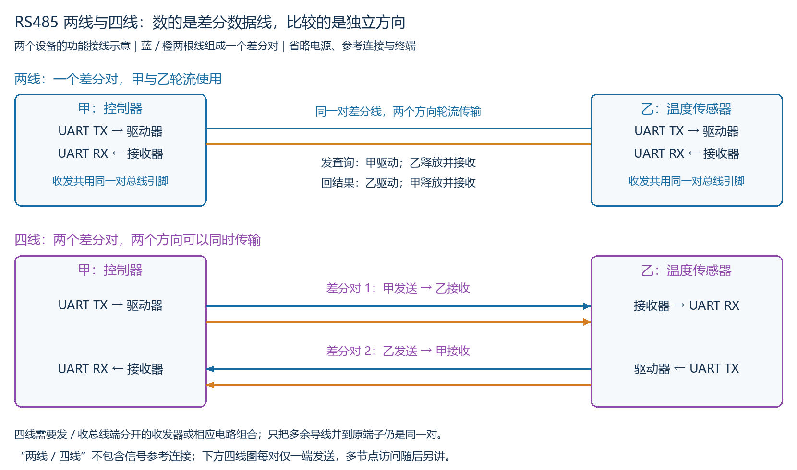

上半图只有一个差分对，蓝/橙两根数据线共同表示每一个位。甲的驱动器与接收器接这一对，乙的驱动器与接收器也接这一对。因此，这不是“一根专门甲发乙收、另一根专门乙发甲收”。

一次正常查询/回复的基本安排为：

1. 甲的驱动器有效，发送查询；乙的驱动输出保持释放，接收查询。
2. 甲的当前数据完整发送后，释放驱动，为对端使用总线留出条件。
3. 乙的驱动器有效，发送结果；甲的驱动输出保持释放，接收结果。

方向变化靠改变哪一端驱动有效，不需要交换两根线。驱动释放与 UART TX 空闲的区别见前一节；具体何时才算发送完成、怎样控制使能，在 M03-02 展开。

若两端同时驱动同一对线路，并发送不同位，例如一端希望差值为正、另一端希望为负，输出会发生争用，不能保证各自的数据独立到达。提高波特率不能把共享的一对线变成两个独立方向。[ADI 半双工结构说明](https://www.analog.com/en/resources/app-notes/an-960.html)

两线半双工限制的是两个方向独立业务数据的同时传输；它不要求本端接收器在发送期间必然关闭。接收器保持使能时可能看到本端发送的信号，这种本端回显也不等于全双工。

### 11. 四线 RS485：两个方向各用一个差分对

下半图有两个彼此独立的差分对，共四根差分数据线：

- 差分对1：甲 UART TX→甲驱动器→两根线→乙接收器→乙 UART RX。
- 差分对2：乙 UART TX→乙驱动器→另外两根线→甲接收器→甲 UART RX。

甲可以在第一对发送时，从第二对接收；乙亦然。因此，这个两个设备、每对仅一端发送的结构具备全双工能力。程序仍可以安排先查询后回复，不必总是同时收发。[TI 两对信号线与全双工结构说明](https://www.ti.com/lit/an/slla272d/slla272d.pdf)

**四线结构需要发/收总线端分开的收发器，或相应的驱动/接收电路组合。**若一颗半双工收发器的驱动与接收已在内部共用唯一一对总线引脚，仅将另一对导线也并到这两个引脚，不会产生第二条独立方向。

把“并接第二对线”展开看，是原来的两个端子各拉出两个分支，仍未增加分开的发送/接收总线端：

```text
原 L1 端子 ─┬─ 第一对的线1
            └─ 第二对的线1

原 L2 端子 ─┬─ 第一对的线2
            └─ 第二对的线2
```

这是功能连接示意，忽略导线电阻与传播差异。两对线仍连接到同一对端子，不能分别作为彼此独立的发送通道与接收通道。判断全双工结构时，既要看两对线的方向分配，也要确认实际电路提供独立的收发总线端；只有方向标签正确并不足够。

下面均只数数据线，参考连接不计入“两线/四线”：

| 本课接口结构 | 差分对数量 | 两个方向的路径 | 能力 |
|---|---:|---|---|
| 常见 RS232 两条单端数据线 | 不适用 | 每根单端数据线承担一个方向 | 全双工 |
| 两线 RS485 | 1 | 两个方向共享同一对线 | 半双工 |
| 四线 RS485 | 2 | 两个方向分别使用一个差分对 | 全双工 |

无论两线还是四线，本章采用 UART 时仍是异步串行帧。两线/四线描述线路结构，不替代参考连接、电气匹配、帧配置及访问安排。扩展多个节点时，同一差分对上的多个发送端仍需协调，不能由“四线全双工”推出所有节点可以同时向同一对线发送；多节点示例见第13～15节。

### 12. 两线/四线自测及参考答案

**复习自测：**

1. 两线 RS485 中，甲尚在驱动查询帧，乙便启用自己的驱动回数据。把乙的波特率提高能否解决关键问题？应调整什么安排？
2. 一颗半双工收发器的驱动/接收共用唯一一对总线引脚。把第二对导线也并到这两个引脚，能否得到全双工？真正的四线结构应怎样安排两个方向？

**参考答案（对应上面题号）：**

1. 不能，关键是两端在争用同一差分对，而非单纯发送快慢。应安排甲完成发送并释放驱动后，乙再驱动并发送回复；每次只允许一端有效驱动同一对线。
2. 不能，并接导线仍是同一对共享总线端。需要分开的发/收总线端与相应收发电路，一对用于甲发送到乙接收，另一对用于乙发送到甲接收。

### 13. 多节点：一台控制器连接三只温度传感器

把前面的单只传感器扩展成三只，每个设备仍有 UART 与 RS485 收发电路。图中所有节点接在同一个差分主干上，发送者驱动的线路信号可以到达多个接收者。[TI RS485 设计指南](https://www.ti.com/lit/an/slla272d/slla272d.pdf)说明 RS485 电气接口支持构建多点线路，标准本身不定义设备地址或业务访问规则。

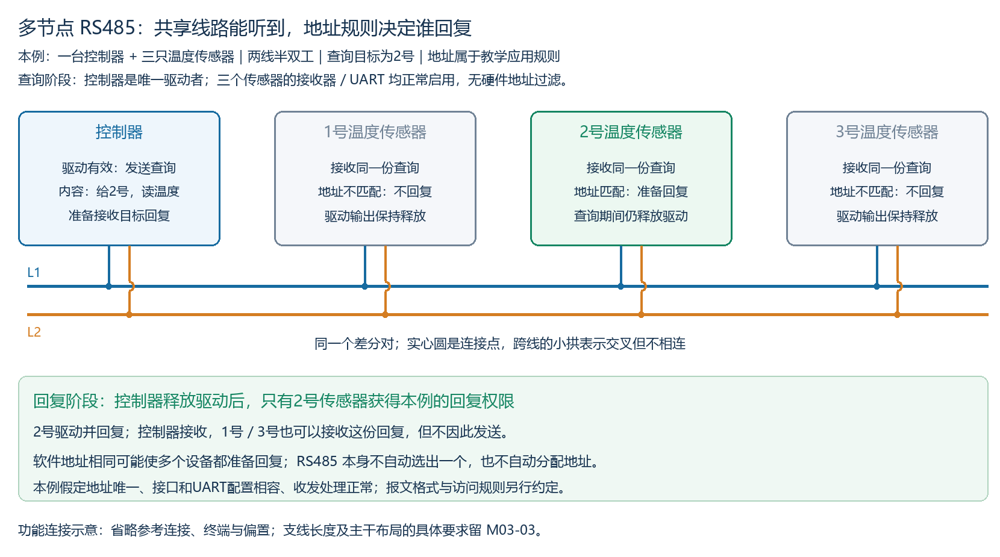

图为功能连接示意，圆点表示接点，小拱表示线交叉但不相连；省略电源、参考连接、终端与偏置，不按真实布线尺寸绘制。主干与支线的设计条件在 M03-03 展开。

本例假设接口与 UART 配置相容，三个传感器的接收器/UART 均正常启用，不启用硬件地址过滤，软件取数与解析正常。由此区分两件事：**线路数据能到达谁，以及上层规则允许谁回复。**

### 14. 地址决定回复权限，不使线路只送到目标设备

本例选择一套简单的教学规则，不作为完整实际协议报文：

- 三只传感器的软件地址分别配置为1、2、3。
- 控制器按顺序点名查询，查询内容含目标地址和“读温度”命令；本例仅允许目标设备回复。
- 传感器只对给自身的有效查询回复，收到回复报文本身不自动再次应答。
- 所有回复都要等待控制器完整发完查询并释放驱动；其他节点保持驱动释放。

控制器发送“给2号：读温度”时：

| 阶段 | 控制器 | 1号传感器 | 2号传感器 | 3号传感器 |
|---|---|---|---|---|
| 查询 | 唯一有效驱动，发送查询 | 接收查询，地址不匹配，不回复 | 接收查询，地址匹配，准备回复，驱动仍释放 | 接收查询，地址不匹配，不回复 |
| 交接 | 查询完整结束，释放驱动 | 驱动保持释放 | 等待具备回复条件 | 驱动保持释放 |
| 回复 | 接收2号回复 | 可接收回复，但不发送 | 唯一有效驱动，发送回复 | 可接收回复，但不发送 |

因此，1号、3号可以在 UART 层收到同一份查询字节，再由设备程序根据上层规则不处理为自身请求；它们不是因为 RS485 硬件自动“挡住了给2号的数据”才不回复。地址配置、地址判断和回复权限属于程序与通信规则，RS485 收发器只完成相应电气收发。实际系统的接收使能、地址过滤、帧格式、接收缓冲和程序处理不同，不能把本例的正常接收假设当成所有设备的无条件保证。

同一差分对每次仅允许一个有效驱动者。多节点“可以连接多个发送者”，并不等于这些发送者可以同时占用这对线。这里采用控制器点名、传感器回应的安排；RS485 标准也不强制所有系统都采用这种安排。

若2号和3号都配置为地址2，且都采用相同的“收到给自身的有效查询就回复”规则，两者都可能准备回复。RS485 本身不会自动选择其中一个；可能出现驱动争用、重叠数据或多份回复，不能保证控制器得到预期的一份响应。即使某次两者发送内容相同，也不能据此认定访问安排正确；本例应配置唯一地址或由上层重新安排访问。

### 15. 多节点与地址自测及参考答案

**复习自测：**

按本节正常接收、无硬件地址过滤和点名回复的教学假设：

1. 控制器向2号发送查询，1号、3号的 UART 能否也收到查询字节？它们是否应该同时回复？
2. 把2号、3号的软件地址都设为2，且两者均采用收到本地址查询后回复的规则。RS485 能否自动选出一个回复者？存在什么风险？

**参考答案（对应上面题号）：**

1. 可以收到；它们连接同一个共享差分对并正常接收。按本例规则不应回复，程序根据目标地址判断该查询不是给自己，驱动保持释放。
2. 不能，地址与回复权限由上层规则处理。两个节点都可能认为查询给自己并启动回复，造成争用、响应重叠或多份回复；应按本例配置唯一地址或重新设计访问安排，不将争用交给 RS485 自动解决。

## M03-02：用使能引脚控制驱动与接收

### 1. 使能是什么，两个开关分别管哪里

“使能”就是允许某个硬件功能工作。以 [TI SN65HVD7x 数据手册](https://www.ti.com/lit/gpn/SN65HVD75) 的独立控制方式为例，收发器把驱动器和接收器做在同一颗芯片中，但可以分别开启/关闭。本节引脚极性以该器件为例，其他器件须查看自己的手册。

| 引脚 | 英文名称或作用 | 本例接法与含义 |
|---|---|---|
| D（其他器件可能标 DI） | Driver Input，驱动器数据输入 | 接 MCU 的 UART TX，输入要发送的位 |
| R（其他器件可能标 RO） | Receiver Output，接收器数据输出 | 接 MCU 的 UART RX，输出从总线恢复的逻辑信号 |
| DE | Driver Enable，驱动器使能 | 1：开启驱动；0：驱动输出高阻，释放本端驱动 |
| /RE | Receiver Enable，接收器使能，低电平有效 | 0：开启接收；1：接收器输出 R 高阻，不再主动输出所接收的数据 |

`/RE` 前面的斜杠表示**低电平有效**：0 才开启。手册也可能用 RE 上方横线、RE# 或 nRE 表示；不是除法，也不是 UART 数据位取反。DE、/RE 是芯片上实在的控制引脚，MCU 可通过已配置的 GPIO 输出高/低电平控制它们。

```text
MCU UART TX → D → 驱动器 → 同一对差分总线
MCU UART RX ← R ← 接收器 ← 同一对差分总线
MCU GPIO ──────→ DE   ：是否开启驱动器
MCU GPIO ──────→ /RE  ：是否开启接收器（低有效）
```

这是功能路径示意，省略电源、参考连接和线路设计。两个使能不改变 UART 的起始位、数据位或停止位格式。**D/TX 决定正在发送什么位，DE 决定是否驱动总线，/RE 决定是否向本端 UART 提供接收信号。**

### 2. 四种组合：开启接收不等于释放驱动

下面假定两根使能分别可控，电气与 UART 条件满足；同一对总线上的其他驱动者须协调。

| DE | /RE | 本端驱动器 | 本端接收器 | 使用含义 |
|---:|---:|---|---|---|
| 0 | 0 | 释放 | 开启 | 本端可接收别人发来的数据 |
| 1 | 1 | 开启 | 关闭 | 一种常见发送安排，本端不监听自己的发送 |
| 1 | 0 | 开启 | 开启 | 本端可监听线路，包括自己的发送；仍是两线共享通道 |
| 0 | 1 | 释放 | 关闭 | 本端不驱动，也不从收发器得到接收数据 |

DE=1、/RE=0 不使一对线变成全双工，也不授权另一端同时驱动。DE=0 只释放**本端**驱动；是否整条总线无人驱动，还要看其他节点。

在本例器件中，若 R 因接收关闭变成高阻，MCU RX 脚的实际电平还受上拉等电路影响，不能画成固定低电平。开启接收只是打通接收硬件路径，也不等于 C 变量已自动更新。接收与缓冲处理仍遵循 M01 的硬件/软件关系。

常见简化接法是将 DE 与 /RE 接到同一根方向控制信号：拉高得到发送组合1/1，拉低得到接收组合0/0；也可把 /RE 固定接低，仅控制 DE，从而持续监听。具体接法取决于电路与使用需求，不要求所有系统都用两根独立 GPIO。[TI 数据手册的收发器配置示例](https://www.ti.com/lit/gpn/SN65HVD75)

### 3. 把使能和数据放在同一条时间轴

采用 DE=1、/RE=1 发送，DE=0、/RE=0 接收的安排，发送 0x55、8N1，每位20 µs：

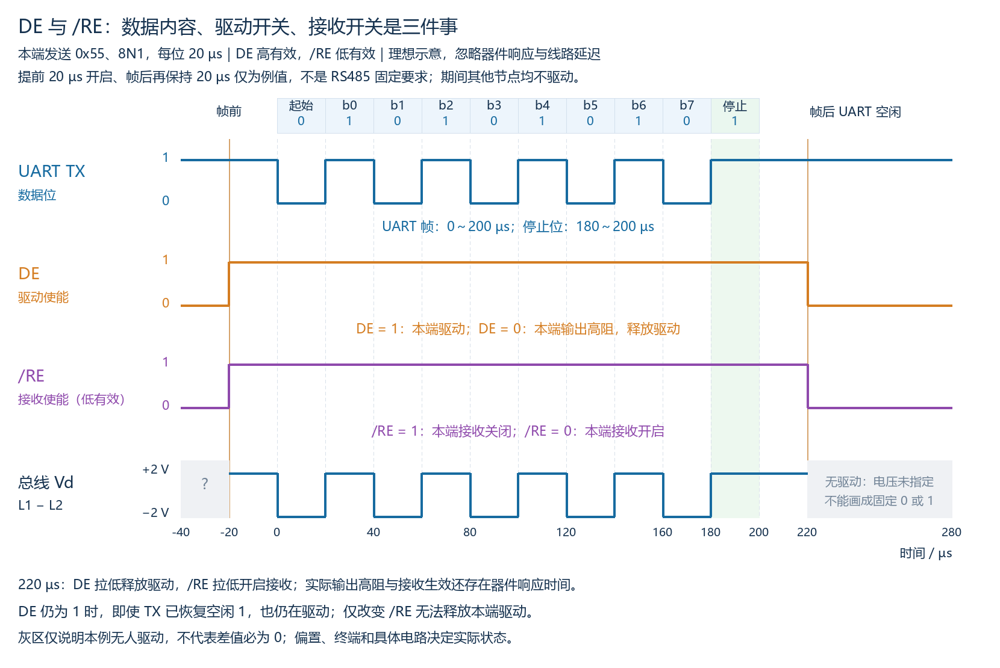

图中各轨迹按理想控制画出，忽略器件响应时间、线路传播及边沿斜率。提前20 µs开启、帧后保持20 µs均是教学例值，不是标准规定的固定等待时间；实际须满足具体器件和系统的时序要求。本例其他节点始终不驱动。

1. −20 µs 时置 DE=1、/RE=1：开启驱动，关闭本端接收；TX 此时仍为帧前空闲1，线路已由本端驱动。
2. 0～200 µs 发送整帧，停止位占180～200 µs；DE 始终保持1，确保停止位也完整驱动。
3. 200～220 µs，帧已结束，TX 为1，DE 仍为1，因此本端仍在驱动线路。
4. 220 µs 置 DE=0、/RE=0：发出释放驱动和开启接收的控制；实际高阻和接收生效还存在器件响应时间。

两段灰区不指定无人驱动时的真实线路电压。高阻释放不是“输出0”，也不是保证差分电压为0；这与 M03-01 的停止位/空闲/释放区分一致。

本节先理解使能动作。程序依据什么状态确认**最后一个停止位已发完**，以及为什么仅看发送缓冲空可能过早，见本小节第5～8节。

### 4. 使能自测及参考答案

**复习自测：**

1. 本端 DE=0、/RE=1，另一端正确发送，线路和 UART 配置均相容，其他条件正常。本端是否释放驱动？本端收发器能否主动向 UART RX 输出收到的数据？
2. 本端帧已经完整发完，DE=1、/RE=1。程序只把 /RE 改成0，DE仍为1。本端是否释放总线驱动？要释放驱动还需怎样设置？

**参考答案（对应上面题号）：**

1. 本端驱动已释放；本端接收器关闭，R 为高阻，不能主动向 UART RX 输出所接收的数据。须将 /RE 设为0开启接收，并满足其他接收条件。
2. 没有释放，/RE=0仅开启接收，DE=1仍开启驱动。完整发送结束且满足交接时序后，还需将 DE 设为0，释放本端驱动。

### 5. UART 内部：等待发送的位置与逐位输出的硬件

用单字节发送缓冲、无 FIFO 的简化模型理解。FIFO 是 First In, First Out（先进先出），这里指可按顺序暂存多份数据的缓冲队列；本例暂不采用这种多字节队列：

```text
C 程序提交字节
      ↓
发送数据缓冲：存放待发字节，可以接收下一份数据
      ↓ UART 硬件转移
发送移位寄存器：按位时间逐位输出，配合帧生成硬件产生起始/停止位
      ↓
UART TX → RS485 驱动器（须开启）→ 差分线路
```

移位寄存器（Shift Register）是硬件存储结构，能按时钟节奏逐位移出数据；这不是 C 程序必须循环执行右移运算的意思。位时间由 UART 的配置与时钟决定。

发送缓冲里的字节转入移位硬件后，**缓冲可以已经空，但移位硬件仍要花时间发送整帧**。采用8N1、一位20 µs，一个字节的完整字符帧需要10位，即200 µs。若发送多个字节，缓冲可以在当前字节逐位发送时提前容纳下一个字节；实际是否有 FIFO、容量和状态定义均以 MCU 手册为准。

### 6. TXE 与 TC：可继续提交数据，和最后一个帧已发完

“标志”通常是 UART 状态寄存器中的位，硬件依据状态置位/复位，程序读取它来判断情况。以下采用常见 STM32 非 FIFO UART 的命名说明，不把名称套到所有 MCU：

| 名称 | 英文含义 | 本课模型的状态含义 | 用途 |
|---|---|---|---|
| TXE | Transmit Data Register Empty，发送数据寄存器空 | 发送数据缓冲可再写入数据；移位硬件可能仍在发送 | 判断能否提交下一个字节 |
| TC | Transmission Complete，发送完成 | 当前最后一帧包括停止位已发完，且没有缓冲中的待发数据 | 判断本端 UART 是否结束此次发送 |

[ST 的 UART 标志定义](https://github.com/STMicroelectronics/stm32f4xx-hal-driver/blob/master/Inc/stm32f4xx_hal_uart.h)分别列出 TXE 与 TC；[ST UART 驱动的阻塞发送实现](https://github.com/STMicroelectronics/stm32f4xx-hal-driver/blob/master/Src/stm32f4xx_hal_uart.c)先等待 TXE 提交每份数据，最后再等待 TC。其他器件可能称 UDRE/TXC，或采用不同的 FIFO 就绪/忙状态名称；应按状态定义判断，不能只看缩写像“完成”。

判断必须属于**本次最后一帧**：启动新发送时，应按具体 MCU 的规定处理 TC 的旧状态，防止把上次留下的完成标志误当成本次完成。不同芯片的自动清除、软件清除和检查顺序不同，本课不提供通用的寄存器清除代码。

### 7. 缓冲空了，停止位却还没结束

本例 −20 µs 提交一个字节并正确复位本次 TC；0 µs 时 UART 把数据转入移位硬件，发送缓冲变空，同时开始8N1帧；没有后续字节。具体提交、移入和置标志时刻是教学题设，不是所有芯片固定时序。

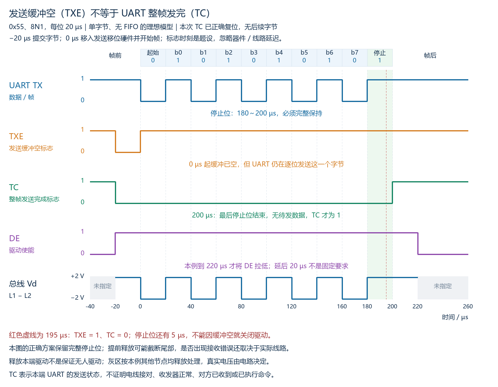

图忽略器件响应、线路传播、边沿斜率及软件执行延迟；DE 提前开启和帧后延后20 µs释放只是例值，实际须满足器件与交接安排。其他节点均不驱动，未驱动区不指定真实电压。

| 时刻/区间 | TXE | TC | 仍需做什么 |
|---|---:|---:|---|
| 0 µs，字节移入发送硬件 | 1 | 0 | 硬件仍需发完整字符帧 |
| 180～200 µs，停止位期间 | 1 | 0 | 保持驱动直到停止位完整结束 |
| 200 µs，完整帧结束且无待发数据 | 1 | 1 | 本端 UART 此次发送完成；按器件时序与访问安排交接驱动 |
| 220 µs，本例发出 DE=0 控制 | 1 | 1 | 本端释放驱动；接收路径按需开启，对方等待允许的交接条件 |

例如195 µs时停止位已持续15 µs，但还剩5 µs。即使 TXE=1，也不能以此提前关闭 DE。提前释放会使剩余停止位不再由本端有效驱动，实际接收是否报错还受偏置、失效保护、采样点和其他节点驱动影响；不能保证每次必然报错，也不能依赖偶然正确认定发送安排可靠。

TC只说明本端 UART 的硬件发送状态，不能证明 RS485 收发器正常、DE正确控制、线路接对、远端已收到或已执行命令；远端完成情况需结合回复或其他协议证据。本端发送完，也不等于无需满足实际驱动关闭时间、线路延迟和对方回复规则。

### 8. 真正发送完成自测及参考答案

**复习自测：**

按本节单字节理想模型：本次 TC 已正确复位，无后续待发数据；帧开始于0 µs，8N1，每位20 µs。

1. 在195 µs读取到 TXE=1、TC=0。能否因为 TXE=1就将 DE 拉低？停止位还剩多久？
2. 完整帧结束后读取到本次 TC=1。能否仅凭它证明对方已经收到并执行命令？它确认的是哪个环节？

**参考答案（对应上面题号）：**

1. 不能。停止位占180～200 µs，195 µs时还剩5 µs；TXE仅说明发送数据缓冲空，不代表移位与帧生成硬件已完成最后一个停止位。
2. 不能。TC确认本端UART已经结束本次最后一帧的发送，不确认收发器、线路或远端处理成功；需要结合接收回复等协议证据判断远端情况。

### 9. DMA 搬运完成与发送函数返回

DMA 是 Direct Memory Access（直接存储器访问），本例由硬件按 UART 请求将 RAM 中的待发字节写入 UART 发送数据寄存器。CPU配置搬运任务后，不必逐次用C代码写入每个字节；UART仍负责逐位发送。

```text
RAM 的待发数据 → DMA 搬运 → UART 发送缓冲 → 移位/帧生成硬件 → UART TX
```

**DMA原始搬运完成事件只说明配置的最后一次数据写入已经完成，不等于UART最后一个停止位已经发完。**此时字节仍可能在发送缓冲或移位硬件中。不能在该事件发生时无条件关闭DE；须确认本次UART的最后完整帧结束，再按交接时序释放驱动。

[ST UART 驱动](https://github.com/STMicroelectronics/stm32f4xx-hal-driver/blob/master/Src/stm32f4xx_hal_uart.c)的普通非循环DMA发送路径中，DMA完成处理随后启用UART的TC中断，继续等待最后发送完成。应区分“DMA硬件搬运完成”与驱动对外提供的“UART发送完成回调”；后者可能已经等待TC，具体需查看文档或实现。不能从回调名字包含Complete就推定它一定属于哪一层；循环DMA等模式也不能套用本例的结束语义。

发送函数返回的含义同样取决于约定：

| 函数约定 | 成功返回说明什么 | 能否据此确认本次UART最后帧发完 |
|---|---|---|
| 仅提交到软件队列或启动异步发送 | 数据被接受，或任务已启动 | 不能 |
| 只等待DMA原始搬运完成 | 最后一次写入UART完成 | 不能 |
| 明确等待本次UART最后帧完成才成功返回 | 本端UART完整发送结束 | 可以作为本端完成证据；交接仍需器件条件 |

例如ST的阻塞发送成功路径等待TC，而启动DMA发送的函数成功返回不等待所有数据发到线路上。即使函数约定成功时等待TC，也必须检查返回状态：超时、错误、取消等返回不构成成功完成证据。函数名含“发送”或“阻塞”本身不足以替代其文档约定。

### 10. 完整流程：控制器查询，传感器回复

仍采用两线半双工、发送时DE=1与/RE=1、接收时DE=0与/RE=0的安排。本例仅用查询0x55与回复0x33的单字节表示方向切换，不作为实际温度查询协议；真正多字节包需把“最后一帧”理解为整包最后一个字节的UART帧。

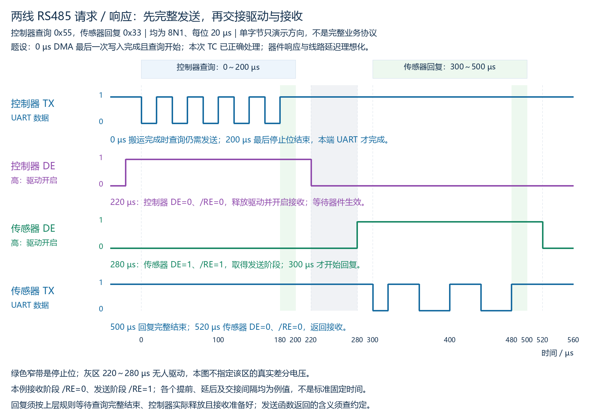

本图8N1，每位20 µs，单帧200 µs。题设规定0 µs时最后一次DMA写入完成且查询开始；本次TC旧状态已正确处理。所有开始、延后和交接时间是例值；响应/传播/软件延迟理想化，实际系统需留足器件时序并协调双方上层回复安排。

| 阶段 | 控制器动作 | 传感器动作 |
|---|---|---|
| 准备查询 | 接收路径及缓冲预先准备；取得发送权限，开启驱动并等待生效 | 保持驱动释放，开启接收 |
| 发送查询 | 提交整份查询，等待本次最后一帧完整结束；不中途关DE | 接收并解析，准备获准的回复；保持驱动释放 |
| 交接 | 完整结束后释放DE、开启接收，满足关闭驱动/接收生效时间 | 按规则等待控制器实际释放与接收准备好，再取得发送阶段 |
| 回复 | 保持驱动释放，接收处理回复 | 开启驱动并等待生效，发送整份回复，等待自身最后一帧完成 |
| 收尾 | 按应用规则判断有效回复或超时 | 释放驱动，恢复接收 |

本图中控制器查询0～200 µs，220 µs发出释放和接收开启控制；传感器280 µs开启驱动、300～500 µs发送回复、520 µs释放驱动。220～280 µs无人驱动，灰区不指定线路电压。控制器的UART TX在回复期间仍可保持空闲1，但因为DE=0，不再由它驱动总线。

“控制器TC=1”不通过RS485线路自动通知传感器“本端已释放且能接收”。对方的回复时机须由协议/系统安排，而不是假定收到最后一个数据字节便可立即驱动。接收器可以按需求一直开启；本例关闭接收再开启只是所选安排。避免漏掉快速回复还应预先准备UART、缓冲和接收服务，满足接收器开启时间；实际电路可选择持续接收等安排。

### 11. DMA/函数返回理解检查及参考答案

**复习自测：**

1. 一次正常DMA发送的原始搬运完成事件已发生，但本次UART仍为TC=0。是否可以立即把DE拉低？还应等待什么状态？
2. 函数甲的约定为“成功返回只表示已启动DMA”；函数乙的约定为“等待本次最后帧的TC后才成功返回”。两者均成功返回，哪个可作为本端UART完整发完的证据？

**参考答案（对应上面题号）：**

1. 不能。DMA完成只说明最后一次写入UART已完成，UART可能仍在发送或尚有缓冲待发数据；应等待本次最后完整帧发送完成的状态，再按器件时序与访问安排释放驱动。
2. 乙。甲仅确认异步任务启动，不能证明整帧发完；乙的成功返回约定包含本次最后帧完成。任何超时/错误返回都不能按成功解释，且本端UART完成不保证远端接收或处理成功。

### 12. 收发切换复习要点

- 开启接收与释放驱动由不同使能控制；TX空闲1不等于DE已释放。
- 多字节查询须等整份查询最后一个字节的完整UART帧结束；缓冲空、原始DMA搬运完成或仅启动成功都不能替代这一判断。
- 根据本次UART完成状态或明确等待该状态的成功函数/通知，按器件时序释放驱动并确保接收路径就绪。
- 回复方遵循上层访问安排，等待查询完整结束、原发送方释放且接收准备好；TC本身不自动通知对方驱动已释放。
- 本端发送完成与远端接收/处理成功是不同证据；只根据自己的TC不能确认业务成功。

## M03-03：物理线路怎样连接

### 1. 拓扑、主干与支线分别指什么

拓扑（Topology）指各设备和线路的连接形状。以一台控制器和三只传感器为例，常见工程布局采用一条连续主线，各设备通过短连接接入。[TI RS485设计指南](https://www.ti.com/lit/an/slla272d/slla272d.pdf)说明主干与短支线的总线结构。

- **主干（Trunk）**：连接整个总线的主要线缆，沿它可以从一个物理端走到另一个物理端。
- **支线（Stub）**：从主干接点到某个设备收发器的连接段，工程上尽量短；实际要求取决于驱动边沿、线缆传播和整体电路，不能无条件给出统一厘米数。
- **节点（Node）**：接入总线的设备接口。本例控制器与每只传感器各算一个节点。

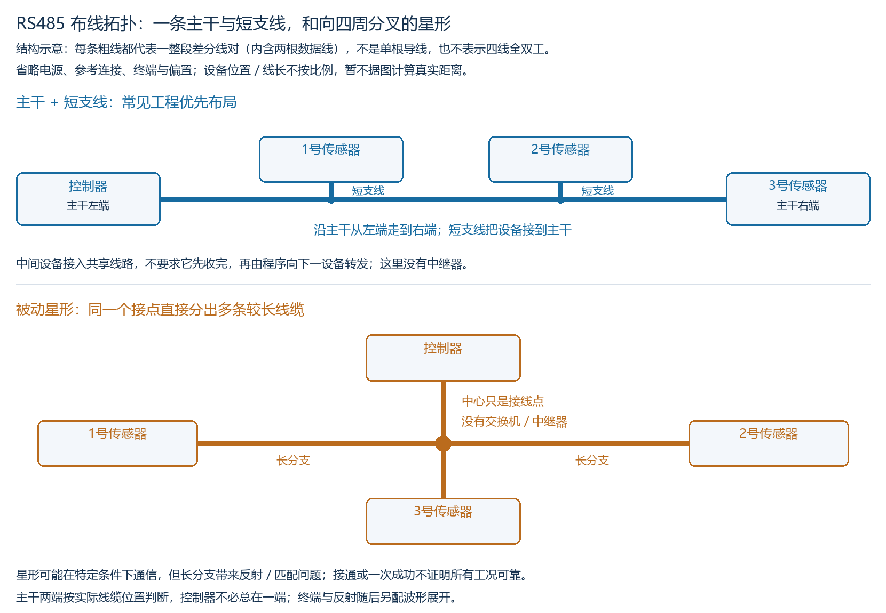

本图每条粗线代表**一整段差分线对，内含两根数据线**，不是单根导线，也不是四线全双工。图只展示连接形状，不按长度比例画，省略电源、信号参考连接、终端与偏置；这些省略不代表实际系统不需要考虑它们。

上图主干从左端控制器连到右端3号传感器，1号/2号经短支线接入。主干两端由实际线缆位置决定，不由地址编号、谁发起查询或哪个设备是控制器决定；控制器也可以接在主干中间，而不是固定必须在端点。

**区分主干末端与支线末端：**1号/2号设备可以位于各自支线的末端，但这不使它们成为主干的两个末端。它们接入主干的接点位于中间，水平主干还继续向左、向右延伸。判断主干两端时，先沿连续主干找两头，不沿支线转向设备。

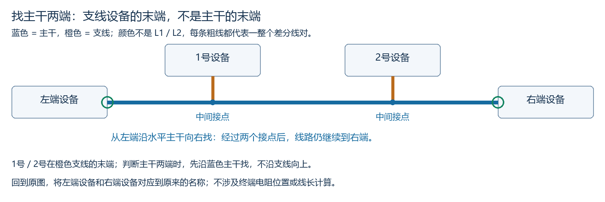

此辅助图用颜色区分线路类别：蓝色表示主干，橙色表示支线，**不是用蓝/橙分别表示L1/L2**；每条粗线仍表示整个差分线对。绿色圈为主干末端，中间接点两侧的主干继续延伸；左右设备使用通用名称，以便对照不同设备位置。

### 2. 沿途连接不等于程序逐个转发

主干经过多个设备接点，表示它们的RS485接口接入同一共享差分线路。本例没有中继器，信号可以沿连续主干到达其他正常接收的节点；**不需要1号先收到字节，再由1号程序重新发送给2号或3号。**这与M03-01多节点同时接收、软件地址决定谁回复的结构一致。

因此，在主干连接连续、接口正常、1号驱动释放、其他电气/UART与访问条件正常的前提下，仅1号程序停止读取UART缓冲，并不自动阻断主干到3号的线路信号。若是切断主干、短路线路、持续错误驱动或接口故障，则属于不同条件，不能套用该结论。

### 3. 被动星形为何不能只看“接通了”

下图从一个中心接点直接分出多条较长线缆，称为星形（Star Topology）。本例中心只是被动接线点，没有交换机、中继器或独立分段驱动。

[TI AN-979](https://www.ti.com/lit/an/snla042a/snla042a.pdf)指出，这种长分支星形存在反射和终端匹配问题；普通多点RS485布线优先采用主干加短支线的方式。长分支会影响实际信号形状，不能只凭逻辑接通推定可靠性。信号传播、反射及终端电阻怎样起作用，见第5～8节的波形与接线图。

星形并非在任何条件下都绝对无法通信；特定短线、边沿和负载条件下可能工作，也可能使用专门的中继/分段方案。但“短线台架低速一次查询成功”不能证明换成长线或其他速率、负载后仍可靠。降低波特率也不保证驱动边沿随之变慢，不能把它当作消除长支线问题的通用办法。

### 4. 拓扑自测及参考答案

**复习自测：**

1. 上图主干布局的两个物理端分别在哪里？1号/2号与主干之间的连接段叫什么？
2. 主干连续、接口正常、1号保持DE=0，其他接收和访问条件正常；只有1号程序停止读取UART缓冲。3号是否因此一定收不到控制器的数据？解释本例是否需要1号程序转发。

**参考答案（对应上面题号）：**

1. 本例两个物理端是左侧控制器和右侧3号传感器所在端；1号/2号接入主干的段是支线。端点按实际线缆位置判断，角色和地址不定义端点。
2. 不会因此必然收不到。这里各设备接入共享主干，不是软件逐跳转发；在题设条件下，1号停止读缓冲不会切断主干或使其驱动争用。若主干/接口电气条件发生故障，则应另行分析。

### 5. 信号传播需要时间，端点不匹配可能产生反射

之前的UART/使能波形常忽略线路传播时间。实际电缆中，电压变化以有限速度传播；驱动端刚改变，远端不会瞬间得到同样变化。传播时间与线缆长度及传播速度有关，本例只规定单程延迟1 µs，不由图推导实际距离。

**反射（Reflection）**指沿线路传播的信号变化在阻抗不匹配处，部分以波的形式返回。端点未匹配、较长支线等都可能改变接收端波形，出现过冲或往返变化。[ADI的传输线与反射说明](https://www.analog.com/en/resources/technical-articles/interfacing-highspeed-signals.html)

**过冲（Overshoot）**是电压短时超过最终稳定值；**振铃（Ringing）**是电压在稳定值附近反复变化。反射能量来自发送的变化，不是接收器自动发出了另一份业务回复，也不是CPU重复提交了字节。

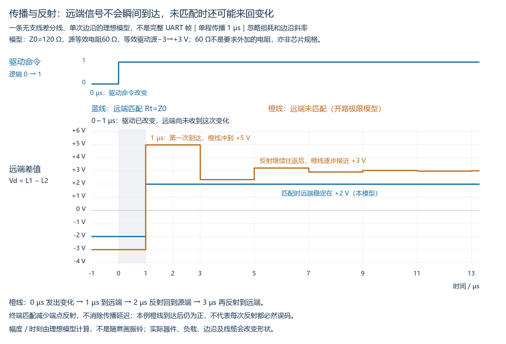

这张图只比较一个边沿，不是完整UART帧，也不是芯片实测。驱动命令在0 µs改变，第一次变化到远端在1 µs才出现：

- 蓝线：远端匹配，在1 µs变到本模型的+2 V，然后稳定；匹配减少端点反射，但**传播延迟仍在**。
- 橙线：远端未匹配，采用接收输入高阻的开路极限；第一次到达时过冲至+5 V，随后在3、5、7 µs等时刻继续变化，逐步接近+3 V。
- 橙线的第一份反射在2 µs回到源端，源端再次反射的变化到远端在3 µs出现；每次往返需要两个单程传播时间。

本例橙线到达后始终为正，并不演示“这个位一定读错”。反射是否影响通信，要结合采样时刻、位间变化、门限、幅度和器件条件；当变化叠加到后续位或影响有效采样时，才可能造成误判。不能将任何过冲都直接等同于必然误码，也不能从单个边沿仍可判定推出所有数据可靠。

<details>
<summary>附图模型参数与计算依据（用于核对，不要求推导）</summary>

采用无支线、无损、纯电阻源/负载的差分传输线等效模型；忽略有限边沿、寄生电容和保护电路。线缆特性阻抗Z0=120 Ω、源等效电阻Rs=60 Ω、单程传播td=1 µs；等效电压源在0 µs由−3 V变为+3 V。Rs仅是此模型的源等效参数，不是要求实际RS485接口额外串入60 Ω，也不是某芯片规格。

- 源端反射系数Γs=(Rs−Z0)/(Rs+Z0)=−1/3，表示返回源端后再反射的电压比例及方向。
- 此次源电压变化6 V，初次入射变化ΔVi=6×Z0/(Rs+Z0)=4 V。
- 开路极限远端ΓL=1，变化前稳态为−3 V；在t=(2n+1)td（n从0起）每次增加2ΔVi×(−1/3)^n，得到5、7/3、29/9……V，极限为+3 V。
- 匹配远端Rt=Z0，ΓL=0；变化前/后远端稳态为−2/+2 V，改变在td到达，不产生本模型的远端反射。

公式采用传输线源端/负载反射关系，参考[ADI传输线案例](https://www.analog.com/en/resources/technical-articles/interfacing-highspeed-signals.html)。绘图脚本校核关键数值，幅度与时刻并非随意画出；这不是随后双端终端实际电路的完整仿真。

</details>

### 6. 终端电阻是什么，接在哪里

**终端电阻（Termination Resistor，图中记Rt）**是放在线路端部的匹配电阻，单位为欧姆（Ω）。其用途是在端点提供与线缆匹配的负载，减少该处的信号反射；它不负责分配地址、选择发送者或改变UART帧格式。[TI RS485设计指南](https://www.ti.com/lit/an/slla272d/slla272d.pdf)、[ADI终端方案说明](https://www.analog.com/en/resources/app-notes/an-960.html)

**特性阻抗（Characteristic Impedance，记Z0）**描述线缆中传播波的电压/电流关系，由线缆结构等决定。它不是万用表量到的铜线直流电阻，也不是收发器的输入电阻。无需在本课推导线缆电感、电容公式，但应知道匹配值要依据线缆规格和系统设计选取。

本课普通两线多点主干采用**双端并联终端方案**：在主干两个物理端附近，各用一个匹配电阻横跨两根差分线。若线缆差分特性阻抗为120 Ω，常用各120 Ω；这个值不是所有线缆的固定要求。

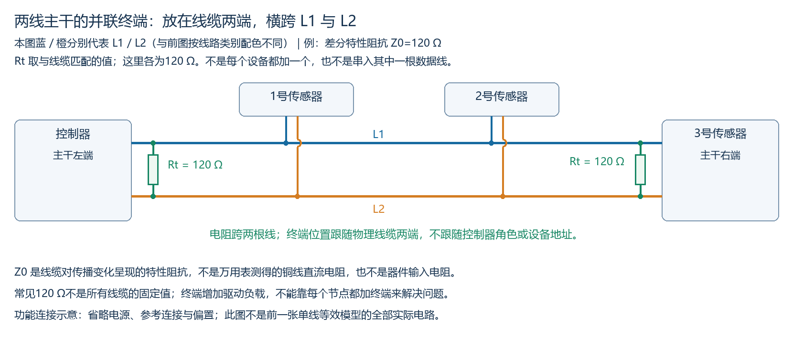

图中蓝/橙分别表示L1/L2，与前面按主干/支线类别配色不同。每个绿色电阻的一端接L1、另一端接L2，**不是串进L1，也不是接到地**。图中终端位于控制器和3号端，是因为它们处在本例线缆两端；若控制器移到中间，终端应仍按实际线缆两端安排，不跟随控制器角色移动。

这是功能接线示意，省略电源、参考连接和偏置，不按真实长度画。它不是前一张单线等效模型的全部实际电路，实际还需考虑收发器输出、节点负载、支线与保护电路。

### 7. 取值与负载的边界

普通两线主干的双端并联方案不要求每个节点都加终端。增加终端会增加驱动负载；理想直流条件下，忽略线缆电阻，仅两个120 Ω终端并联就等效60 Ω，再加节点负载后驱动条件还要核对器件手册。随意再加多个120 Ω会进一步降低等效负载电阻，并非“越多越稳”。

**“负载更重”具体指什么？**每个跨线电阻都为电流提供一条从L1到L2（或相反方向）的通路。在相同差分电压下，并联支路更多，总电流更大。以维持Vd=2 V为理想比较条件，只计算终端电阻，忽略线阻、偏置和接收器负载：

| 跨线终端 | 直流等效电阻 | 驱动器需要提供的终端总电流I=Vd/R |
|---|---|---|
| 两个120 Ω | 60 Ω | 约33.3 mA |
| 四个120 Ω | 30 Ω | 约66.7 mA |

驱动器通过电源取能，并在两根总线线上提供/回收电流；并联电阻越多，维持同一差值所需的总电流越大。实际驱动器的输出能力有限，若负载超出能力，差分幅度可能降低，使抗干扰余量不足。这里不是证明任意器件接30 Ω就一定误码，而是说明必须核对驱动负载，不能把额外终端当成无成本的改善。终端按线缆端点用于匹配，不按设备数量逐台添加。

短线和较慢边沿条件下，不加终端也可能工作；是否需要及采用何种终端应按传播、边沿、数据率和实际电路评估，不将所有RS485实现都概括为无条件同一种接法。本课先学普通两线多点主干的常见双端并联方案；四线接收端终端、交流终端等不在此直接套用。

终端不能替代DE协调、地址规则、接收准备或空闲偏置，也不能保证主干两端匹配后任意长支线都无影响。偏置与无人驱动状态见第9～12节，避免把终端匹配和维持空闲状态混为一谈。

### 8. 传播与终端自测及参考答案

**复习自测：**

1. 单程传播延迟1 µs，驱动端在0 µs发出一次变化。若在远端发生反射，第一份反射最早何时回到驱动端？远端正确匹配能否让第一次变化在0 µs就到达远端？
2. 普通两线主干采用双端并联终端方案，实际线缆两端为设备甲、乙，控制器接在主干中间。匹配电阻应安排在哪里？每个电阻是横跨L1/L2，还是串入L1？
3. 忽略线阻和其他负载，两个与四个120 Ω终端分别并联。若都要维持2 V差分电压，终端总电流分别是多少？为什么不能说每台设备都加终端更好？

**参考答案（对应上面题号）：**

1. 2 µs：1 µs到远端，再用1 µs返回；匹配不会消除传播延迟，第一次变化仍在1 µs到达远端。
2. 安排在甲、乙所在的两个物理线缆端附近，不因控制器在中间而移动终端；各电阻横跨L1/L2，不串入L1，阻值按线缆特性阻抗和设计条件选择。
3. 两个并联等效60 Ω，电流2/60≈33.3 mA；四个并联等效30 Ω，电流2/30≈66.7 mA。相同电压下电阻降低导致所需电流增加，驱动负载更重；实际驱动能力有限，超出能力时差分幅度可能不足，不能无条件逐节点加终端。

### 9. 所有驱动释放后，终端电阻不负责生成空闲1

回忆三个不同的量：发送端UART TX、总线差值Vd=VL1−VL2、接收器逻辑输出R。UART TX保持1但DE=0时，发送驱动已释放，它不会因此仍向总线施加逻辑1的差分电压。

若所有驱动释放、无外部偏置，只有两个跨线终端，并忽略输入泄漏、干扰、线阻与瞬态，终端把两根线联系起来，使**理想稳态的Vd为0**；这不等于两根线各自对参考地都为0 V，也不代表所有实际无人驱动系统必为0。真实共模电位和差值还受实际电路影响，接收输入范围需满足。

本节普通、无内部失效保护的门限模型仍采用Vd≥+0.2 V保证判1、Vd≤−0.2 V保证判0，中间区间不保证输出。Vd=0落在中间，不能要求该类接收器一定向UART RX输出空闲1；也不能反过来说一定输出0或一定抖动。

终端电阻的职责是匹配传播负载、减少反射，不是生成无人驱动时的正差值。建立确定空闲接收状态可采用外部偏置或具有相应内部失效保护的接收器，须按实际器件能力与环境设计。[TI关于Failsafe及外部偏置的说明](https://www.ti.com/lit/an/slla272d/slla272d.pdf)

### 10. 外部偏置：上拉、下拉与终端形成直流通路

**偏置（Biasing）**是在正常信号之外建立一个基础电压/电流状态。本例失效保护偏置（Fail-safe Biasing）用上拉电阻将L1接到偏置电源，用下拉电阻将L2接到该电源GND；接收器定义L1−L2为正时判1，因此无人驱动时希望获得足够的正差值。实际A/B名称与比较极性须查器件手册，不能机械按字母接上拉。

所有DE=0时，外部偏置电阻仍有电流；“释放驱动”不是“整个电路没有电流”。在驱动发送期间，已启用的驱动器须在偏置与其他负载存在时建立有效数据电平；偏置本身不产生UART数据帧。

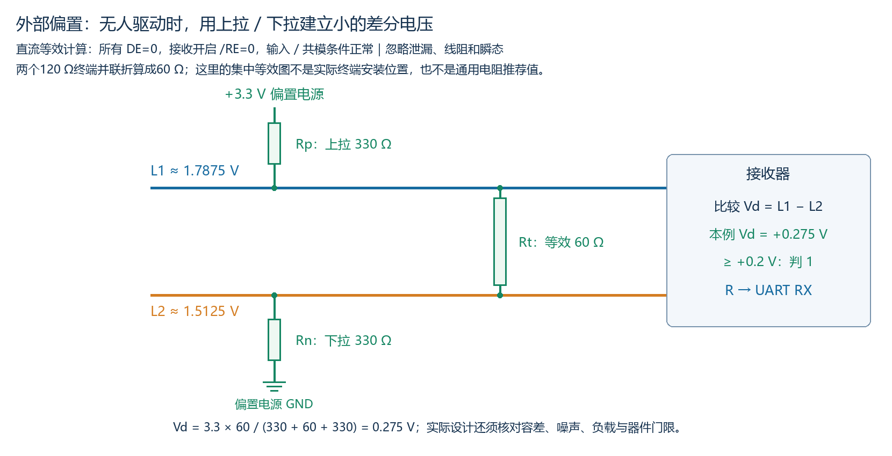

这是直流等效图，假定接收输入高阻、无泄漏和其他负载、无干扰、线阻与瞬态；输入/共模范围和供电正常。两个120 Ω终端仍实际各在主干一端，图中为计算方便折算为Rt_eq=120∥120=60 Ω，不表示应把两个终端搬到同一处。

电流依次经过上拉Rp、等效终端Rt_eq和下拉Rn。用电阻分压计算差分电压：

```text
I = Vcc / (Rp + Rt_eq + Rn)
Vd = I × Rt_eq
   = Vcc × Rt_eq / (Rp + Rt_eq + Rn)
```

本例Vcc=3.3 V，Rp=Rn=330 Ω，Rt_eq=60 Ω：

```text
I  = 3.3 / 720 A ≈ 4.583 mA
Vd = 3.3 × 60 / 720 = 0.275 V
L2 = I × Rn = 1.5125 V
L1 = L2 + Vd = 1.7875 V
```

0.275 V高于本例普通接收模型的+0.2 V门限，可在该理想条件下保证R=1。本组数值只用于推演，不是所有硬件的通用电阻推荐；设计还须核对供电/电阻容差、输入泄漏、节点和驱动负载、噪声与实际门限，留足余量。[TI外部偏置设计说明](https://www.ti.com/lit/an/slla272d/slla272d.pdf)

若偏置电阻太大，跨终端的差值可能不足；即使安装了上拉/下拉，也不能仅凭“有偏置”保证空闲判1。偏置太强又会增加负载，不能靠无限减小电阻来解决问题。本例使用一组偏置，不机械在每个设备上重复复制；实际多组方案须统一考虑它们的影响。

### 11. 内部失效保护：R输出1，不等于总线被驱动成+2 V

**失效保护（Fail-safe）**在这里指接收器能在其规定的无有效信号条件下给出确定逻辑输出。以[TI SN65HVD7x数据手册](https://www.ti.com/lit/gpn/SN65HVD75)为例，正常供电、接收开启/RE=0且输入条件合法时，接收器可在空闲/零差值等规定条件下保持R为高。其内部接收门限与保护机制不同于前述无保护的±0.2 V示例，不能把两套条件混用。

内部保护不通过开启发送驱动把总线推出+2 V。R是接收器到MCU UART RX的逻辑输出，与它比较的总线Vd是两个不同的量。

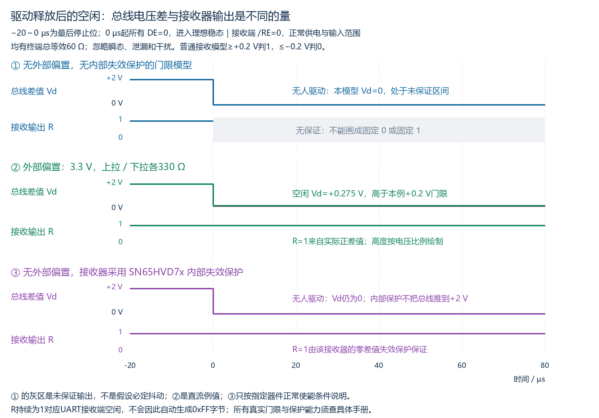

图规定−20～0 µs是最后停止位，0 µs起所有驱动释放，接收端始终/RE=0。为对比稳态，忽略传播、建立过程、泄漏及噪声，不把0 µs立刻达到稳态当作真实器件零等待要求；换向仍须遵循之前的时序条件。

| 本节情况 | 无人驱动时的Vd | R输出 | 原因 |
|---|---|---|---|
| 无外部偏置、无内部失效保护的门限模型 | 理想稳态0 V | 不保证0或1 | 差值处于该模型未保证区间 |
| 本例外部偏置 | +0.275 V | 1 | 实际差值超过普通模型+0.2 V门限 |
| 无外部偏置、指定器件内部失效保护 | 理想稳态0 V | 1 | 器件在规定零差值/空闲条件下给出高输出 |

看到R=1不能反推总线必为+2 V，或反推一定装了外部偏置。持续R=1表示UART RX保持空闲逻辑，不会因此自动收到0xFF字节；接收字节还需要起始位及完整帧。

内部失效保护的覆盖条件和噪声余量因器件而异；是否省略外部偏置应依据具体器件、网络与噪声条件，不从“芯片支持Fail-safe”推出所有接线/供电故障都能正确接收。终端、外部偏置和内部失效保护分别解决不同环节，也不能替代参考连接/共模条件，见第13～16节。

### 12. 偏置与失效保护自测及参考答案

**复习自测：**

1. 按本节理想直流模型，Vcc=3.3 V，两端终端各120 Ω，上拉/下拉各改为470 Ω。求无人驱动时Vd；对于无内部保护、Vd≥+0.2 V才保证判1的普通门限模型，能否保证空闲判1？
2. 无外部偏置、所有DE=0，带相应内部失效保护的SN65HVD7x正常供电、/RE=0、输入条件正常；测得Vd≈0而R=1。能否据R=1说总线上一定有+2 V差值？解释R=1来自哪个环节。

**参考答案（对应上面题号）：**

1. 两终端等效60 Ω，Vd=3.3×60/(470+60+470)=0.198 V；低于+0.2 V，不能保证该普通模型判1。不能因此说必判0，它仍处于未保证区间。实际设计还需容差和噪声余量。
2. 不能。R=1由接收器内部失效保护的输出判定保证，不意味着内部驱动器向总线施加了+2 V；总线差值与接收逻辑输出不同。

### 13. 电压相对谁测量：发送地GA与接收地GB

**信号参考地（Signal Reference Ground）**是接口电压测量与电路工作的参考节点。本节GA、GB分别指发送端与接收端RS485收发器的参考地；非隔离时通常与各自MCU本地地相连，隔离系统中总线侧地可能与MCU侧地分开。

两个远端设备使用不同电源或处于不同位置时，GA与GB的电位可能不同，称**地电位差（Ground Potential Difference）**。本节固定符号：

```text
ΔG = VGA − VGB
```

若GA比GB高6 V，ΔG=+6 V。发送端说“L1是3 V”，表示L1相对GA为3 V；接收器相对自己的GB看到的是：

```text
VL1（相对GB） = VL1（相对GA） + ΔG
VL2（相对GB） = VL2（相对GA） + ΔG
```

例如发送端L1/GA=3 V、L2/GA=1 V，ΔG=+6 V时，接收端看到9 V和7 V，差值仍是2 V。这里总线输入引脚有其规定的宽电压工作范围；它们与接到MCU的逻辑输出R是不同端口，不能据此把这些总线电压直接接到普通3.3 V MCU RX。

### 14. 共模电压与每个输入引脚的工作条件

**共模电压（Common-mode Voltage，Vcm）**是接收器两根输入相对其参考地的平均电压；**差分电压Vd**是这两个输入的电压差：

```text
Vcm = [VL1（相对GB） + VL2（相对GB）] / 2
Vd  =  VL1（相对GB） − VL2（相对GB）
```

给两根输入同加ΔG，Vd不变，Vcm会增加ΔG。差分接收能抵消一定范围内共同叠加的变化，**不等于输入可以相对本地地无限偏移**。[TI关于地电位差与共模条件的说明](https://www.ti.com/lit/an/slla272d/slla272d.pdf)

以[SN65HVD7x推荐工作条件](https://www.ti.com/lit/gpn/SN65HVD75)为例，每个总线输入引脚相对本端GND的输入范围为−7～+12 V，另有差分输入等条件需要满足。本课用该具体范围演示，其他器件应查自己的手册，不把此数值当作所有收发器的唯一范围。

当发送端此刻L1/GA=3 V、L2/GA=1 V时：

| ΔG | 接收端L1/GB | 接收端L2/GB | Vd | Vcm | 本例逐端输入范围 |
|---:|---:|---:|---:|---:|---|
| 0 V | 3 V | 1 V | +2 V | 2 V | 两个输入都满足 |
| +8 V | 11 V | 9 V | +2 V | 10 V | 两个输入都满足 |
| +10 V | 13 V | 11 V | +2 V | 12 V | L1超过+12 V，不满足 |

第三行平均值为12 V，仍不能只看平均值宣布所有输入条件满足：一个引脚已经13 V。应分别核对手册列出的逐端输入、共模、差分、供电/使能和时序等实际条件，而不是只算出差值正确。

共模值是两个输入的平均值；逐端输入条件检查的是**每个引脚自己的电压**。即使手册给出的数值区间看起来相同，也不能把“平均落在范围内”当成“两根输入各自都在范围内”。局部下限示意见下图：

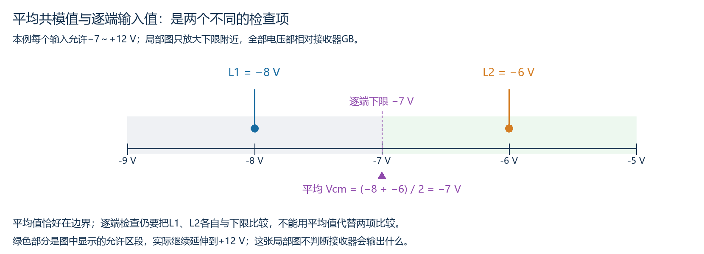

所有电压相对同一个接收地GB，两个原始输入和它们的平均值分别标出；绿色区间在图外继续延伸到+12 V。此图只区分检查项，不虚构越界后的输出逻辑或损坏结果。

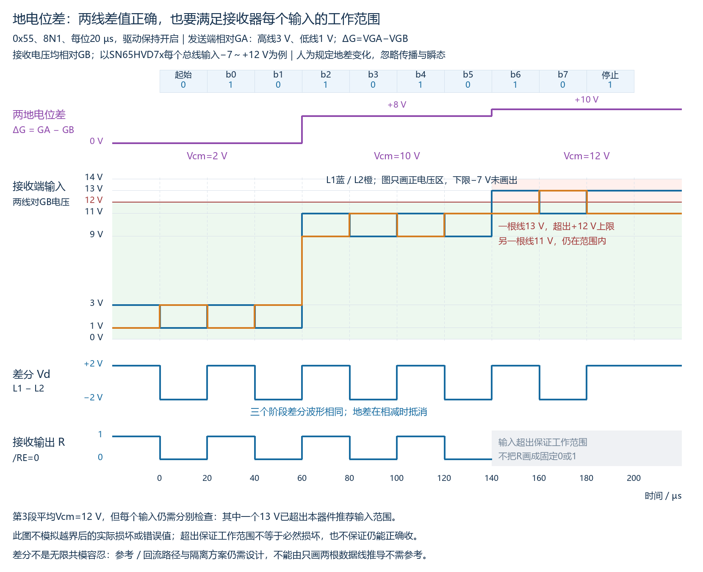

图采用0x55、8N1、每位20 µs；发送驱动一直开启，不涉及驱动释放，接收器/RE=0。人为规定接收端看到的ΔG在60 µs变为+8 V、140 µs变为+10 V，忽略传播、建立过程及边沿/地差变化的瞬态，不是实测或实际布线建议。因位值交替，第三段高电压13 V在L1/L2之间交替出现，但总有一个输入越界；R用灰区表示不再保证，未虚构它必然抖动、固定错误或器件损坏。

推荐工作范围给出正常功能保证条件；超出它不能再保证正常接收。是否损坏还涉及绝对最大额定值、应力与实际条件，不从“超出工作范围”直接断言一定烧毁，也不从“尚未烧毁”推出通信一定正确。内部失效保护、终端或偏置都不能替代输入工作范围要求。

### 15. 参考/回流路径与隔离：不靠“两线”三个字决定接地

“两线RS485”数的是两根差分数据线，不把参考连接计入该称呼。数据线对提供差分信号的电流回路，参考设计还应控制接收器相对本地地的电位与共模回流。非隔离链路需设计受控的参考/回流路径，使各节点地电位偏移、回流与输入条件处于允许范围。通过电源、设备结构或其他路径已经存在参考关系的系统，不能简单按“有没有单独第三根导线”判断全部条件。

信号参考地不自动等同于机壳或大地。对于可能存在地电位差的远端设备，也不能把“所有GND直接短接”当成无条件规则；地线回路可能带来电流和共同干扰，具体方案应按系统设计。[TI的接地与隔离章节](https://www.ti.com/lit/an/slla272d/slla272d.pdf)

**电气隔离（Galvanic Isolation）**通过隔离元件传递信号，让不同电气区域没有直接导电连接。RS485链路可把MCU侧与总线收发器侧隔开，并用隔离供电维持总线侧工作；通信信号、供电和参考关系都应一致地安排，不能由未隔离的旁路绕过隔离边界。


这是分区功能图，不是具体电路实现。隔离有助于处理本地两侧地电位差，但总线侧接收器仍有自己的供电和输入/共模范围，不能由“隔离了”推出总线输入无限容忍。面试阶段先能区分MCU侧地与总线侧地、说明隔离信号及供电的作用，不要求设计隔离电源或浪涌电路。

### 16. 参考地与共模自测及参考答案

**复习自测：**

仅判断本时刻的理想稳定输入；接收器供电、/RE=0等其他条件正常，本例每个总线输入允许−7～+12 V。

1. 发送端相对GA：L1=3 V、L2=1 V；GA比GB高6 V。接收端相对GB的L1、L2各是多少，Vd是多少？两个输入是否满足本例逐端范围？
2. 另一个场景，接收端相对GB测得L1=−8 V、L2=−6 V。Vd=−2 V、平均Vcm=−7 V。能否只凭差值正确、平均值处于范围内就保证正常接收？哪个输入条件需要注意？

**参考答案（对应上面题号）：**

1. ΔG=+6 V，接收端L1=9 V、L2=7 V，Vd=2 V；两个输入均在−7～+12 V内。满足这些数值条件不单独证明远端命令处理成功。
2. 不能。L1=−8 V低于本例逐端输入下限−7 V，即使平均值为−7 V且差值为−2 V，也不满足全部工作条件，不能保证正常接收；不因此断言一定损坏或固定输出某个值。

## M03-04：UART、RS485和Modbus如何配合

### 1. 从“读取1号温度传感器”看三者的分工

本节采用控制器发请求、传感器回响应的常见UART+两线RS485链路。**Modbus**是协议名称，不需要展开成一个英文缩写；**RTU（Remote Terminal Unit，远程终端单元）**在此表示Modbus串行通信的一种二进制传输模式。Modbus定义读写等操作及请求/响应内容；串行RTU报文还包含设备地址和CRC校验。[Modbus应用协议](https://www.modbus.org/file/secure/modbusprotocolspecification.pdf)、[Modbus串行指南](https://www.modbus.org/file/secure/modbusoverserial.pdf)

| 对象 | 在这个场景里具体做什么 | 不能仅凭它证明什么 |
|---|---|---|
| 控制器的Modbus软件 | 组成读请求：找哪个设备、读哪个数据项、读多少；计算CRC | 仅组出请求不证明线路已经发出 |
| UART硬件 | 将每个字节变成起始位、数据位、可选校验位、停止位组成的字符帧；接收端恢复字节 | 收到字符不证明命令、地址、整份报文校验有效 |
| RS485收发器及线路 | 在发送时把逻辑信号转换为差分信号，在接收时恢复逻辑信号 | 不理解“读温度”，不按Modbus地址屏蔽其他节点的接收器 |
| 传感器的Modbus软件 | 收集字节，检查报文及本机地址，解析请求，执行支持的操作并组织响应 | 仍需设备手册说明数据项的实际含义 |

软件要正确安排发送、等待完整结束、释放驱动、准备接收；层次关系不替代前面DE与/RE的控制。RS485支持使用自定义上层协议，也可承载Modbus；不能见到RS485接口就认定使用Modbus。[应用协议的通信媒体说明](https://www.modbus.org/file/secure/modbusprotocolspecification.pdf)

### 2. 一份具体请求，以及其中一个字节

假设传感器地址为1，且该设备手册把保持寄存器0x0000定义为温度数据项。**保持寄存器（Holding Register）**是Modbus向外提供的一类16位数据项，可由相应功能读取/写入；它不等同于前面控制UART等硬件的MCU外设寄存器。具体是否支持某操作以及数据比例、单位都查设备手册，Modbus没有规定所有设备的0x0000必须是温度。

读取该地址起的一个保持寄存器，可组成以下RTU请求（均为十六进制字节）：

```text
01 03 00 00 00 01 84 0A
```

| 字节 | 含义 |
|---|---|
| 01 | 目标设备地址1 |
| 03 | 功能码0x03：读取保持寄存器 |
| 00 00 | 起始数据地址0x0000，高字节在前 |
| 00 01 | 读取数量1，高字节在前 |
| 84 0A | 前六字节的CRC结果0x0A84，CRC低字节先发送 |

**CRC（Cyclic Redundancy Check，循环冗余校验）**根据报文字节计算校验值，接收软件重新计算并比较。它与UART逐字符的奇偶校验不同；本节只认识用途，不要求推导算法。示例CRC已按串行指南算法计算核对，属于教学计算，没有实际线路验证。[功能码0x03与请求数据格式](https://www.modbus.org/file/secure/modbusprotocolspecification.pdf)、[RTU报文与CRC规则](https://www.modbus.org/file/secure/modbusoverserial.pdf)

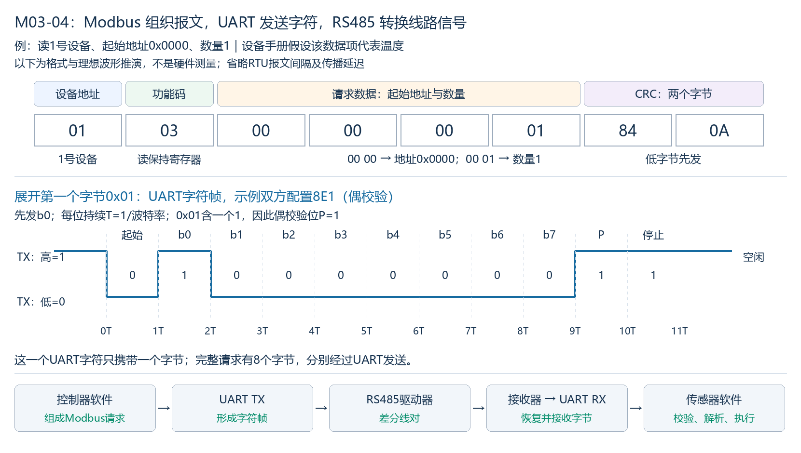

图中整个请求有8个字节；UART分别发送这些字节，**一个UART字符帧并不是整份Modbus报文**。以首字节0x01为例，双方配置8E1（8数据位、偶校验、1停止位）：起始0、b0到b7依次为1/0/0/0/0/0/0/0、P=1、停止1，共11个位时间。波形是UART TX逻辑信号，不是RS485某一根线的电压。

串行指南默认偶校验，无奇偶校验时规定两个停止位；具体设备配置仍按其文档匹配。完整RTU还用静默间隔区分报文，不能把最后一个UART停止位当作全部报文边界规则。本图只展开一个字符，不用它实现完整RTU收发状态机。[串行字符和报文规则](https://www.modbus.org/file/secure/modbusoverserial.pdf)

### 3. 层次关系自测及参考答案

**复习自测：**

1. 传感器UART已收到全部8个字节、未报告字符帧错误，但Modbus软件检查CRC不符。UART是否已把字节交给软件？软件能否直接把它当作有效Modbus请求执行？
2. 控制器把请求中的设备地址01改成02并正确重算CRC，其他条件正常。该修改属于RS485收发器硬件选择，还是软件报文选择？其他正常开启的节点接收器是否因此不会看到报文的字节？

**参考答案（对应上面题号）：**

1. 已交给软件，这是题设的UART收字节结果；不能直接接受并执行CRC不符的请求。UART字符接收和整份Modbus报文有效是不同条件；无字符帧错误也不证明字节未发生变化。
2. 属于软件组成报文及协议地址选择。RS485收发器不解析该地址；正常连接、接收开启的其他节点仍可接收字节，由协议软件识别目标地址并决定是否处理/响应。地址修改不是关闭其他节点接收硬件。

### 4. 非目标节点仍可接收字节，软件决定是否处理

在本节普通RS485+UART链路中，RS485接收器只比较差分电压，不解析Modbus设备地址。以下各节点共用同一差分线对，供电、接收使能、UART参数及线路条件均正常，查询期间仅控制器驱动，无另行配置的硬件地址过滤：


图中给2号的请求经过所有正常开启的节点接收器/UART；软件正常读取并校验报文后，2号识别地址匹配而处理，1/3号识别地址不同而跳过该单播请求。**“不处理、不回复”发生在软件处理阶段，不是接收器看不到字节。**报文地址修改也不自动改变其他节点的/RE或UART接收使能。

示意C片段：假设软件已取到完整的非广播单播请求，报文长度及CRC等均已检查通过，仅展开地址分支。

```c
if (request[0] != local_address) {
    return;  // 跳过这份请求的处理；接收器和UART仍开启
}
handle_request(request);  // 处理本机支持的有效请求
```

这是协议软件控制流示意，不是完整Modbus实现；不代表未经程序取数UART就会自动更新C变量，也没有主机或硬件运行验证。广播请求有单独规则，本例仅讨论发给一个地址的有效单播请求。

**复习自测：**

1. 同一正常总线有地址3和7两个节点，接收器/UART均开启且程序正常取数；控制器发出有效的、给7号的单播读请求。3号UART是否仍可收到字节？3号软件应否执行该请求并回复？

**参考答案（对应上面题号）：**

1. 3号UART仍可收到同一请求的字节；软件检查到本机地址不匹配，应跳过该单播读请求，不执行、不回复。共享线路硬件接收与软件地址选择是两个阶段。

### 5. 沿回复路径检查：信号和字节走到了哪里

设A为控制器、B为传感器，两线半双工请求/响应。A软件等待超时只表示在规定时间内没有取得符合其接受条件的回复；应沿同一次回复逐段确认信号或字节，缩小问题所在的位置。

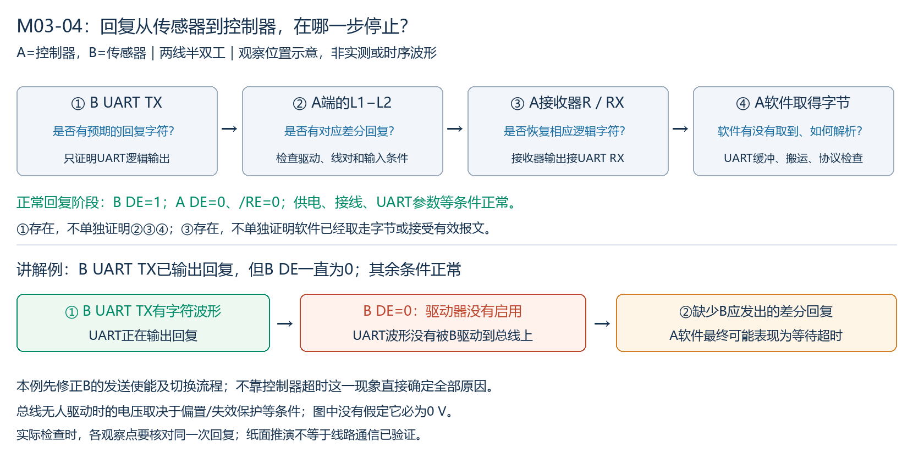

| 观察结果 | 下一段优先检查什么 |
|---|---|
| B UART TX没有预期回复字符 | B是否接受了请求、软件是否组成并提交回复、UART发送配置与引脚是否正确 |
| B UART TX有回复，但A端线对没有相应差分回复 | B发送阶段DE、收发器供电与连接、线对和负载等电气条件；TX波形不单独证明总线已驱动 |
| A端线对有预期回复，但A接收器R未正确恢复 | A的/RE、接收输入/参考范围、极性及收发器条件；不是仅看差值就忽略逐端范围 |
| R信号已到正确UART RX，但UART或软件未取得对应字节 | UART接收使能、实际时钟/波特率/帧配置、缓冲错误与读取、中断或DMA搬运 |
| 软件取得字节，却没有接受有效回复 | 字节是否完整且为本次回复、缓冲/组包、长度、地址、功能、CRC及设备数据约定；CRC失败本身不唯一指向软件或线路 |

实际检查可用示波器观察线路/电压及时序，用逻辑分析仪在电平适配的逻辑节点观察字符；软件侧查看UART标志、缓冲和取得的字节。解码结果还须与实际UART配置相符，不能把某一观察点有信号当成全部链路正确。此处是定位方法与纸面推演，暂无工具或硬件实验。

**具体讲解例：**B UART TX已输出回复字符，但B DE一直为0，其余条件正常。B驱动没有启用，UART字符没有被B驱动到线对；A软件最终可能等待超时。应修正B发送使能和完整收发切换流程。总线无人驱动时的电压由偏置等电路条件决定，不因此假定必为0 V。

### 6. 把前面学过的故障放回相应位置

- **只能发，接收不到：**发送后A应按流程释放驱动并开启接收。A DE=0、/RE=1只做到了释放驱动，接收器仍关闭；两者应分别检查。
- **末尾字符丢失：**检查释放驱动的时刻，是否只等原始DMA搬运完成或TXE，而没有等本次最后字符及停止位真正完成。时序及波形见M03-02，不能仅凭“丢末尾”排除缓冲、超时或上层长度问题。
- **总线有回复、程序读到旧值：**确认R波形、UART接收缓冲与实际取数途径。UART有字节而DMA未启动时，目标RAM不会因UART收到数据就自动更新；先检查本机搬运链路。
- **多个节点同时回复：**检查单播地址唯一性和回复权限、各DE时序。RS485不自动选一个节点获胜，协议地址也不在收发器里自动屏蔽非目标节点。
- **偶发乱码：**对照UART实际时钟/帧配置、方向时序、终端/支线/负载、偏置与输入范围，并区分接收缓冲溢出或解析错误。每个假设都应对应观察点和验证方法。

### 7. 基础故障定位自测及参考答案

**复习自测：**

1. A端总线有正确回复，A DE=0、/RE=1，供电、输入范围、接线和UART配置等其他条件正常。A接收器是否已开启？优先修正哪个信号，设成多少？
2. A UART硬件接收缓冲中已有回复字节；程序采用DMA取数，但从DMA目标RAM读到旧值，已知搬运没有启动。优先检查RS485终端还是本机搬运流程？RAM旧值能否证明传感器没有发送？

**参考答案（对应上面题号）：**

1. 没有，/RE为低有效接收使能，1表示关闭。应将/RE设为0，A DE保持0，以便在回复阶段开启接收并释放发送驱动。
2. 优先检查本机DMA请求/使能、通道映射、目标缓冲及启动流程等搬运环节；题设已有UART缓冲的回复字节，RAM旧值不能证明传感器未发送。DMA原始搬运与UART收/发完成、软件有效报文判断分别是不同事件。

## 全章复习速查与面试表述

| 主题 | 应能说明的关键机制 |
|---|---|
| RS485的职责 | 差分驱动/接收的电气要求；常见UART+两线RS485是串行、异步、半双工，异步来自UART方式 |
| 两线/四线 | 两线收发共享一对线、轮流驱动；真正四线需要两对线及独立收/发通路，不能只在半双工原端子上并接一对线 |
| 接收与回复 | 共线且接收正常开启的节点可收到同一请求，软件按单播地址决定处理/回复；收发器不自动解析Modbus地址 |
| 方向切换 | DE控制驱动，/RE控制接收；发送前启用驱动，等本次最后字符与停止位完成再释放驱动，回复阶段应准备接收 |
| 完成事件 | TXE、原始DMA搬运完成、函数返回不自动等于最后字符发送完成；标志与函数契约按芯片/API核对 |
| 终端与偏置 | 终端按线缆端点匹配、减少反射，额外终端会加重负载；偏置/内部失效保护用于无人驱动状态的确定接收 |
| 输入条件 | 差值正确不单独保证接收，还须满足各输入电压、共模/参考及供电/使能等条件，具体参数按手册 |
| UART与Modbus | UART处理字符帧；软件组织/检查Modbus请求，CRC不符不能直接执行，字符帧无错误不证明报文有效 |
| 基础排错 | 对照同一次回复，沿UART TX→差分线对→接收器R/UART RX→UART缓冲/软件取数→协议检查逐段找证据 |

**面试表述示例：**

> RS485是一种差分电气接口，常用于多节点通信。常见两线UART链路采用半双工，多个节点轮流驱动同一对线；UART负责字符帧，上层协议负责地址和请求内容。软件要正确控制DE和接收使能，在最后字符真正发送完成后释放驱动。线路设计还需考虑终端、偏置、支线和接收输入范围。通信异常时，应沿逻辑信号、差分线路、UART取数和协议处理逐段验证。

这段表述是复习示例。波特率、距离、节点数、电阻值和切换延迟都需结合器件与系统条件，不把本章理想模型当成所有RS485系统的固定规格。

## 资料入口

- [TI：RS485 设计指南](https://www.ti.com/lit/an/slla272d/slla272d.pdf)：标准范围、两线/四线结构、差分信号及布线与接收条件。
- [ADI：AN-960](https://www.analog.com/en/resources/app-notes/an-960.html)：RS485/RS422 差分接口及电路实现说明。
- [TI：SN65HVD7x 数据手册](https://www.ti.com/lit/gpn/SN65HVD75)：接收器比较极性、使能、具体门限和失效保护；本课不要求背器件引脚号。
- [Modbus组织：应用协议V1.1b3](https://www.modbus.org/file/secure/modbusprotocolspecification.pdf)及[串行指南V1.02](https://www.modbus.org/file/secure/modbusoverserial.pdf)：功能码、请求格式、RTU字符与报文、CRC规则。
- [ST：STM32F4 UART 标志定义](https://github.com/STMicroelectronics/stm32f4xx-hal-driver/blob/master/Inc/stm32f4xx_hal_uart.h)与[发送实现](https://github.com/STMicroelectronics/stm32f4xx-hal-driver/blob/master/Src/stm32f4xx_hal_uart.c)：TXE与TC分工及最后等待发送完成；其他MCU以自己的手册为准。
- [TI：AN-979 RS485实际限制](https://www.ti.com/lit/an/snla042a/snla042a.pdf)：主干、支线、星形连接与边沿条件；本课不把示例速度、距离或线长当成无条件限制。
- [ADI：高速信号连接中的传输线案例](https://www.analog.com/en/resources/technical-articles/interfacing-highspeed-signals.html)：传播延迟、源/负载反射和波形模型依据，供附图核对，不要求在本课推导全套传输线理论。
