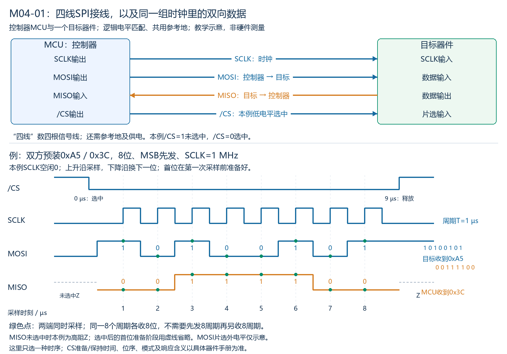
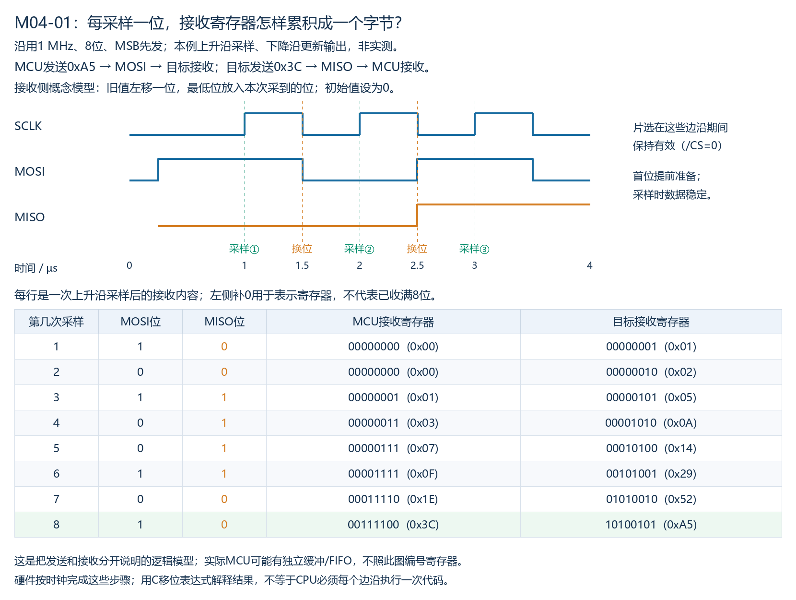
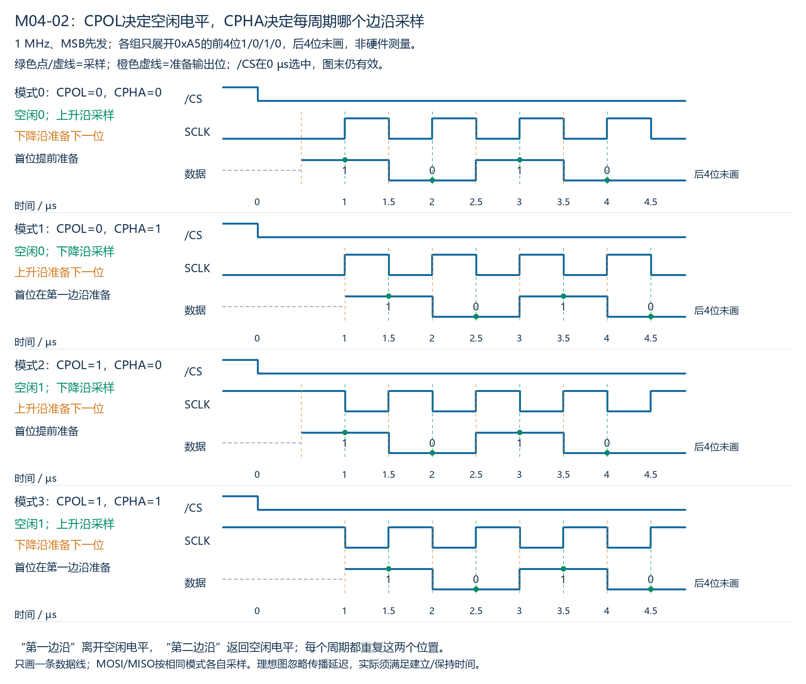
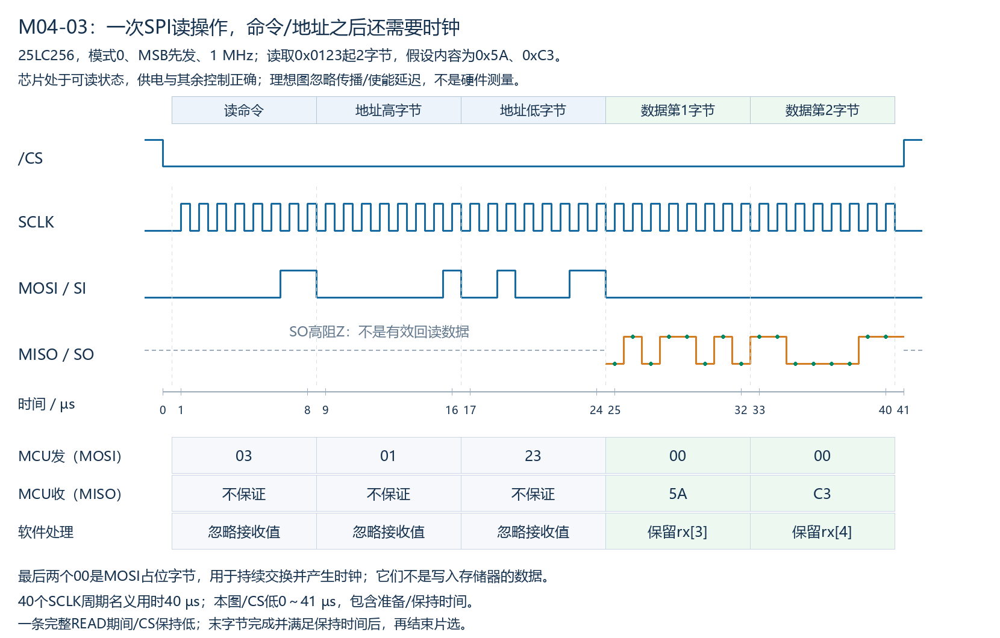
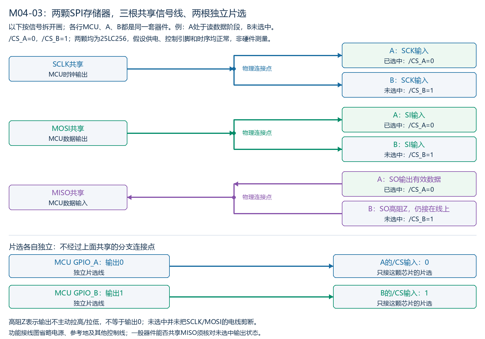

# M04：SPI同步串行通信

## 本章目标与当前范围

SPI（Serial Peripheral Interface，串行外设接口）常用于MCU与板上传感器、存储器等器件之间传输数据。本章以硬件SPI、一个控制器与目标器件为起点，理解接线、时钟、移位、采样与片选，再展开模式、命令和多设备。[ADI：SPI接口介绍](https://www.analog.com/en/resources/analog-dialogue/articles/introduction-to-spi-interface.html)

教材状态：已覆盖。本章首轮原理正文、接线/波形、各组自测答案与原理速查已整理。配套P009/P010范围及实际表现见练习进度；教材覆盖不表示全部内容独立掌握或经过硬件验证。

当前先学原理，暂停代码编写与代码分析。既有C片段保留为之后可选的实现参考，可直接跳过；本阶段以接线、波形、文字流程与场景判断为学习/验收依据。

本章采用器件无关的理想模型，不表示真实芯片已运行。逻辑电平匹配并共用参考地；位数、位序、片选极性、时钟模式和命令含义以目标器件手册为准。

## M04-01：四根信号线与双向交换

### 1. 先认识两个具体对象

假设MCU连接板上的温度传感器。MCU是**控制器（Controller）**，负责产生SCLK和控制片选；传感器是**目标器件（Target/Peripheral）**，被选中后依照控制器的时钟接收或提供数据。旧资料也将这两个角色称为Master和Slave，下面展开MOSI/MISO缩写时保留这些传统用词。

本节先研究位怎样传输；真正读取温度所需的命令、地址及等待阶段要看传感器手册，不由SPI四根线统一规定。

### 2. 四根信号线分别做什么

| 信号 | 英文名称 | 本节方向及作用 |
|---|---|---|
| SCLK | Serial Clock，串行时钟 | 控制器→目标，告诉双方按哪些时刻移动/采样数据 |
| MOSI | Master Out Slave In | 控制器输出→目标输入，传送控制器发出的数据 |
| MISO | Master In Slave Out | 目标输出→控制器输入，传送目标发出的数据 |
| /CS | Chip Select，片选；斜线表示本例低有效 | 控制器→目标，本例0选中、1未选中 |

MOSI/MISO按控制器角色确定名称。控制器的MOSI连接目标的数据输入，MISO连接目标的数据输出，不能只凭目标引脚也写“数据输出”就接到控制器MOSI。

“四线”指四根信号线，还要安排参考地和供电。接收器看到的是相对参考地的逻辑电平。本例电平兼容，不是将RS232或RS485线路直接接到SPI引脚。

### 3. 接线与一组完整的示例波形



图的条件：

- MCU预装发送字节0xA5；目标预装发送字节0x3C。这只是交换机制示例，不表示0xA5必定是某个传感器命令，也不表示目标能在尚未收完命令前立即计算并返回命令结果。
- 每方向8位，MSB（Most Significant Bit，最高有效位）先发；MOSI依次为1/0/1/0/0/1/0/1，MISO依次为0/0/1/1/1/1/0/0。
- SCLK频率1 MHz、周期1 µs。本例空闲为0，上升沿采样，下降沿换下一位；首位在第一次采样前准备好。这里只固定一种方式，其他模式随后讲。
- /CS在0 µs变低、9 µs变高，示例留有准备和保持时间；两端在1～8 µs的8个上升沿采样。绿色点是实际采用的采样点。
- 本例目标未选中时释放MISO为高阻Z，图中虚线也省略了选中后的首位准备过渡；不是把Z当0。MOSI片选外的电平仅为示意，不规定所有器件空闲必须为0或1。

### 4. 时钟怎样推动收发

1. 控制器选择目标，双方准备首位。
2. 在本例的第一次SCLK上升沿，目标采样MOSI的1，MCU采样MISO的0。
3. 在随后下降沿，双方把下一位送到各自输出线上；到下个上升沿再采样。
4. 重复至第8次采样，目标得到0xA5，MCU得到0x3C；控制器按时序完成时钟与片选结束。

硬件SPI内部用移位寄存器按时钟串行送出并接收位，不要求CPU为每一位执行一次发送函数。**同步**表示采用控制器提供的时钟约定数据采样时刻，不表示两端CPU同时运行某条C语句。仅拉低/CS不会自动产生时钟；本例目标不能独立把一个串行字节发送完。

本节普通四线SPI具有**串行、同步、全双工**的结构：两个方向各用一根数据线，在同一组时钟中同时交换。双方需要的有效业务数据不一定都在每个时刻存在，不能把某次收到的无效/占位字节当成完整命令结果。[ADI关于同步、双向收发及片选的说明](https://www.analog.com/en/resources/analog-dialogue/articles/introduction-to-spi-interface.html)

### 5. 八位双向交换要多少时钟

本例一个SCLK周期使两端各采样一位；8个周期，两端各收到8位。不是先发8个周期、再另用8个周期收，所以不能把全双工字节交换按16个周期计算。

只计算8个完整SCLK周期的名义用时：

```text
Tclk = 1 / fSCLK
t8 = 8 / fSCLK
```

1 MHz时为8 µs；2 MHz时为4 µs。一次事务还可能包含片选前后等待、字节间隔、命令和地址等额外部分，不能把8/f直接当成所有SPI操作总耗时。图中/CS低电平为9 µs，已经明确包含准备/保持时间，不等同于名义8周期时间。

本例8个数据位不添加UART字符帧的起始位、校验位和停止位。目标如何区分命令、地址、数据及一次操作边界，要结合SPI时序与器件协议，不能从“8位交换”推出任意器件都用一个字节完成读取。

### 6. 本节理解自测及参考答案

**理解自测：**

1. /CS已经为0，目标已准备好一个发送字节；其他配置正确，但控制器没有产生任何SCLK跳变。本例目标能否自行把8位送完，让MCU取得完整字节？说明原因。
2. 双方每方向8位，目标已预装发送数据，采用本节同时收发方式。SCLK改为2 MHz，只计8个完整时钟周期，不计片选前后等待。MCU发送一个字节并同时接收一个字节，需要8个还是16个周期？用时多少？

**参考答案（对应上面题号）：**

1. 不能。片选只选择目标，不能替代时钟；本例双方依照控制器给出的SCLK边沿采样和推进位，没有时钟跳变就不能完成这8位交换。不能从已选中、数据已准备好推出MCU已收到完整字节。
2. 8个周期，8/(2×10^6)=4 µs。每周期两个方向各传一位，两个8位字节共用同一组时钟，不是把发送和接收串行相加。

### 7. 移位寄存器：把一个字节逐位送出、逐位收进

**移位寄存器（Shift Register）**可理解为保存若干位、能按时钟将位移动的硬件。为看清方向，本节把发送和接收分成两个8位概念寄存器；实际MCU的内部移位通路、发送/接收缓冲或FIFO可能采用不同布局，不能把本节模型直接对应为CPU可访问的具体寄存器。

沿用MCU发0xA5、目标发0x3C的例子：

- 发送侧MSB先发，先把当前最高位送到输出线上；本例每次采样后，在随后的下降沿推进到下一发送位。
- 接收侧把本次采到的位纳入接收值。若初值为0，可用“旧值左移一位，再把新位放到最低位”描述。
- 上升沿时两端同时采样各自输入，不要求CPU在每个边沿运行一次C函数。



### 8. 接收值怎样累积（C表达式仅作后续可选参考）

原理是旧值左移一位，再把本次采到的0或1放进最低位。下列C表达式仅保留为后续可选参考，当前不要求阅读或分析；`sampled_bit`只能是0或1，`rx`为8位无符号值：

```c
uint8_t rx = 0;
/* 每采到一位，对应的数学更新为： */
rx = (uint8_t)((rx << 1) | sampled_bit);
```

这是说明硬件过程的表达式，不是要求CPU按SPI时钟逐位执行，也不是完整可运行的MCU程序。本节图示状态由绘图脚本的数值推演核对，没有C程序编译或硬件运行结果。

目标发出的0x3C按MSB先发为`0 0 1 1 1 1 0 0`。MCU从0开始累积：前两次仍为0；第3次变为1，第4次变为3，第6次为0x0F，第8次才得到完整的0x3C。**寄存器数值与已收到的位数必须一起判断**：前两次值为0，不表示没有采样；第6次值为0x0F，也不表示目标发送的完整字节就是0x0F。

同一时刻，目标在MOSI上收到MCU的位，按相同模型累积，8次后得到0xA5。这两个方向共用时钟、各自接收数据，接收内容不必等于本端发送内容。

本例要区分两类边沿：

1. **上升沿采样当前位。**接收方需要该位在采样边沿附近稳定；具体建立/保持要求按器件手册。
2. **随后的下降沿准备下一位。**输出位可能变0/1，也可能与上一位相同，因此某次“换位”不一定在线上产生电平跳变。

首位在第一次采样前预先准备，不等待第一次下降沿。本节的上升/下降沿分工只适用于当前选定时序，不能先套用到所有SPI模式；四模式下一节展开。

### 9. 逐拍移位理解自测及参考答案

**理解自测：**

沿用本节MSB先发、上升沿采样、下降沿准备下一位的规则。新例目标预装发送0xD2，MCU接收概念寄存器初值0，片选与其他条件正常。

1. 前3次上升沿采到的MISO位依次是什么？第3次采样后MCU接收寄存器是多少？此时是否已收到完整8位？
2. 第3个上升沿采样之后，目标应在该上升沿同时改变为第4位，还是在随后的下降沿准备第4位？为什么？

**参考答案（对应上面题号）：**

1. 0xD2=`11010010`，前三位是1/1/0，累积为1→3→6，接收寄存器为0x06；只采到3位，尚未得到完整8位，不能把0x06当成目标的完整发送字节。
2. 本例在随后的下降沿准备第4位。上升沿用于采样当前位，数据应在采样附近稳定；将输出推进放在另一个边沿，给下一次采样留出稳定时间。具体建立/保持要求仍需核对手册。

## M04-02：CPOL、CPHA与四种时钟模式

### 1. CPOL：时钟空闲时停在哪个电平

**CPOL（Clock Polarity，时钟极性）**决定SCLK空闲电平：

- CPOL=0：空闲为低；每周期先上升，再下降。
- CPOL=1：空闲为高；每周期先下降，再上升。

每周期**第一边沿（Leading Edge，先沿）**离开空闲电平，**第二边沿（Trailing Edge，后沿）**返回空闲电平。因此“第一边沿”不固定等于上升沿；CPOL也不决定片选的有效电平，片选仍按器件要求配置。[ADI的时钟极性与相位说明](https://www.analog.com/en/resources/analog-dialogue/articles/introduction-to-spi-interface.html)

### 2. CPHA：每周期在哪个边沿采样

**CPHA（Clock Phase，时钟相位）**决定采样放在每周期的哪一个边沿：

| CPHA | 接收采样 | 输出准备 |
|---|---|---|
| 0 | 每周期第一边沿采样 | 首位在第一个边沿前准备好；此后第二边沿准备下一位 |
| 1 | 每周期第二边沿采样 | 第一边沿准备本周期要采的位，包括首位 |

“第一/第二”在每个周期重复，不是整份字节只在第1或第2次时钟跳变采样。CPHA=0不固定表示上升沿采样；必须先由CPOL确定边沿顺序。

采样时数据需要满足建立/保持要求；输出事件画在另一边沿，是给数据稳定留出时间。相邻位相同时，准备下一位不一定产生电平翻转。具体延迟/时序仍按器件手册，不由理想图规定。

### 3. 组合成四种模式

| 模式 | CPOL | CPHA | SCLK空闲 | 接收采样沿 | 输出位准备沿 |
|---|---|---|---|---|---|
| 0 | 0 | 0 | 低 | 上升 | 下降，首位提前准备 |
| 1 | 0 | 1 | 低 | 下降 | 上升，包括首位 |
| 2 | 1 | 0 | 高 | 下降 | 上升，首位提前准备 |
| 3 | 1 | 1 | 高 | 上升 | 下降，包括首位 |

常见模式编号可写作`(CPOL << 1) | CPHA`。此前M04-01选定的“空闲低、上升沿采样、下降沿推进下一位”对应模式0。[四模式定义](https://www.analog.com/en/resources/analog-dialogue/articles/introduction-to-spi-interface.html)

### 4. 用同一数据前缀对照波形



各组均为SCLK=1 MHz，0 µs时/CS选中；只画0xA5的前4位1/0/1/0，后4位未画，图末片选仍有效，不表示4位就结束这个8位事务。绿色点/虚线表示采样，橙色虚线表示准备输出；数据有效前用灰虚线省略，不规定其逻辑值。

以模式2为例：CPOL=1，时钟空闲高，1 µs首先下降；CPHA=0要求该第一边沿直接采样，因此首位必须在1 µs之前稳定。1.5 µs上升沿准备第二位，2 µs下降沿再采第二位。

模式3同样空闲高，但CPHA=1：1 µs第一下降沿准备首位，1.5 µs第二上升沿才采首位。图中改变的是数据相对时钟的位置，不是随意把0/1数据取反。

由四模式定义可知，模式0/3虽同为上升沿采样，空闲和首位安排仍不同；模式1/2同为下降沿采样，也不能据此认定配置匹配。实际要按目标手册要求配置，不能仅以某个字节偶然读对确认模式正确；模式不匹配也不意味着每一个字节必定不同。

本图只用一根数据线表示规则，普通全双工中的MOSI/MISO各自遵守所配置的模式；图是忽略传播延迟的教学推演，没有硬件测量。

### 5. 四模式理解自测及参考答案

**理解自测：**

1. 目标手册要求SCLK空闲高、在上升沿采样。CPOL、CPHA分别是什么，属于模式几？
2. 另一场景CPOL=1、CPHA=0，第一下降沿就要采样首位。发送端能否等这个下降沿才准备首位？为什么？

**参考答案（对应上面题号）：**

1. CPOL=1；空闲高时先下降、后上升，上升沿是第二边沿，因此CPHA=1，模式3。
2. 不能。CPHA=0在第一边沿直接采样，首位应在该边沿前满足数据建立要求，并满足采样后的保持要求；不是到采样边沿才开始准备。本例下一位在随后的上升沿准备。

### 6. 配套波形应用

[练习进度中的P009](../练习进度.md)提供一张新的完整8位波形，保留位序、片选、实际采样点及时间刻度，用于判断模式、还原两向数据和计算时钟频率/名义用时。该题是当前知识应用，实际作答与提示程度记录在练习进度，不将题面或教师绘图本身记为完成练习。

## M04-03：命令、地址、数据与完整片选过程

### 1. 从“交换字节”走到“读取指定位置”

SPI提供移位与采样机制，具体器件才规定命令和字段含义。本节以Microchip **25LC256 EEPROM**为真实协议实例；**EEPROM（Electrically Erasable Programmable Read-Only Memory，电可擦可编程只读存储器）**能按器件流程写入并保存数据，本节只研究读操作。[25LC256数据手册，指令表及3.2节](https://ww1.microchip.com/downloads/aemDocuments/documents/MPD/ProductDocuments/DataSheets/25AA256-25LC256-256K-SPI-Bus-Serial-EEPROM-20001822J.pdf)

芯片SI（Serial Input，串行输入）接MCU的MOSI，SO（Serial Output，串行输出）接MCU的MISO。本例配置模式0、MSB先发、1 MHz，芯片当前可读、供电与其他控制引脚配置正常；暂不展开写入、写忙、写保护或保持引脚电路。

该芯片的READ操作先发8位指令0x03，再发16位地址，高字节先发；随后继续给时钟，SO依次输出该地址起的数据，地址自动递增，拉高/CS结束读取。地址序列的最高位在该芯片为don't care，本例置0。这里的命令/地址规则属于这款芯片，不能套成所有SPI设备的固定格式。

**本例目标：**从存储器内部地址0x0123开始读2字节。假设0x0123存有0x5A，下一地址0x0124存有0xC3。这些数据是教学假设，不是实测。0x0123是芯片内部位置，器件本身由片选选择，不是把这个数当作SPI总线节点地址。

### 2. 一条READ中的五次字节交换



| 交换次序 | MCU从MOSI发出 | MCU从MISO收到的含义 |
|---|---|---|
| 1 | 0x03，读命令 | 不是所需存储数据，忽略 |
| 2 | 0x01，地址高字节 | 不是所需存储数据，忽略 |
| 3 | 0x23，地址低字节 | 不是所需存储数据，忽略 |
| 4 | 0x00，占位 | 第一有效数据0x5A |
| 5 | 0x00，占位 | 第二有效数据0xC3 |

图中命令/地址阶段SO为高阻，MCU硬件即使采出某些值也不能把它们当作有效存储数据，不假定其必为0或0xFF。第4次交换已经在接收第一有效字节，不额外插入本例未要求的空读等待字节。[手册READ时序图与串行输出说明](https://ww1.microchip.com/downloads/aemDocuments/documents/MPD/ProductDocuments/DataSheets/25AA256-25LC256-256K-SPI-Bus-Serial-EEPROM-20001822J.pdf)

**占位字节（Dummy Byte）**在这里是MCU继续交换、产生接收所需时钟时同时从MOSI送出的内容，示例选择0x00。这些0不是向存储器写入0；目标当前执行的是READ，数据输出阶段不把SI上的这些占位内容作为写入数据。其他器件的读协议、额外等待周期及占位要求仍须查各自手册。

虽然CPU的目的只有读取，普通四线SPI仍需控制器推进时钟，通常以发送占位数据驱动全双工交换；具体MCU也可能提供专门接收模式，使用时依其外设规则，本节只采用明确的逐字节交换模型。

### 3. 片选保持与可选实现参考

从0x03开始，到最后需要的数据字节结束，/CS保持低；完成最后一位并满足芯片时序后再拉高。若命令与地址之间拉高/CS，便终止了原读取，后面再拉低不能默认从上次字段位置接着解析；不能把“每字节交换完成”直接当作“一次器件操作完成”。

以下实现片段仅作后续可选参考，当前可跳过；图与文字已经说明命令、地址、占位交换及有效数据位置，不以代码分析验收。定义一个抽象函数`spi_xfer8(tx)`：在已正确配置的硬件SPI上完成8位发收，等待本次8位传输真正完成后返回接收值，不自行切换片选。代码不是具体MCU可直接运行的驱动，实际还需配置、超时、错误和时序处理。

```c
uint8_t tx[5] = {0x03, 0x01, 0x23, 0x00, 0x00};
uint8_t rx[5];

cs_low();
for (size_t i = 0; i < 5; ++i) {
    rx[i] = spi_xfer8(tx[i]);
}
cs_high();  // 最后一位完成，并满足器件保持时间后结束片选

uint8_t first  = rx[3];  // 0x5A
uint8_t second = rx[4];  // 0xC3
```

前3个接收值按协议忽略，不等于硬件没有接收；这里用数组保留全部交换结果，是为了看清有效数据的下标。5次交换共40个SCLK周期，1 MHz下名义用时40 µs；图中/CS低0～41 µs包含准备/保持时间。C代码仅示意，图示位序/数据由脚本推演核对，没有C编译或MCU运行验证。

### 4. 读取流程理解自测及参考答案

**理解自测：**

沿用上述芯片、同一起始地址0x0123、模式及位序，芯片状态正常。

1. 如果只读1字节，MCU在同一次/CS低期间应依次交换哪些发送字节？共多少时钟？若用rx数组保存每次交换结果，保留哪个下标的有效数据？
2. 若程序每交换完一个字节就拉高/CS，再拉低交换下一个字节，能否把这些字节默认看成同一条完整READ？为什么？

**参考答案（对应上面题号）：**

1. 依次发0x03、0x01、0x23、0x00，4次8位交换，共32个时钟。有效数据在第4次交换，数组下标rx[3]；前3次接收值按协议忽略。
2. 不能。拉高/CS会终止原读取，再选中是新的指令序列，不能默认继续上次字段；本例命令、地址和所需数据须处在同一次有效片选中。具体边界始终按目标协议确认。

### 5. 多个目标器件：共享三根线，片选各自独立

在普通独立片选的连接方式中，控制器SCLK连接各目标的时钟输入，MOSI连接各目标的数据输入，各目标的数据输出连接同一条MISO；每个目标另有独立片选。[ADI的多目标普通连接方式](https://www.analog.com/en/resources/analog-dialogue/articles/introduction-to-spi-interface.html)

以两颗25LC256为例，分别命名A、B。下图为了避免交叉线误读，按信号拆开画；每行提到的A/B/MCU仍是同一套器件，并不是三套独立接口。假设正在A的数据输出阶段，A选中、B未选中。



| 普通单目标读事务 | /CS_A | /CS_B | 有效数据输出来源 |
|---|---|---|---|
| 读A | 0 | 1 | A在其读数据阶段输出，B释放SO |
| 读B | 1 | 0 | B在其读数据阶段输出，A释放SO |
| 都不访问 | 1 | 1 | 本例两颗SO均为高阻 |

A与B内部都可以存在地址0x0123，不因此冲突：片选决定本次访问哪颗器件，03/01/23中的地址字段再决定该器件内部的起始存储位置。换目标不是必须修改内部地址。

共享SCLK/MOSI表示两颗芯片引脚仍连接在同一导线上，未选中并没有把电线切断；片选让未选中的芯片不参与本次指令序列。不能把“不参与指令处理”理解成未选中引脚的电平绝不变化。

### 6. 为什么共享MISO需要未选中输出释放

25LC256手册明确：未选中时SO进入高阻，使多颗器件可以共享SPI总线。**高阻Z是不主动把线拉高或拉低，不是输出0。**A输出有效数据时，B虽然物理接在线上，但其SO高阻，不以相反电平驱动这条线。[Microchip手册第2.1节](https://ww1.microchip.com/downloads/aemDocuments/documents/MPD/ProductDocuments/DataSheets/25AA256-25LC256-256K-SPI-Bus-Serial-EEPROM-20001822J.pdf)

若误将两颗同时选中，它们都可能接收同一命令和地址。等两颗进入数据输出阶段，如果某一位A输出1、B输出0，就是两个输出试图将同一条MISO驱动到相反电平，产生争用，不能保证正确接收。这不是控制器能在输入端自动分离并挑选两份数据。

两颗同时选中不代表任意时刻都必定发生相反驱动：命令/地址阶段本例SO尚未输出数据，同值数据位也不是相反驱动。但普通独立读事务不能据此依赖多个目标同时输出。

对于其他SPI器件，要核对未选中时MISO是否释放、释放/使能时序及电平兼容性，不能仅凭接口名就把输出直接并联。若所有目标都释放且没有其他已知拉电平条件，也不能由高阻推出MISO固定为0或1。

### 7. 切换器件时还要切换对应配置

普通事务中先完成当前器件访问并按其时序取消片选，再选下一器件；需要改变模式或频率时，在各目标未选中的状态下，按控制器外设规则完成配置。共用同一SPI外设不表示各器件要求的模式、最高频率、位序与命令也相同。

本节用GPIO分别控制两个片选，不规定所有MCU必须采用同一种片选实现；若用硬件片选，仍需确认它在目标要求的完整命令/地址/数据过程中保持正确状态。

### 8. 多设备理解自测及参考答案

**理解自测：**

沿用两颗25LC256共用SCLK/MOSI/MISO、各自低有效片选，其他条件正常。

1. 要读B内部地址0x0123，/CS_A和/CS_B各设多少？地址高低字节还能是01、23吗，为什么？
2. 如果两颗都被选中并进入读数据输出阶段，某一位A输出1、B输出0，MCU能否保证正确接收？指出原因。

**参考答案（对应上面题号）：**

1. /CS_A=1、/CS_B=0。地址仍可为01、23；片选选择B，地址字段选择B内部0x0123，不需要为了区分芯片而改变内部位置。
2. 不能保证。两颗输出连接在同一条MISO上，试图驱动相反电平而发生争用；控制器不能把一根输入线上的两个独立输出自动拆成两份正确数据。

### 9. 配套器件读取应用

[练习进度中的P010](../练习进度.md)把上述规则组合到从目标B新内部地址连续读取的任务。当前原理阶段用模式、片选、发送序列、时钟数量和用时进行验收；原代码分析项不属于当前要求。器件规则来自手册，实际作答、范围调整和教师补充程度见练习记录。

## 全章原理速查与面试表述

| 主题 | 核心机制 |
|---|---|
| 四信号线 | 控制器提供SCLK与片选，MOSI向目标发送，MISO从目标返回；参考地/供电另行安排 |
| 同步与全双工 | 按约定时钟边沿采样；普通四线中同一组时钟可让两个方向各交换数据，业务内容是否有效由协议阶段决定 |
| 移位 | 最高位先发时，输出依次推进到下一位，接收值逐位累积；部分数值不等于完整字节 |
| CPOL/CPHA | CPOL定空闲高低，CPHA定每周期先沿或后沿采样；仅知道上升/下降采样不能唯一确定模式 |
| 首位 | CPHA=0首位在第一边沿前准备好，CPHA=1在第一边沿准备、第二边沿采样 |
| 片选与内部地址 | 独立片选选器件，命令中的地址选该器件内部位置；片选边界由器件协议定义，不自动每8位结束一次操作 |
| 读取与占位 | 先按器件协议发命令/地址，再继续时钟取得数据；MOSI占位内容在本例READ中不是写入数据 |
| 有效数据位置 | 命令/地址阶段即使收进一些值，也不当作所需存储数据；按阶段保留后续有效字节 |
| 多目标共享 | 普通独立读事务只选中目标；其他输出须按器件条件释放MISO，两个相反输出同驱一线会争用 |
| 用时 | 名义位交换时间按时钟周期数除以频率计算；命令、地址、占位/数据都要计入，片选等待/软件空档另计 |

本章两字节读取示例中，五次交换依次为命令、地址高、地址低、数据1、数据2；P010三字节场景则有六次交换，后面三次才是有效数据。一次完整读取期间保持目标片选有效，完成全部所需位并满足器件时序后结束。

**基础原理排错方向：**

- 没有预期数据时，沿片选、实际SCLK、MOSI命令/地址、MISO及接收阶段检查，不能只凭一个固定返回值下唯一结论。
- 数据错位或内容异常时，对照模式、位序、时钟频率/器件时序、地址拆分和有效数据阶段；高频超出条件可能减少稳定余量，不是只改一个配置值就保证所有问题解决。
- 多器件时，检查非目标片选与MISO释放条件；片选每字节翻转、把命令/地址阶段接收值当数据，都是与原理有关的检查方向，不要求通过代码题才能说明。

**面试表述示例：**

> SPI是同步串行接口。普通四线连接由控制器提供时钟和片选，MOSI、MISO分别承载两个方向的数据。CPOL决定时钟空闲电平，CPHA决定每周期在哪个边沿采样。实际读写还要遵守器件定义的命令、地址、数据与片选边界；读取时控制器需继续提供时钟，接收值也要按协议阶段判断是否有效。多个器件通常共用时钟和数据线、各自片选，未选中输出能否释放必须核对手册。

## 资料入口

- [ADI：Introduction to SPI Interface](https://www.analog.com/en/resources/analog-dialogue/articles/introduction-to-spi-interface.html)：四线接口、信号方向、同步收发、片选及模式示例。实际器件的位数、最高频率及命令仍需查相应手册。
- [Microchip：25AA256/25LC256数据手册](https://ww1.microchip.com/downloads/aemDocuments/documents/MPD/ProductDocuments/DataSheets/25AA256-25LC256-256K-SPI-Bus-Serial-EEPROM-20001822J.pdf)：指令表、3.2节READ及对应时序图；本章读取实例的规则来源，内存内容为教学假设。
