# M05：IIC（I²C）同步串行总线

本章首轮原理内容已覆盖：开漏/上拉、START/STOP、字节与应答、寻址和寄存器访问、重复起始及连续读取、拉伸/仲裁、地址冲突、NACK与总线恢复；含波形、自测答案及全章速查。当前只学原理，不安排代码编写或分析；教材覆盖不等于已完成硬件实践或长期掌握验证。

## 一、本章目标与结构模型

I²C是 **Inter-Integrated Circuit** 的缩写，意为集成电路之间的通信；常写作I2C、IIC，读作“I squared C”。它常用于MCU与传感器、EEPROM等器件之间的板内通信。

本章后续目标是读懂一次完整寄存器访问，知道每个阶段谁控制数据线、谁应答，并分析地址和线路异常。

I²C是串行、同步通信。普通双向I²C用一根共享数据线轮流传送两个方向的数据，属于半双工；两根信号线中的另一根是时钟线，不是第二条独立数据通道。本章先以一个控制器、多个目标器件的普通开漏总线为范围，不涉及特殊单向推挽模式。

| 名称 | 英文 | 作用 |
|---|---|---|
| SDA | Serial Data | 串行数据线，控制器和目标器件按阶段轮流发送/接收 |
| SCL | Serial Clock | 串行时钟线，控制传送节奏 |
| 控制器 | Controller，旧资料常称Master | 通常由MCU承担，发起通信并产生时钟节奏 |
| 目标器件 | Target，旧资料常称Slave | 例如传感器，按寻址及访问要求参与通信 |
| GND | Ground | 信号电压的共同参考地 |

控制器/目标器件是总线角色，发送方/接收方会随阶段改变。控制器读传感器时，传感器发送数据，控制器接收。SCL也采用共享开漏模型；某些目标器件能将其保持为低，时钟拉伸机制留后续解释，不能理解成所有时刻只有MCU能影响SCL。

## 二、共享接线解决什么问题

例如，一颗MCU要访问两个传感器。三个器件的SDA接到同一条SDA，SCL接到同一条SCL。

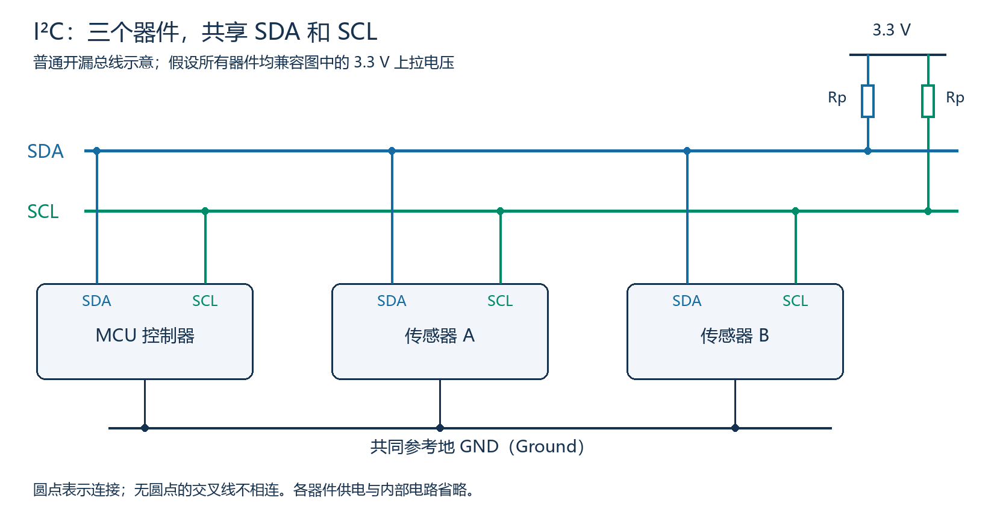

图中每条信号线各用一只Rp上拉电阻，连接到3.3 V。假设这些器件均兼容该电压；3.3 V是本例条件，不是I²C固定电压。图中未画器件供电和内部电路，不是可直接照抄的完整硬件原理图。

- “两线”指SDA和SCL两根信号线，实际系统还需要供电和信号参考地。
- 普通连接中，不必为每颗传感器单独增加片选线；控制器在总线上发送设备地址来选择目标，地址格式后续讲。
- 所有器件都连着共享线，寻址不会把其他器件物理断开；未轮到发送的器件应释放相应输出。
- 图示每线一只上拉表示一套简单接法。现成模块可能已经带上拉，不能无条件逐节点重复增加；阻值、并联后的等效值和总线负载需要核对。

## 三、开漏怎样让多个器件共享线路

**Open Drain：开漏。**先把每个输出理解为一个“接向地的可控开关”：实际电路通常使用晶体管，这里只看功能。

| 器件动作 | 内部下拉开关 | 对线路的作用 |
|---|---|---|
| 拉低 | 接通 | 将线路拉到接近0 V，表示逻辑0 |
| 释放 | 断开 | 输出呈高阻，不再主动拉低；不等于主动输出高电平 |

接收输入仍连接着总线。因此器件释放输出后，还能观察线路实际是高还是低。

在本章普通开漏模型下：

- 要发送0，当前发送方拉低线路。
- 要发送1，当前发送方释放线路；只有其他器件也都释放，且有正常上拉和足够上升时间，线路才能达到有效高电平。
- 只要任意一个器件仍拉低，总线就保持低；不会把两个器件的“0”和“1”平均成中间值。

按“释放为1、拉低为0”的逻辑关系，可以称为 **wired-AND，线与**。它描述共享线路的电气结果，不代表任意器件可以不遵守通信阶段随意发送；具体发送权限和仲裁后续讲。

## 四、上拉电阻到底在做什么

**Pull-up Resistor：上拉电阻**，Rp是图中符号。

没有器件下拉时，上拉提供一条通向电源的路径，将线路拉高。器件下拉时，电流路径为：

```text
3.3 V → Rp → SDA或SCL → 正在导通的下拉开关 → GND
```

此时Rp限制电流，使器件可以将线路拉低。不能用导线直接代替Rp连接电源；否则器件下拉时会形成电源到地的低阻通路。

移除一条线的全部上拉，且没有其他已知上拉来源后，全部设备释放也不能保证该线为高电平；不能依靠偶然测到的高电平认定接法正确。下拉仍可使线变低，但线路缺少可靠回到高电平的机制。

线路、引脚具有电容。最后一个下拉开关断开后，上拉电阻给总线电容充电，因此电压逐渐升高。电阻太大或电容太大，会使上升过慢；电阻太小又增加下拉电流。没有适用于所有总线的固定上拉阻值，具体选择需结合器件电流能力、电平门限、总线电容及速率要求。本节先理解机制，不展开阻值设计。

## 五、从波形看“释放”与“线变高”的区别

下面只取MCU和传感器B观察SDA，其他器件均释放。上方两行表示器件的下拉动作，不是两根独立的数据线；最下方才是那一根共享SDA的电压。

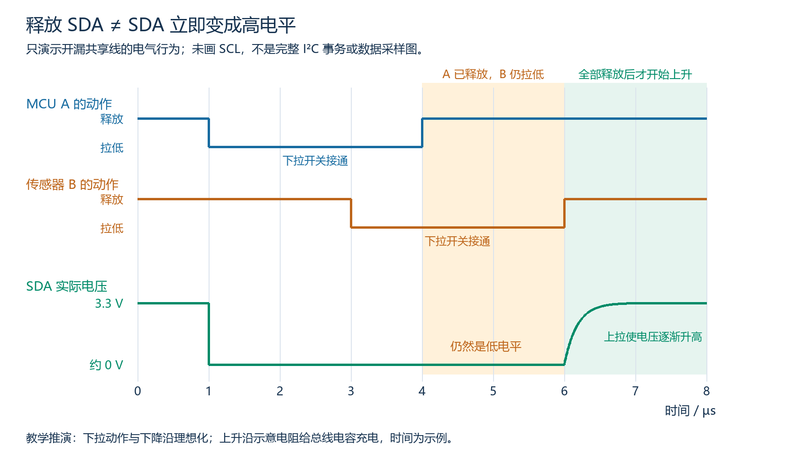

这是一段电气教学推演，未画SCL，不表示完整I²C事务，也没有数据位采样点。下拉动作和下降沿理想化，上升沿示意电容充电；时间仅为示例，未进行硬件测量。

| 时间 | MCU动作 | 传感器B动作 | SDA结果 |
|---|---|---|---|
| 0～1 µs | 释放 | 释放 | 已被上拉为高 |
| 1～3 µs | 拉低 | 释放 | 低 |
| 3～4 µs | 拉低 | 拉低 | 低 |
| 4～6 µs | 释放 | 拉低 | 仍然低；MCU释放不能使B的下拉失效 |
| 6 µs以后 | 释放 | 释放 | 上拉开始使线电压升高，经过上升过程达到有效高电平 |

关键结论：**软件/外设想发送1、输出已释放、引脚实际读到1，是三个需要区分的状态。**在普通总线空闲状态，SDA、SCL通常都由上拉保持为高；“某一条线已释放”本身不足以证明总线空闲。完整的空闲、START和STOP判读留下一节。

## 六、本节常见混淆与观察点

| 说法或现象 | 正确理解/检查方向 |
|---|---|
| 开漏写1就是主动输出电源电压 | 开漏的1对应释放，高电平由上拉建立，还取决于其他器件和上升时间 |
| MCU释放后读到0，所以MCU必然损坏 | 也可能是其他器件下拉、对地短接或上升未完成，需进一步观察 |
| 一个拉低、另一个释放，会形成推挽高低争用 | 释放不主动驱动高；普通开漏共享线的结果为低 |
| 为了更快升高，直接把信号线接电源 | 下拉时会形成电源到地的低阻通路，需使用合适上拉电阻 |
| 两根信号线就等于两个数据方向能同时传输 | SCL传时钟，两个数据方向共用SDA，按阶段轮流传送 |

## 七、复习自测与参考答案

本组用于教材后续自查，不自动作为已完成练习；当前聊天中的理解检查另记练习进度。

1. SDA和SCL的英文及作用是什么？“两线”是否表示不需要地和供电？
2. 控制器释放SDA，但传感器仍下拉，实际线路是什么状态？控制器还能观察线路吗？
3. 所有器件都释放SDA，但该线全部上拉已移除且无其他已知上拉，能否保证逻辑1？
4. 为什么最后一个器件释放后，线路也不一定立即达到有效高电平？
5. 能不能用一根导线代替Rp直接把SDA接到电源？

参考答案：

1. SDA是Serial Data，传送串行数据；SCL是Serial Clock，提供传送节奏。“两线”只计这两根信号线，实际仍需供电和信号参考地。
2. 实际为低，因为传感器仍下拉。控制器的输入仍能观察总线，释放输出不等于断开接收输入。
3. 不能。全部释放只表示没人主动拉低，缺少可靠的拉高路径时不能保证高电平。
4. 上拉需要给总线电容充电，上升有耗时；达到有效高电平还需满足器件门限与时序条件。
5. 不能。器件下拉时会使电源经低阻路径接向地；Rp既提供拉高路径，也限制下拉时的电流。

## 八、START、STOP与数据有效规则

### 8.1 为什么需要开始和停止条件

多个器件共用线路，接收方需要知道何时开始一轮通信、何时结束。I²C用SDA和SCL之间的特定变化关系表示这些边界。

| 场景 | SCL状态 | SDA的变化或要求 | 含义 |
|---|---|---|---|
| START，开始条件，记S | 保持高 | 高变低 | 开始通信；重复起始另见后续 |
| STOP，停止条件，记P | 保持高 | 低变高 | 结束当前事务 |
| 普通数据位的准备阶段 | 低 | 可以按下一位需要改变，也可不变 | 准备下一位 |
| 普通数据位的有效阶段 | 高 | 必须保持稳定 | 该时钟脉冲传送的位值 |

START/STOP由控制器产生。在普通开漏模型下，产生START时先确认SCL实际为高，再把SDA拉低；产生STOP时先将SDA保持低，释放SCL并确认其实际为高，再释放SDA使其升高。仍需满足规范的建立、保持等时序要求，不是只看软件已发出释放动作。

START/STOP是两根线配合形成的**条件**，不是UART那种固定占一个位时间的起始位/停止位；不作为普通数据位计数。一个事务可包含多个字节，不是在每个字节前后都套一次START/STOP。字节后的应答后续讲解。

### 8.2 直接看三段局部波形

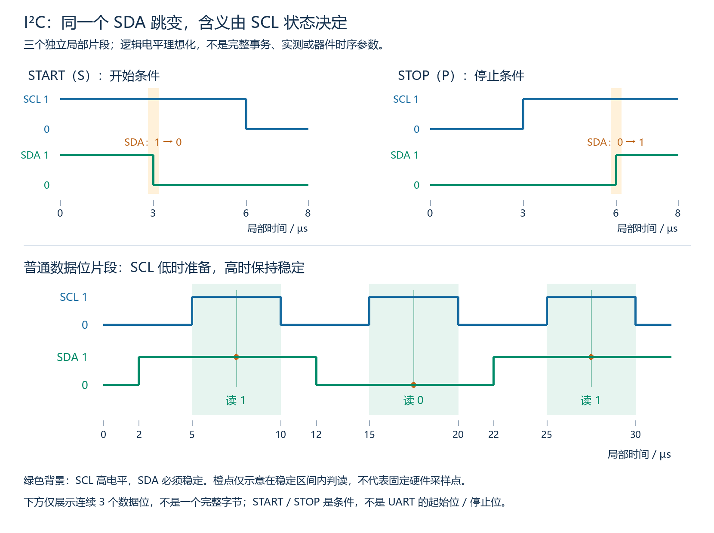

上方两图、下方数据片段是三个独立片段，局部时间各自计数。波形是理想化逻辑示意，不是实测，也不是标准模式的参数示例；未展示一个完整事务。橙点仅示意在稳定区间内判读，不规定所有硬件的固定采样时刻。

1. 左上：SCL保持高，3 µs时SDA从1降到0，形成START；随后6 µs时控制器把SCL拉低，进入后续传送准备。
2. 右上：先使SCL在3 µs升高，SDA继续保持低；到6 µs时SDA升高，形成STOP。
3. 下方：在2、12、22 µs改变SDA时，SCL均为低。接下来的三个SCL高电平区间分别为5～10、15～20、25～30 µs，SDA分别稳定为1、0、1，因此这三个数据位依次为101。

每个普通数据位对应一个SCL时钟脉冲。不能只数SDA跳变：连续两个相同数据位之间，SDA不必改变，但仍需各自的时钟脉冲。数据还需满足SCL上升前的建立时间和相应保持时间；“低时可改变”不表示紧贴边沿任意改变都符合实际器件时序。

### 8.3 为什么普通数据不能在SCL高时改变

在SCL高时把SDA从1改成0，会形成START条件；从0改成1，则形成STOP条件。接收器可能按控制边界处理，不能把这种变化仅理解为正常修改当前数据位。

普通总线空闲时SCL、SDA都为高，但抓到一个“两线均高”的瞬间不能独自证明空闲，因为正常传送数据1时也会出现两线均高。需结合前后的START/STOP及总线空闲时间要求判断，不能只看截图中某一点。

### 8.4 本段复习自测与参考答案

1. SCL高时SDA下降、SCL高时SDA上升，分别表示什么？
2. 下方数据图中12 µs的SDA下降是否为START？这三个普通数据位是什么？
3. 如果把下方图中12 µs的下降延迟到17 µs，为什么不能当成合规的数据准备？
4. 两个连续数据位都是1，需要SDA在中间先降再升吗？看到两线同时为高能否断定空闲？

参考答案：

1. 分别是START开始条件和STOP停止条件，判断必须同时考虑SCL状态。
2. 不是，因为该时刻SCL为低，属于准备下一位；三个数据位依次为101。
3. 17 µs位于SCL高电平区间15～20 µs，SDA从1下降为0会形成START条件，也违反普通数据高电平期间保持稳定的要求。
4. 不需要，SDA可持续为高，两个位仍各有一个时钟脉冲。不能仅凭瞬间两线均高认定空闲，正常数据1的高时钟阶段也是如此。

## 九、8位字节与第9个时钟：ACK/NACK

### 9.1 字节怎样发送

I²C每个字节有8个数据位，以 **MSB（Most Significant Bit，最高有效位）先发**，即b7→b6→…→b0。每个字节之后还有第9个应答时钟；这一位不是第9个数据位，也不是奇偶校验位。

例如0xA6的二进制是1010 0110，在线路上的发送顺序是1、0、1、0、0、1、1、0。控制器产生全部9个时钟，包括应答时钟；即使控制器正在接收传感器的数据，也仍由控制器提供时钟节奏。

### 9.2 谁负责第9位

**ACK：Acknowledge，应答，SDA为低。NACK：Not Acknowledge，非应答，SDA为高。**

前8位的发送方完成字节后，必须在第9个时钟之前的低电平阶段释放SDA，让该字节的接收方作出响应：

| 接收方的响应 | 接收方动作 | 正常线路在第9个时钟高电平时的SDA |
|---|---|---|
| ACK | 拉低SDA，并在该高电平期间保持低 | 0 |
| NACK | 不拉低SDA，保持释放 | 1，由上拉建立 |

这里假设发送方已正确释放、有正常上拉、其他器件不干扰，且电平/时序满足要求。不能把“接收方想NACK”与“实际线路必然为高”无条件等同。

第9个时钟结束后先回到低电平，再按后续阶段交接线路；不能在SCL仍为高时提前释放ACK而意外形成STOP。ACK/NACK也不代替START/STOP。

### 9.3 写入0xA6并收到ACK的局部波形

假设MCU已经选中传感器，正在传送一个写数据字节。寻址、START与STOP在此图中省略，只展示该字节局部。

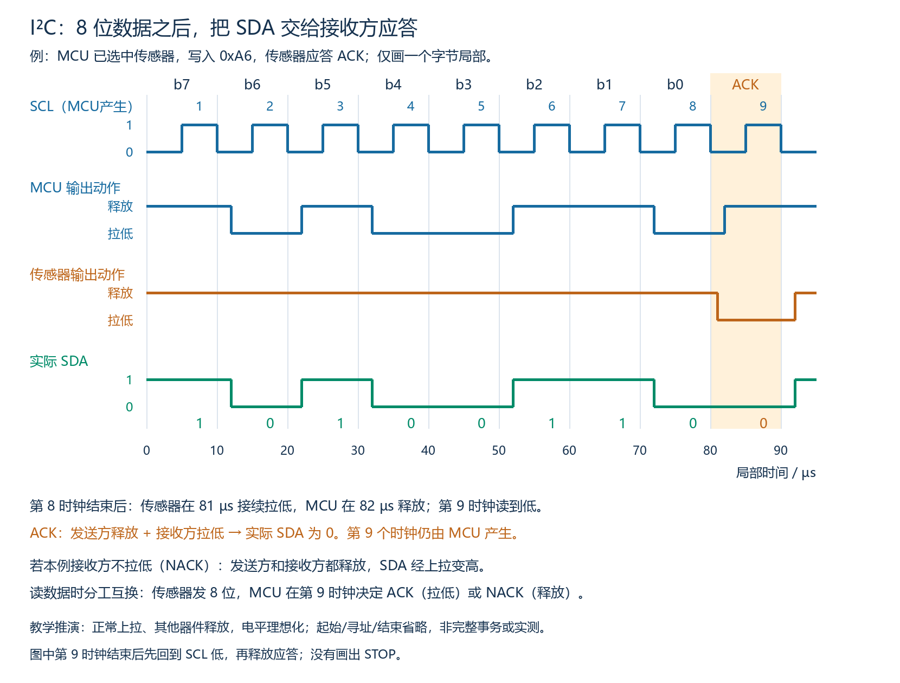

图中上方是SCL；中间两行是两个器件各自的输出动作；最下方才是共享SDA。三者的关系为：

1. 前8个时钟，MCU按10100110拉低或释放，传感器释放输出并读取线路。
2. 第8个时钟在80 µs结束，SCL回到低。传感器在81 µs开始接续拉低，MCU在82 µs释放；两者交接期间都拉低不会产生推挽高低争用。
3. 第9个时钟高电平区间为85～90 µs。MCU已释放，传感器拉低，因此实际SDA为0，MCU读到ACK。
4. 第9个时钟结束后，SCL先回到低，传感器再在92 µs释放。这里只是应答结束，图中没有画出STOP。

如果传感器在第9位不拉低，其他条件正常，MCU在82 µs释放后SDA经上拉变高，第9个时钟读到的就是NACK。教学图电平理想化、时间为示例，没有硬件测量，也不代表某个具体器件的动作延迟。

### 9.4 应答由接收方给出，不固定由目标器件给出

| 当前传送的字节 | 前8位发送方 | 第9位响应方 | 时钟产生方 |
|---|---|---|---|
| MCU写一个字节给传感器 | MCU | 传感器 | MCU |
| 传感器返回一个数据字节给MCU | 传感器 | MCU | MCU |

控制器连续读取、还要后续字节时，通常在收到当前字节后ACK；接收最后一个字节后用NACK表示不再继续接收，随后按流程STOP或重复起始。NACK不一定代表故障，读取最后一字节时是正常结束接收的信号；完整读流程后续专门画图。

写入或寻址时出现NACK，则可能是无对应接收器、器件忙、不能接受数据等，需要结合阶段判断。ACK本身也不能证明应用动作完成、非易失存储写入完成或内容具备端到端校验；应依据具体器件协议确认。

如果前8位发送方错误地继续把SDA拉低，即使接收方想NACK而释放，线路也会是0，发送方可能读到假的ACK。因此第9位的“发送方释放”是必要规则，不能仅检查第9位有没有低电平。

### 9.5 本段复习自测与参考答案

1. 0xA6在I²C线上按什么位序发送？计入应答需要多少个时钟？
2. MCU写一个字节后，第9位谁释放、谁可拉低？第9个时钟由谁产生？
3. MCU读取传感器的最后一个数据字节后，谁发NACK，电气动作是什么？
4. 发送方第9位错误地下拉，接收方释放准备NACK，线路会怎样？

参考答案：

1. MSB先发，依次10100110；8个数据时钟加1个应答时钟，共9个。不计START/STOP或等待耗时。
2. MCU作为该字节发送方释放SDA，传感器作为接收方可拉低给ACK，或保持释放给NACK；时钟仍由MCU产生。
3. MCU是此数据字节的接收方，保持释放SDA表示NACK；传感器也应释放，由上拉建立高电平。NACK后还需按事务流程产生STOP或重复起始。
4. 线路仍为低，发送方可能误读成ACK。这不是有效的接收方应答，属于发送方未按要求交接SDA。

## 十、M05-02：7位设备地址、读写位与寄存器地址

### 10.1 先分清“哪颗器件”和“器件内部哪里”

**Device Address：设备地址**，用于在共享I²C总线上选择目标器件。**Register Address：寄存器地址**，用于选择目标器件内部要访问的位置。

假设两个虚构传感器共用总线：

| 器件 | 7位设备地址 | 器件内部位置 | 本例该位置的值 |
|---|---|---|---|
| A | 0x48 | 寄存器0x02 | 0x35 |
| B | 0x49 | 寄存器0x02 | 0xA7 |

要访问A内部的0x02，需先选A，再按A手册指定内部位置0x02。B内部也有0x02并不造成设备地址冲突，它们分别属于不同器件的内部空间。0x02是位置编号，0x35/0xA7是该位置存放或返回的内容，三者不能混为一谈。

这些地址不是CPU的C变量地址，也不是线路上的电压。设备地址由具体器件设计规定，有的固定、有的可由地址引脚或配置改变，不能在MCU中任意写一个地址就让目标自动改地址。

寄存器访问是器件自身的协议约定，并非所有I²C器件都采用“一个8位寄存器地址”的模型。有的使用多字节内部地址、命令或固定数据流，是否自动递增也需查器件手册。

### 10.2 START之后的第一个字节

在本课普通7位寻址中，控制器产生START后发送：

```text
第1～7位：a6 a5 a4 a3 a2 a1 a0  → 7位设备地址
第8位：  R/W                   → 本次访问的读写方向
第9时钟：ACK/NACK              → 由被寻址的目标器件响应
```

**R/W：Read/Write，读/写。**方向以控制器为参照：0表示控制器向目标写，1表示控制器从目标读。

这里的第8位是读写位，不属于7位设备地址；第9位是应答，不属于首字节的8位。10位寻址另有格式，本阶段不展开。7位字段有128种编码，但存在保留地址，不能推导为无条件可挂128颗普通器件。

### 10.3 为什么0x48会变成0x90或0x91

7位地址0x48的二进制按7位写为1001000，读写位加在它的右侧：

| 访问 | 地址7位 | 读写位 | 完整8位首字节 |
|---|---|---|---|
| 写A | 1001000 | 0 | 10010000 = 0x90 |
| 读A | 1001000 | 1 | 10010001 = 0x91 |

数值关系：**写首字节 = 7位设备地址×2；读首字节 = 7位设备地址×2+1。**这是在线字节的组成说明，不是要求当前编写代码。

反向核对时，去掉完整首字节最右侧的R/W，剩余7位应当等于题设设备地址。更换寄存器地址或写入数据，不应改变同一目标的设备寻址字段。

0x90与0x91是同一设备地址配不同方向得到的首字节，不是两颗不同器件。手册有时列7位地址，有时把完整首字节称为写地址/读地址；分析工具也可能显示拆出的7位地址和读写方向。软件接口接受7位还是已移位的表示同样有约定，之后使用时需看文档，不能对所有接口无条件再次乘2。

### 10.4 读寻址的发送方与应答方

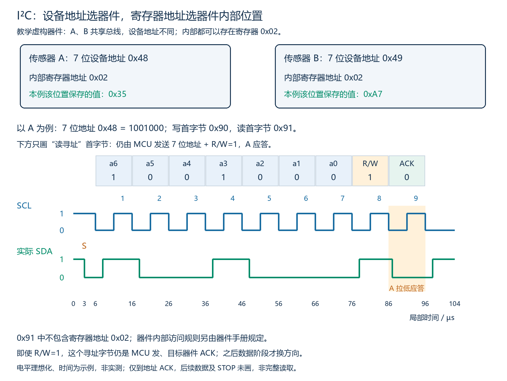

图的下半段只展示START、读取A的寻址首字节0x91及A的ACK，未展示后续数据或STOP，不是完整寄存器读取。器件和寄存器内容是虚构教学条件，逻辑电平理想化、时间仅为示例，没有实测。

即使R/W=1，**这个寻址首字节仍由MCU发送**，因为要由MCU告诉目标“访问谁、准备读还是写”。A收到自己的地址并能够参与时，在第9个时钟拉低给ACK；其他未匹配的普通目标不应答本次地址。

地址ACK之后，读数据阶段才由目标发送数据、MCU接收并响应ACK/NACK。不能把“读取数据时由MCU应答”的规则提前套用到寻址首字节上。

0x91中只包含设备地址与读方向，**不包含寄存器地址0x02**。想读取特定内部寄存器，如何先指定位置、再换成读取方向，留下一段完整流程讲解；不能看到0x91就断言读到的一定是0x02的内容。

### 10.5 本段复习自测与参考答案

1. 7位设备地址为0x48，写、读时的首字节分别是什么？为什么不同但仍指向同一器件？
2. 读寻址首字节由谁发送，谁应答？这与后续读数据的应答方是否相同？
3. A、B设备地址不同，但内部都有寄存器0x02，会造成设备地址冲突吗？首字节0x91包含0x02吗？
4. 所有I²C器件都必须用一个8位寄存器地址访问内部位置吗？

参考答案：

1. 分别为0x90、0x91；高7位都是设备地址0x48，最低位分别为写0、读1。
2. MCU发送寻址字节，被寻址目标响应；后续目标发送读数据时，MCU作为接收方响应ACK/NACK，两阶段职责不同。
3. 不会，内部位置属于各自器件空间；0x91只含7位设备地址与读写位，不含寄存器地址0x02。
4. 不是。内部地址宽度、命令、访问流程和自动递增等由具体器件规定，需按手册解释。

## 十一、M05-02：一次完整的单寄存器写入

### 11.1 先给出器件规则

本节继续使用虚构的传感器A：7位设备地址0x48，具有一个可写配置寄存器0x02。本例要把它正常更新为0xA5。

假设器件规则明确规定：收到写寻址首字节并应答后，下一个字节解释为8位寄存器地址，再下一个字节解释为写入数据；正常完成本事务后，该配置寄存器更新。全部阶段正常应答，无时钟拉伸或额外等待。

这是本例器件规定的内部访问格式，不能把“寄存器地址8位、紧跟一个数据字节、何时更新”当作所有I²C器件的固定规则。总线规范定义寻址、传输和应答，内部字段含义由器件手册规定。

### 11.2 三个字节怎样组成一笔写入

```text
START → 0x90 → ACK → 0x02 → ACK → 0xA5 → ACK → STOP
```

| 阶段 | 谁发送/操作 | 该阶段解决的问题 |
|---|---|---|
| START | MCU产生 | 开始本次事务 |
| 0x90 | MCU发送8位，A应答 | 0x48设备地址配写方向0，选中A并准备写入 |
| 0x02 | MCU发送8位，A应答 | 告诉A访问内部寄存器0x02 |
| 0xA5 | MCU发送8位，A应答 | 告诉A该寄存器要写入的内容 |
| STOP | MCU产生 | 结束本次事务 |

三个字节的位数相同、都MSB先发，但作用由所在阶段决定。0x02不是重新寻址另一颗设备，0xA5也不是目标设备地址。

中间没有额外的START或STOP。在ACK之后，SCL回到低电平，目标释放应答，由MCU按下一个阶段继续准备数据。不能在寄存器地址后随意插入STOP，还假定下一笔事务自动保留相同解释状态，除非器件手册明确支持。

### 11.3 完整接线时序与应答交接

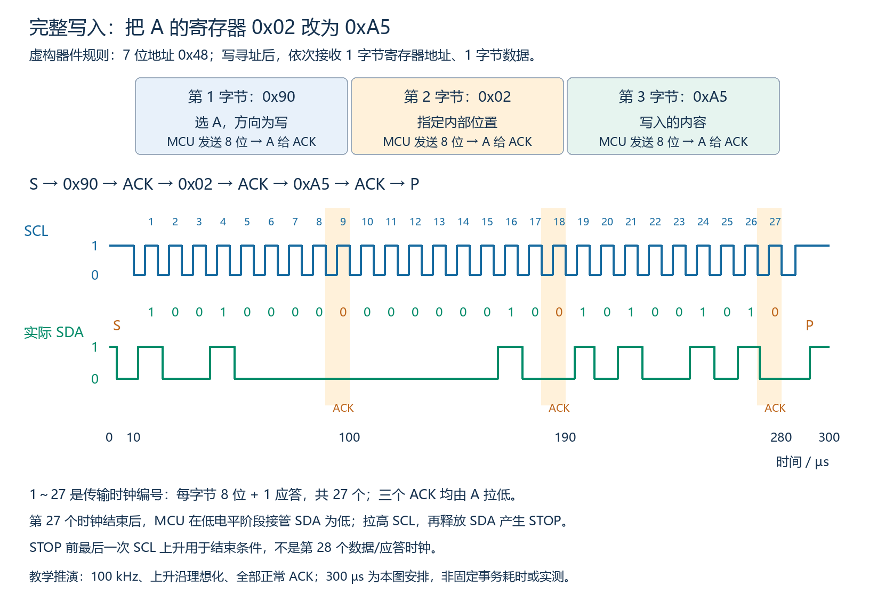

图示为教学推演：正常上拉、电平理想化，时钟100 kHz；编号1～27为传输时钟，三个橙色区分别是第9、18、27时钟的ACK。它们都由A拉低，MCU在对应应答阶段释放SDA。

写最后一个数据字节时，MCU仍然是发送方，不能套用“读取最后字节时由MCU发NACK”的规则。正常写入的最后字节仍由A接收并ACK，之后MCU产生STOP。若目标NACK，应按阶段及器件要求处理，不能继续把它记为正常成功写入。

STOP的交接：第27时钟结束后先使SCL为低，MCU接管SDA并保持低，A释放应答；MCU使SCL回到实际高，再释放SDA产生上升，形成STOP。图中STOP前最后一次SCL上升用于结束条件，不是第28个普通数据/应答时钟。

ACK表示该传输阶段的接收响应，不是端到端校验或一切内部处理均完成的证明。本例配置寄存器按给定规则更新；真实器件的只读限制、写保护、忙状态、写入生效时机和必要回读需依据手册。

### 11.4 时钟数与耗时

本例有3个8位字节，每字节附1个应答时钟，共 **3×9=27个传输时钟**。若连续时钟100 kHz，则周期10 µs，纯27个传输周期耗时270 µs。

270 µs不包含START/STOP控制过程、事务间空闲或额外等待，不能无条件称为整笔事务总耗时。图中安排从0至300 µs展示完整过程，仅为本图示例安排；其27个传输周期从10 µs至280 µs，正好270 µs。

### 11.5 本段复习自测与参考答案

1. 本例的0x90、0x02、0xA5分别表示什么？
2. 三个字节由谁发送、三个ACK由谁给？最后一个写数据字节后，MCU需要主动发NACK吗？
3. 纯传输时钟共多少个？100 kHz时这部分耗时多少？是否等于整笔事务时间？
4. 能否在寄存器地址后随意STOP，再开始新事务直接发0xA5，并默认同样完成写入？

参考答案：

1. 0x90是设备地址0x48配写方向的首字节；0x02是内部寄存器地址；0xA5是要写入该位置的数据。
2. MCU发送全部三个字节，A作为接收方给三个ACK。MCU是最后写数据字节的发送方，不主动给该字节NACK；正常收到A的ACK后按流程STOP。
3. 27个，100 kHz时纯传输周期耗时270 µs；不等于无条件的整笔事务总耗时，还需计入控制条件与等待等。
4. 不能默认。STOP结束当前事务，新事务会重新寻址，内部访问状态如何处理由器件规则决定。

## 十二、指定寄存器读取与Repeated START

### 12.1 为什么读取前有一段“写”

继续采用虚构A：7位设备地址0x48，寄存器0x02当前返回0xA5。本节明确增加A的读取规则：

- 写寻址后接收的一个8位寄存器地址用于设置内部访问位置；再收到一个数据字节才按上一节写入内容。
- 设置位置后允许控制器产生重复起始，A保留所指定的内部位置；之后收到读寻址，从该位置返回数据。
- 本节读取一个字节，读完由MCU给NACK，再STOP。无时钟拉伸或额外等待，全部寻址和位置字节正常ACK。

器件记住“下次访问内部哪里”的状态，常称 **Address Pointer，地址指针**。本例指器件内部状态，不是C语言指针变量。设置指针为0x02，不等于把寄存器内容改为0x02；此时寄存器仍返回0xA5。

读寻址首字节0x91只提供设备地址与方向，不包含内部位置。先发0x90进入写方向，是为了由MCU发送“访问位置0x02”，不意味着这次操作一定要改写该寄存器内容。上述规则是本例器件约定，不是所有器件统一的内部读法。

### 12.2 完整读取流程与角色切换

```text
START → 0x90 → ACK → 0x02 → ACK → Sr → 0x91 → ACK → 0xA5 → NACK → STOP
```

| 阶段 | 8位字节发送方 | 字节后的响应方 | 作用 |
|---|---|---|---|
| 0x90 | MCU | A给ACK | 选择0x48并进入写方向 |
| 0x02 | MCU | A给ACK | 设置内部访问位置，不改写内容 |
| Sr | MCU产生条件，不是字节 | 无独立应答位 | 在没有STOP的情况下重新开始寻址 |
| 0x91 | MCU | A给ACK | 再次选择0x48，改为读方向 |
| 0xA5 | A | MCU给NACK | A返回该位置的内容，MCU表示不再接收下一字节 |
| STOP | MCU产生条件，不是字节 | 无独立应答位 | 结束事务 |

全部时钟仍由MCU产生。三个ACK由A给，最后NACK由MCU给；不要把寻址阶段的A应答与读数据阶段的MCU应答混为一谈。MCU给NACK时保持释放，A在完成8位后也释放，有正常上拉时第9位为高。

### 12.3 Repeated START是什么

**Repeated START，重复起始，记为Sr。**它的电气条件与START相同：SCL为高时SDA从高变低。区别在于它发生在前一个START之后、STOP之前，中间没有结束当前事务，总线仍忙。

**为什么写Sr而不只写START？**Sr是为了标明“这次START是前面没有STOP的重复起始”，不是另一种电气信号。S表示START，r提示repeated（重复）；也可写成“重复START”或“Sr（重复START）”。只写START能描述该电气条件，但流程图中特意区分S/Sr，更容易看出事务边界。NXP规范3.1.4在不特别强调重复起始时，也会用S统称两者。

两种流程应明确区分：`…ACK → Sr（重复START）→ 读寻址…` 中间没有STOP；`…ACK → STOP → START → 读寻址…` 已结束前一事务并开启后一事务，不能不看器件规则就当作可直接替换。

产生Sr不是把SDA在低电平状态直接再“写一次0”。需要在SCL低时让SDA先回高，再让SCL实际升高，最后将SDA拉低，形成清晰的开始条件。Sr后接收器按新的寻址阶段解释首字节。

本例Sr用于改换数据方向；一般Sr也可以重新寻址其他目标，不要求每次一定切换方向。器件是否保留内部位置、是否允许STOP后另发读事务，都需按手册，不能从I²C规范推导所有器件行为相同。

### 12.4 完整波形与Sr局部放大

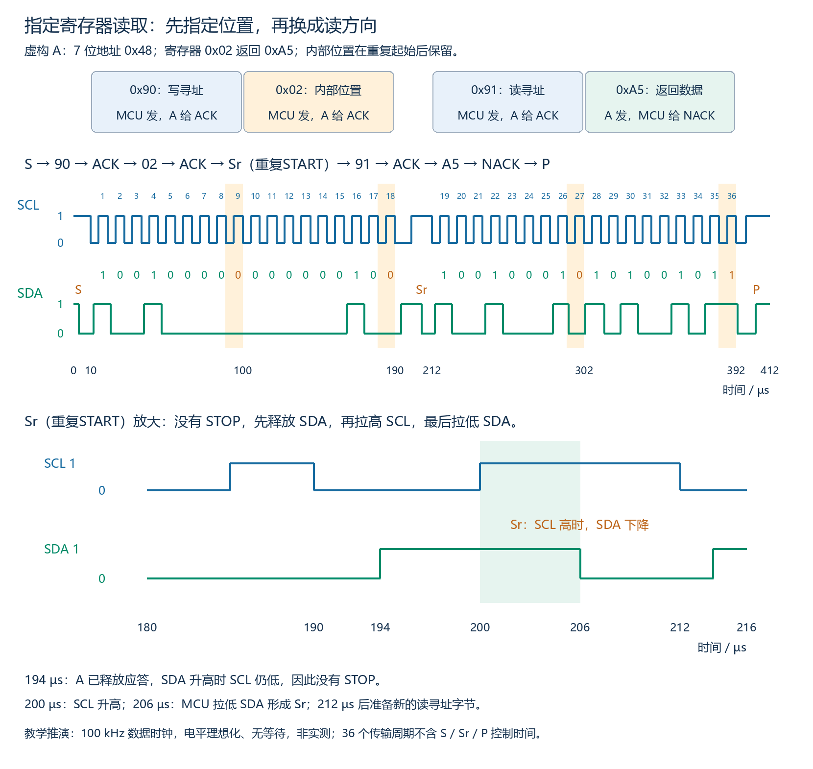

图上方为完整读取，下方放大第二个字节应答后的Sr过程。全部为理想化教学推演，非实测，虚构值不是实际传感器读数。

- 第1～9时钟：MCU发0x90，A给ACK。
- 第10～18时钟：MCU发0x02，A给ACK，随后进入Sr。
- 图中194 µs时A释放应答，SDA升高时SCL仍为低，所以没有STOP。
- 200 µs时SCL升高；206 µs时MCU拉低SDA，形成Sr。212 µs时SCL回到低，准备新寻址。
- 第19～27时钟：MCU发0x91，A给ACK。
- 第28～36时钟：A发0xA5，MCU给NACK。随后SCL回低，MCU准备SDA为低、拉高SCL、释放SDA产生STOP。

若在0x02的ACK后**不产生Sr，直接发送0x91**，按本例先前给定的写入格式，A会把它解释为要写进寄存器0x02的数据，而非读寻址。字段含义取决于通信边界和当前阶段，不能单看某个十六进制数值。

图中4个字节各跟一个响应时钟，共36个传输周期；100 kHz下纯传输360 µs，不包括START/Sr/STOP、等待等时间。重复起始与STOP准备时的SCL变化用于控制边界，不额外编号为普通数据/应答时钟。

### 12.5 本段复习自测与参考答案

1. 本例为什么先写0x02再切换读？它是否把寄存器内容改为0x02？
2. Sr与最初START的电气条件有什么区别？中间是否有STOP？
3. 0x91后的ACK与0xA5后的NACK分别由谁给？
4. 不产生Sr，直接在0x02的ACK之后发0x91，本例A会怎样解释？
5. 本例共多少个传输时钟？100 kHz下纯传输耗时多少？

参考答案：

1. 先由MCU指定内部访问位置，随后读寻址才可按本例规则从该位置返回内容。设置地址指针不是改写内容，0x02仍返回0xA5。
2. 电气条件相同，均为SCL高时SDA下降；Sr之前没有STOP，事务尚未结束。
3. 0x91由MCU发送，A给ACK；0xA5由A发送，MCU接收完后给NACK。
4. 它仍处于写入数据阶段，会把0x91当作要写到寄存器0x02的数据，不能默认已经切到读。
5. 4×9=36个，纯传输360 µs；不含START/Sr/STOP及等待等。

## 十三、M05-03：连续读取、自动递增与末字节NACK

### 13.1 先明确器件是否支持连续读取

本节继续使用虚构A，7位设备地址0x48。补充本例规则：从指定内部位置开始连续读取时，读出当前字节并收到MCU的ACK后，内部位置自动加1，再发送下一个位置的数据。支持所需范围内的3字节连续读取，不跨越边界、不需要额外命令，无时钟拉伸或等待。

| 内部寄存器地址 | 本例返回的8位内容 |
|---|---|
| 0x02 | 0xA5 |
| 0x03 | 0x3C |
| 0x04 | 0x81 |

**Auto-increment：自动递增。**这里指器件内部访问位置逐次加1。它是器件协议与实现规定的行为，不是I²C总线无条件保证的行为。某些器件使用固定位置、FIFO或特殊递增使能方式，连续读法、边界及后续指针状态需按手册。

ACK本身只表达接收方应答并继续接收，不会自动赋予任何器件“地址加1”的能力。本例能得到02、03、04三个位置，依赖上述明确的器件规则。

### 13.2 从0x02连续读3个字节

前段与单字节读取相同：

```text
START → 0x90 → A的ACK → 0x02 → A的ACK
→ Sr（重复START）→ 0x91 → A的ACK
```

接下来是连续数据阶段：

```text
A发送0xA5 → MCU给ACK
A发送0x3C → MCU给ACK
A发送0x81 → MCU给NACK
→ MCU产生STOP
```

MCU只指定一次起始位置0x02。数据字节之间没有重新发送设备地址、寄存器地址或Sr；器件按给定规则自动进入下一内部位置，每个8位数据之后仍有独立的第9响应时钟。全部时钟由MCU产生。

在本例流程里，MCU不需要预先发送一个数值3来声明读取长度。MCU根据自己需要的数量决定何时给ACK、何时用NACK结束接收；具体器件若另有长度字段等要求，则按它自己的协议。

### 13.3 从波形理解继续与结束

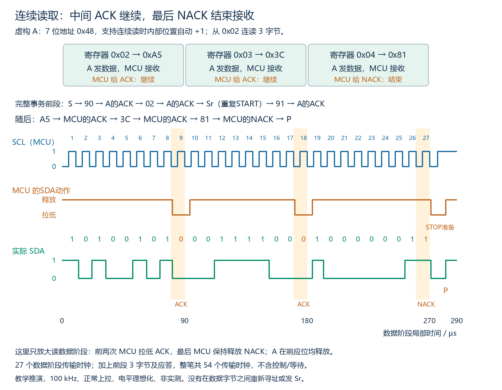

图上方列出完整事务前段和3字节读取摘要，下方波形只放大读数据阶段。横轴是该阶段的局部时间，1～27也是该阶段的时钟编号，前面的寻址/内部位置不在本波形时间轴内。全图为正常上拉、100 kHz、逻辑电平理想化的教学推演，非实测。

| 数据字节 | 数据由谁发送 | MCU在响应阶段的动作 | 正常SDA响应电平 | 本例下一步 |
|---|---|---|---|---|
| 0xA5 | A | 拉低，给ACK | 0 | A继续返回0x03的内容 |
| 0x3C | A | 拉低，给ACK | 0 | A继续返回0x04的内容 |
| 0x81 | A | 保持释放，给NACK | 1 | 结束本次接收，随后STOP |

A在每个应答时钟期间均释放SDA。MCU在前两次应答时拉低，最后一次保持释放；电气行为不改变。图中最后0x81的b0已经是1，NACK也是1，因此这两位之间可以没有SDA跳变，仍通过不同SCL时钟区分。

“最后一个”由MCU本次要接收的数量决定，不由寄存器地址或数据值固定决定；换成只读2字节时，第2字节就是最后一个，应在其响应阶段结束接收，不能机械沿用3字节例图的前两次ACK。NACK是协议中的响应，不会断开SDA/SCL物理连接；它也不等同于已经产生STOP。

注意NACK结束之后，MCU在SCL低时又短暂拉低SDA，是为了准备STOP，并非给第三次ACK；随后SCL升高，MCU释放SDA形成STOP。NACK不代替STOP。

如果MCU在第一个数据字节后就给NACK，已表示不再继续接收本次数据。不能仅靠继续产生时钟，就保证目标还按原序列返回下一个字节；应按器件规则结束或重新开始所需访问。同样，计划结束却误给ACK，目标会按协议准备继续，不能把ACK当正常的末字节结束信号。

### 13.4 总时钟数与传输耗时

仅3字节数据阶段：3×9=27个传输时钟。整笔事务还包括写寻址、内部地址、读寻址三个8位字节及其响应：

**整笔传输时钟数 =（3个前段字节＋N个数据字节）×9。**

本例N=3，共54个传输时钟，100 kHz下纯传输周期540 µs；不包含START/Sr/STOP控制与等待。数据阶段图内只画27个周期，不能将它误作整笔事务的54个周期。

该公式只适用于本例7位寻址、1字节内部地址、先写位置再重复起始读取的结构。10位寻址、多字节内部地址或其他命令格式应重新按实际阶段计数。

### 13.5 本段复习自测与参考答案

1. 本例为什么只发一次0x02，就能返回02、03、04三个位置的内容？这是所有I²C器件共有的规则吗？
2. 从0x02读3字节，MCU的三次数据响应依次是什么，怎样操作SDA？
3. 是否需要在0xA5与0x3C之间再发一次设备地址或Sr？本例是否预先发送读取长度3？
4. 第1字节后提前给NACK，继续打时钟能否保证收到原本计划的第2字节？
5. 只算数据阶段和算整笔事务，时钟数分别是多少？100 kHz下整笔纯传输周期耗时多少？

参考答案：

1. 本例器件支持连续读时内部位置自动加1，并满足本次范围要求；不是I²C无条件通则，需看具体器件规则。
2. ACK、ACK、NACK；前两次拉低，最后保持释放。在目标释放、上拉正常时，响应电平依次0、0、1。
3. 不需要，数据阶段按本例器件规则连续进行。该流程不预发数值3，MCU通过响应和时钟过程决定接收何时结束。
4. 不能保证；NACK已通知目标结束本次接收，不能要求它在后续时钟继续按原序列发送。
5. 数据阶段27个，整笔54个；100 kHz下纯传输540 µs，不含控制及等待。

## 十四、M05-04：Clock stretching，时钟拉伸

### 14.1 目标器件为什么需要控制SCL

控制器负责产生I²C传送的时钟节奏，但目标器件有时需要更多时间准备数据或处理刚接收的内容。支持此功能的目标可将SCL保持为低，暂缓传送，准备好后再释放。

**Clock stretching：时钟拉伸。**关键机制是延长SCL低电平阶段。它是可选能力，不是所有目标都会使用，也不能假定所有控制器都无条件支持；使用时需核对双方器件和模式的要求。本节假设双方均支持图示的拉伸方式。

这与ACK/NACK不同：ACK/NACK在相应第9个时钟通过SDA表达接收响应；时钟拉伸通过保持SCL低改变实际时序。目标保持SCL低不等于接管并自由产生一串数据时钟，控制器仍负责正常时钟节奏。

### 14.2 释放SCL与SCL实际变高不是同一事件

在本例开漏共享线上，控制器的SCL动作只有拉低或释放。控制器释放后，如果目标仍拉低，总线就仍是低；只有所有相关下拉者都释放，正常上拉才使SCL升高。

支持拉伸的控制器流程应包括：准备低电平阶段的数据，释放SCL，等待并确认引脚实际达到高电平，再按实际SCL安排后续高电平与下降沿。不能只凭“自己已经释放”就当成总线已经出现高电平时钟脉冲。

这描述外设/控制流程原理，不要求当前编写或分析代码。具体输入检测、采样和超时细节由控制器硬件及配置决定，不把本图高电平中点当作所有器件固定采样时刻。

### 14.3 用波形看多等的8 µs

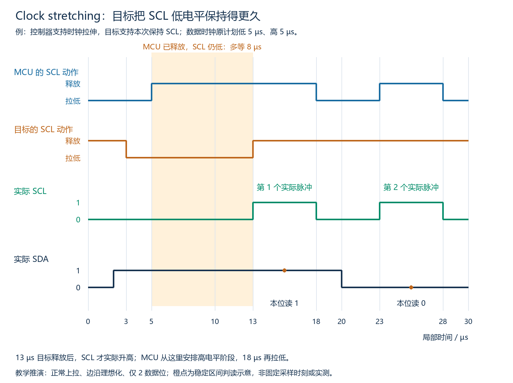

图示为两个数据位的局部推演，假设正常上拉、边沿理想化，控制器与目标均支持本次拉伸，无其他器件干扰。原计划每周期低5 µs、高5 µs；橙点仅示意在稳定数据区间判读，非实际测量或固定采样时刻。

| 时间 | MCU的SCL动作 | 目标的SCL动作 | 总线实际情况 |
|---|---|---|---|
| 0～3 µs | 拉低 | 释放 | SCL低，准备数据 |
| 3～5 µs | 拉低 | 拉低 | SCL仍低，目标已开始保持 |
| 5～13 µs | 释放 | 拉低 | MCU希望进入高电平，但总线仍低，等待 |
| 13～18 µs | 释放 | 释放 | SCL实际高，第1个数据时钟的高阶段 |
| 18～23 µs | 拉低 | 释放 | SCL低，准备下一位 |
| 23～28 µs | 释放 | 释放 | SCL高，第2个数据时钟的高阶段 |

第一位SDA在SCL实际高的13～18 µs保持1，第二位在23～28 µs保持0，因此这两个位仍依次为1、0。传送在等待后继续，没有因等待多出数据位。

目标本次下拉动作从3至13 µs共10 µs，但MCU本来就会拉低到5 µs，因此相对原计划额外等待是13−5=8 µs，不能把两种时间混为一谈。本图原计划的第一个低电平阶段从5 µs结束，实际延长到13 µs；控制器从13 µs安排5 µs高阶段，到18 µs再拉低。

### 14.4 时钟数量与实际耗时

如果没有重试或额外协议字段，拉伸只是延长低电平，不增加字节、应答位或传输时钟数量。原先按时钟数÷标称频率算出的纯传输时间，不再包含全部等待。

在其他时间安排均不变的简化条件下：**传输周期加拉伸的实际耗时 = 原无拉伸传输周期耗时 + 各次有效额外拉伸等待之和。**完整事务还可能需要计入START/Sr/STOP等控制时间。

因此标称400 kHz不意味着每个实际位周期在存在拉伸时都恰好2.5 µs。拉伸也不要求先修改MCU的分频配置；线路实际节奏可以因等待而改变。

### 14.5 等待与异常的边界

控制器需要结合器件处理时间、硬件能力和应用要求设置合理的等待/超时处理，不能无限盲等，也不能为绕过拉伸把开漏输出改成强推高。

看到SCL持续低，只能确认线路低，不能仅凭这一点断定目标正在合法拉伸；也可能有短接、错误配置或异常器件等。后续将学习如何按信号和器件状态区分，不在本节直接假定所有低电平都是拉伸。

### 14.6 本段复习自测与参考答案

1. 图中MCU在5 µs释放SCL，实际SCL何时升高，相对原计划多等多久？
2. 拉伸期间应答位或数据时钟数量会自动增加吗？
3. 时钟拉伸和ACK/NACK分别通过哪根线、什么行为表达？
4. 控制器已经释放SCL，能否不读实际线路状态就认定高电平已经开始？SCL持续低是否必然是合法拉伸？

参考答案：

1. 13 µs才升高，额外等待8 µs；目标下拉共10 µs包含MCU原本低阶段中的2 µs，不能全算新增等待。
2. 不会。在无重试或新增协议阶段的条件下，只是现有低电平阶段延长，实际耗时增加，字节和应答数不变。
3. 拉伸由目标保持SCL低来暂停节奏；ACK/NACK由接收方在第9个时钟通过SDA低/高表达响应，两者职责不同。
4. 不能，需观察实际SCL并按硬件/协议时序处理。持续低也可能是故障，需结合器件状态和线路排查。

## 十五、M05-04：Arbitration，多控制器仲裁

### 15.1 为什么还需要仲裁

本节有两个能发起通信的MCU控制器C1、C2，共用SDA/SCL。它们不是此前的两个传感器目标。控制器通常先确认总线空闲再发起通信，但仍可能在接近的时刻同时产生START，继而都准备发送。

**Arbitration：仲裁**，决定同时竞争总线的控制器中谁继续传送、谁让出。本课只理解基本机制，不实现多控制器驱动。

多控制器还需要 **Clock synchronization：时钟同步**。各控制器根据实际SCL协调位边界：任一控制器仍下拉则SCL仍低，全部释放才变高，高阶段也会受先下拉者影响。本图假设已经形成同步的SCL，只画共享SCL，不把它假装成两个互不相关的时钟。

### 15.2 在自己发送的位上，同时观察实际SDA

在正常开漏总线上，发送1是释放，发送0是拉低。两控制器发送不同位值时，发1的一方没有主动强推高，所以线路仍由发0的一方拉低。

在受仲裁的地址/数据发送位中，各控制器于SCL高时观察线路并与自身发送意图比较：

| 本控制器本位想发送 | 实际SDA | 结论 |
|---|---|---|
| 1，即释放 | 0 | 有其他竞争者拉低，本控制器失去仲裁 |
| 1，即释放 | 1 | 本位未失去仲裁，尚不能证明以后一定获胜 |
| 0，即拉低 | 0 | 本位与自身一致，可继续；不能仅凭一致证明只有自己在发送 |

在首个不同位上，发送1却读到0的一方让出，发送0的一方继续。无需额外仲裁线或软件预先选出胜者；这依赖开漏结构、时钟同步及正确的总线行为，不能照搬到任意推挽接口。

### 15.3 看两个寻址首字节怎样竞争

C1想访问7位目标地址0x34，写首字节为0x68，即01101000；C2想访问0x30，写首字节为0x60，即01100000。双方几乎同时START，并已同步时钟。

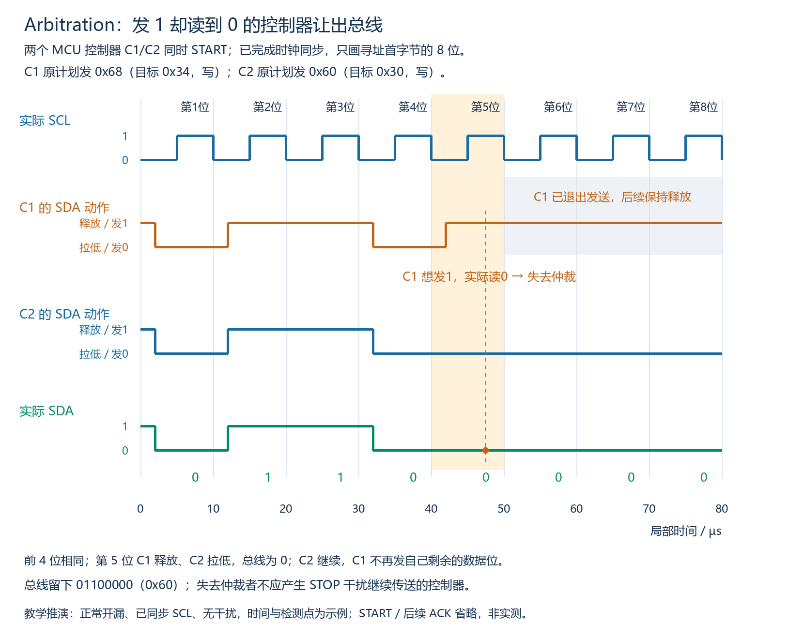

图中只画首字节8位，START、目标应答及后续数据未画，不是完整事务；边沿理想化，正常开漏、无干扰，时间和检测点为示例，非实测。

- 前4位都是0110，双方都读到自己要发的值，尚未分出结果。
- 第5位，C1想发1而释放；C2想发0而拉低。实际SDA为0。
- C1在SCL高时观察到“想发1、实际0”，知道失去仲裁；C2观察到自己要发的0，可继续。
- C1退出自己的SDA发送，后续保持释放；不能再照原计划把剩余位拉低。图中C1后半段的释放不表示它仍在发送一串1，而是已经让出发送。
- 总线实际保留C2的01100000，即0x60；本例不会因C1让出而破坏C2的寻址字节。

本例在寻址首字节就分出结果。若控制器发出的前面内容相同，仲裁可能继续到后面的不同位，不能规定每次一定在地址第一位或固定某位完成。

### 15.4 失去仲裁后怎样处理

失去仲裁者应停止主动发送自己的SDA数据并保持释放，不能擅自产生STOP来结束“自己的事务”，否则会打断胜者正在进行的传送。需要等总线重新空闲后，再按控制器及应用规则重试。

SCL的退出时机由多控制器外设规则处理，不能将“退出SDA发送”无条件解释为立刻停止所有SCL动作；NXP规范允许失去仲裁者继续产生时钟至当前字节结束。本阶段只理解边界，不编写退出或重试代码。

这不是把物理连线断开，失去仲裁的控制器仍能观察总线。有些MCU还具备目标角色，遇到自身目标地址时如何切换需看器件说明，本阶段不展开。

### 15.5 不要把三个机制混为一谈

| 机制 | 发生条件/观察点 | 解决的问题 |
|---|---|---|
| ACK/NACK | 接收方在响应时钟通过SDA低/高给响应 | 字节接收响应、继续或结束接收 |
| Clock stretching | 目标保持SCL低，控制器等待实际升高 | 目标需要更多处理时间 |
| Arbitration | 控制器发送受仲裁位时，释放发1却在SCL高读到0 | 多控制器同时竞争时决定谁让出 |

正常ACK时发送方本来就应释放SDA，让目标拉低，这不是“发1输给另一个控制器”。仲裁规则必须结合当前阶段和角色使用，不能把任何一次释放SDA后读0都叫失去仲裁。

本节的多控制器竞争，也不同于两个目标器件误用同一设备地址；目标地址冲突不会自动由本节仲裁替控制器选出其中一个，下一段单独分析。

### 15.6 本段复习自测与参考答案

1. 图中C1/C2的首个不同位是第几位，谁失去仲裁，实际SDA是多少？
2. 发1却读到0的一方为什么能安全让出，而不是形成强推高与强拉低争用？
3. 失去仲裁者能否立即发STOP？本位发1并读到1，能否证明自己已经最终获胜？
4. 正常目标ACK时，发送方释放却读到0，是否意味着多控制器仲裁失败？

参考答案：

1. 第5个发送位；C1想发1、C2发0，实际0，C1失去仲裁。
2. 发1对应释放输出，没有主动强推高；发0者把共享线拉低，败者随后保持释放，使继续传送者的数据保留。
3. 不能发STOP干扰胜者。某位发读均为1仅说明本位未失去仲裁，后面若出现不同位仍可能失去仲裁。
4. 不是。ACK是预定由接收方控制SDA的响应阶段，应按ACK规则解释，不按本控制器正在发送普通地址/数据位的仲裁条件解释。

## 十六、M05-04：两个目标器件的设备地址相同

### 16.1 与两个控制器竞争不同

本节只有一个MCU控制器，两个目标A、B都使用7位设备地址0x48，共享同一对SDA/SCL。假设两者采用相同的8位内部地址访问格式，都正常响应，并继续发送本节规定的数据，不自行退出或引入其他时序差异。

MCU发送写寻址0x90或读寻址0x91时，A、B都匹配0x48，都可能参与后续访问。控制器仲裁解决的是多个控制器竞争发送，不会自动替MCU在两个同地址目标中选出一颗。

### 16.2 为什么仍然可能看到正常ACK

寻址响应时，A和B均可以拉低SDA，控制器看到的仍只是一个低电平ACK。正常线路/响应前提下，它能说明有响应，不能数出是一颗还是两颗，更不能确认两颗都正确执行了后续操作。

**Bus scan：总线扫描。**常见扫描思路是逐个地址试探是否有响应，它看到的是响应地址，不是对物理器件逐颗点数。因此扫描出现0x48，也不能由此证明总线只连接一颗该地址器件；实际扫描方式及可用地址需按设备说明，当前不运行扫描程序。

若两目标支持相同写入格式，写入命令和数据可能被两颗一起接受。若读出内容相同，读取结果还可能看起来正常；这些现象均不证明MCU能独立选择其中一颗。

### 16.3 两个不同返回字节会怎样

假设都访问内部0x02，A要返回0xA5，B要返回0x3C。MCU在读数据的8位期间释放SDA，A、B按同一组时钟继续发各自的8位。

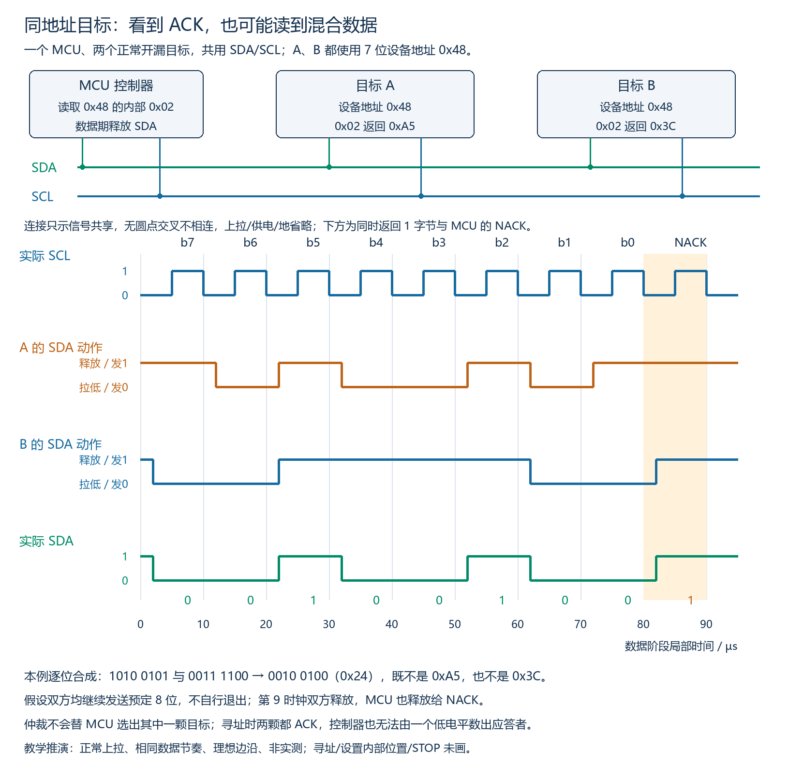

上方只示意共享信号连接，上拉、供电、参考地省略；无连接点的交叉线不相连。下方只展示一个读数据字节及MCU NACK，寻址/设置内部位置/STOP未画。图为正常上拉、理想开漏/边沿、相同数据节奏的推演，非实测，也不保证所有真实同地址异常都呈现此结果。

每一位只要有一方拉低，SDA就是0；两方都释放才为1。因此本例按位合成如下：

```text
A计划发送：1010 0101  = 0xA5
B计划发送：0011 1100  = 0x3C
实际SDA ：0010 0100  = 0x24
```

这是两个字节逐位线与的结果，不是对两份数据求平均，也不是先完整接收一份再接收另一份。MCU只得到一根共享SDA的一个字节，无法从0x24唯一还原两颗器件各自的数据；本例既没有正确读出A的A5，也没有正确读出B的3C。

不要套用控制器仲裁而假定“发1读0的那个目标会自动退出”，本节假设两个目标继续输出预定数据。第9时钟两个目标均释放，MCU也释放给NACK，随后按流程结束；本图未画STOP。

### 16.4 想独立访问，怎样消除地址歧义

| 器件/系统条件 | 可行方向 |
|---|---|
| 器件提供可选地址引脚或配置 | 按手册将两颗设成不同设备地址，例如本例可用时分别设48/49，再使用对应寻址字节 |
| 两颗地址固定、无法改 | 放到相互独立的I²C总线上，各自访问 |
| 需要共用控制器的一组I²C引脚 | 使用总线开关/多路复用器（Multiplexer）隔离分支，每次只接通所需的同地址目标分支 |

可编程地址也需按手册完成实际配置，必要时先隔离器件，不能只在MCU里把要发送的地址从48改成49，就假定某颗硬件会自动改地址。总线开关同时接通两个仍同地址的目标分支，也会重新产生本节问题。

标准中允许有意设计的同地址组播写场景，但需要明确系统设计与单独验证方法；不能把它当作任意同地址目标都可独立读取的依据。本课默认目标是分别访问各器件。

### 16.5 本段复习自测与参考答案

1. 两个目标同用0x48，寻址得到ACK，能否证明只有一个响应者？总线扫描能否据此数出两颗？
2. 本例A发A5、B发3C，理想开漏数据阶段会得到什么字节？MCU能否自动拆成两份？
3. 控制器仲裁会自动解决同地址目标的独立选择吗？
4. 两颗目标地址固定相同，有哪些隔离访问方向？只修改MCU发出的地址是否足够？

参考答案：

1. 不能；多个目标同时拉低依然只是一个ACK。常见扫描只能发现响应地址，不能由这个ACK区分应答者数量。
2. 0x24，二进制00100100；在本例同步输出条件下是逐位线与。不能从这一个混合结果唯一拆出两颗的独立数据。
3. 不会。仲裁是多个控制器发送时的竞争规则，本节是一个控制器同时选中两个目标。
4. 可放独立总线，或使用总线开关/多路复用器每次隔离选择一支；若器件可配置地址，也可按手册实际改成不同地址。仅改MCU要发的地址不会自动改变固定地址目标。

## 十七、M05-04：无应答与NACK的阶段定位

### 17.1 先确定观察到的究竟是什么

**NACK（Not Acknowledge，非应答）**的线路表现，是相应第9个SCL时钟高电平期间，SDA保持高。判断应结合实际线路电平、字节边界和当前接收方，不能只凭软件显示“失败”就认定发生了某阶段NACK。

如果SCL一直低、事务没有推进到第9个高电平，就尚未观察到这个NACK条件。它可能是等待、配置或线路异常，持续低的排查下一段单独讲。

### 17.2 相同NACK波形，为什么结论不同

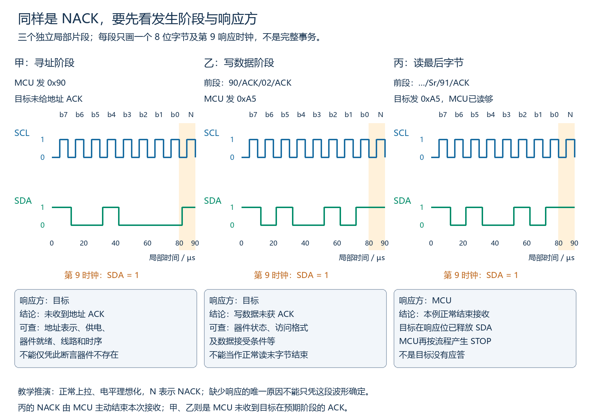

三个片段时间独立，各只画一个8位字节与第9响应时钟，其他阶段按说明省略；正常上拉、电平理想化，非完整事务或实测，N表示NACK。乙、丙都画0xA5及高电平响应，但发送/接收角色不同。

| NACK所在阶段 | 该字节发送方 | 应响应的一方 | 可以确认什么 | 不能直接推断什么 |
|---|---|---|---|---|
| 设备寻址之后 | MCU | 目标 | 未收到这个寻址字节的ACK | 目标一定不存在或损坏 |
| 内部地址/命令字节之后 | MCU | 目标 | 前面可已获地址ACK，但该阶段未获ACK | 唯一原因就是某寄存器不存在 |
| 写数据字节之后 | MCU | 目标 | 该数据字节未得到预期ACK，不能按正常写入成功验收 | 最后一个字节NACK就是正常写入结束 |
| MCU已读够的最后一个数据字节之后 | 目标 | MCU | MCU按计划结束本次接收 | 目标没应答或硬件发生故障 |

“读最后字节给NACK”属于接收方MCU的结束信号；不能直接套到MCU作为发送方的写操作。本例正常写入仍期望目标对最后数据字节给ACK，然后控制器按流程STOP。

### 17.3 地址阶段NACK：先核对线上到底访问了谁

先把实际首字节拆成7位地址与R/W，核对器件当前配置，而不是只看软件变量名或工具上一个没有说明含义的十六进制值。

例如器件手册的7位地址为0x48，写首字节应为0x90、读首字节应为0x91。逻辑分析仪可能将原始0x90解码显示为“Address 0x48 + Write”，这属于正确的显示方式；不能因为看到48就认为线上8位也必须是48。软件接口接受哪种表示同样需看文档，当前不分析代码。

核对地址后，再按实际条件检查：目标供电/参考地、复位/使能及上电就绪时间，SDA/SCL接线与引脚功能，上拉/电平和实际时序、器件支持的速率与方向。NACK可能来自无匹配接收方、器件暂忙或暂时无法参与等，不能只凭一次NACK唯一定位。

这些是待验证的原因，不是看到NACK就同时宣告所有项有问题。观察波形与查手册的目的，是缩小原因并逐一确认。

### 17.4 后续字节NACK：保留阶段证据

假设90已经ACK，02也ACK，接着A5得到NACK。应先记录为“写数据A5后的目标响应为NACK”，而不是笼统写成“设备找不到”或直接断言“02不存在”。

可能涉及器件状态、访问顺序、数据/长度接受条件、保护设置或电气时序，实际是否以NACK拒绝这些条件由器件规定。地址阶段ACK也不证明器件型号/唯一性或后续字段都正确。

在本节控制器仍拥有总线、SCL可正常推进的前提下，应按器件与外设规则结束或重新组织访问，记录失败阶段；只有器件文档支持的暂忙等情形，才按合适的等待/超时与重试规则处理。不能忽略NACK继续写后续字段，并假定器件仍按原预期接收。

也不能把失败理解为先前所有动作必然未发生；真实器件对已接收字段何时生效，应依据其协议。当前只学诊断与控制流程原理，不要求实现重试程序。

### 17.5 面试中的诊断表达

可按“观察→定位→假设→验证”的顺序说明。例如：已经确认第9个SCL高电平内SDA为高；它出现在写数据字节后，响应方应为目标；因此先定位为该写阶段未获ACK，再依据器件访问格式、状态与线路时序验证，不能直接认定器件损坏。

与之相对，如果是控制器收到最后一个读取字节后主动NACK，这是预定结束接收，还需要后续STOP或Sr；单独这个NACK不是故障证据。

### 17.6 本段复习自测与参考答案

1. 设备寻址后NACK，能否唯一说明没有器件或器件已坏？
2. 解码器显示“Address 0x48 + Write”，是否表示线上原始8位首字节为0x48？
3. 流程90/ACK/02/ACK/A5/NACK中，NACK由谁响应？能当作正常写入末字节结束吗？能唯一断言02不存在吗？
4. 目标返回最后一个读取字节后，MCU给NACK，是目标未应答吗？若SCL还一直低没到第9高电平，能直接叫该位NACK吗？

参考答案：

1. 不能。先确认实际首字节/地址表示，再核对供电、就绪、接线、上拉/电平与时序等；器件暂忙等也可能不应答。
2. 不一定且本例不是：这是7位地址与方向的解码显示，对应原始写首字节0x90。必须区分工具显示字段和原始8位。
3. 应响应的是目标，MCU未收到写数据字节的ACK；不能套用读末字节正常NACK，也不能仅据此唯一认定02不存在。
4. 不是，MCU作为接收方已读够，主动结束接收。SCL未到相应第9高电平时，也不能把未推进或等待直接标成该位NACK。

## 十八、M05-04：总线持续低与有条件恢复

### 18.1 先区分正常低电平与异常卡住

**Bus clear：总线清除，常称总线恢复。**它试图解除器件异常占住线路的状态，使后续通信有机会重新开始，不代表补救了原事务的数据。

低电平本身不是故障：数据0、ACK、SCL正常低相位和器件支持的时钟拉伸都可能产生低电平。应结合正在进行的事务、器件手册及系统规定的等待/超时判断，不能看到低就立即干预；不把某个统一超时值套给所有普通I²C器件。

本节恢复示例限单控制器、无其他合法传输；多控制器系统需先协调总线使用，不能向别人的正常事务插入恢复脉冲。先看控制器是否还在主动下拉，再在它释放相应线路后观察**实际SDA/SCL**，核对引脚、上拉/供电、接线和目标状态等。

| 实际线路状态 | 对恢复的含义 |
|---|---|
| MCU已释放SCL，但实际SCL持续低 | 无法生成正常的高低时钟；先区分仍在合法拉伸、其他器件下拉、配置或线路故障等 |
| SCL可正常升高，SDA异常持续低 | 若目标停在未完成传输中，可按器件/控制器恢复流程尝试九个实际时钟并观察释放 |
| 两线能够恢复高并形成合法STOP | 还需满足总线空闲时间、整理控制器状态，再按器件规则开始新事务；不能直接认定旧事务成功 |

### 18.2 为什么控制器重启了，目标仍可能不松手

例如MCU读取传感器时，MCU意外复位，停止生成SCL。传感器没有同时复位，仍处于原来的发送阶段，可能正输出一个0并等待下一个时钟，因此持续拉低SDA。MCU重新初始化自己的I²C外设，只改变本机状态，不会自动清除外部传感器的传输状态。

I²C按8位数据及第9响应时钟推进。给停在中间的目标补时钟，可能让它推进到释放SDA的阶段；这解释了九个恢复时钟的用途。它们不是新的正常寻址命令，也不能保证线路短路、供电异常或所有器件异常都能解除。

### 18.3 看成功释放与没有实际时钟的区别

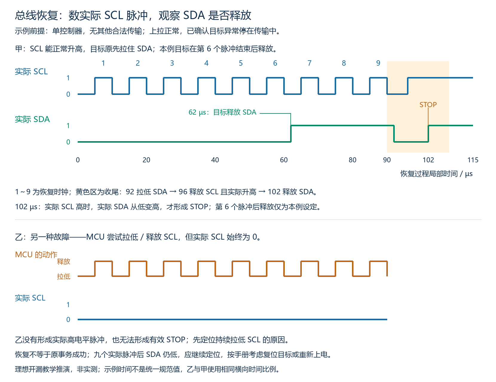

图为理想开漏教学推演，非实测，时间只是示例。甲假设上拉正常、SCL可升高，目标在第6脉冲结束后的62µs释放SDA，这是本例指定行为，不是所有器件固定第6次释放。乙是另一个故障，横向时间比例与甲相同。

甲的控制流程：

1. 恢复时控制器释放SDA，用SCL拉低/释放动作产生实际高低脉冲，并观察实际线路；不能主动强推高来压过下拉者。
2. 本例产生九个恢复脉冲。62µs时SDA升高，但此时SCL低，因此这次变化不构成STOP。
3. 本例目标释放后，控制器在92µs、SCL低时拉低SDA；96µs释放SCL并确认它实际升高；102µs释放SDA。实际SCL高时SDA低→高，形成STOP。黄色区域是STOP收尾，未编号为第10个恢复时钟。
4. 确认实际线路释放及所需总线空闲时间，按MCU手册整理外设状态；再依据目标手册重新寻址、设置所需内部位置并访问。旧事务中已经接受的写入是否生效，仍取决于目标规则，不能一概认定全成功或全未执行。

上述收尾用于解释合法STOP如何形成；具体恢复动作、时序与是否提前结束脉冲，应服从器件和控制器流程。NXP 3.1.16规定SDA卡低时发送九个时钟；不意味着任意状态下机械切换九次就一定恢复。

乙中MCU虽然尝试了九次释放，但实际SCL始终没有高电平，因此不是九个有效恢复脉冲。SCL一直低也无法形成STOP，软件发出“STOP请求”不等于线上已经出现STOP。

### 18.4 九个实际脉冲之后仍不释放怎么办

NXP UM10204 3.1.16给出：SCL卡低时，优先在器件支持时使用硬件复位；不支持硬件复位时可通过重新上电触发**POR（Power-On Reset，上电复位）**。SDA卡低时先尝试九个时钟，若仍不释放，再使用硬件复位或重新上电。

这里应针对保持总线低的相关器件和原因处理，不等于只重启MCU。继续核对是否由目标、控制器引脚配置、接线短路、供电/上拉等导致；器件复位/重新上电也须按它的手册及系统供电设计。若是物理短路，补时钟或重启都不能修好短路。

因此面试中可按以下顺序描述：先确认异常并定位哪根实际线路卡低；SCL能升高且SDA卡低时，才讨论九时钟推进；检查是否真正释放及能否合法收尾；失败则定位保持低的器件/硬件原因，按手册选择复位或重新上电；恢复后重新建立合法访问，不把恢复当作原事务成功。

### 18.5 本段复习自测与参考答案

1. MCU在传输中复位，目标为何可能仍拉低SDA？重新初始化MCU外设一定能解除吗？
2. MCU切换了九次SCL动作，但实际SCL一直低，算九个有效恢复时钟吗？能形成STOP吗？
3. 图甲62µs与102µs的SDA均低→高，哪一个是STOP，依据是什么？
4. 九个实际时钟后SDA仍低，能宣告恢复成功吗？下一步有哪些处理方向？恢复成功能证明旧事务数据正确吗？

参考答案：

1. 目标没有同步复位，可能仍停在原来的发送0阶段等待时钟。只初始化本机不能保证改变外部目标状态。
2. 不算，实际没有高电平脉冲；SCL持续低时无法形成STOP。
3. 102µs是STOP，因为实际SCL高时SDA低→高。62µs时SCL低，只是目标在低相位释放SDA。
4. 不能。定位哪个器件或硬件原因持续拉低，按手册考虑目标硬件复位或重新上电，排除接线/供电等异常；不能强推高或无限重复宣告成功。即使线路恢复，也不能据此证明旧事务成功，应按器件规则重新建立访问并验证结果。

### 18.6 波形证据对照：未获ACK与时钟未推进

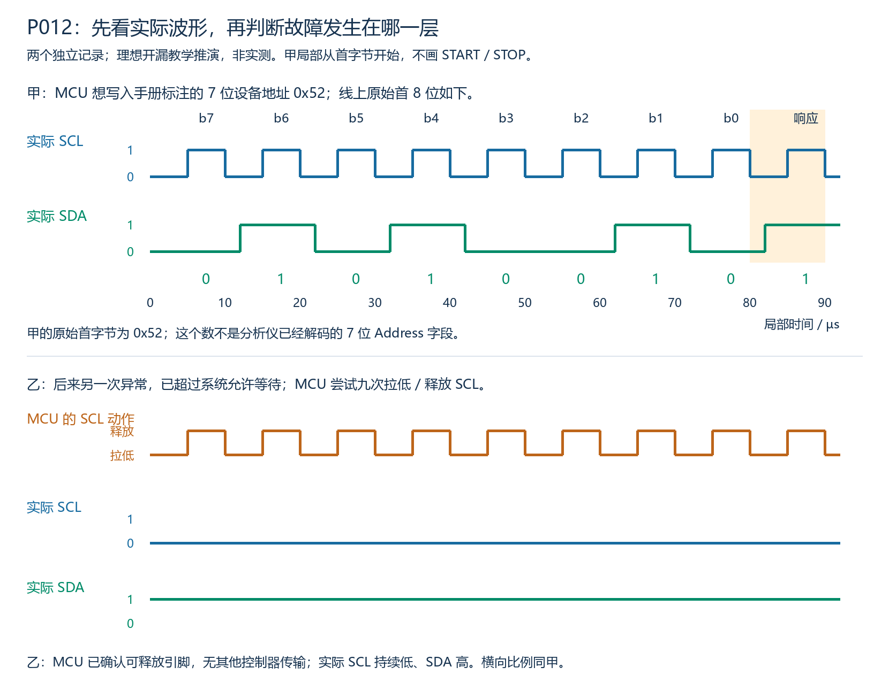

上图有明确的8位及第9实际SCL高电平，可据响应位讨论NACK，并用原始首8位核对地址字段与方向。下图虽然SDA高，但SCL持续低，不能跳过字节/时钟条件，仅凭SDA高就贴上“地址NACK”的结论；也不能把MCU动作次数当作已经到达目标的有效时钟数。

实际诊断应先记录所处阶段与观察事实，再提出并验证原因。例如分别核对寻址表示，或定位哪一端及什么硬件条件持续拉低SCL；一次观察通常不等于唯一根因。图为理想教学推演，非硬件实测，个人作答保留在练习进度。

图甲的原始0x52拆分为7位0x29及写方向；若要写手册标注的7位0x52，正确首字节应为0xA4。已发现寻址对象不符，应先修正表示，再验证合法访问，不能由这次NACK唯一判断目标损坏。图乙未形成实际SCL高电平，因此既不能叫对应地址响应位NACK，也没有九个有效恢复时钟；应优先定位持续拉低SCL的端点及硬件条件。

## 十九、全章速查与面试表述

### 19.1 一次访问要看哪些规则

| 观察对象 | 核心规则与边界 |
|---|---|
| 总线结构 | 普通双向I²C以SDA传数据、SCL定节奏，串行/同步/半双工；本章采用开漏共享线和上拉 |
| 开漏高低 | 拉低表示0；释放不等于保证高，需上拉正常且无人继续拉低 |
| 数据与边界 | 普通数据在SCL高时稳定；SCL高时SDA高→低为START，低→高为STOP |
| 重复START | Sr即Repeated START，没有先STOP便重新发出START条件，随后重新寻址 |
| 字节与响应 | MSB先发，8位后第9时钟由接收方响应；ACK低，NACK高，需结合阶段解释 |
| 7位寻址 | 线上首8位由7位设备地址和R/W组成；写为地址×2，读为地址×2＋1；不要混同原始字节、解码字段和软件接口参数 |
| 内部位置 | 器件内部寄存器地址与设备地址不同；内部地址字节数、读写格式及自动递增条件由器件规定 |
| 典型寄存器读 | START→写寻址及ACK→内部位置及ACK→Sr→读寻址及ACK→数据及MCU响应→STOP；具体采用该流程需器件支持 |
| 连续读取 | MCU对还要继续的字节给ACK，对最后一个所需字节给NACK，再合法收尾；NACK不等于断开导线 |
| 时钟与耗时 | 完整传送的每字节及响应计9时钟；纯时钟耗时可用时钟数/频率，另计START/STOP、等待及有效额外拉伸等开销 |
| 拉伸 | 控制器释放SCL后，目标仍拉低可延长实际低相位；实际高电平起点需看线路，不只看控制器计划 |
| 仲裁 | 多控制器竞争时，普通发送位想发1却读到0者失去仲裁，不应发STOP干扰继续者；不能套到正常ACK响应位 |
| 地址冲突 | 同地址目标可共同ACK，扫描不能由一个ACK数出应答者；独立访问需真实配置不同地址或隔离总线/分支 |
| NACK定位 | 先认实际第9高电平，再看当前接收方与阶段；MCU读末NACK可为正常结束，目标写NACK不能照搬此结论 |
| 总线恢复 | 先判断异常并区分SCL/SDA卡低；SCL可升高且SDA卡低时才讨论九时钟推进；失败按原因/手册处理，恢复不证明原事务成功 |

### 19.2 面试中怎样说明完整机制

可先说：I²C是常用于芯片间通信的同步串行总线，普通双向模式使用共享的SDA和SCL，通过地址选择目标。再按追问解释：普通开漏结构靠上拉得到高电平，控制器生成时钟但应观察拉伸后的实际SCL；每个字节8位后由接收方在第9时钟响应，连续读时控制器对最后所需字节给NACK，再合法收尾。

遇到“为什么不通”，先说明观察到的是哪一阶段、哪根实际线路及什么电平/时序，再提出验证方向。地址ACK、软件返回、尝试切换引脚、一次恢复动作分别只能证明对应层次的事实，不能跳到“器件唯一、数据正确、原事务成功”等尚未验证的结论。

本章速查用于之后查阅；当前不新增旧模块复测或集中复习。真实上升时间、门限、频率限制及复位/访问细节仍需查具体器件手册。

## 二十、资料与后续内容

- [NXP UM10204：I²C-bus specification and user manual](https://cache.nxp.com/docs/en/user-guide/UM10204.pdf)：总线定义、SDA/SCL、开漏与传输规则，重点见3.1相关小节。
- [TI SLVA704：Understanding the I²C Bus](https://www.ti.com/lit/pdf/slva704)：第1节电气结构与开漏，第2节接口和传送规则。

数据有效、开始条件/重复起始、字节与应答/NACK条件见NXP UM10204的3.1.3～3.1.6，同步/仲裁见3.1.7～3.1.8，拉伸见3.1.9，寻址/组合传输及同地址组播边界见3.1.10，总线清除见3.1.16。器件访问格式及示例波形是明确条件下的教学推演。本章首轮原理及当前练习范围收尾完成；后续学习入口为M06软件收发与应用数据包，由学习者明确开始后再创建对应教材。
