# M06：软件收发与应用数据包

本章首轮原理内容已覆盖：M06-01的配置/收发交接、轮询、总超时/字节间超时、中断分工与DMA组织，以及M06-02的缓冲、三种组包方式、报文校验/CRC职责、异常后的边界恢复与迟到回复归属基础。全章速查与面试表述见第十九节，个人练习结果与提示程度见进度文件。

本阶段只用图示、时序与自然语言学习原理，不要求阅读、编写或分析C代码。所有时间和数据均为明确条件下的教学推演，非硬件实验。

## 一、本章解决什么问题

UART等外设可以完成底层传输，但应用还需知道收到多少字节、字节放在哪里、何时收齐一条回复，以及缺少数据时等多久、如何结束等待。本章把“字节已到”推进到“软件能够处理完整消息”。

学习顺序：先讲收发流程与等待/超时，再讲中断和DMA如何组织取数；接着讲软件缓冲及环形缓冲；最后讲应用报文边界、完整性检查和异常后的重新同步。

## 二、用四个交接点理解接收

以MCU接收传感器的UART回复为例：

| 交接点 | 谁做什么 | 仍不能据此断定什么 |
|---|---|---|
| UART接收硬件 | 在RX引脚采样并还原字节，放入硬件接收缓冲 | 软件RAM已有该字节、应用已收齐回复 |
| CPU取数 | 通过轮询发现有未读字节，再读取它 | 已经保存进正确的软件缓冲位置 |
| RAM软件缓冲 | 保存本次字节，维护有效数量 | 分配的所有位置都装着本次有效数据 |
| 应用协议处理 | 根据约定识别消息边界，并检查格式/内容 | 只要凑够若干字节就一定是正确业务数据 |

**RAM（Random Access Memory，随机存取存储器）**中的软件缓冲，由软件管理数据及有效数量；它与UART内部接收缓冲不是同一处。**Packet/Message：数据包/消息**，本课用“报文”表示应用按约定组成的一条消息，不把它等同于一个UART字符帧。

同样四个字节是否为一条消息，由应用协议决定。UART的8N1仅规定每个字符帧的结构，不会自动知道四个字节代表一条传感器回复；软件明确要求收4字节，也只是按自己配置的数量收集。

## 三、接收前先准备什么

自然语言流程如下，具体寄存器/调用顺序以MCU手册为准：

1. 确定硬件链路与协议要求：接线/电平兼容，UART实例、速率和字符格式，预期回复格式及允许等待时间。
2. 配置必要的GPIO/外设时钟、对应UART引脚功能、UART参数和接收使能。
3. 准备足够的软件缓冲空间，正确初始化本次有效数量和接收状态；旧字节/错误标志如何处理按外设和协议规则，不能随意清除正在接收的有效数据。
4. 在对端可能回复前，使接收取数路径能够工作；若以后使用中断/DMA，还需配置相应请求、通道或中断路径，本段不展开。
5. 明确本次等待从何时计时、什么条件算完成，然后发起/等待事务。接收与发送可以并行，不能笼统规定必须等发送结束后才开启接收。
6. 持续取数和保存，依据有效数量/协议条件判进度；到截止时仍未满足条件则按本次规则退出并报告超时，不将半条数据当成成功回复。

本节示例在t=0前已准备好接收，t=0开始等待回复；其5ms预算仅指这个接收窗口，不含之前配置/发请求的时间。这是题设，不是所有工程接口的通用计时起点。

## 四、Polling与Blocking各指什么

**Polling：轮询。**CPU主动反复检查状态，有字节时执行读取和保存；轮询不会改变UART线上位时间，也不需要恰好在字节完成的瞬间取数，只要在硬件容量/服务时间允许范围内及时取走即可。

**Blocking：阻塞。**在本次接收完成、失败或超时之前，这段接收流程不返回，调用它的主流程暂时不能继续后面的工作。阻塞不等于UART硬件停止运行，也不代表所有中断都会停止；本例不涉及操作系统任务调度。

轮询是“怎么检查”，阻塞是“流程会不会等待着不返回”。两者不是同义词，也可以设计为每次只检查一次、有无数据都及时返回、之后再查。当前先用阻塞轮询解释等待和超时，后续再比较组织方法。

## 五、带总超时的四字节回复示例

假设应用约定一条回复固定4字节，完整示例内容可为A5 01 19 5A，当前不解释字段编码。UART为普通非反相逻辑电平、10000 baud、8N1、LSB先发，每个字符帧1ms。接收路径已准备好，t=0起允许整个接收窗口最多5ms，收到字节不会重新开始这5ms。

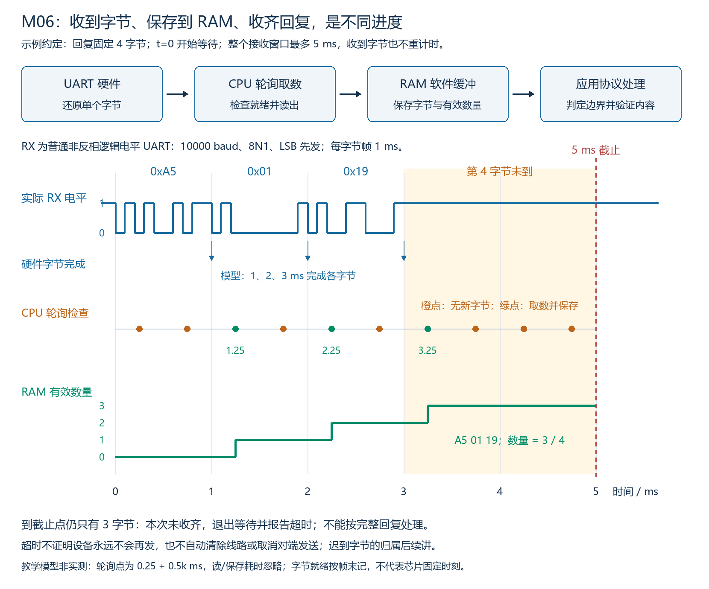

波形为理想教学推演：仅前三个字节实际到达，第四个没到；模型把各字节接收就绪放在1、2、3ms帧末，真实器件的置位时刻依其手册。CPU取数检查点为0.25、0.75、1.25……4.75ms，并在5ms处理截止；忽略读取和保存耗时。假设硬件能容纳一未读字节，RAM容量至少4字节，本例服务及时、无溢出、无其他接收错误。

| 时刻 | 接收进度 |
|---|---|
| 0ms | 开始本次等待，RAM有效数量0，截止为5ms |
| 1ms | UART完成A5，硬件有未读字节；RAM数量尚未增加 |
| 1.25ms | CPU取A5存入RAM，数量变1 |
| 2ms / 2.25ms | UART完成01，之后CPU取数保存，数量变2 |
| 3ms / 3.25ms | UART完成19，之后CPU取数保存，数量变3 |
| 5ms | 仍只有3/4字节，判本次未收齐并退出等待，不能按完整回复处理 |

固定长度示例先解决“收齐所需数量”的边界；即便收到4字节，也还要按应用规则验证内容，不能仅凭UART接收数量声称报文完全正确。缓冲中剩余位置的旧值或初始值，不计作本次第4字节。

## 六、Timeout究竟说明什么

**Timeout：超时。**在规定的时间预算内，预期条件仍未满足。本例条件是软件收齐本次4字节，因此5ms仍只有3字节，就应退出本次等待，而不是无限等下去。

本节采用**总超时**：从这次等待开始计算整个窗口，来一个字节不会重置起点。后续会区分“每个字节重新计时”和“字节间允许空闲时间”等规则，不能看到超时参数就默认含义相同。

超时并不证明对端从未发送、永远不会再发送，也不自动取消对端发送、清空线路或关闭本机UART。迟到字节可能仍进入硬件/软件缓冲；能否继续用、如何避免混入下一条报文，要根据接收恢复及应用协议规则决定，后续专门讲。

示意中的5ms是理想截止处理点。真实软件需计时源有效并及时检查，时间粒度、调度和处理延迟会影响实际退出时刻；本节不要求实现计时程序。

## 七、本段复习自测与参考答案

1. 为什么UART已经收到3字节，不能说明软件收齐一条固定4字节回复？
2. 图中2.10ms时，RAM有效数量是多少？第二字节尚未入RAM能否证明UART没收到？
3. t=0开始、总预算5ms，第三字节在4.8ms保存，截止会自动变成9.8ms吗？截止仍仅3字节，能按完整4字节回复处理吗？
4. 本次接收超时，是否说明UART硬件关闭、对端永远不会再发送？轮询和阻塞是同一个概念吗？

参考答案：

1. 字节到达硬件与CPU保存至RAM是不同交接；应用还需按协议满足消息边界，本例要4字节，并检查内容。只到3字节不完整。
2. 1。01已在2ms由UART接收，但下一个取数/保存点是2.25ms；RAM未更新不能证明UART没收到。
3. 不会，本例明确整个窗口截止仍为5ms，不随收字节重计时；不能处理成完整回复。
4. 都不能这样推断，超时只说明预期条件在预算内未满足。轮询是CPU主动检查状态，阻塞是接收流程完成/失败/超时前不返回；可以组合，但并非同义。

## 八、总超时与字节间超时

### 8.1 两个计时起点，对应两个问题

**Total timeout：总超时。**约束本次接收窗口总共最多等待多久。本章以开始等待时刻为固定起点，收到中间字节不重置总截止。

**Inter-byte timeout：字节间超时。**约束收到一个字节后，还能等多久没有下一个完整字节。本节明确采用软件规则：成功保存第1个完整字节后启用；每保存一个新字节，更新最后字节时刻并重新计算间隔截止。时间单位均为ms，忽略取数延迟；它不是从RX任意跳变/起始位重计时，也不是所有UART硬件的统一定义。

| 限制 | 本节计时方式 | 新字节到达后的变化 |
|---|---|---|
| 总超时 | 开始等待时刻＋总预算 | 总截止固定 |
| 字节间超时 | 最后一个完整字节保存时刻＋允许间隔 | 未结束接收时，随新字节保存更新 |

本节不把“计时到期后系统怎么处理”藏在名称里：这里的应用规则是一旦任一计时到期且未收齐，就结束本次候选报文并报告未完成；不因为随后迟到一个字节就自动恢复旧候选。真实驱动的超时可能只是通知已有数据，并不自动终止接收，应单独查明。

### 8.2 同样的字节，为什么会得到不同等待结果

示例仍约定一条回复4字节，但本段改为从0开始，总预算10ms，字节间允许3ms。四个字节完整保存时刻为1、3、5、9.5ms。

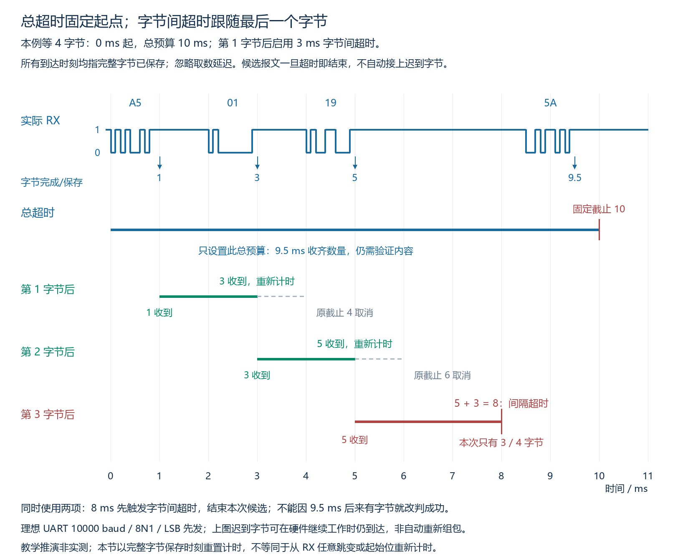

理想UART为10000 baud/8N1/LSB先发，每字符帧1ms；四帧分别在0～1、2～3、4～5、8.5～9.5ms。忽略取数延迟，按帧末保存，不把此模型等同于具体芯片接收标志的固定置位时刻。若硬件继续工作，应用在8ms超时后，迟到的第四字节仍可能出现在RX上。图非实测，不据此自动归属下一条消息。

| 事件 | 总截止 | 字节间截止及本次处理 |
|---|---|---|
| 0开始等待 | 10 | 尚未收第1字节，间隔计时未启用；总预算已约束首次等待 |
| 1保存第1字节 | 10 | 1＋3＝4 |
| 3保存第2字节 | 10 | 在原4之前，更新为3＋3＝6 |
| 5保存第3字节 | 10 | 在原6之前，更新为5＋3＝8 |
| 8仍无第4字节 | 10 | 间隔到期，按本节规则结束本次候选，只有3/4字节 |
| 9.5第4字节到达 | 原本总预算仍未到 | 同时使用两项时，本次已在8结束，不能追认成功 |

如果只设置这个10ms总预算而没有字节间限制，则本例到9.5ms可以收齐四字节数量，再按协议检查内容。这是两种接收策略的对比，不能把只用总超时的结果套给同时使用两项的策略。

### 8.3 同时使用时，看先到的有效截止

在仍未收齐且接收尚未结束时，比较固定总截止与当前间隔截止，先到哪个就先处理哪个。一旦触发失败结束，不再靠迟到字节重置旧候选的计时。

例如总截止9ms、允许间隔2.5ms，最后字节在8ms保存且仍未收齐：间隔截止为10.5ms，但总截止9ms更早，因此不能仅凭新字节更新了间隔，就把本次总窗口延到10.5ms。

同时使用可以兼顾整个事务的业务等待上限与中途长时间没有新字节的检测。本节的间隔计时从首字节后才启用，所以若第1字节始终不来，仍由总超时约束；仅设置这种间隔计时无法自动限制首次等待。

具体允许间隔需考虑对端处理、速率、调度/服务延迟和协议要求，不从10000 baud便推出统一的3ms值。本课避开“字节恰好在截止同时到达”的边界；实际系统须明确判定优先级、计时精度和检查延迟。

### 8.4 不要把软件间隔计时、硬件空闲与协议结束混为一谈

本节以完整字节成功保存时刻作为软件重计时点；某芯片的硬件IDLE（Idle，空闲）或接收超时事件可能按线路无活动、字符时间或其他条件计时，不能直接套本节数值。轮询/调度延迟也可能使软件观察到的间隔不同于线上间隔。

驱动报告一批数据可以处理，不等于已经识别出完整应用报文；本节固定4字节、超时则失败的约定也是应用规则，不是UART看到间隔就自动知道报文边界。

例如[Zephyr异步UART官方文档](https://docs.zephyrproject.org/latest/doxygen/html/group__uart__async.html)将一种接收超时定义为至少收到一个字节后的不活动时段，用来触发已有数据就绪通知，没有字节时不产生该超时事件。这是帮助区分计时起点与超时动作的具体接口例子，不把它当成本节软件候选失败策略的实现，也不要求学习其API或代码。

### 8.5 本段复习自测与参考答案

1. 总超时和字节间超时的起点分别是什么？新字节是否重置两者？
2. 本段四字节示例为何只用10ms总预算可在9.5ms收齐，但同时设置3ms间隔预算时在8ms结束？
3. 总截止9ms，允许间隔2.5ms，只有1、3、4.5ms保存的3个字节，尚未收齐，哪项先超时、何时？
4. 固定5字节回复，总截止9ms，允许间隔2.5ms，2、4、6、8ms保存前4字节，第5字节没到，应在何时由哪项超时结束？

参考答案：

1. 本节总超时从开始等待计时，截止固定；字节间超时从第1字节保存后启用，并在后续完整字节保存时重新计时。新字节只更新当前间隔截止，不更新总截止。
2. 第4字节9.5ms在总截止10之前，但第三字节5ms之后等到8ms已超过本例允许间隔，组合策略已经结束本次候选，不能追认成功。
3. 间隔截止4.5＋2.5＝7ms，比总截止9早，因此7ms间隔超时。
4. 当前间隔截止8＋2.5＝10.5ms，但总截止9更早，因此9ms总超时。前面相邻保存间隔都小于2.5ms，没有提前触发。

## 九、接收中断与主循环怎样分工

### 9.1 从一直等字节，变成在字节就绪时服务

若主循环需要更新显示、处理按键和计算结果，阻塞等待一条回复会推迟同一路径后面的工作。可以先准备接收状态，启用UART接收事件及相应CPU中断路径，然后回到主循环做其他工作；字节就绪时再由中断及时取数。是否真正非阻塞仍取决于软件组织，不能只凭用了中断就认定主流程不再等待。

**IRQ（Interrupt Request，中断请求）**是请求CPU处理事件；**ISR（Interrupt Service Routine，中断服务程序）**是CPU响应该请求时执行的程序。**Main loop（主循环）**是本例CPU平时反复执行的主流程。本节采用单核、无操作系统模型，中断到来后CPU暂停当前主循环工作，执行ISR，结束后返回继续原工作；并非多了一个CPU与主循环同时执行两段软件。

UART硬件仍可独立采样字节。中断通知CPU，不会自动替CPU把字节搬到RAM；本节DMA关闭，仍由CPU在ISR中读出、保存和更新软件数量。中断响应也有延迟，字节就绪与保存不必同一时刻。

### 9.2 一条四字节回复的时间线

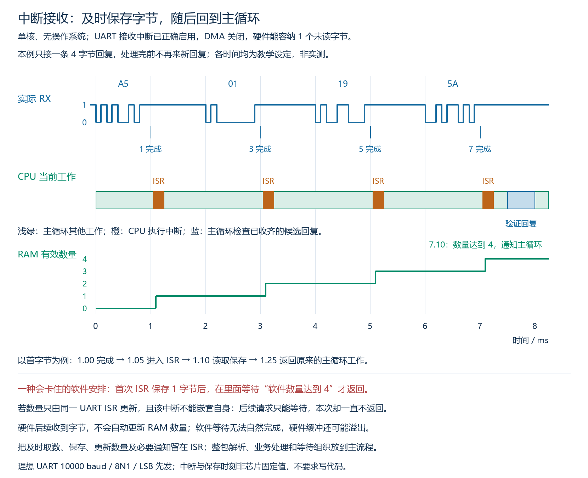

教学设定：普通非反相UART，10000 baud/8N1/LSB先发；A5、01、19、5A分别在1、3、5、7ms完整接收。硬件容纳1个未读字节，ISR及时读取，无溢出/其他错误；仅一条回复，处理完成前不再来新回复，暂不引入下一包覆盖竞争。所有时刻为理想推演，非实测或芯片固定延迟。

以第一个字节为例：1.00ms硬件完成→1.05ms进入ISR→1.10ms读出并保存，RAM有效数量变1→1.25ms退出ISR，继续主循环工作。后续三个字节采用相同相对延迟。

本例职责如下：

| 接收ISR | 主循环 |
|---|---|
| 确认并处理本次接收事件，按外设规则取走当前可读数据 | 在字节之间继续其他业务，不在同一路径无限等待 |
| 在容量允许的RAM位置保存字节，更新有效数量/接收状态 | 检查已保存数量、接收完成/错误状态及时间预算 |
| 达到本例所需4字节时，留下“候选已收齐”通知 | 根据通知验证候选报文的格式/内容，再执行业务 |
| 按芯片规则处理必要状态/错误并及时返回 | 根据超时/错误与协议规则组织重试、恢复或重新接收 |

到7.10ms数量达4，只说明本例收齐候选数量，不表示业务已执行；图中主循环7.5ms才检查并验证。通知可理解为软件留下的一个完成标记，本阶段不要求实现变量或同步代码；连续多包与缓冲所有权后续讲。

### 9.3 重要的是能否及时取数，不是主循环函数的总耗时

一个主循环业务即使需要5ms，只要允许UART中断及时打断，ISR按本例及时取走每个字节，就不能只凭“5ms大于字节完成间隔2ms”断定硬件一定溢出。应关注每次字节就绪到实际读走的服务延迟、硬件容量及后续到达节奏。

若业务执行期间关闭中断、长期被更高优先级工作占用，或ISR本身耗时过长，服务延迟可能增大并导致溢出。中断模式不保证零延迟或永不丢字节。本例各字节在完成后0.10ms读走、下个字节2ms后才完成，符合题设的一字节容量条件。

中断也不自动实现应用总超时。主循环若很久才检查截止，超时处理就可能推迟；需要安排及时的计时/状态检查。具体定时器中断或任务调度设计不在本段展开。

### 9.4 为什么通常不在接收ISR里等整条报文

假设第一次ISR已保存1字节，却在内部一直等“软件有效数量达到4”才返回，并且：

- 软件数量只在这个UART的ISR每次进入时更新；
- 同一个UART中断不能嵌套打断自身；
- 等待期间没有其他取数/更新数量的路径，DMA关闭，也没有超时退出。

那么后续字节可以进入UART硬件，后续中断请求却只能等待。本次ISR不返回，后续ISR就没有机会执行；软件数量停在1，等待条件无法自然变成4。这是指定软件安排的循环依赖，不是UART停止采样；硬件容量耗尽还可能溢出。

应让ISR处理当前已经可读的数据、保存并更新状态，然后及时返回；主循环在后续运行中检查是否收齐、是否超时，再处理整包和业务。若硬件有FIFO，一次ISR可能需要取走多字节，应按手册/驱动语义处理，不能一概规定每次中断只能读一个。

保持ISR短、把耗时处理移到可延后的执行路径是常见组织原则，[Zephyr中断文档](https://docs.zephyrproject.org/latest/kernel/services/interrupts.html)也解释了中断应快速执行及延后处理。这里采用主循环承接耗时工作，不要求学习该操作系统。并非任何简单解析都绝不能在ISR做，而是不能让未受控等待/耗时工作妨碍及时服务。

### 9.5 本段复习自测与参考答案

1. 中断接收是否意味着UART自动把字节写进RAM？单核CPU是在同时执行主循环和ISR吗？
2. 主循环某项业务需5ms，期间UART中断可及时打断，ISR按图执行，能否只凭5ms大于字节完成间隔2ms断定UART必然溢出？应主要看什么？
3. 本段指定条件下，首次ISR保存1字节后等待数量4才返回，后续字节已到UART，软件数量能自然变成4吗？应怎样分工？
4. 每次UART中断是否只能对应一个字节？中断接收能自动保证应用超时准时处理吗？

参考答案：

1. 不能，本节DMA关闭，CPU在ISR中取数保存。单核模型是暂停主循环、执行ISR、返回继续；UART硬件可并行接收，不是两段CPU软件同时执行。
2. 不能。应看字节就绪到被实际取走的服务延迟、硬件容量与到达节奏；主任务长但可被及时抢占，并不等于长期无人取数。
3. 不能。更新数量依赖后续ISR进入，本次不返回又阻止同源后续ISR进入；硬件字节不会自动改RAM数量。ISR及时取数/保存/更新/必要通知并返回，主循环随后检查完成/超时、处理整包与业务。
4. 不是，有FIFO等条件时一次ISR可能处理多个可读字节，依手册。不能自动保证，软件仍需安排及时的应用计时和状态检查。

## 十、DMA接收组织与三种方式的取舍

### 10.1 谁完成搬运，谁决定处理

**DMA（Direct Memory Access，直接存储器访问）**是按预先配置在外设与内存等位置之间搬运数据的硬件机制。在本节UART接收例子中：UART从RX还原字节→产生接收DMA请求→DMA读取UART接收数据并写入RAM→CPU依据进度/完成/错误状态处理结果。

CPU不必为每个字节都执行一次“读取UART再写RAM”，仍须配置源/目标、方向、数量及传输模式，安排状态通知、应用超时、缓冲衔接和协议处理。DMA不是另一个会理解报文含义的CPU，也不会自动更新任意C变量或执行应用业务。

本节示例配置如下，具体字段名称与顺序依芯片手册：

| 配置内容 | 本例含义 |
|---|---|
| 方向 | 从UART外设到RAM |
| 源位置 | UART接收数据访问位置，逐字节读取时源地址固定 |
| 目标位置 | 可由DMA访问的RAM缓冲，每搬1字节目标位置递增 |
| 单位与数量 | 本例8位字符无校验，按1字节为单位搬8次；不把所有芯片计数单位默认当字节 |
| 模式 | Normal，普通/单次模式：达到配置数量后结束本批，不自动回绕到缓冲开头 |
| 工作条件 | UART及DMA时钟/映射/接收请求与DMA通道正确启用，RAM容量与访问条件满足 |
| 通知 | 本例仅用本批搬完后的完成中断通知CPU，无半传输通知，无接收/DMA错误 |

DMA与中断可以配合使用：DMA搬数据，CPU在完成ISR中更新本批状态/留下通知并及时返回，主循环随后验证和处理。并非“使用DMA就不需要任何中断”，也不是每个字节仍必须进入CPU接收ISR。

### 10.2 一次搬8字节，可能包含两条应用报文

假设已知接收从报文边界开始，应用固定每4字节一条。两条候选分别为A5 01 19 5A与A5 01 20 5A，字段含义暂不展开。DMA普通模式配置8字节，连续收到这8字节，无额外第9字节，也没有其他写入者改动缓冲。

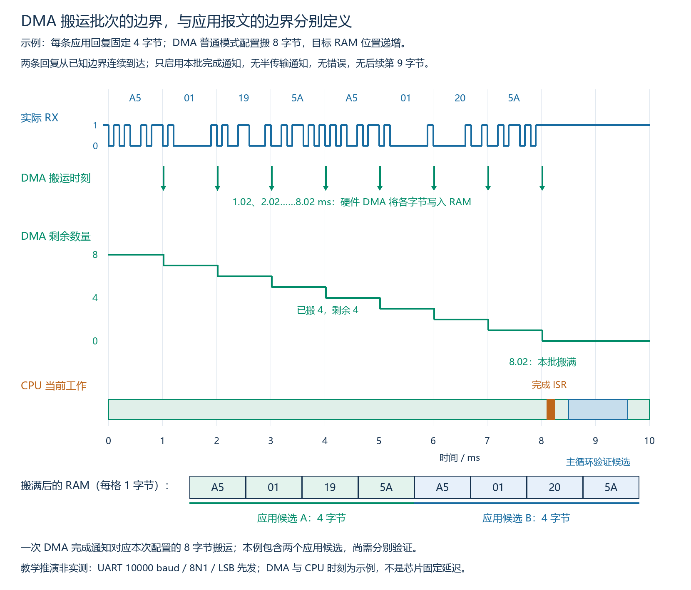

理想UART为10000 baud/8N1/LSB先发，连续八个字符帧分别在1～8ms帧末完成。示例DMA在每个完整字节之后0.02ms读写RAM，剩余计数8→7→……→0。DMA服务及时、RAM供CPU正常读取，所有时间为教学设定，非芯片固定值或实测。

- 到4.02ms已搬4字节，剩余4；即使没有完成通知，前4字节已在RAM，不等于“完全没收到”。在本例数量与缓冲归属明确的条件下，可据进度判断已搬量。
- 到8.02ms第8字节写入RAM，剩余0，本批搬运完成；本例8.10～8.25ms由CPU执行完成ISR，8.5ms主循环开始验证候选。
- 本批8字节按已知4字节边界分成两条候选，不能把“一次完成通知”直接当成“一条应用报文”。分别验证后才能决定是否交给业务。

**DMA批次边界由搬运配置确定，应用报文边界由协议确定。**本例只是方便对齐的一种情况，真实批次还可能只含半条报文，或包含完整报文加另一条的开头；更不能假定每个缓冲起点天生就是报文起点。具体如何拼接留后续组包章节。

DMA完成也不等于CRC/命令/地址等应用检查通过。UART错误、DMA错误、软件使用范围和应用完整性属于不同检查；即使逐字节电气传输正常，也可能收到不符合业务格式的内容。

### 10.3 剩余计数、应用数量与超时分别管理

在本例普通模式、一字节单位、无重启/回绕/错误且进度已确认的前提下，可用配置8减当前剩余4，确认已搬4字节。真实应用需依控制器保证进度和数据可见性，并确认缓冲所有权；不假定任意时刻读取一份计数或所有RAM位置都自动属于本次有效数据。

DMA的硬件剩余计数与程序自己维护的“收到多少字节/是否完成”状态不是同一个对象。DMA不会自动修改任意软件计数变量，CPU需依据可靠的进度/完成信息组织应用状态；本阶段不要求写同步代码。

如果本批配置8却只到4字节，剩余4且不再有新数据，完成事件可能一直不出现。软件仍应按应用规定检查总超时/间隔超时；不能只因为DMA未满，就无限等下去。超时后如何暂停/停止、取得一致的已搬数据并衔接下一轮，应按外设/驱动和协议规则，不能任意清零长度后让旧DMA继续写同一缓冲。

普通模式搬满后，本次DMA不会自动把第9字节写回第一个位置；接收硬件也不一定随之关闭。连续数据若仍到来，需要及时衔接下一块可用缓冲或合适的接收方式，否则可能积压/丢失。循环DMA与环形缓冲之后再讲，不把普通模式当作自动循环。

### 10.4 怎样选择轮询、中断与DMA

| 组织方式 | 主要搬运者与适用方向 | 仍需解决什么 |
|---|---|---|
| 轮询取数 | CPU主动查状态并读存；少量、低频、允许等待或可及时检查的简单事务可考虑，配置相对直接 | 服务是否及时、是否阻塞主路径、等待/超时和缓冲 |
| 中断取数 | CPU响应接收事件后读存；数据间歇到来且主循环需兼顾其他工作时可考虑 | 响应延迟、ISR耗时/频率、软件缓冲及整包处理 |
| DMA接收 | DMA按配置读写；连续/较大批数据、希望减少CPU逐字节搬运时可考虑 | 配置和服务能力、批次通知、有效数据范围、缓冲衔接、应用边界与超时 |

没有仅由某个固定波特率决定的统一切换门槛，应结合吞吐量、CPU负担、硬件支持、延迟与程序复杂度。DMA可能降低逐字节CPU工作，但不改变UART波特率或帧在线路上的耗时，也不保证所有系统中总耗时必然更小。

本节按ST官方UART驱动中的DMA接收启动/普通模式完成路径核对：完成后结束该次接收DMA请求，并通过完成通知衔接软件；它没有替应用解析报文。资料仅供导师查证，不要求学习者分析代码，具体行为仍依所用MCU/驱动版本。

### 10.5 本段复习自测与参考答案

1. DMA接收时，UART、DMA和CPU分别做什么？使用DMA还能使用中断吗？
2. 本例一次配置8字节完成，能证明只有一条应用报文且内容有效吗？
3. 已知批次从报文边界开始，每条固定3字节，DMA一次搬6字节，包含几个候选？一次DMA完成能证明它们都有效吗？
4. 普通DMA配置8，确认本次剩余4、RAM前4字节有效但没有完成通知，是否完全没收到？应用总截止已到，能因DMA没满无限等吗？
5. 普通模式搬满后，后来的第9字节是否自动回到缓冲第1格？DMA是否能让相同UART波特率的线路字节变快？

参考答案：

1. UART采样还原字节，DMA按配置搬到RAM，CPU配置、管理进度/错误/超时/缓冲并处理协议与业务。可以用DMA完成等中断通知CPU，两者不互斥。
2. 不能。本例已知边界和固定长度下包含两条4字节候选，还需分别验证内容；完成只表明该搬运批次达到条件。
3. 两个候选，不能证明都有效，还需按协议验证。不能由通知次数决定报文数。
4. 不是完全没收到，已确认搬4字节。不能无限等，应按应用超时规则结束/恢复并依驱动安全地处理已搬进度及后续数据。
5. 不会，本节普通模式不自动回绕，需要另行安排连续接收。不会改变波特率规定的位时间/帧耗时，只是改变本机搬运工作。

## 十一、M06-02：接收缓冲的容量、消费与软件丢失

### 11.1 软件缓冲解决什么问题

UART收到字节的节奏由对端发送决定，主循环可能正在处理其他业务。软件缓冲可以暂存已经取走但还未交给后续处理的数据，使及时接收与稍后处理能够分开安排。

**Producer，生产者**是向缓冲交付数据的一方，本例为接收ISR；**Consumer，消费者**是取走数据进行后续处理的一方，本例为主循环。DMA也可以参与写入数据，但需由软件正确确认可读范围，本段先用ISR管理的字节队列解释容量，不展开DMA并发实现。

本例使用**FIFO（First In, First Out，先进先出）**队列：成功存入的数据按先后顺序被取走。当前只讲逻辑顺序和容量，稍后再讲环形方式如何复用物理RAM位置。

### 11.2 分清容量、待处理量和空闲量

| 数量 | 本节含义 |
|---|---|
| Capacity，容量 | 本例队列最多能保留多少个尚未取走的字节 |
| 待处理量 | 已成功入队、尚未安全取走的字节数 |
| 空闲量 | 本例可继续接收的容量，等于容量减待处理量 |

在没有其他占用/预留的本例中，待处理量变化为“原待处理量＋成功入队量－安全取走量”。注意加的是成功入队量，不是所有到达RX的字节数；队列满时被拒绝的新字节不增加待处理量。

分配8个RAM字节的位置，不等于其中全是本次有效数据。数据取走后原来的内存位可能仍保留旧值，是否空闲由读写进度/有效状态决定，不依赖把内存清零；0x00本身也可以是有效数据，不能把值为0直接当作空位。

### 11.3 容量4的具体接收过程

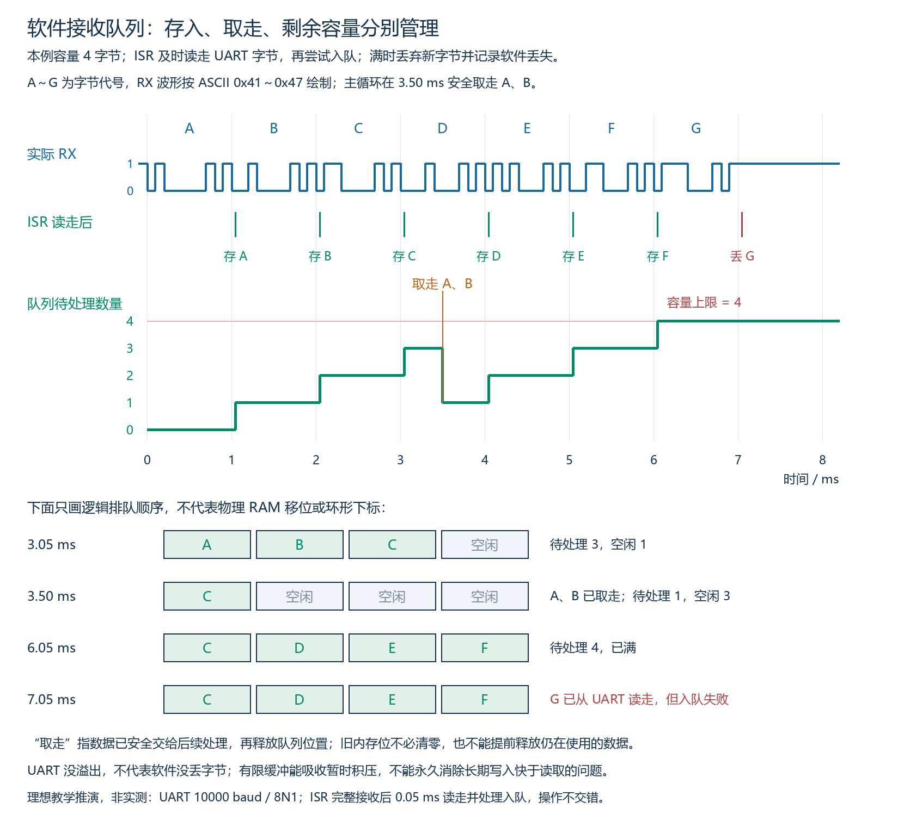

模型：单核、ISR从UART及时取字节，软件队列有效容量4字节；7个字节A～G依次到达，图中普通非反相UART为10000 baud/8N1，LSB先发，波形按ASCII 0x41～0x47绘制。硬件在1～7ms模型帧末分别收完，ISR在各完成后0.05ms读走并尝试入队，无UART硬件溢出/其他错误。主循环3.50ms安全取走A、B，其余时段未消费；各操作按图顺序完成，不讨论共享状态操作交错。

本例满队列采用明确策略：**丢弃新字节，保留仍待处理的旧字节，并记录软件丢失事件**。它是本例选择，不是所有驱动默认行为。

| 时刻/动作 | 待处理逻辑顺序 | 待处理量/空闲量 |
|---|---|---|
| 3.05ms存完前三字节 | A B C | 3 / 1 |
| 3.50ms主循环取走A、B | C | 1 / 3 |
| 4.05、5.05、6.05ms再存D、E、F | C D E F | 4 / 0 |
| 7.05ms读走G但队列已满 | 仍为C D E F；G丢失 | 4 / 0 |

下方格子展示逻辑排队顺序，不代表RAM实际搬移字节，或已经展示环形下标。已消费空间可以由正确的队列管理继续利用，具体物理位置如何选择下一段再讲。

### 11.4 硬件没溢出，软件仍可能丢

本例G已从UART硬件及时取走，因此接收硬件没有因为这个字节未取走而溢出；但软件队列没有空位，G依然没有交给后续处理。不能仅凭UART没报告溢出，就宣称整条接收链没有丢字节。

若不检查满状态而直接重用仍有未读数据的位置，则可能覆盖旧数据；若明确采用丢新策略，则丢的是新数据。不同策略影响丢什么，但都不能让有限容量凭空多保留数据。

应记录软件入队失败/丢失，不能继续假定原报文连续完整。具体是否弃掉当前候选、怎样重新同步、是否请求重发，需依据应用协议，后续章节展开。不默认任意UART链路都能自动让对端暂停；暂停/流控需双方及硬件/协议支持。

### 11.5 “取走”与“释放位置”需要对应

本例的“安全取走”可以理解为已经复制到由后续处理持有的另一处存储，然后再释放队列位置。若仅记住队列内的某个位置、数据还没读完，就提前把该位置交回生产者，新字节可能覆盖仍在使用的内容。

不要求把每个已消费位置清零，但必须正确更新状态，真实ISR/主循环协作还需保证共享读写进度一致。本阶段先按事件顺序推演，不写同步或锁代码。

### 11.6 大缓冲能吸收暂时积压，不能无限补偿慢处理

主循环短时间忙碌时，更大缓冲可以保留更多积压数据，使它稍后有机会追上。若长期持续到达1000字节/秒，而长期只能取走800字节/秒，在本节无暂停、无压缩/合并等条件下，每秒净增加约200字节，任意有限缓冲最终都会满；单纯扩容只能延后发生时刻。

应结合业务需求提高消费能力、减少不必要处理、降低数据产生量，或在双方支持时安排流控/暂停；短期突发和长期平均能力分别评估，不能一见积压便只说“换DMA”。硬件搬运更快并不自动加快应用消费。

这些是有限队列模型下的推演。[Zephyr缓冲文档](https://docs.zephyrproject.org/latest/kernel/data_structures/ring_buffers.html)也区分缓冲容量、实际可写范围、已写发布和已消费释放；本节仅借它核对这些概念，环形下标下一段讲，不要求学习其API或实现。

### 11.7 本段复习自测与参考答案

1. 容量8、已有5字节待处理，主循环安全取走3字节，再成功写入4字节，最终待处理量和空闲量各是多少？
2. 主循环取走字节后必须把旧内存清零，才能释放空间吗？仅保留指向旧位置的引用、没读完便释放有什么问题？
3. UART硬件没溢出，但软件队列满后按策略丢了新字节，能否认定端到端没有丢字节？
4. 长期写入1000字节/秒、取走800字节/秒，只有扩容且不改变流量/处理能力，能否永久解决满缓冲？

参考答案：

1. 待处理5－3＋4＝6字节，空闲8－6＝2字节；取走的3字节不再计入队列待处理量。
2. 不必清零，以有效状态和读写进度管理。尚未安全读走就释放，会让生产者重用并可能覆盖仍在使用的数据。
3. 不能，UART硬件取数正常与软件队列保存成功是不同交接，本例软件层已经丢字节。
4. 不能，平均每秒积压约200字节，任意有限容量最终会满；需处理持续的供需差异，扩容只能延后。

## 十二、M06-02：简单环形缓冲的读写位置与满空

### 12.1 “环”指访问顺序循环

**Ring buffer / Circular buffer，环形缓冲。**底层可以是一段固定RAM数组，按逻辑顺序写入、读取；访问末位置之后回到0号位置，复用已经释放的空间，不要求每次把未读字节整体移到数组开头。[Zephyr环形缓冲说明](https://docs.zephyrproject.org/latest/kernel/data_structures/ring_buffers.html)也说明了FIFO次序、读写位置和末尾回绕。

本节定义三个状态，避免不同资料对head/tail的命名差异：

| 状态 | 本节约定 |
|---|---|
| R，Read index，读下标 | 有数据时，下一个要安全取走的字节位置 |
| W，Write index，写下标 | 有空位时，下一个成功写入的字节位置 |
| n，Count，待处理数量 | 成功写入但尚未安全取走的字节数 |

本课额外记录数量n，因此N个物理位置全可用，可保留N字节；以下所有例子均按此方案，操作按事件顺序完成。另有预留一格等满空区分方案，此时可用容量可能是物理格数减1，不能混用它的判定条件。

### 12.2 写入与取走分别移动哪一个下标

- 先判断未满，再把新字节写到W，成功后W前进一格、n增加1。
- 先判断非空，再从R安全取走字节，随后R前进一格、n减少1。
- R、W经过最后一格后，下一位置回到0；数组的物理位置没有跟着移动。
- 满时按本例丢新策略拒绝新字节，R、W、n都不因拒绝而变化；空时没有可取字节，不把旧内存值当新数据，也不随意移动R。

这些是逻辑操作规则，不是并发实现代码。实际ISR/主循环共同维护状态需正确同步，尤其本课额外数量由读写双方更新时不能假定任意共享更新天然安全；同步代码不在当前阶段要求内。

### 12.3 四格缓冲的物理位置与逻辑次序

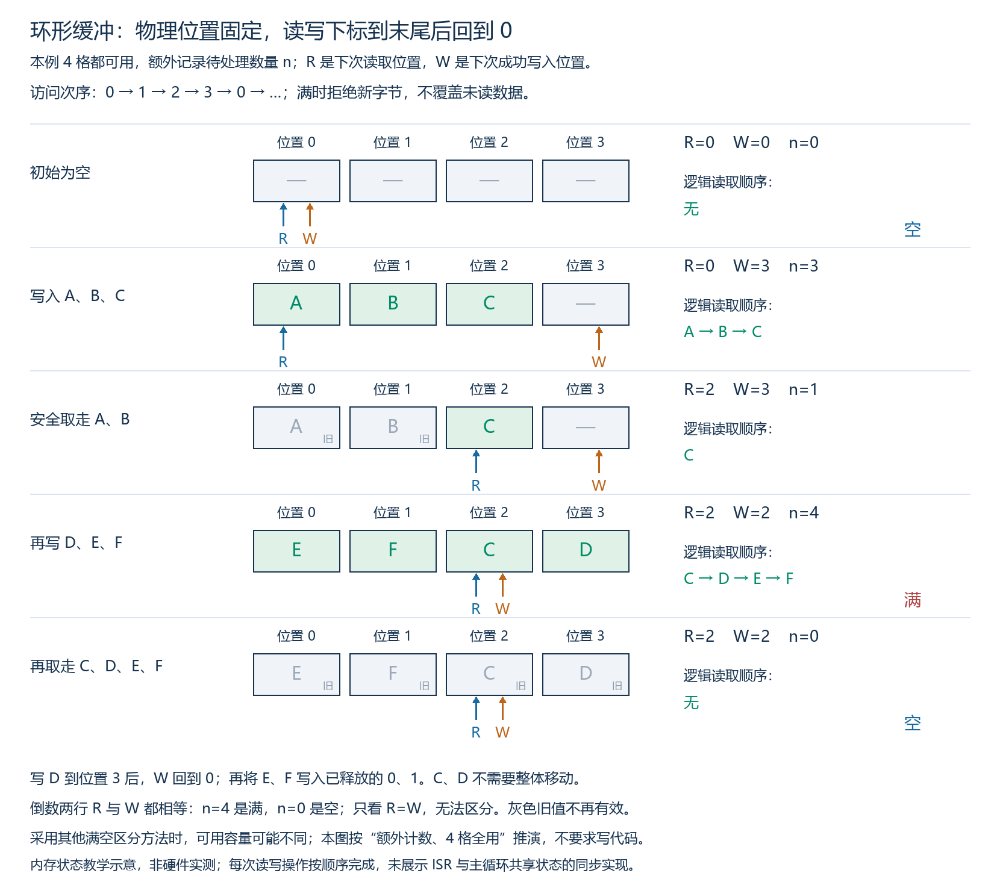

图为内存状态教学示意，非硬件测量。四格编号0、1、2、3，初始R=W=0、n=0。绿色为有效未读字节，灰色字母为仍留在RAM但已无效的旧值。

| 操作结束后 | R | W | n | 未读数据的逻辑顺序 |
|---|---|---|---|---|
| 初始空 | 0 | 0 | 0 | 无 |
| 依次成功写A、B、C | 0 | 3 | 3 | A、B、C |
| 安全取走A、B | 2 | 3 | 1 | C |
| 再成功写D、E、F | 2 | 2 | 4 | C、D、E、F |
| 再安全取走C、D、E、F | 2 | 2 | 0 | 无 |

写D时使用3号位置，W随后回0；写E、F复用已经释放的0、1。满时物理RAM从0到3是E、F、C、D，读取却从R=2开始，按2→3→0→1得到C、D、E、F，仍保持FIFO。不能每次都从物理位置0开始读，也不需要将C、D整体搬移。

最后一行物理RAM仍可能保留E、F、C、D，但数量n=0，全部已消费，因此不存在4个待处理字节。释放空间不必把旧值清零。

### 12.4 为什么只看R=W不够

本节允许四格全用，并额外记录数量，因此R=W可能表示两种状态：n=0时空，n=容量时满。上图倒数两行R=W=2，但前一行满、后一行空。

若满时仍直接写W，会覆盖当前最老的未读字节；环形只解决末尾回绕与空间复用，不会自动消除容量限制。应先按n判断本次操作是否合法，再移动对应下标。

真实实现还可以使用其他状态表达方式，不能脱离该实现约定，仅背“读写下标相等就是空”或“有N格必有N字节可用”。本课检查均明确使用额外计数的全容量方案。

### 12.5 本段复习自测与参考答案

1. 环形缓冲是否要求每次消费后把剩余数据整体搬到数组开头？逻辑读取顺序总从物理0号位置开始吗？
2. 五格编号0～4，额外计数，初始空R=W=0。依次写A/B/C/D，安全取走3字节，再成功写E/F/G。最终R、W、n各是多少，下一个应读哪个字节？
3. 五格全可用，R=W=2、n=5，是空还是满？按满时丢新策略，再来一个字节，R/W/n是否变化？
4. 若上题五个字节全部安全取走，R/W/n各是多少？旧值未清零还能再次当有效字节读取吗？

参考答案：

1. 不要求，环形通过回绕下标复用空间。按R所指的最老未读字节开始，不能固定从0读取。
2. 写四字节后R=0/W=4/n=4；取三后R=3/W=4/n=1；再写E到4、F到0、G到1，最终R=3、W=2、n=4，下一个读D。
3. 满，不能继续写入未读位置；拒绝新字节后R=2、W=2、n=5保持不变，应另记软件丢失。
4. R前进五格回到2，W仍2，n=0；本次为空，不能把旧值再当有效数据读取。

## 十三、M06-02：循环DMA与软件环形管理的边界

### 13.1 硬件回绕与软件满空策略分别负责什么

**Circular mode，循环模式。**本节采用常见的外设到RAM循环DMA配置：源位置固定、目标位置递增，达到本轮配置数量后重新装载计数/地址，继续服务之后的接收请求。目标位置因此不断按0、1……末格、0的顺序重复。

[ST的DMA官方培训资料](https://www.st.com/resource/en/product_training/STM32G0-System-Direct-memory-access-controller-DMA.pdf)说明了循环模式下地址/计数自动重装以及传输继续的机制。本节借此建立模型，不把寄存器名称、通知细节或所有高级DMA功能混为相同实现。

| 对象 | 本节责任与边界 |
|---|---|
| 软件环形队列 | 软件维护读写进度/有效状态，先判断有无空位，决定本次是否接受新字节；上节指定满时丢新 |
| 常见循环DMA配置 | 硬件按配置持续回绕写RAM，不读取任意软件R/W/n变量，也不自动等消费者读完旧数据 |
| CPU接收管理 | 及时识别可读数据范围、安全复制/消费、维护连续进度、处理覆盖/错误/应用超时及报文 |

循环DMA可以用于环形接收方案，但“DMA会回绕”不等于已经实现了安全的软件队列。它也不会因为收到一条应用报文就自动停在报文边界，或等待完成ISR返回后才继续写下一轮。

### 13.2 主循环不消费时，旧数据怎样被覆盖

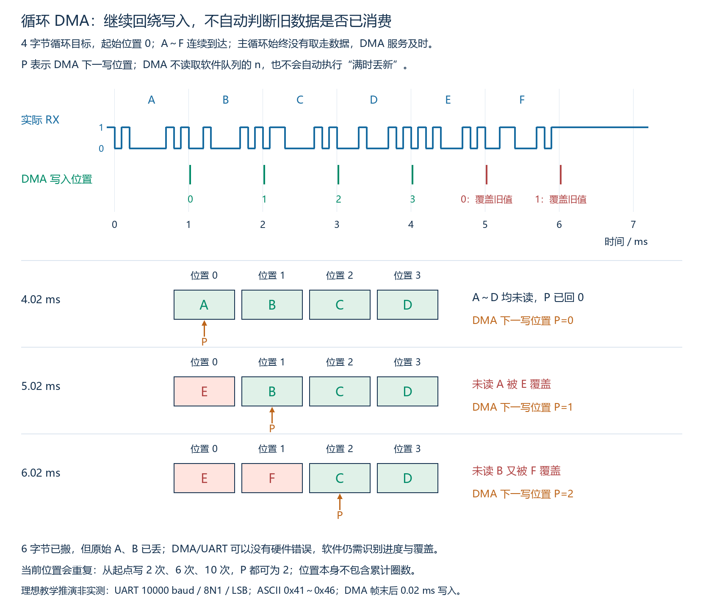

教学条件：4字节循环DMA目标，从0开始；普通非反相UART10000 baud/8N1/LSB，A～F按ASCII 0x41～0x46连续到达。模型字节在1～6ms帧末就绪，DMA在各帧末后0.02ms写入RAM，服务及时；主循环始终未取走数据。图为理想推演，非实测。

本节用**P表示DMA下一写位置**，范围0～3；P是解释用的位置概念，不声称每个芯片提供同名寄存器，也不等于上一节由软件检查满空后才更新的W。

| 时刻 | 物理0～3号位置 | DMA下一写位置P | 数据是否受损 |
|---|---|---|---|
| 4.02ms | A B C D | 0 | 本例四个字节均未消费，但暂未覆盖 |
| 5.02ms | E B C D | 1 | 尚未读取的A被E覆盖 |
| 6.02ms | E F C D | 2 | 尚未读取的B又被F覆盖 |

这些写入可以全部按硬件配置成功，UART和DMA都未出现对应硬件错误，但原始A、B已无法从这四格恢复。不能把“DMA无传输错误”当作“应用无丢数据”。

物理RAM此时还保留C/D/E/F，并不代表软件已经正确知道读起点、发生过多少覆盖，或应用报文依然完整。不可继续把旧读位置当成仍保存原字节，也不能仅把软件数量清零，就假定硬件及后续报文已经重新对齐。

### 13.3 为什么当前位置不能代替累计进度

本例从0启动后，成功写2次、6次、10次都得到P=2。位置只说明下一次将写哪一格，不包含累计圈数。

同理，两次观察P都等于2，中间可能没有新字节，也可能已经写了一整圈甚至多圈；若观察间隔没有可靠约束，仅由位置相等无法区分。

需要可靠的累计搬运/圈次信息，或对观察/服务间隔及最大输入量作保证，使两次观察之间不可能写满一整圈。具体可结合及时处理的分段/周期通知与进度快照，但通知本身也需要正确服务；不能默认一个中断标志会保存任意多个尚未处理的整圈次数。

本阶段不实现寄存器读取或圈次算法，只要求说明“位置会重复，因此可能缺累计信息”。真实数据可见性、计数快照与缓冲共享仍按芯片/驱动规则处理。

### 13.4 怎样组织后续消费

软件应及时识别已写好的数据段，在DMA绕回该段前安全复制或消费，之后再交给报文处理。某些DMA提供**Half-transfer（半传输）**和本轮完成通知，可以帮助分段安排；并不是通知发生后那块RAM就永久停止变化。

最长服务时间应包含通知响应、进度确认、实际复制/消费等工作，并结合最坏输入速率、缓冲容量和当前数据所在位置验证。不能仅按“设置了循环模式”就保证不丢，也不能说每一条应用消息必须等DMA整轮完成才有机会处理。

若数据已经被覆盖，应记录软件层数据丢失，按协议处理当前候选及重新同步，不能静默把剩余字节拼作连续有效报文。增大缓冲、提高消费能力或双方支持的流控可用于满足时序条件，但“回绕”本身不增加容量。

### 13.5 本段复习自测与参考答案

1. 上节软件满时丢新策略，会因启用循环DMA而自动由硬件执行吗？
2. 五格循环DMA从0开始，连续写入A～G，主循环一个也未取走。哪些未读旧字节被覆盖？下一写位置P是多少？
3. 五格循环DMA两次观察P均为2，能否认定中间没有新数据？还需什么信息或约束？
4. 循环DMA本轮完成通知到来后，是否意味着这块RAM永远保持不变、正好一条报文有效？

参考答案：

1. 不会，本节这种常见配置只按配置持续回绕，不查询任意软件队列数量或消费状态；CPU仍须组织安全消费与覆盖检测。
2. F覆盖A、G覆盖B，未读A/B丢失；物理为F/G/C/D/E，P=2。DMA服务可以正常，软件数据仍丢失。
3. 不能，可能0、5、10……次写入。需可靠累计搬运/圈次信息，或保证观察/服务间隔内最大输入不足一整圈；只看当前位置不够。
4. 都不意味着。DMA会继续回绕，通知不锁定RAM；批次边界也不等于应用报文边界，仍需及时消费和协议验证。

## 十四、M06-02：固定长度组包与跨环形末尾读取

### 14.1 先声明协议边界，再处理每批数据

**Fixed-length framing，固定长度分帧/组包。**本节协议约定每条报文固定4字节；软件从已知的第1条报文起点开始，每收集4字节就形成一个完整数量的候选，再按协议验证内容。

前提必须明确：字节按序、没有丢失/重复/覆盖，当前起点已经对齐，且本段不触发接收超时。若起点未知或中途丢了字节，机械地每4字节切一段不能保证恢复正确边界，之后将讲同步和异常恢复。

**Callback，回调**是驱动在事件发生时调用约定处理入口的一种组织方式，执行上下文依具体驱动。回调带来的可用数据范围，或某次DMA交付的批次，不天然等于应用报文。

例如[Zephyr异步UART文档](https://docs.zephyrproject.org/latest/doxygen/html/group__uart__async.html)说明，数据就绪通知可因缓冲满或收到数据后的不活动等事件产生，同一缓冲也可能多次通知。因此应按接口语义确认本次新增范围，再按应用协议组包；不能由通知本身直接认定一条报文结束，也不能每次重复处理整个旧缓冲。

以下把“批次”抽象为已确认的新增有效字节，每批按序安全交付，具体中断/DMA回调实现不要求编写。

### 14.2 把未满候选保留到下一批

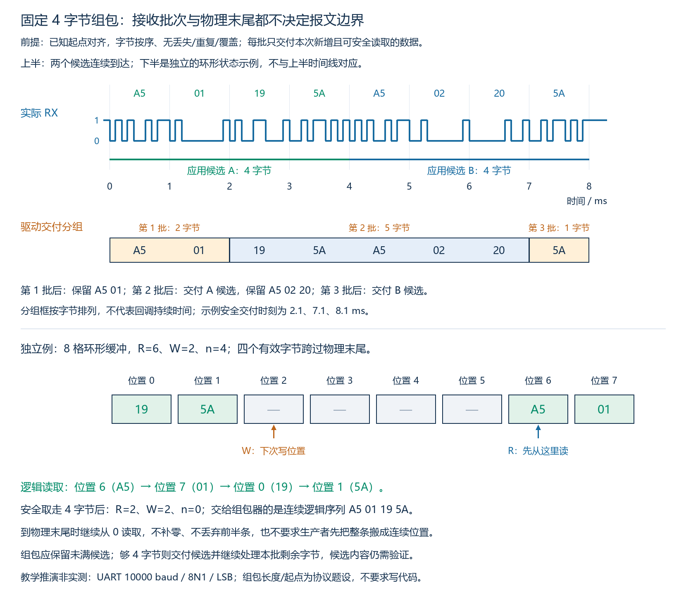

上半图两条候选为A5 01 19 5A与A5 02 20 5A。普通非反相UART10000 baud/8N1/LSB，连续八帧0～8ms；示例在2.1、7.1、8.1ms安全交付三批，大小分别2、5、1。分组框按字节位置排列，不表示CPU回调持续时间，图为理想推演非实测。

| 收到本次新增批次 | 本次处理 | 必须保留的未满候选 |
|---|---|---|
| 第1批：A5 01 | 只有2字节，未到4，不交付完整候选 | A5 01 |
| 第2批：19 5A A5 02 20 | 前2字节补完旧候选，交付A5 01 19 5A；继续处理本批余下3字节 | A5 02 20 |
| 第3批：5A | 补到4字节，交付A5 02 20 5A | 无 |

自然语言流程是：依次接收新增字节，补到当前未满候选；够4字节便交付一个候选并开始下一条，继续处理本批剩余；本批结束仍未满时保留当前候选的字节和有效数量，等待后续新增数据或应用超时处理。

所以同一批可能包含半条、一条、多条或一条尾部加下一条开头。不能回调一结束便清掉所有未满数据，也不能只处理本批第一条候选就丢弃剩余字节。收齐数量仍需内容验证，不直接等同于业务成功。

保存未满候选时，应保证字节仍由组包器安全持有，例如复制到自己的候选存储；不能只记一个驱动即将重用的位置，然后默认旧内容会永久保留。组包器消耗的是字节顺序，不依赖每批数据都从报文起点开始。

### 14.3 跨环形末尾仍是一条逻辑连续报文

下半图是一个独立状态，与上半时间线不对应。环形缓冲8格全可用、额外数量方案，R=6、W=2、n=4，四个有效字节为：位置6=A5、7=01、0=19、1=5A。当前R恰好是报文起点，读取期间无其他写入/覆盖。

读取从R=6开始，按6→7→0→1取四个字节，逻辑序列仍为A5 01 19 5A。物理位置跨末尾不是报文结束，也不需要补零或丢弃已取出的前半条。

安全复制/消费四字节后，R到2、W仍2、n=0。队列变空只说明这四字节已从接收队列交给后续；候选可能已复制到组包器持有的另一存储，还要验证和处理，不能将队列释放等同于业务已完成。

一次连续内存范围访问不应越过数组边界，可以分别访问末尾段与开头段，再保持逻辑顺序组合，或者依次取字节。具体实现当前不要求代码。只要有效数据/所有权受保护，不需要让生产者先把整条报文重新搬成一段物理连续空间。

### 14.4 固定长度与接收长度的不同约束

本节固定4字节是应用协议规定；某次DMA配置8、驱动上报5、环形当前能连续读取2等数字，是接收组织与物理范围条件，不能相互替代。

组包前要确认真正的新增有效字节以及正确顺序；组包时维护候选的有效长度；组包后验证内容。出现超时/丢失/覆盖时，应切到协议规定的恢复流程，而不是把未来任意字节无条件接在失败候选后面。具体分隔符、长度字段和恢复机制将在后续段落讲。

### 14.5 本段复习自测与参考答案

1. 固定4字节，起点对齐且无丢失，两批新增分别11 22 33与44 55 66。处理第2批后可交付哪个候选？还需保留什么？数字均为十六进制。
2. 每次回调结束都把未满候选清空，会怎样？一次回调会不会同时补完旧候选并带来新候选开头？
3. 八格全用，R=7、W=3、n=4；位置7=A1、0=B2、1=C3、2=D4，均有效。按固定4字节、安全取走后，候选内容、R和n分别是什么？
4. 起点未知或中途丢字节，仅每4字节切一条是否保证正确？物理环形末尾能否自动当作报文末尾？

参考答案：

1. 可交付11 22 33 44，保留55 66作为下一候选前2字节；不能把单批长度当报文长度。
2. 会丢掉尚未补齐的数据。会，同批可同时包含前一条尾部与下一条开头，需持续处理所有新增字节并保留残留。
3. 候选A1 B2 C3 D4；R按7→0→1→2→3变为3，n=0，W保持3。前提是这四字节已安全交给组包器/后续处理。
4. 都不能。固定长度还需边界起点/连续性等前提，丢失后需要按协议恢复；物理缓冲边界由内存布局决定，应用边界由协议决定。

### 14.6 接收队列与组包器分别计数的完整示例

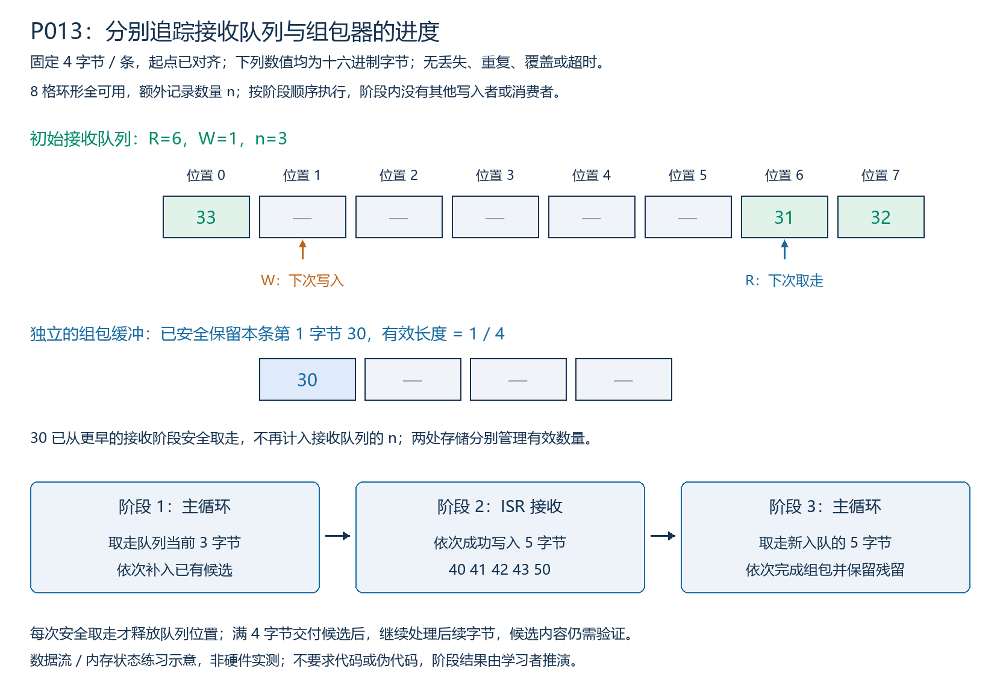

前提如图：固定4字节，8格环形全部可用，顺序执行且无并发写入/覆盖。数字为十六进制字节，R/W/n为十进制状态。组包器已另存30，不计入队列n。

| 阶段结束 | R | W | n | 组包结果 |
|---|---|---|---|---|
| 初始 | 6 | 1 | 3 | 已保留30 |
| 主循环取走31、32、33 | 1 | 1 | 0 | 交付30 31 32 33，候选存储重新开始 |
| ISR成功入队40、41、42、43、50 | 1 | 6 | 5 | 组包器尚未消费这批 |
| 主循环取走新入队的5字节 | 6 | 6 | 0 | 交付40 41 42 43，另存50为下一条开头 |

队列n=0与组包器仍保留50可以同时成立：数据已从队列安全移交，仍待后续字节补齐。R/W是下一访问位置；每次只由对应动作推进，n不等于容量或组包器残留数量。

## 十五、M06-02：分隔符组包与超长后的边界恢复

### 15.1 用约定字节标记结束

**Delimiter，分隔符**：协议指定某个字节或字节序列作为报文边界。本节自定义UART文本协议，以**LF（Line Feed，换行）=0x0A**结束一条，LF不属于交付正文。正文长度可以变化，但最多4字节，且不允许包含LF。启动时假设已位于报文边界；字节按序、安全交付，无其他错误或超时。

字符采用**ASCII（American Standard Code for Information Interchange，美国信息交换标准代码）**编码。本节的T、=、2等每个字符占一字节。LF或`\n`是对一个0x0A字节的表示，不是分别发送字母L/F或反斜杠/n两个字符。若协议使用CR（Carriage Return，回车，0x0D）或CRLF，应按对应约定处理，不能默认都等同于本节的单LF。

LF作为UART的数据字节，仍有自己的起始位、8个数据位和停止位。UART停止位负责字符帧结构；应用软件识别0x0A来结束文本消息。这里的正文上限与结束规则都由教学协议规定，不是UART自带要求。

### 15.2 分批接收，遇到LF交付候选

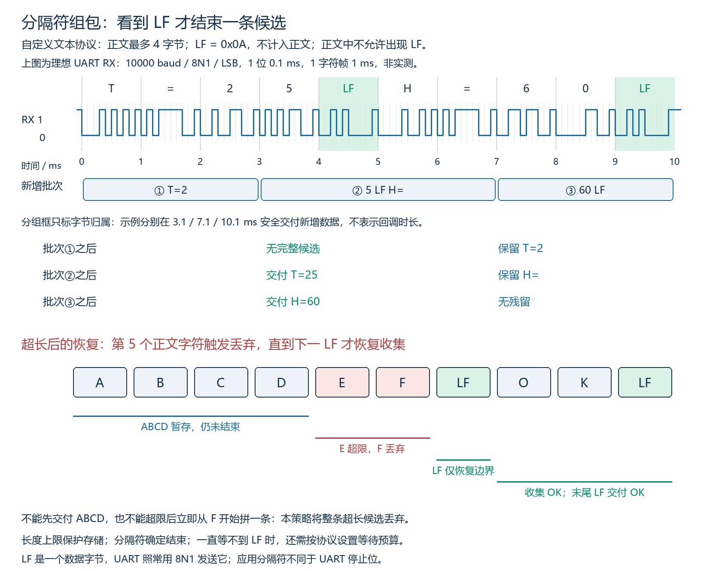

上半图连续发送`T=25 LF H=60 LF`，其数据字节为54 3D 32 35 0A 48 3D 36 30 0A（十六进制）。理想UART10000 baud/8N1/LSB，每字符帧1ms；波形为推演，非实测。三批新增范围分别在3.1、7.1、10.1ms安全交付；分组框按字节归属排列，不表示回调执行时长。

| 新增批次 | 当批交付的候选正文 | 待保留正文 |
|---|---|---|
| T=2 | 无，未遇LF | T=2 |
| 5 LF H= | T=25 | H= |
| 60 LF | H=60 | 无 |

逐字节收集正文；在收集状态遇LF则结束当前候选，再继续处理本批剩余字节。批次结束但未遇LF时，保留当前正文。收齐候选仍要检查内容，例如数值字段能否解析、命令是否合法，不能直接认定业务有效。

### 15.3 长度上限不是固定报文长度

最多4字节允许`OK LF`、`T=2 LF`、`T=25 LF`等不同正文长度。已收到4个正文字符但没有LF时，不能提前交付：它可能随后正常结束，也可能继续变成超长输入。LF不占本节4字节正文额度；具体存储实现若另存LF或字符串结尾零，还需单独预留空间。

本节明确采用以下超长策略：收到第5个非LF正文字符时，丢弃整条当前候选，进入丢弃状态；此后忽略所有非LF字节。遇到下一个LF时，仅结束丢弃、恢复收集下一条，不交付被截断的正文或丢弃过程的后缀。

下半图独立输入`A B C D E F LF O K LF`：ABCD暂存而不交付；E使长度超限，原候选丢弃，F也丢弃；第一个LF只恢复边界；随后O/K/末尾LF形成唯一候选`OK`。若超限后立即清空并把F当新开头，就可能误把原报文后缀当作新消息。

这是明确选定的一种应用策略，不声称所有协议都这么恢复。超长时也不能继续无界扩张存储或越界写入。

### 15.4 分隔符适用条件与等待预算

正文若可包含未转义的0x0A，接收方就无法判断它是正文还是结束。需限制正文、按协议转义，或改用其他分帧方式；双方必须采用一致约定。真实案例可见[RFC 6587 §3.4.2](https://datatracker.ietf.org/doc/html/rfc6587#section-3.4.2)对正文内LF导致错误拆分的说明；这是历史syslog/TCP资料，供理解边界冲突，并非本节UART协议规范。[RFC 1662 §4.2](https://datatracker.ietf.org/doc/html/rfc1662#section-4.2)则给出保留分隔值需转义的具体协议实例，不要求学习PPP实现。

长度上限只能限制占用空间，不能防止一直等不到LF。收集或丢弃状态仍需应用定义的等待预算和退出/恢复策略。超时后的迟到数据归属不能仅由“清空候选”保证，本段暂不扩展该恢复过程。空LF如何处理也应写进协议；本节约定空候选忽略，不交付业务。

### 15.5 本段复习自测与参考答案

1. 本节上限4，三批新增为`V=1`、`2 LF O`、`K LF`。第2批结束时交付什么、保留什么？第3批交付什么？
2. 改为正文最多3字节，按同一超长策略接收`1 2 3 4 5 LF O K LF`。能否提前交付123？最终交付哪些候选正文？
3. 正文刚好收到4字节但没有LF，是否收齐？若随后收到LF，是否因第5个字节而超长？
4. 若正文允许任意二进制0x0A且没有转义，仅用0x0A结束是否无歧义？LF是否等同于UART停止位？

参考答案：

1. 第2批交付V=12，保留O；第3批交付OK，无残留。交付正文不含LF。
2. 不能；只交付OK。收到第4个正文字符4时整条超长候选丢弃，5忽略，第一个LF只恢复边界。
3. 尚未结束；随后LF正常结束4字节正文，LF不计正文长度，不触发超限。
4. 不能，会发生正文/边界歧义；需要一致的限制、转义或其他分帧约定。两者不同，LF是UART传输的一个数据字节，停止位属于每个UART字符帧。

## 十六、M06-02：长度字段组包

### 16.1 先约定长度表示什么

**Length field，长度字段**：在报文中用约定位置的数值声明长度。**LEN**为Length（长度）的常用缩写；**Payload，载荷**，本节称正文。接收软件先解析长度，再按声明数量收集正文。这个字段由应用协议规定，不由UART自动解释。

本节教学协议为`[1字节LEN] [N字节正文]`：LEN是一个无符号二进制字节，数值N只计正文，合法范围1～4，不允许空正文；整条总长为1+N。正文可以包含任意字节值，没有结束符。本例从已知报文起点开始，数据按序、安全交付，没有丢失、重复、覆盖或超时；暂不加帧头和校验，便于只观察长度机制。

例如`03 A5 0A 00`全部是十六进制字节：03表示正文3字节，正文为A5/0A/00，整条4字节。03不是ASCII字符`3`（0x33），也不包含LEN本身。在正文位置的00只是有效数据，并不按C字符串结尾零处理。

其他协议可能以长度表示整条总长、采用两字节长度、包含校验或排除某些字段，必须看各自定义。多字节长度还需约定字节序；本节LEN仅一字节，不引入多字节编码计算。

### 16.2 跨批次保留长度和已收正文

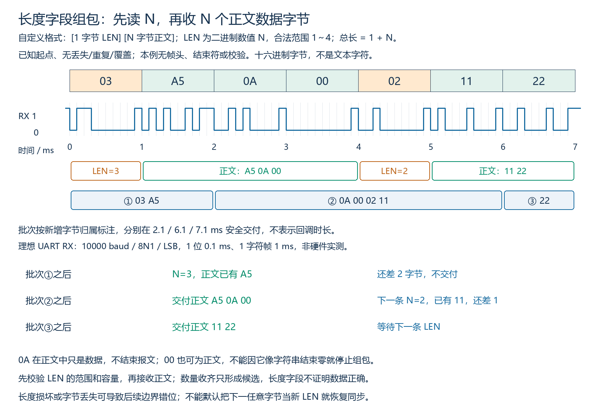

连续输入`03 A5 0A 00 02 11 22`，两条原始报文为`03 A5 0A 00`与`02 11 22`。图为普通非反相UART10000 baud/8N1/LSB的理想推演，每字符帧1ms，非实测；三批在2.1、6.1、7.1ms安全交付新增数据，分组框不表示回调时长。

| 新增批次 | 当批交付的候选正文 | 必须保留的组包状态 |
|---|---|---|
| 03 A5 | 无 | N=3，已收正文A5，还差2字节 |
| 0A 00 02 11 | A5 0A 00 | 新一条N=2，已收正文11，还差1字节 |
| 22 | 11 22 | 当前候选完成，等待下一条LEN |

自然语言流程：等待LEN；解析并检查范围与容量；收集恰好N个正文字节；形成一个候选并继续处理本批剩余字节，下一字节属于下一条LEN。若批次中途结束，保留N、已收数量和安全持有的正文，等待下一批或按协议超时处理。

这里展示的是交付正文；真实接口也可以连同LEN或其他元信息交付，只需明确语义。收正文阶段不能将其中恰好等于02/03的字节再解析成新LEN，也不能因0A像LF就结束。字节的含义取决于协议位置和当前接收阶段。

### 16.3 先检查长度，再使用存储

若LEN=05，已超出本节合法上限4，应拒绝当前候选，不能把5字节写入仅容纳4字节的正文空间，也不能擅自把长度裁成4并当成有效消息。真实实现还需核对完整存储需求及整数运算范围，本阶段不写代码。

即使LEN合法，声明3字节而实际只收到2字节，仍未收齐；不能用RAM旧值或自动补零凑足，更不能无限等待。应保留有效数量，按应用约定的等待预算处理失败。

本格式没有专用同步标志，长度损坏或丢字节可能把后续LEN当正文，从而持续错位。遇非法长度/超时后，仅“清空并把下一任意字节当LEN”不能保证恢复正确边界；要结合协议约定的重新开始条件或同步机制，后续再展开。仅按损坏长度盲目跳过N字节也不一定恢复。

长度字段只声明数量，不证明正文正确或来自期望设备。数量收齐后仍需按协议检查内容/校验；本节尚未加入校验字段。

### 16.4 原理资料与适用边界

[RFC 6587 §3.4.1](https://datatracker.ietf.org/doc/html/rfc6587#section-3.4.1)给出用长度确定消息边界的真实案例，其长度采用十进制ASCII数字加空格，和本节单字节二进制LEN不同。该资料是历史syslog/TCP格式，供对照“长度表示需要明确”，不作为UART规范或本节格式来源。

### 16.5 本段复习自测与参考答案

1. 按本节格式，三批为`02 AA` / `BB 03 10 0A` / `20`。第2批结束时交付哪个正文、下一条N是多少、保留哪些正文、还差几字节？第3批交付哪个正文？均为十六进制字节。
2. 正文上限4，收到LEN=05，能否照这个数写入仅4字节正文空间？另一独立场景LEN=03，但只收到11/22后再无新字节，能否补00当作收齐？
3. `03 A5 0A 00`的LEN数值、正文长度、整条长度分别是多少？0A是否结束报文？
4. 长度损坏或丢字节后，是否只要把下一任意字节当LEN就保证同步？收到声明数量是否就证明内容正确？

参考答案：

1. 第2批交付AA BB；下一条N=3，已收正文10 0A，还差1字节。第3批交付10 0A 20；0A在正文中没有结束作用。
2. 都不能。先拒绝非法长度，不能越界或擅自裁长；未收到的字节不能补零伪装为有效输入，需按实际数量和等待预算处理。
3. LEN数值3，正文3字节，整条4字节；0A是普通正文字节，不是本格式的结束符。
4. 都不能。边界错位需协议定义的恢复依据；长度仅声明数量，还要内容/完整性等检查。

## 十七、M06-02：报文校验、CRC与UART奇偶校验的区别

### 17.1 数量收齐仍可能内容出错

**Checksum，校验和/校验值**：发送方按照约定规则，从指定数据计算额外的核对值，和数据一起发送。接收方按同样规则、同一范围重算并核对。规则和范围不一致也会造成不匹配，不能仅凭校验失败唯一判定线路干扰。

先用可手算的教学SUM8：格式由上一段扩展为`[1字节LEN][N字节正文][1字节SUM8]`，LEN仍只计正文且合法1～4，总长变为N+2。SUM8等于LEN与全部正文数值之和，只保留低8位（对256取余），不包含SUM8自身或UART起始/停止/奇偶校验位。此处SUM8是本节命名，不声称所有“校验和”都这样计算。

发送正文10/20时，02+10+20=32，发送完整字节序列02 10 20 32（全为十六进制）。若收到02 13 20 32，重算02+13+20=35，与收到的32不同，当前候选不能作为有效请求执行。不要把末尾32也加进这个重算规则。

若和超过FF，只取低8位，例如01+FF=100，对应SUM8=00。SUM8=00本身是合法校验字节，不代表没有收到。

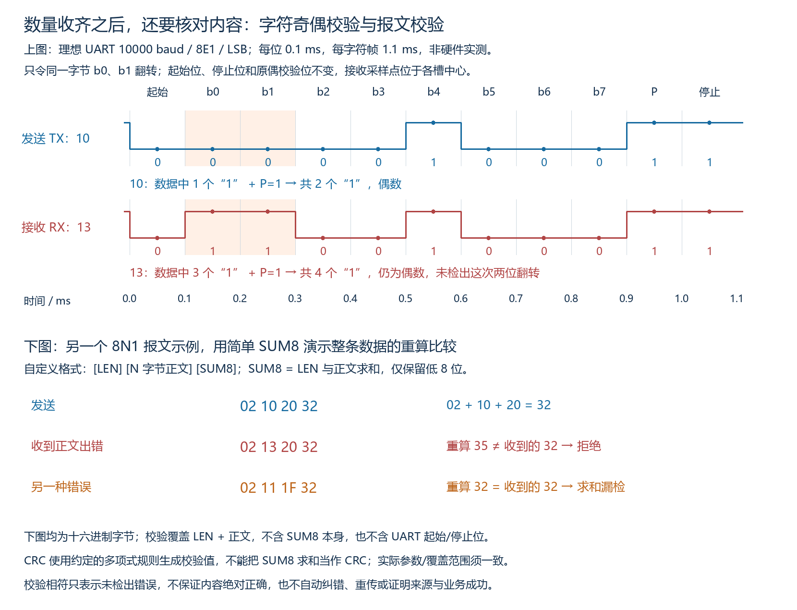

下半图是独立的8N1应用报文例，不与上半字符时间线拼接。还有一种变化02 11 1F 32，重算仍为32，简单求和无法发现本次错误。求和不保留所有内容信息，存在不同数据得到相同校验值的情况；不能将相符等同于绝对正确。

### 17.2 UART奇偶校验检查的是字符层面的奇偶关系

上半图为理想10000 baud/8E1/LSB，每位0.1ms、每字符帧1.1ms，非实测。发送0x10的数据位只有1个“1”，偶校验位P=1；数据加P共有2个“1”。若同一字节b0和b1由0翻到1，接收数据变0x13，P仍为1，则共有4个“1”，偶校验仍通过。图上圆点标理想槽中心采样位置，起始/停止仍有效。

因此“UART没有奇偶错误”不证明每个字节都正确，也不证明应用报文完整。奇偶校验按每个UART字符配置，不能代替对指定报文字节范围的校验。8N1没有奇偶校验位，仍然可以在应用数据内附加SUM或CRC；它们作为普通数据字节传输。

### 17.3 CRC是什么，双方怎样核对

**CRC（Cyclic Redundancy Check，循环冗余校验）**：用约定的多项式运算规则对受保护的比特序列生成校验值。不是把字节相加；本节用SUM8讲核对流程，不把SUM8称为CRC。CRC-16/CRC-32中的数字表示校验值位宽，但同为16位也可能有不同具体算法。

发送方：确定受保护字节范围 → 以指定CRC参数计算 → 按协议字节顺序附加校验值 → 发送。接收方：正确组包并保留校验字段 → 对相同受保护范围按相同规则重算 → 与收到的校验值比较 → 不匹配则拒绝候选，相符后继续其他验证。本节采用“重算后比较”的解释，不要求多项式长除法、代码或查表实现。

实际双方需一致的项目包括位宽、多项式、初始值、输入/输出反射规则、最终异或值，以及字节覆盖范围、处理顺序、校验值发送顺序。“反射”是在算法规定的位置反转位顺序；这里知道它属于参数即可，不能仅凭UART为LSB先发就自行选择CRC变体。报文CRC通常针对约定数据字节，不能擅自把UART起始/停止/奇偶位加入计算。

CRC的检出性质取决于具体多项式、保护长度及错误模式；仍有漏检可能。CRC是差错检测，常规核对流程不会自动修复错误或重传，也不证明发送者身份、报文新鲜性或业务已经执行。重试、应答和业务结果需要应用协议另行规定。

[TI SLAA221A：CRC Implementation with MSP430 MCUs](https://www.ti.com/lit/pdf/slaa221)说明多项式基础、重算比较及漏检可能，也列出参数/反射等实现差异；本阶段只取原理，不要求阅读其中C/汇编代码。CRC可以由软件或合适的硬件单元计算，普通UART不会仅凭配置波特率就自动理解任意应用报文的CRC范围。

### 17.4 从接收候选到业务处理

按当前教学格式，先确认新增字节和边界 → 检查LEN合法及空间足够 → 收齐正文和SUM8/CRC字段 → 检查约定范围的校验 → 检查命令/地址/字段/当前状态等应用条件 → 再执行允许的业务。实际检查可以按协议优化先后，但不能跳过必要约束。

不能因为后面有校验就先按不可信LEN越界存储，也不能在校验失败后仍执行本应拒绝的请求。失败后还要按协议处理候选、接收状态与重新同步，不等于所有缓冲都无条件清零；下一段专门讨论恢复。

### 17.5 本段复习自测与参考答案

1. 按本节SUM8格式收到03 10 20 31 63，均为十六进制。重算SUM8是多少？能否通过该项校验？校验不符能否唯一断定线路干扰？
2. 8E1发送0x03，P=0，接收数据却变0x00而P未变，起始/停止有效。是否一定出现奇偶错误？若整条报文CRC不匹配，即使所有字符无UART错误，能否执行该请求？CRC相符能否证明对端业务已执行成功？
3. 正文FF、LEN=01，本节SUM8是多少？带SUM8整条总长多少字节？8N1能否携带应用CRC？
4. 16位CRC结果相符是否证明绝对没有错误？是否只要两端都写“CRC-16”就必然兼容？

参考答案：

1. 03+10+20+31=64，与收到63不同，不通过。不能唯一定位物理原因，还要核对算法、范围、参数、组包和实际数据等。
2. 不会仅因该变化报偶校验错：原数据2个1、接收0个1，连同P=0都为偶数。不能执行校验失败的请求；CRC相符也不证明业务成功，需要应用层处理/应答证据。
3. 01+FF=100，低8位00；1字节LEN+1字节正文+1字节SUM8共3字节。能，CRC字段作为普通数据字节传送。
4. 都不能。有限校验值可能漏检，兼容还需具体变体、参数、覆盖范围和传输顺序等一致。

## 十八、M06-02：异常后的重新同步与迟到回复

### 18.1 重新同步解决的是报文边界

**Resynchronization，重新同步**：在当前候选失败或边界不可信后，依据协议规则重新寻找可以开始解析报文的位置。这里指软件报文边界，不是UART位采样时钟重新校准。

超时、非法长度、校验失败、硬件溢出或软件覆盖并非完全相同，但都需明确处置：拒绝不能信任的当前候选、记录错误/更新相关状态，按协议选择恢复路径。已丢失的字节不能用未来数据或RAM旧值伪装补齐。是否重试、何时再次允许业务执行，也要由应用规则决定。

清空候选只改变软件持有的内容和数量，不会撤回已经在线上传输的字节，也不会让对端自动停止发送；下一批仍可能含失败报文的旧尾部。反之，无条件清空全部接收缓冲，也可能一起丢掉已经收到的后续完整消息。

### 18.2 明确的LF恢复规则：丢弃到结束，再继续处理同批数据

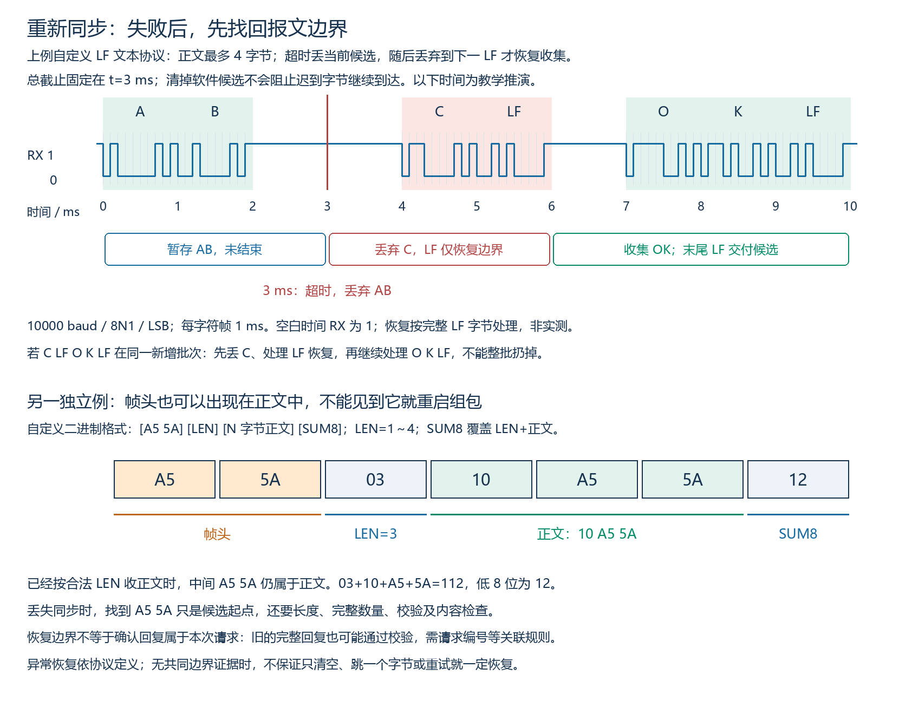

上图使用独立的教学文本协议：正文最多4字节、LF结束且正文不含LF；协议约定超时后丢当前候选，进入丢弃状态，直到下一个完整LF才恢复收集。输入按序、安全交付，不发生额外字节丢失。总等待从0开始，当前请求截止3ms。

- A、B的UART字符帧分别在0～1、1～2ms传输，软件已有未结束候选AB。
- 3ms截止时，当前请求超时结束，丢弃AB；进入边界恢复，不能继续给这次失败请求延长原截止时间。
- 迟到C在4～5ms、LF在5～6ms传来。C被丢弃；完整LF使恢复流程回到可收集下一条的状态，不交付C或旧AB。
- O/K/LF在7～10ms到达，可形成后续候选OK。图为10000 baud/8N1/LSB理想波形，非实测；恢复按完整字节处理，不把LF内部某个电平变化当作软件边界。

若C LF O K LF由驱动在同一新增批次安全交付，也应逐字节处理：丢C、遇LF退出丢弃状态、继续收O/K/末尾LF。不能因为批次以旧尾部开始就把整批全部丢弃。

这只是本协议明确选定的策略。若始终没有LF，恢复流程也需要自己的时间/资源预算及升级处置，不能阻塞业务无限等待。通信双方若没有可依赖的共同边界，单方面清空、睡眠或重发不保证同步；必要时须按协议共同重新开始，具体方式依系统定义。

### 18.3 帧头是候选起点，不是见到就强制重启

**Frame header，帧头**：应用报文开头的约定内容。某些格式用固定标记帮助搜索起点；它不是UART每个字符的起始位。下图独立的二进制协议为`[A5 5A][LEN][N字节正文][SUM8]`，LEN合法1～4、只计正文，SUM8只覆盖LEN+正文低8位，整条总长N+4。

合法示例A5 5A 03 10 A5 5A 12：起点为第1个A5；正文是10 A5 5A，SUM8为03+10+A5+5A=112的低8位12。当前已经解析合法LEN并正在接收正文，正文里的A5 5A应按数据收集，不能立即清空重启。这种格式允许正文出现标记值，接收阶段决定字节含义。

丢失同步时，搜索到A5 5A仅提出一个候选起点；还要检查后续长度、存储容量、完整数量、校验及内容。随机数据或旧报文内部也可能含这个组合，甚至有限校验也存在漏检，不承诺“找到帧头就绝对正确”。

失败后应有明确的继续搜索策略，处理重叠标记和分批残留；例如批次末尾只有A5时，不能因本批还没出现完整A5 5A就忘掉这个可能的前缀。重新搜索从哪里开始、保留哪些尚未排除的字节，应由协议解析方案说明，本节不要求实现扫描代码。不能将错误的候选长度直接当作必然可靠的下一边界。

### 18.4 恢复边界与回复归属分别确认

即使OK是一条完整候选，也不能仅凭边界/校验判它属于超时后的新请求。**Request ID，请求编号**或**Sequence number，序号**可以帮助关联：例如应用约定回复回显请求号，当前等待8号而收到7号，即使格式、校验正确，也不能将其计作8号成功回复；按协议丢弃或记录过期响应。

真实协议还需约定编号复用、回绕及旧报文最长存活等条件；不是加任意一字节编号就无条件杜绝混淆。没有编号时，可结合协议规定的状态、地址/命令、时间边界或双方重新开始条件判断，但“地址/命令相同”也可能仍是上一轮同类请求的旧回复。

超时只说明预算内未收到满足条件的回复，不能证明对端没有执行请求。若业务为计数加1等非重复安全动作，盲目重发可能重复执行；是否重试及怎样避免重复，需要协议的去重/结果确认规则。这里只建立恢复与归属的基础，不要求设计完整可靠传输协议。

### 18.5 本段复习自测与参考答案

1. 按上面的LF超时恢复规则，已暂存X1时超时，随后同一新增批次为`2 LF G O LF`。形成什么后续候选？能否把整批丢弃作为正确解析？仅凭该候选完整能否认定它属于新请求？
2. 二进制候选`A5 5A 02 A5 5A 01`已从第1个A5对齐，LEN已验证合法。正文是什么？中间A5 5A是否使当前组包立即重启？另一独立关联判断：当前等8号、收到7号正确校验的回复，能否算8号成功？
3. 搜索模式中某批只以A5结尾，下一批从5A开始，是否可以无条件丢掉这个A5？找到完整帧头是否免去长度/校验/内容检查？
4. 请求超时是否证明对端未执行？清空候选是否会取消对端发送？计数加1请求能否无条件重发而保证只加一次？

参考答案：

1. GO；按本题规则不能整批丢弃，应丢2、用第一个LF恢复、继续收GO及末尾LF。完整候选不证明属于新请求，仍需关联条件。
2. 正文A5 5A，中间不重启；SUM8=02+A5+5A=101的低8位01。7号不能算8号成功，即使校验相符。
3. 都不能。可能是跨批次标记，需保留必要搜索前缀；标记只是候选起点，仍需其他验证。
4. 都不保证。超时是本地等待结果；清候选不改变对端/线上发送；重发可能重复执行，需去重或结果确认等协议设计。

### 18.6 校验失败与请求号不匹配应分别记录

例如当前等待09号回复，格式[A5 5A][LEN][N正文][SUM8]，本次要求N=2、正文为请求号/结果值、SUM8只计LEN+正文低8位。下列候选已正确分离并独立保存，均在本次预算内，数字为十六进制：

| 候选 | 重算SUM8与收到值 | 请求号 | 当前处理 |
|---|---|---|---|
| A5 5A 02 09 30 3C | 3B与3C不同 | 09 | 校验失败，拒绝当前候选 |
| A5 5A 02 08 30 3A | 3A与3A相同 | 08 | 校验通过但请求号不匹配，不计为09号成功 |
| A5 5A 02 09 30 3B | 3B与3B相同 | 09 | 可继续做本次请求的业务验证，不直接宣称业务已完成 |

拒绝都发生在接收处理流程中，但原因不同，应保留各自证据。第一个候选失败也不意味着后续独立、安全保存的候选必须全部清掉；要继续按协议判断它们。

## 十九、全章速查与面试表述

本节供查阅，不新增复习测验或代码任务。

| 面对的问题 | 首先确认的机制或约束 |
|---|---|
| 外设没开始收发 | 外设实例、时钟、参数、引脚复用、接收准备与请求使能 |
| 软件一直等待 | 完成条件、有效进度、总预算/间隔预算；ISR不能等待只有自身后续进入才能更新的条件 |
| UART无溢出但数据仍丢 | 软件队列容量/服务速度、DMA覆盖、有效范围与所有权 |
| 环形R=W | 结合数量或其他明确满空方案判断；位置重复不代表无新数据 |
| 一批数据不像一条报文 | 按协议固定长度/分隔符/长度字段组包，跨批次保留必要状态 |
| 数量收齐但内容异常 | 按约定覆盖范围检查SUM/CRC及应用字段，字符奇偶校验不能代替整条检查 |
| 校验通过却不是本次回复 | 检查请求编号、地址/命令和协议状态等关联条件 |
| 超时或候选失败 | 拒绝不可信候选，按协议恢复边界/处理迟到数据；重试要考虑重复执行 |

面试可这样表述：

> UART负责字符传输，软件还要管理取数、有效缓冲、报文边界和业务验证。我会让中断及时保存数据并返回，或用DMA搬运，再按协议持续组包；限制长度和等待时间，核对报文校验与请求归属。出现丢失、超时或校验失败时，按协议恢复边界，并明确迟到回复、重试和重复执行的处理。

这是一种组织思路，具体配置、缓存共享、超时语义与恢复动作仍需目标芯片、驱动和应用协议共同确定。当前课程结论限于原理推演，不代表已有硬件实践。

## 二十、资料与下一段

- [STMicroelectronics：STM32F4 HAL UART官方驱动](https://github.com/STMicroelectronics/stm32f4xx-hal-driver/blob/master/Src/stm32f4xx_hal_uart.c)：导师用于核对外设准备、轮询/中断/DMA模式与带超时接收的一个具体实现；当前不要求阅读代码，也不把其标志/参数语义套给所有MCU。
- 字符帧及取数字节的基础资料见[M01-UART.md](M01-UART.md)，本章直接用于解释新的软件组织问题，不另插入旧模块复测。

本章首轮正文、图示及各段自测参考答案已覆盖。按用户2026-10-18明确安排，[M07](M07-接口选型与分层排错.md)仅提供接口选型、仪器使用和通信排错的完整自学教材，课堂跳过；下一课堂入口为M08给定链路综合案例，待用户启动。代码阶段与集中复习仍另行启动。
