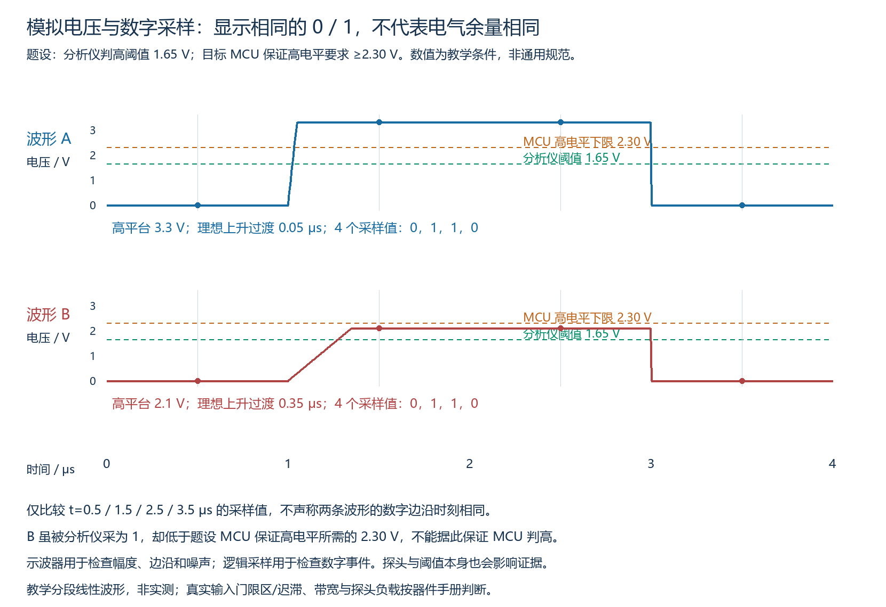
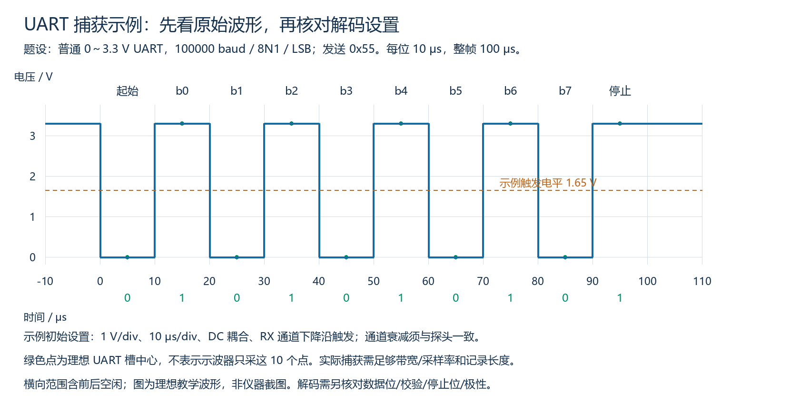
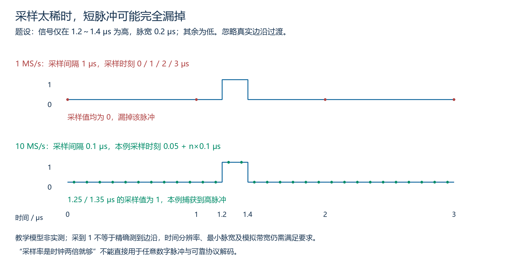
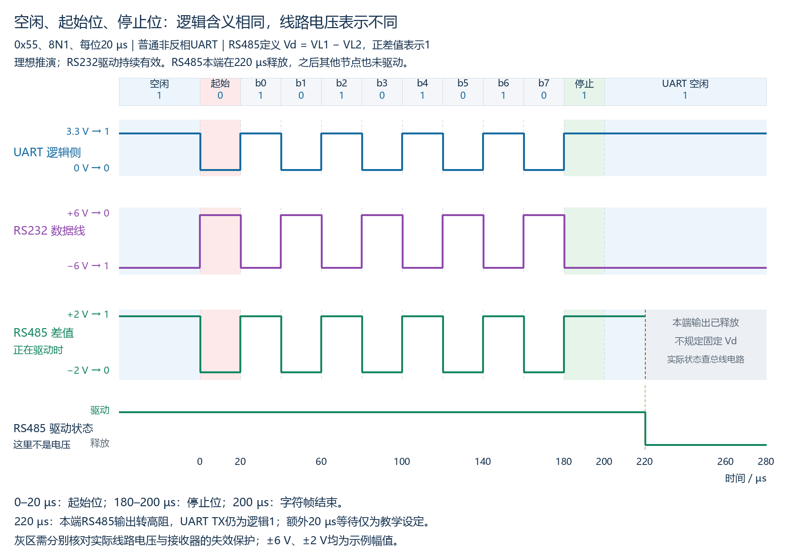
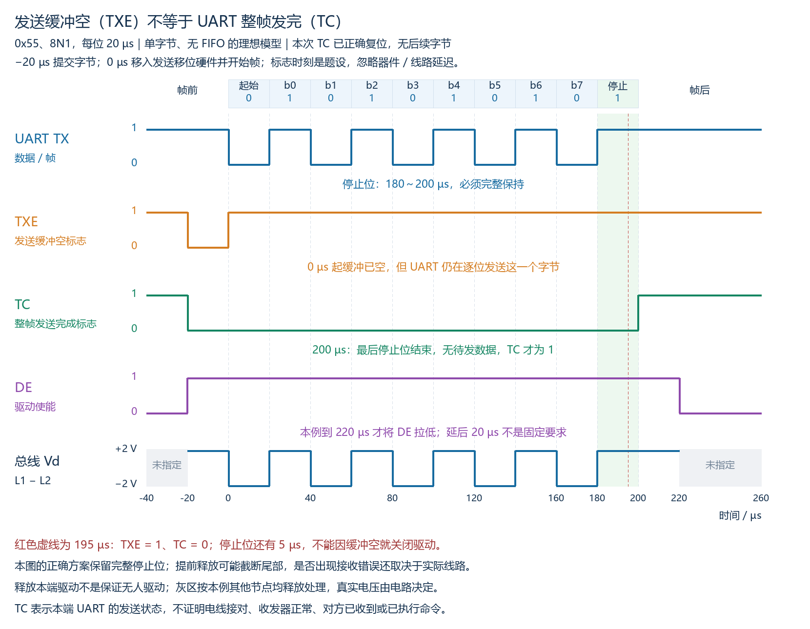
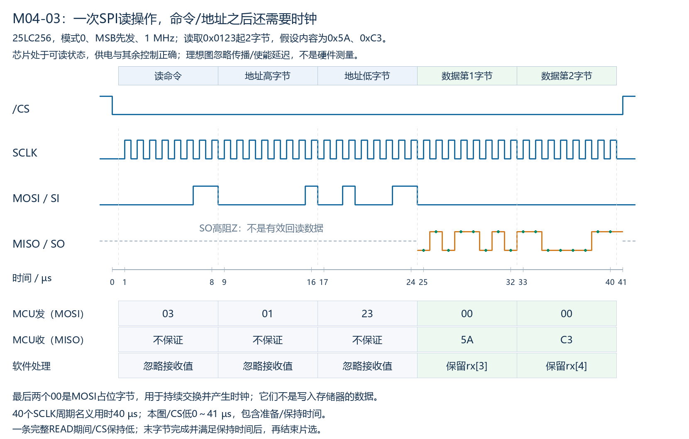
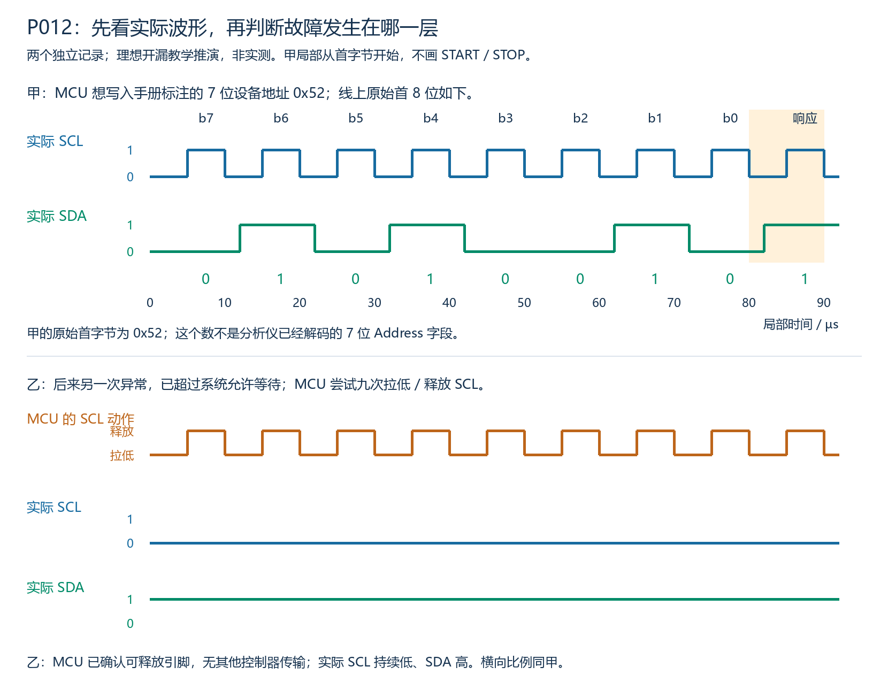

# M07自学教材：接口选型、示波器、逻辑分析仪与通信故障分析

本章供以后自行阅读。包括正文、操作思路、教学波形、案例和逐题参考答案；教材完成不表示学习者已经阅读、练习或掌握。当前课堂跳过本章，不要求购买仪器或开发板。

本章沿用M00～M06的基础，不要求代码。所有图、数值和诊断记录均为明确条件下的教学推演，非硬件实测。涉及真实接线时，以具体仪器、探头、芯片及目标设备手册为准。

## 一、阅读路线与术语

建议依次阅读：第二～四节理解选型；第五～八节理解仪器与捕获；第九～十二节练习排错；第十三节自测，最后核对答案。

| 术语 | 全称与含义 |
|---|---|
| MCU | Microcontroller Unit，微控制器，含CPU及通信外设等部件 |
| UART | Universal Asynchronous Receiver/Transmitter，通用异步收发器 |
| SPI | Serial Peripheral Interface，串行外设接口 |
| I²C / IIC | Inter-Integrated Circuit，集成电路间总线 |
| RS232 / RS485 | 串行接口的电气规范；名称中的RS源自Recommended Standard（推荐标准），不代表应用报文格式 |
| Oscilloscope | 示波器，观察随时间变化的电压等模拟量 |
| Logic analyzer | 逻辑分析仪，采集数字状态与事件，常支持协议解码 |
| Probe / DUT | 探头 / Device Under Test，被测设备 |
| Trigger | 触发，指定捕获应围绕哪个事件展开 |
| Sample rate | 采样率，每秒取得多少采样点，常写S/s、MS/s |
| Bandwidth | 带宽，测量系统响应快速变化的能力指标之一，不能直接等同于通信波特率 |
| Decoder | 解码器，根据选定协议和参数解释采样数据的软件 |

## 二、选型前先分清层次

不能将五个名称当作同一层次的五选一菜单。常见完整组合是：

```text
应用报文：命令、地址、长度、CRC、应答、重试
                    ↓
UART字符帧 → MCU逻辑引脚 → RS232或RS485收发器 → 外部线路
```

UART组织字符收发；RS232/RS485处理线路电气传输。改用RS485并不会自动增加节点地址、总线仲裁或CRC。SPI/IIC则各有同步时序、目标选择方式，并与器件命令/寄存器协议共同使用。

例如选用“UART＋RS485＋自定义请求/响应”是三个层面的决定；不能因为需要CRC就判断必须用RS485，也不能因为两端UART参数相同就认为逻辑电平UART可以直连RS232。

## 三、五种接口的比较与选型流程

### 3.1 条件化比较表

以下是本课程常见用法，信号参考地、供电和额外控制线不包含在简写的信号数中。

| 项目 | UART逻辑侧 | UART＋RS232 | UART＋两线RS485 | 常见SPI | 常见IIC |
|---|---|---|---|---|---|
| 主要时序 | 异步字符帧 | 沿用UART字符帧 | 沿用UART字符帧 | 共享SCLK，同步移位 | 共享SCL，START/STOP及应答 |
| 基本信号 | TX、RX | 两向数据及信号地，可能有流控线 | 一对差分线，另处理参考与方向 | SCLK、MOSI、MISO、各目标片选 | SDA、SCL及上拉 |
| 常见双工 | 独立TX/RX可全双工 | 常用异步全双工点对点 | 半双工；四线结构另论 | 移位时可同时发送/接收 | 同一SDA分阶段换向 |
| 目标区分 | 通常由连接及上层协议决定 | 点对点设备角色与接线 | 应用地址/访问协调 | 通常靠片选；器件内部地址另算 | 常见7位设备地址；寄存器地址另算 |
| 主要约束 | 逻辑电平、参考地、时钟误差 | 电平转换、针脚/角色、接口规格 | 共模、拓扑/支线、终端、偏置、收发切换 | 模式、片选、线数、信号完整性及器件时序 | 地址冲突、上拉/总电容、拉伸与时序 |
| 常见用途 | 板内/近距离串口连接 | 与既有串口仪器连接 | 多节点线缆通信 | 兼容的存储器、转换器、显示器等 | 兼容的传感器、低速控制器件等 |

这不是速度或距离排名。器件支持接口、板级布线、边沿速度、线缆、负载和软件协议共同决定可用范围。不能把某个常见速率/距离组合作为所有RS485芯片的保证；也不能说“只要是SPI就一定比所有IIC实现快”。

### 3.2 可执行的六步选择流程

1. **列出已定条件。**对端只支持什么接口？电压是多少？是否必须兼容现有连接器/协议？先排除不兼容组合。
2. **画出位置与拓扑。**同板还是跨设备线缆？一对一还是多节点？各节点是否共享可靠参考？不要只问“几根线”。
3. **算业务量。**有效数据率、突发峰值、等待预算、方向切换及协议开销分别多少？UART的波特率不是有效字节率。
4. **检查器件与物理条件。**SPI模式/最高时钟、IIC地址/拉伸、收发器共模/电压能力、负载与布线等，以手册约束为准。
5. **安排软件职责。**接收准备、缓冲、调度、报文边界、错误检测、超时与恢复分别由谁处理？电气接口不会自动提供完整业务可靠性。
6. **说明取舍与验证计划。**列出为何符合条件、主要限制，以及哪些条件还需实际验证；不要把暂定方案说成唯一最优。

### 3.3 吞吐量的条件示例

假设每秒要传8000字节正文，既定UART为115200 baud/8N1，每8字节正文还附4字节协议字段，暂不计帧间等待。线上需每秒8000×12/8=12000个字符；每字符10位，需120000 bit/s，超过115200，方案在这些条件下不满足。

可改变速率、打包开销或业务量，也可讨论别的兼容接口，但不能仅凭“UART有115200”认定8000字节正文一定够用。若通信还有往返等待、总线让出或重试，预算要继续加入。

## 四、三个完整选型案例

### 4.1 板内两个传感器，MCU引脚紧张

题设两颗传感器都支持IIC，地址可分别设置为0x29/0x2A，数据量不大，电压兼容且板级电容/上升时间可满足手册。选择IIC可让两器件共享SDA/SCL，控制器按设备地址访问。

后续仍需确认上拉、供电、寄存器访问和失败处理。若地址固定且冲突，不能靠“软件给两颗起不同名字”解决；需可控地址、分段/复用、独立总线等器件支持的方案。也不能因引脚少就忽略上拉电流与电容约束。

### 4.2 一颗需要持续较大数据量的板内器件

题设器件支持SPI，现有MCU有足够片选与数据引脚，双方支持的时钟及模式能满足业务预算，可优先考虑SPI。理由来自已知带宽、器件和布线条件，而非“SPI总是最快”。

需要确定指令/地址/占位长度、CS是否必须覆盖整个事务、数据边沿与总线负载。读操作仍需控制器送时钟，返回值在接收序列中的位置由器件协议确定。

### 4.3 跨设备线缆上连接多个传感器

题设目标设备支持两线RS485，控制器负责轮询，线缆/速率/共模与收发器条件可以满足设计。可使用UART＋RS485，并规定地址、单个回复者、方向切换、报文校验和超时。

还需设计主干与支线、端点终端、空闲偏置/失效保护、参考地或隔离。RS485的差分传输不能自动消除任意地电位差，也不会阻止两个节点同时驱动。

若对端是已有RS232仪器，应先遵守其接口。逻辑电平USB-UART适配器通常不能直接代替USB-RS232；RS485也不能只靠改串口软件就接上该仪器。

## 五、示波器与逻辑分析仪分别看什么

| 观察目标 | 优先使用的证据 | 仍不能直接证明什么 |
|---|---|---|
| 电压高低、上升沿、过冲、振铃、噪声 | 示波器模拟波形 | 单次看起来正常不等于长期可靠 |
| 多根信号的先后关系与较长事务 | 逻辑采样/时序记录 | 数字0/1不保留全部模拟幅度信息 |
| UART字节、SPI字段、IIC地址与ACK | 正确设置的协议解码＋原始信号 | 解码成功不等于业务完成或全部电气指标合格 |
| UART收到字节后CPU/DMA是否保存 | 硬件状态、软件有效量和事件记录 | 只看TX/RX波形不能证明RAM已更新 |

部分示波器支持数字通道/协议解码，部分逻辑分析仪也采模拟量；按设备能力判断，不能只按产品名称划绝对边界。**MSO（Mixed Signal Oscilloscope，混合信号示波器）**可组合模拟与数字观察。



题设分析仪判高阈值1.65V，目标MCU保证高电平下限2.30V。A的高平台3.3V，B只有2.1V，且上升较慢。在图中四个指定采样点，两者数字结果都是0/1/1/0，但B不能保证满足MCU高电平要求。这些阈值只是示例，真实门限/迟滞看双方手册。

因此“分析仪解码正确”只能证明它按自身采样和阈值得到该结果；不能据此保证目标器件在所有条件下也如此判定。不同波形的数字边沿时间也可能不同，图仅比较四个采样值。

## 六、示波器入门：从连接到一次UART捕获

### 6.1 先明确探头的两个连接点

普通单端电压探头测的是探尖相对参考端的电压。常见台式示波器各通道外壳/地夹相连，并与保护地相连；不能把两个通道地夹分别夹在两个不同电位点，更不能把地夹当作可任意接到差分负端的探尖。

本章低压示例只适用于**已确认可与仪器共地**的电路：探尖接MCU的TX或RX测试点，参考接目标信号地，参考回路尽量短。RS485的A/B都不是当然的地；要测A−B，应使用额定范围合适的差分方案。两通道相减只是在两路均安全、共模/输入范围均满足且误差可接受时的测量手段，不提供电气隔离。

不要断开示波器保护地来制造浮地；未知市电侧、非隔离电源或地关系不明的节点不按本章接线。浮地测量需合适的隔离/差分设备与额定值。[Tektronix浮地测量说明](https://www.tek.com/en/documents/technical-brief/floating-oscilloscope-measurements-and-operator-protection)解释了普通接地示波器的边界。

### 6.2 常见旋钮与设置

| 设置 | 含义 | 本章UART示例的起始选择 |
|---|---|---|
| Channel / CH | 通道及输入来源 | 选实际连接RX的通道 |
| V/div | 每个纵向大格代表多少伏 | 1V/div，让0～3.3V留在显示范围内 |
| Time/div | 每个横向大格代表多少时间 | 10μs/div，先辨认位宽；看完整事务时再放宽 |
| Position / Offset | 屏幕位置或输入偏置相关控制 | 找到零电平并避免截幅，注意两者依机型语义不同 |
| DC / AC coupling | 直流耦合保留直流分量；交流耦合滤掉直流分量 | 看逻辑幅度/空闲平台先用DC |
| Probe attenuation | 探头衰减比例 | 10×探头需匹配通道10×设置；这不是只改变图形美观 |
| Trigger source / edge / level | 触发来源、边沿、阈值 | RX、下降沿、示例1.65V |
| Run/Stop / Single | 连续采集、停止、单次等待触发 | 偶发/一次事务可用Single并在发起前布置捕获 |
| Record length / sample rate | 记录点数/每秒采样数 | 同时覆盖前后文与所需边沿分辨率 |

具体菜单名称和默认值依仪器而变；Auto Setup可协助初始显示，但不能替代量程、触发和采样的核对。[Tektronix控制项说明](https://www.tek.com/en/documents/poster/oscilloscope-fundamentals-capturing-your-signal)给出这些通用控制的用途。

### 6.3 探头补偿与负载

对需要补偿的无源衰减探头，可按仪器手册先接其校准方波端与参考端，调整补偿，使方波顶部不过分圆钝或尖峰。校准输出的频率/幅度以本机标注为准；不要把这一步写成测过目标总线。

10×探头往往比同类1×设置带来更小电容负载，但实际看探头规格；代价包括小信号显示能力等。探头电容、长地线、带宽和补偿均可能改变看到的波形。IIC等上拉节点可能因探头负载而变慢，看到振铃也要检查测量回路。[Tektronix探头连接与补偿教程](https://www.tek.com/en/documents/primer/setting-and-using-oscilloscope)可作实际操作参考。

### 6.4 一次可复现的UART捕获流程

题设：已知0～3.3V普通UART、100000 baud/8N1/LSB，重复发送0x55；接线安全且参数来源明确。

1. 核对输入/探头允许电压、共地关系和衰减，接好目标点与短参考。
2. 选DC、合适纵向量程；先确认空闲高电平约3.3V、低平台接近0V，实际合格门限仍看接收器。
3. 每位10μs。先设10μs/div观察位宽，再调整记录窗口覆盖空闲、整帧及必要后续；实际屏幕大格数可能不同。
4. 设RX下降沿触发、阈值位于有效高低之间，保留一些触发前记录，以判断空闲与起始情况；数据位也可能下降，单纯边沿触发不保证总选中帧头。
5. 在发起前进入Single或相应等待状态，再发送。停止后量相邻边沿和帧内位槽，避免只量一段长高平台就当作一位。
6. 加UART解码，指定通道、100000、8N1、LSB及普通极性；对照原始起始/数据/停止槽核对0x55。
7. 保存波形、设置和测点，注明抓到哪次事务；有必要时提高采样/缩短窗口重捕，而非仅放大旧图假装增加采样。



0x55按b0先发为1/0/1/0/1/0/1/0；起始位0、停止位1，总10位、100μs。图中绿色点是理想接收槽中心，不是示波器全部采样点；图也不是实际示波器截图。

### 6.5 带宽、采样率与记录长度

采样间隔Ts=1/fs。1MS/s表示每1μs一个采样点。通信时钟不直接规定边沿上升时间；即使报文慢，快速边沿也可能需要更高测量带宽。模拟带宽不足会改变边沿形状，不能只提高采样率解决。

固定采样率和未压缩点数的模型下，记录时间T≈点数/fs。例如40000点、4MS/s约10ms。真实仪器会因通道数、存储/压缩和设置改变实际采样，须检查当前显示值。[Tektronix带宽与采样说明](https://www.tek.com/en/documents/primer/evaluating-oscilloscopes)强调应同时考虑信号边沿和捕获条件。

## 七、逻辑分析仪入门：连接、采样与解码

### 7.1 先核对电压、参考地和测点

数字输入是相对其参考端比较电压，不会因为软件添加“RS485解码器”就变成差分接收器。优先在已确认兼容的MCU逻辑侧观察；如必须看线路侧，检查该型号输入范围、门限、共模及隔离条件，必要时使用匹配接收器或专用前端。

不能泛称所有逻辑分析仪都能或都不能直测RS232/RS485；耐压合格、数字阈值合适、差分判断正确是不同条件。[Saleae差分与较高电压解码说明](https://www.saleae.com/support/protocol-analyzers/analyzer-user-guides/decode-differential-and-high-voltage-data)提供了一个具体设备系列的前端边界。

USB仪器还可能通过电脑、电源或其他连接形成参考通路；不要假设输入通道相互隔离或USB天然隔离。接地与允许输入值需查目标型号，[Saleae安全说明](https://www.saleae.com/support/specifications-hardware/product-comparison-and-selection/safety-and-warranty)列有这类连接约束。

### 7.2 通道与解码参数清单

| 协议 | 常用采集通道 | 解码前必须核对 |
|---|---|---|
| UART | TX/RX各一路，可同时观察 | 波特率、数据位、奇偶、停止位、极性；两路方向明确 |
| SPI | SCLK、CS、MOSI、MISO | CPOL/CPHA、CS有效电平、位序、字长；地址和占位由器件协议解释 |
| IIC | SCL、SDA | 两路映射、阈值、START/STOP、7位地址与带R/W字节的显示区别 |
| UART＋RS485 | MCU侧TX/RX，必要时DE、/RE | 逻辑侧UART参数和方向控制；不能仅凭RX字节推出线路差分/共模正常 |
| UART＋RS232 | 可兼容的逻辑侧TX/RX，或经核对的线路前端 | 测点在哪一侧、是否需要反相、是否超出输入范围 |

采集时“CH0/CH1”只是通道名，不等于哪端发送。先用接线记录确认映射，再决定方向和解码器设置。

### 7.3 采样率与时间窗

对于100000 baud的UART，一位10μs。若以1MS/s采样，每位平均10个点；4MS/s则40个点。后者时间间隔更细，但都不是不看阈值/最短脉冲就保证可靠的通用倍数。

对SPI要关注SCLK的最短高/低脉宽和数据相对采样沿的变化，而非只套UART的“每位几个点”。对IIC还需覆盖第9时钟与可能的拉伸。打开更多通道/模拟通道后，部分仪器可选最高采样率会下降，应按当前配置核对。[Saleae采样率说明](https://www.saleae.com/support/logic-software/capturing-data/what-sample-rate-is-required)给出的倍数是该产品说明中的经验起点，不能替代具体时序保证。



脉冲仅高于1.2～1.4μs时，0/1/2/3μs采样全为0。另一组0.05+n×0.1μs的采样会在1.25/1.35μs采到1。没有捕获到变化不证明线路从未变化；采到变化也不代表精确测到了模拟边沿。

### 7.4 一次捕获的操作顺序

确认输入与接地 → 按接线命名通道 → 选门限/电压标准 → 设置采样率和足够记录时间 → 在事务前准备触发/捕获 → 发起一次明确事务 → 核对原始数字变化 → 配协议解码 → 用已知字段验证 → 保存原始记录和参数。

若“没有数据”，先看是否未触发、抓错通道/窗口或门限不符；若“乱码”，先把自动解码当作一种待核对解释，不要立刻认定目标硬件损坏。解码器输出7位地址0x29，与线上首字节0x52/0x53可能完全一致，并非丢了一位。

## 八、不同接口应该观察什么

### 8.1 UART与RS232

先在发送端逻辑TX确认有正确字符，再到线路输出、接收端线路输入、逻辑RX逐点核对。RS232线路极性与逻辑侧不同，空闲/停止通常为负电压，起始为正电压；本课普通逻辑UART空闲/停止为高，起始为低。测点与解码极性必须配套。



TX有字符不证明对端收到；对端RX有正确字符也不证明CPU已取走。对“末尾错一位”，同时检查字符格式、位时间及采样边界，不能只比较菜单中波特率文字。

### 8.2 RS485

观察逻辑TX、DE、总线差分、接收端逻辑RX，并核对共模条件。DE解除应等真正发送完成，不应只等DMA搬完；停止位仍需有效驱动。收发器释放后总线的状态由偏置/失效保护等条件决定。



示波器看波形失真时，还要检查测量回路是否改变信号。用两条对地曲线相减得到差分仍不能免去各端输入/共模范围检查；仅差分正确也不证明接收器允许的对地输入没有越界。

### 8.3 SPI

同时捕获CS、SCLK和数据；先由SCLK空闲和采样沿核对模式，再对照CS范围与字段边界。返回FF可能来自未驱动、上拉、未选中、错误命令或器件真实返回FF，不能唯一判损坏。多目标共享MISO需未选中目标正确释放。



解码器按8位显示的每个字节，不自动知道哪字节是有效数据。比如器件要求先命令再两字节地址，前几个接收值可能只是占位阶段；必须照手册认定有效下标。

### 8.4 IIC

观察START、地址及R/W、第9时钟ACK/NACK、重复START、正文和STOP。高电平的模拟上升过程可由示波器检查；逻辑解码则帮助检查访问顺序。SCL持续低时，不把软件期望的九次脉冲当成线路上实际发生的九个有效时钟。



NACK只表明对应应答阶段未被接收方拉低，原因还可能包括地址/方向、就绪状态或时序。最后读取字节由控制器给NACK也可能是正常结束，不能将所有NACK都判为故障。

## 九、分层排错：从现象走到可验证结论

### 9.1 每次记录四项

| 项目 | 应写什么 | 不充分的写法 |
|---|---|---|
| 现象 | 谁、何时、哪个测点、输入/输出具体是什么 | “串口坏了” |
| 假设 | 哪条链路或哪项配置可能解释现象 | “可能有干扰”，但没有可核对条件 |
| 验证 | 下一个检查点与预期的两种结果 | 一次改波特率、接线和代码后再看 |
| 结论 | 本次证据确认什么，仍缺什么 | “能解码所以全都没问题” |

尽量一次改变一个有理由的条件，保留正常/异常记录。改动后恢复不一定证明最初猜测唯一正确，还要排除同时改变的其他因素。

### 9.2 通用分层顺序

```text
明确对端/事务/预期结果
  → 供电、复位和目标是否就绪
  → MCU实例、引脚功能、时钟、参数和接收准备
  → 接线方向、参考、电平/收发器和使能
  → 实际电压、边沿、时序与协议字段
  → UART/目标外设状态、CPU/DMA交接
  → RAM新增有效量、缓冲覆盖与消费速度
  → 组包、长度、校验、地址/请求号和业务状态
```

这是组织顺序而非每个故障都必须从头查。若已知道接收端RX正确、UART也产生相应接收状态，应优先缩小到取数/保存和后续软件，不反复盲改终端电阻。确认的观察点要保留，避免把结论扩展到尚未观察的部分。

### 9.3 证据能把范围缩到哪里

| 已知证据 | 可优先缩小到 | 仍不能直接认定 |
|---|---|---|
| 应用发送调用返回 | 返回语义对应的本机阶段 | 对端已经执行 |
| 发送MCU TX正确，线路端无输出 | 收发器供电、接线和使能一带 | 一定是收发器芯片损坏 |
| 接收MCU RX正确，UART状态异常 | UART参数/时钟/状态管理等 | DMA已经搬到RAM |
| UART本次收到，RAM无新增 | DMA/ISR/轮询与保存路径 | 对端没发 |
| RAM已有完整候选，业务不更新 | 长度/校验/请求关联/解析/业务状态 | 线路不通 |
| 降速后偶发故障减少 | 时序、负载、服务压力等相关条件 | 唯一原因就是线缆反射 |

## 十、常见现象与检查清单

| 现象 | 先核对 | 然后用什么证据区分 |
|---|---|---|
| 完全无数据 | 目标供电/复位、外设实例/引脚、收发方向与测点 | 发送逻辑侧→线路侧→接收逻辑侧逐段是否有活动 |
| 字节稳定但值不对 | 波特率实际值、帧格式、极性/位序、SPI模式 | 原始波形与配置是否匹配，是否取错字段 |
| 只能发不能收 | 两向接线、/RE、RX复用、接收准备、DMA请求 | 总线有回复而逻辑RX/外设/RAM哪一段缺进度 |
| RS485末字节错 | DE解除时刻、停止位与TC完成 | 将DE与最后字符对齐，而非只看DMA完成 |
| SPI读全FF/00 | CS、命令/地址、时钟、MISO释放与有效数据位置 | 目标是否驱动、数据是否落在正确采样沿和返回阶段 |
| IIC无ACK | 7位地址表示、R/W、供电/就绪、实际第9时钟 | 区分NACK、SCL未拉高和主控未真正发出事务 |
| 偶发丢字节 | UART硬件溢出、最长服务延迟、软件队列满/循环DMA覆盖 | 记录硬件错误、成功写入/消费量与事件时间 |
| CRC经常不符 | 组包边界、算法参数、范围和传输顺序 | 原始字节是否已错、还是两端算法/字段约定不一致 |
| 收齐且校验通过却不更新 | 请求号、地址/命令、状态与业务条件 | 旧回复或错误请求是否被正确拒绝 |

错误标志读取/清除和DMA进度快照可能有芯片特定规则；不能把某个HAL函数返回或某款MCU寄存器的行为套给所有器件。

## 十一、三个完整诊断案例

### 11.1 总线上有回复，RAM一直是旧值

题设：接收端逻辑RX可见正确的4字节回复，UART状态也确认本次已收到；当前使用UART接收DMA，但DMA请求关闭，RAM有效数量未增加。

先说明范围：已有证据支持字节到达接收逻辑侧及UART，不能再说传感器没发送。接着检查DMA是否启动、请求是否使能、通道/方向/源目标及计数是否匹配，确认RAM新增有效范围。修复后用新一次事务检查搬运和有效数量，再组包/验证；旧RAM内容不能当作本次新数据。

### 11.2 RS485前面正确，停止位附近异常

题设：软件在最后一个字节DMA搬入UART后立即DE=0；线路最后字符尚未完成，对端偶发帧错误。应将DMA完成、UART真正发送完成与DE曲线放到同一时间轴核对。

这给出明确的过早释放风险。应按实际UART完成语义和收发器时序保持驱动至最后字符结束，再按规定切换接收；同时确认/RE启用和对端回复等待。不能用固定延时猜测所有波特率/帧配置均合适，也不能只因“前面字节正确”排除方向时序。

### 11.3 字节数量够、校验也对，但本次请求仍超时

题设当前等09号，收到A5 5A 02 08 30 3A，候选已正确分离，SUM8覆盖LEN+正文。02+08+30=3A，校验通过，但这是08号，不能作为09号的成功回复。

应分别记录“校验通过、关联不匹配”，保留本次请求自己的截止时间，继续处理后续候选或按预算结束。不能将所有拒绝统称CRC错，也不能为了结束等待就拿旧回复顶替。超时仍不证明对端没有执行09号，重试需考虑应用的重复执行规则。

## 十二、面试表达与个人查阅记录模板

选型表述可用：**既定条件 → 相容方案 → 主要取舍 → 尚需验证的约束**。排错表述可用：**现象 → 已确认测点 → 剩余范围 → 下一项检查 → 两种结果分别说明什么**。

例如：“接收端RX和UART均有本次字节，但RAM有效量不变，我先检查UART到RAM的DMA/ISR路径。若DMA请求关闭，可解释没有搬运；恢复后还要核对新增数量与组包，不把RAM变化直接称为业务成功。”

以后自行实践时可记录：设备/固件与接口、测点及参考、接线、仪器/探头型号与设置、事务内容、原始数据、已确认条件、仍待验证项。没有仪器时，可先填写教学案例对应的证据表；不要把纸面推演写成实际测量。

## 十三、自测题与逐题参考答案

以下为自学配套题，当前不作为课堂待答任务。

### 13.1 自测题

1. 一个设计写“选择RS485，所以自动具有多节点地址、CRC和轮询”。哪里需要补充？
2. 两颗同板IIC传感器地址都固定0x29。给它们设置不同的软件变量名能否解决？选型时还应检查什么？
3. 每秒8000字节正文，每8字节正文加4字节开销；UART115200/8N1且无额外空闲，是否够？列出线上所需位速率。
4. 图中分析仪阈值1.65V、MCU保证高电平下限2.30V，信号高平台2.1V。分析仪采到1能否证明MCU必定判1？
5. 普通接地台式示波器测RS485差分，能否将地夹接B、探尖接A就认为安全？两通道相减能否提供隔离？
6. 10×探头却将通道设1×，或误用AC耦合检查空闲平台，测量解释可能出现什么问题？
7. 100000 baud/8N1发送0x55，每位和整帧多长？选择RX下降沿触发是否保证每次都对准起始位？
8. 40000个采样点、4MS/s，在固定未压缩模型下记录多长？一位10μs时平均有几个采样点？
9. 一个0.2μs高脉冲出现在1.2～1.4μs，采样时刻0/1/2/3μs，为什么可能显示没有脉冲？
10. IIC解码器显示地址0x29，但线上发送首字节0x52，是不是解码错误？SPI解码为FF能否唯一判定器件损坏？
11. UART本次已收到、RAM无新增，能否直接说对端没发？DMA完成能否直接作为RS485解除DE的依据？
12. 收到A5 5A 02 08 30 3A，SUM8覆盖LEN+正文，当前等09号。校验是否通过、能否算本次成功？拒绝原因是什么？

### 13.2 参考答案

1. RS485规定电气传输条件，上述应用功能要由上层协议与软件另外定义；还需方向/拓扑/参考等设计。
2. 不能。检查地址可配置性、分段/复用或独立总线的可行性，以及电压、上拉、总电容/时序和设备能力。
3. 不够。8000×12/8=12000字符/s，8N1每字符10位，需120000 bit/s，已超过115200；额外等待只会进一步占预算。
4. 不能。分析仪判定条件与MCU不同，2.1V低于题设保证高电平的2.30V；需要模拟幅度及实际器件门限证据。
5. 都不能这样保证。B是信号端，不是当然的参考地；普通通道地可能接保护地/互联，需额定范围合适的差分或隔离方案。数学相减不改变硬件共地和输入范围。
6. 衰减不匹配可能造成幅度读数尺度错误；AC耦合去掉直流分量，不适合直接判断真实逻辑平台。先修正测量链设置再判断被测信号。
7. 10μs/位，10位共100μs；不能保证，数据位也有下降沿，需前后文或适合的触发/解码条件确认。
8. 40000/4000000=0.01s，即10ms；每位平均40点。真实设备还需核对当前采样、记录/通道条件。
9. 这四个采样时刻都处于低电平，短脉冲落在两次采样之间；没有记录不代表从未发生。
10. 不一定，0x52可表示7位地址0x29与写方向。FF也不唯一指损坏，还需CS/命令/驱动/采样和真实寄存器值等证据。
11. 都不能。前者优先检查UART到RAM交接与有效数量，后者还需UART真正发送完成及收发器规定的时序。
12. 02+08+30=3A，校验通过；不能算09号成功，原因是请求号不匹配。也不能把校验通过直接称为业务已执行。

## 十四、资料与后续阅读

- [M01 UART](M01-UART.md)、[M02 RS232](M02-RS232.md)、[M03 RS485](M03-RS485.md)、[M04 SPI](M04-SPI.md)、[M05 IIC](M05-IIC.md)：具体信号、连接和事务原理。
- [M06 软件收发与应用数据包](M06-软件收发与应用数据包.md)：CPU/DMA、缓冲、边界、校验与迟到回复。
- [Tektronix示波器连接与探头补偿](https://www.tek.com/en/documents/primer/setting-and-using-oscilloscope)、[控制项与捕获](https://www.tek.com/en/documents/poster/oscilloscope-fundamentals-capturing-your-signal)、[带宽/采样](https://www.tek.com/en/documents/primer/evaluating-oscilloscopes)、[浮地测量](https://www.tek.com/en/documents/technical-brief/floating-oscilloscope-measurements-and-operator-protection)：按用途查阅，不替代目标型号手册。
- [Saleae采样率](https://www.saleae.com/support/logic-software/capturing-data/what-sample-rate-is-required)、[差分与较高电压解码](https://www.saleae.com/support/protocol-analyzers/analyzer-user-guides/decode-differential-and-high-voltage-data)、[安全与连接](https://www.saleae.com/support/specifications-hardware/product-comparison-and-selection/safety-and-warranty)：具体产品系列的操作边界，不推广为所有分析仪的共同参数。

课堂后续按当前学习大纲进入给定链路综合案例与原理面试。本章可以后自行阅读；教材提供不代表本章学习/实验或P015/P016已经完成。
