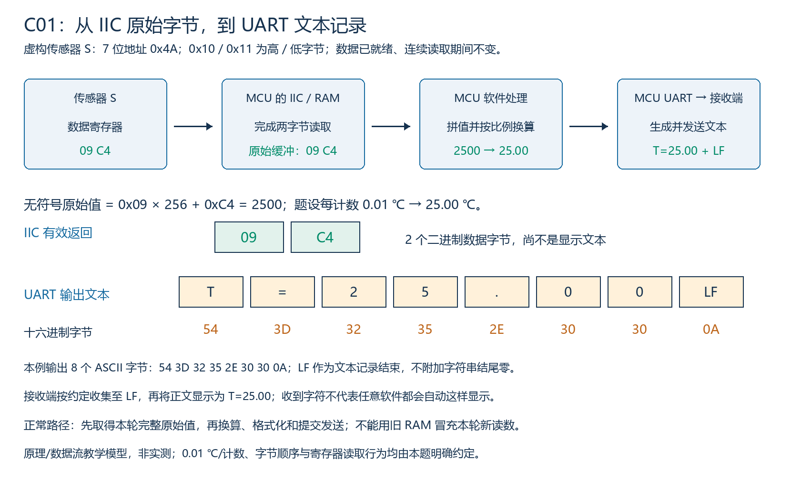
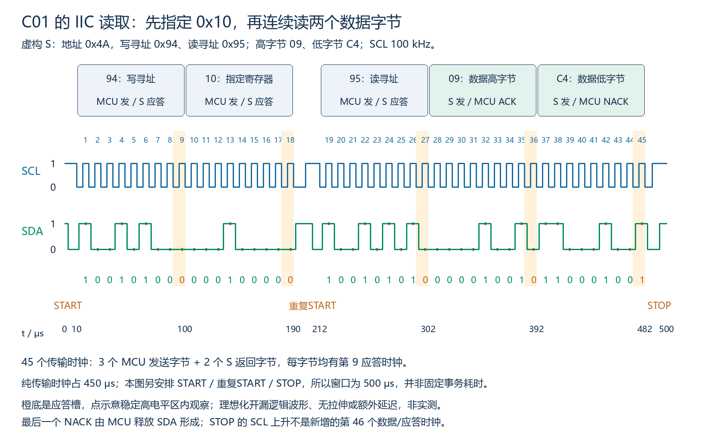
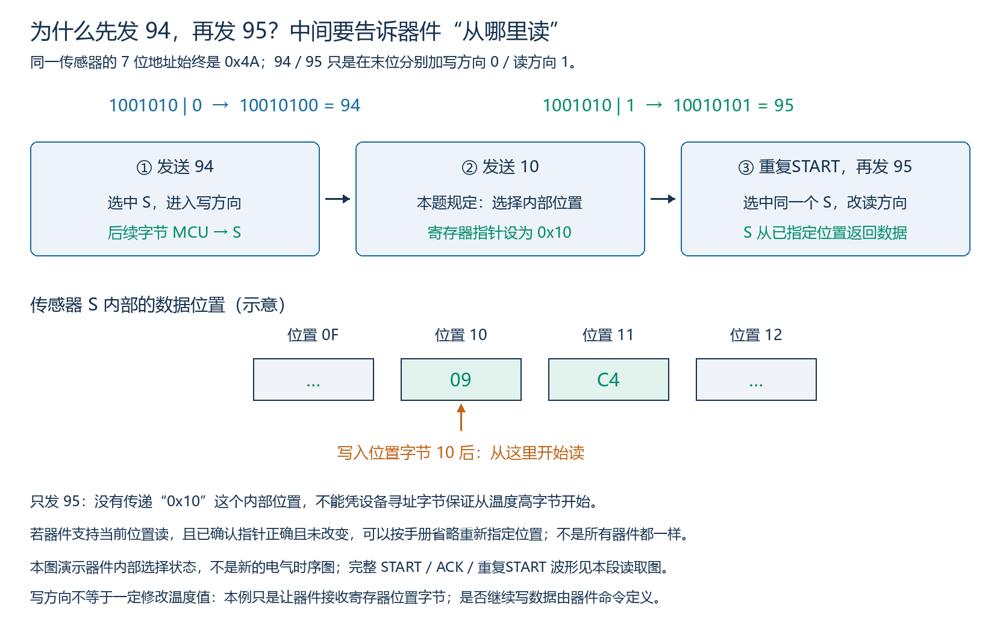
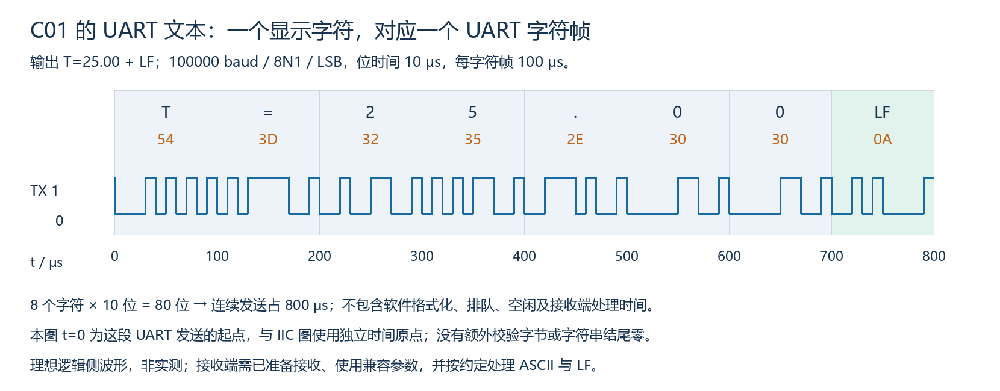
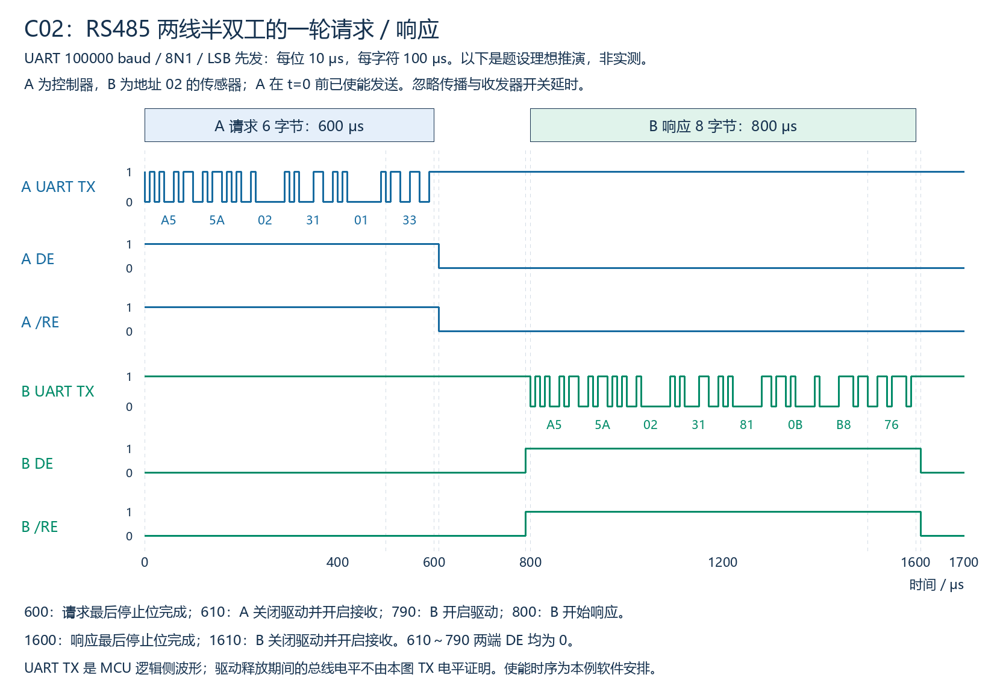
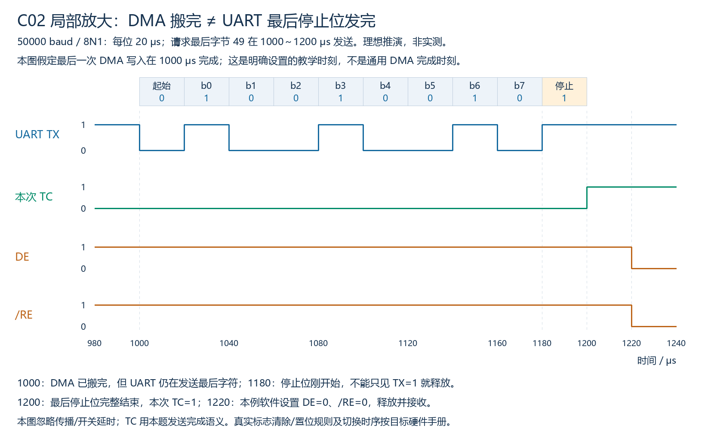
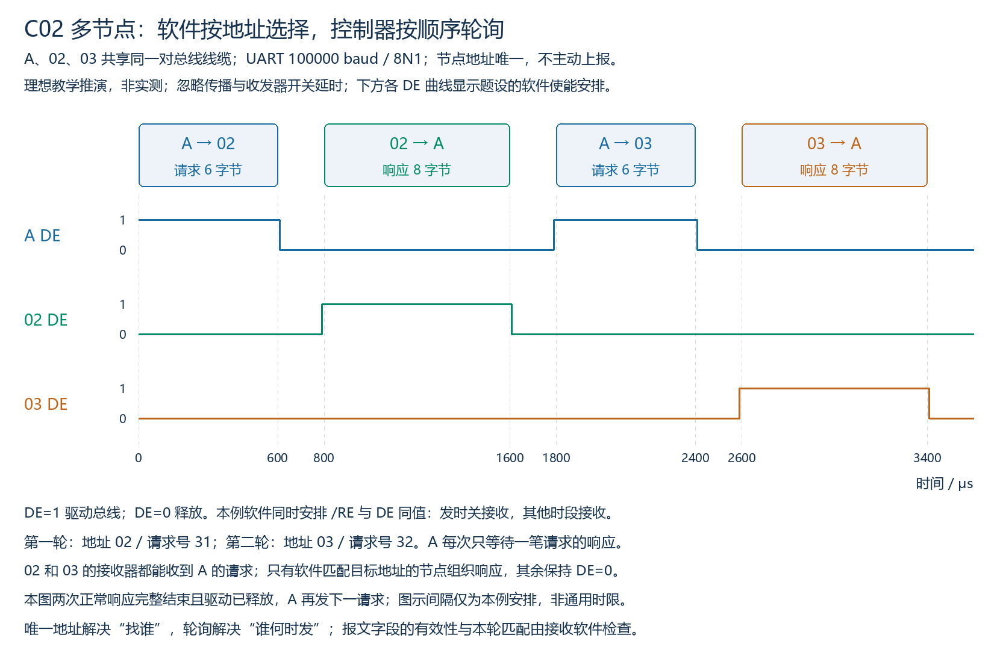
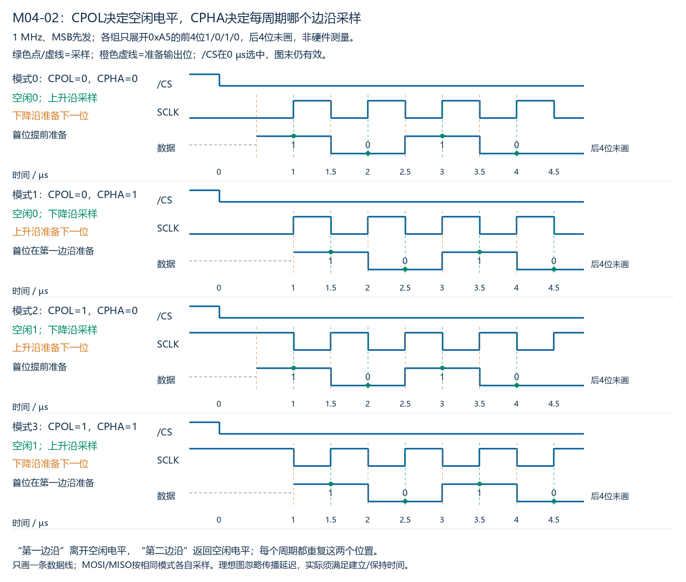
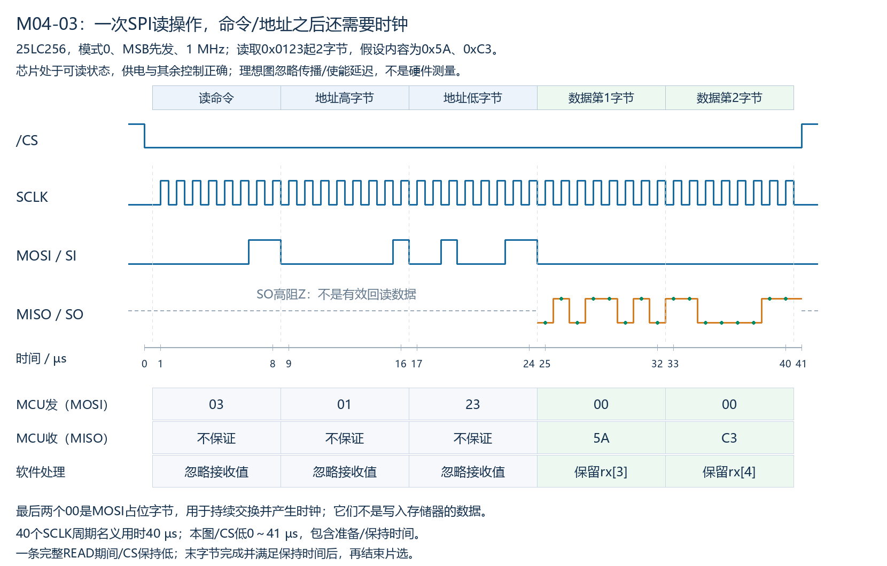
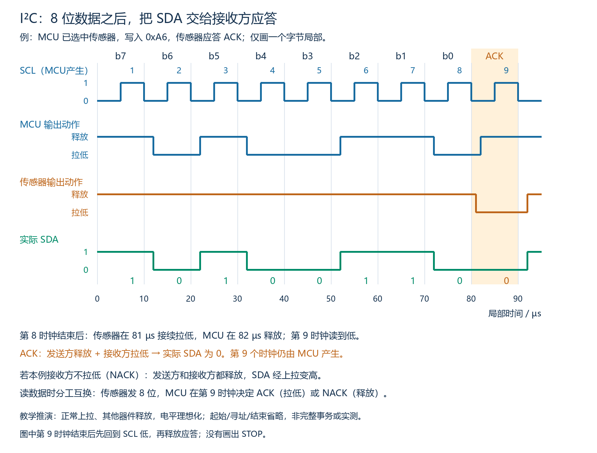

# M08：综合案例与模拟面试

本章完整覆盖两个给定链路综合案例、面试表达与原理问答、自查计算和参考答案。C01是IIC温度读取到UART文本输出，C02是两线RS485请求/响应与多节点轮询。面试部分按学习者要求仅作自学资料，不开展模拟面试交互，不以打字回答判定口述能力。

本章不要求选择接口、操作示波器/逻辑分析仪或完成通信故障定位专项，也不要求代码。图示和参数为明确条件下的教学推演，非硬件实测。旧模块不在此另行复测；已学知识直接用于当前综合场景。

## 一、C01目标：把两段通信串成完整数据流程

需求：MCU从既定IIC传感器S读取一次数据，再让接收端显示一条温度记录。传感器接口、UART连接及报文格式已给定，无需讨论选型。



链路中有不同层次的对象：

- 传感器保存原始计数，IIC完成寄存器访问并把数据交给MCU。
- MCU软件确认本轮有效字节、按手册拼值及换算，再生成格式化文本。
- MCU的UART发送文本字节，接收端接收并按约定显示。

因此不是把IIC线直接接到UART线，也不是原始缓冲进入UART后就自动变成可读温度。IIC和UART可以使用各自的时钟参数；格式转换是软件职责。

## 二、先读这份虚构器件与链路说明

本例为教学器件，不对应真实型号。以下行为都是本题条件，不能当作任意温度传感器的通用规定。

| 项目 | 本题约定 |
|---|---|
| 连接前提 | MCU、S和UART接收端的供电/参考与逻辑电平兼容，IIC上拉和UART连接已正确设置 |
| S的7位IIC地址 | 0x4A；线上写寻址字节0x94、读寻址字节0x95 |
| IIC时钟 | 100kHz；本例无拉伸与传输错误，必要应答均正常 |
| 内部位置 | 寄存器0x10为数据高字节，0x11为低字节；先写0x10后重复START切读，内部位置保留并自动递增 |
| 数据一致性 | 数据已就绪，本次连续两字节读期间保持同一个样本不变 |
| 数值含义 | 无符号16位原始计数，高字节先返回；每计数0.01℃，本段仅讨论非负示例 |
| 当前返回 | 高字节0x09、低字节0xC4 |
| UART | 普通逻辑侧，100000 baud、8N1、LSB先发；接收端使用兼容配置并已准备接收 |
| 输出格式 | ASCII正文`T=25.00`，后跟一个LF（Line Feed，换行，0x0A）；不额外发送字符串结尾零 |
| 接收端约定 | 收集至LF形成一条记录，显示正文并换行；这是接收软件约定，不声称任意终端收到LF都具有同样显示行为 |

真实器件还可能需要配置采样模式、启动转换、等待就绪、读状态或采用其他字节格式；本题通过“数据已就绪且连续读一致”的前提将这些准备条件明确给定，不要求猜测不存在的器件手册。

## 三、正常流程：准备、读取、解释、输出

### 3.1 先准备两条通信路径

在读取之前，确认给定IIC实例、引脚功能/开漏及上拉、外设时钟与100kHz参数已按目标硬件正确准备。UART同样需正确实例、引脚、时钟及100000/8N1配置，接收端预先准备。

软件还需为原始数据与待发送文本保留合适的存储，并分别管理有效长度。“原始数组容量2”不等于本轮已读到2字节；“文本数组容量足够”也不等于待发长度就是整个数组大小。初始化/配置是准备环节，不会单凭设置参数就自动完成一次传感器读取和输出。

### 3.2 从0x10连续读取两字节

本题的完整事务为：

```text
START
→ 94 → S给ACK
→ 10 → S给ACK
→ 重复START
→ 95 → S给ACK
→ S发送09 → MCU给ACK
→ S发送C4 → MCU给NACK
→ MCU产生STOP
```

这里94/95包含设备地址及方向，10是器件内部位置，09/C4是返回的数据。最初的写方向用于指定读取位置，不是在写入温度；重复START后改为读取。最后一个字节MCU给NACK是正常结束连续读取，不是本题通信失败。



共5个字节阶段，每阶段8数据位加1应答时钟，所以有45个传输时钟。100kHz下纯时钟占450μs；图还明确安排了开始/重复开始/停止等时间，显示窗口为500μs。不能将450μs当成任意实现的完整事务耗时，STOP前用于条件生成的SCL上升也不另计作第46个传输时钟。

### 3.2.1 为什么先发0x94，而不直接发0x95

**0x95只指定“读这颗器件”，没有携带“从内部0x10开始读”这个位置。**本例用写方向先传内部位置，再以读方向获取相应数据。

设备7位地址始终是0x4A，即二进制1001010。拼上R/W方向位得到：

```text
1001010 + 方向0 → 10010100 = 0x94：MCU向S传字节
1001010 + 方向1 → 10010101 = 0x95：S向MCU传字节
```

上面“拼上”表示在7位地址之后附加一位，不是数值相加。0x94/0x95不是两个不同的设备地址，也不是传感器内的寄存器编号。

**Register pointer，寄存器指针/当前访问位置**：器件内部用于记住访问哪个寄存器的选择状态。可以把它看作“当前页码”，但它的行为仍由器件手册定义。本题的0x10是位置选择字节，作用是设置该状态，不是把温度改成0x10。



| 发送阶段 | 对传感器的含义 | 为什么需要 |
|---|---|---|
| 94 | 选中地址4A的器件，后续由MCU发送 | 让器件接收下面的位置选择字节 |
| 10 | 按本题协议，把内部读取起点设为0x10 | 明确要读温度高字节所在位置 |
| 重复START、95 | 重新寻址同一器件并切换读方向 | 从已指定位置取得返回数据；本题明确位置在重复START后保留 |

因此“写方向”描述这一阶段字节由谁发给谁，不代表一定在改写数据寄存器。许多器件把写方向收到的第一个字节解释为位置/命令，后面若继续发送才可能按协议写入数据；这一解析规则不由IIC地址位统一规定。

若直接START→95，控制器尚未传达本次要选0x10。对支持“从当前位置直接读”的器件，可能从此前保留的位置读；若此前访问过状态或配置寄存器，就可能得到别的内容。器件若不支持这种访问，则按其协议处理。不能只凭95就保证本例温度读取正确，也不能一概说直接读一定NACK。

**并非每次IIC读取都必须先写位置。**当器件支持直接读取、当前寄存器位置已知正确且未被其他操作改变时，可按手册省略重复设置；有些器件还会在连续读取后递增位置，有些保持寄存器选择，不能统一猜测读取后的状态。例如[TI TMP102手册6.3.5节](https://www.ti.com/lit/ds/symlink/tmp102.pdf)说明它会记住已写入的寄存器选择，重复读同一个寄存器可不再次发送位置字节。这里只借它说明“是否可省略取决于器件”，不把TMP102的寄存器、位格式或换算关系套给虚构S。

### 3.3 在RAM中形成原始值与物理量

只有本轮两字节完整且按约定成功取得，才把它作为这一轮的有效原始读数。题设保证本次连续读取的一致性，不需要拼接不同采样时刻的高低字节。

```text
原始高字节 09，低字节 C4
→ 原始数值 = 0x09 × 256 + 0xC4 = 2500
→ 温度 = 2500 × 0.01℃ = 25.00℃
```

这是“字节顺序→原始计数→单位比例”的三步解释。IIC在一个字节内按高位先传，与16位数的高/低字节先后是两个约定；这里先高字节来自器件说明。也不能因为UART按LSB先发，就把原始两字节顺序或数值换算倒过来。

### 3.4 生成ASCII文本，再提交UART发送

**ASCII（American Standard Code for Information Interchange，美国信息交换标准代码）**给字符规定编码。本题的8个待发数据字节是：

| 字符 | T | = | 2 | 5 | . | 0 | 0 | LF |
|---|---|---|---|---|---|---|---|---|
| 十六进制编码 | 54 | 3D | 32 | 35 | 2E | 30 | 30 | 0A |

IIC返回2字节、UART发送8字节完全不矛盾：前者是原始二进制数据，后者是加标签、小数点和结束符后的显示记录。直接将09/C4原样送UART，不会得到上述ASCII文本。

若使用C风格字符串存储，内存中可能还需要一个结尾零，但本题线上只发这8个字节；存储容量与发送有效长度分别确定。当前不要求写格式化代码或使用浮点库。



100000 baud下位时间10μs，8N1每字符10位；8字符连续发送共800μs。这个数字不包含软件换算/排队、额外帧间空闲或接收端处理时间。UART图的t=0是文本发送起点，与IIC图的t=0独立，不代表两种总线在图示同一绝对时刻开始。

接收端还要取走UART字符、收集至LF并显示。这些阶段不由发送端的提交函数返回自动证明；若发送采用异步/中断/DMA，文本存储还须在驱动规定的使用期间保持有效，不能过早重用。

## 四、必要失败分支：不把旧值当本轮新值

本段只安排完整流程所需的结果分支，不追查故障根因：

| 本轮结果 | 后续动作 |
|---|---|
| 两字节读取成功，满足题设有效条件 | 拼值、换算、格式化为本轮新记录，再按发送接口约定提交 |
| 读取未完成/已超时，或仅确认部分字节 | 不把缓冲中残留的另一字节拼作本轮新读数；本轮记为未获得完整新值，按应用约定通知或跳过该次输出 |
| 应用选择继续显示上次成功读数 | 明确是旧值及其有效时间，不谎称刚刚成功采到相同温度 |

失败状态如何编码显示可以另定；本段不发明一套额外错误报文，也不因未取得新数据就要求学习者查线路或使用仪器。

## 五、本段自测与参考答案

以下是当前案例讲解后的理解检查，不是C01整个项目的独立验收；教材答案供以后查阅，不代表学习者已经答对。

1. 另一次已完整读取高字节0A、低字节28，即原始计数2600；比例及输出规则不变。应生成哪条文本记录？线上共发几个UART数据字节？
2. 本轮只确认第一个字节已保存，第二个仍是上一轮RAM残留。能否把两字节拼作本轮新温度输出？本轮应进入什么结果分支？
3. 若把09/C4两个原始字节直接交给UART，接收端是否自然得到`T=25.00`？UART位序是否会替软件完成数值换算？
4. 本例IIC与UART各自的纯传输数量/时间是什么？它们相加是否自动等于完整应用响应时间？
5. 假设同一器件另有可读位置0x20，采用相同访问流程。将`94 → 10 → 重复START → 95`改成从0x20开始读取时，哪个字节应改变？为什么94和95不需要一起改？

参考答案：

1. `T=26.00`后跟LF；8个UART数据字节，编码54 3D 32 36 2E 30 30 0A。数据位之外还需每字符起始/停止位。
2. 不能。本轮没有取得完整新值，不输出为本轮新温度；可以按约定通知/跳过本次记录。保留旧显示需标明旧值，不能伪装成功。
3. 不会，原始二进制与ASCII文本不同，需软件拼值、按比例换算并生成字符序列；UART位序只决定字符数据位的线上传输次序。
4. IIC共45个传输时钟，100kHz下450μs，不含各种条件/间隔；UART8字符×10位，100000 baud下800μs，无额外空闲。两者的纯传输时间和不自动包含准备、换算、排队、控制条件和接收端显示等开销，也不代表所有实现均串行无重叠。
5. 位置字节10改为20；94/95仍选择同一个7位地址4A及相应方向。内部位置改变不等于换一颗器件，读写方向也未因此改变；访问流程是否相同已由题设明确。

## 六、C01另一组条件的完整参考

虚构S2的7位地址为35，内部20/21分别为高/低字节，先写位置后重复START读，位置保留并自动递增；样本就绪且连续读一致。返回0B/B8，无符号16位、0.01℃/计数。两条链路正确准备，IIC400kHz，UART50000 baud/8N1，连续发送无额外空闲。

```text
START → 6A → S2 ACK → 20 → S2 ACK
→ 重复START → 6B → S2 ACK
→ S2发送0B → MCU ACK → S2发送B8 → MCU NACK → STOP

原始值：0x0BB8 = 3000 → 30.00℃
输出字符：T  =  3  0  .  0  0  LF
ASCII字节：54 3D 33 30 2E 30 30 0A
```

IIC仍是5个字节阶段，45个传输时钟，纯时钟时间45/400000=112.5μs。UART每字符10位，共8字符×10位/50000=1600μs；200μs只是一个字符帧时间。

注意三种表示：0B/B8是传感器原始数据，3000是解释后的计数，文本中的3/0分别编码为33/30。不能把原始两字节填在文本数字的位置。输出格式已约定为ASCII正文加LF，不自行增加单位符号；物理量的℃与线上是否传单位分别决定，°不属于ASCII。文本入队不证明UART已发送完，更不证明对端已显示。

## 七、C02第一段：给定两线RS485请求/响应

### 7.1 连接与本例协议

控制器A和温度传感器B，各通过自己的UART连接RS485收发器，再共享一对总线导线。供电、逻辑电平、参考、终端和空闲偏置已按目标硬件正确准备，不要求重新选型或定位线路问题。UART双方为100000 baud/8N1/LSB先发。

```text
A的软件 ↔ A UART ↔ A收发器 ══ 同一对总线导线 ══ B收发器 ↔ B UART ↔ B的软件
```

**以下为教学自定义二进制协议，不是Modbus。**所有报文字节以十六进制书写，软件按固定字段位置解释，并使用M06已讲的帧头、长度约束、SUM8和请求号机制。

| 方向 | 帧头 | 设备地址 | 请求号 | 操作/响应类型 | 数据高/低字节 | SUM8 |
|---|---|---|---|---|---|---|
| A请求，共6字节 | A5 5A | 02 | 31 | 01：读取温度 | 无 | 33 |
| B响应，共8字节 | A5 5A | 02 | 31 | 81：温度正常响应 | 0B B8 | 76 |

地址02在请求中表示目标，在响应中表示来源；请求号31由A为本轮分配，B原样带回；01与81由本例软件约定。它们不是RS485收发器自动认识的字段，也不是IIC的7位寻址阶段。

本题SUM8定义为前面全部字节相加取低8位，包含帧头。例如请求和为0x133，校验字节33；响应和为0x276，校验字节76。应接收完整响应，核对固定结构、SUM8、地址、请求号和响应类型，再将数据0B/B8按本例无符号16位、0.01℃/计数解释为30.00℃。

本例响应使用原始二进制数据，故0B/B8直接作为两个数据字段是正确的；C01约定ASCII文本，必须先转成字符。数据表示由应用协议规定，不能见到UART就一律当文本。

### 7.2 同一对线如何交接

本例发送阶段设DE=1、/RE=1，接收阶段设DE=0、/RE=0；/RE为低有效，1关闭接收。发送时关闭本机接收是本例安排，不是所有RS485设计的强制要求。



每字符1起始+8数据+1停止=10位，100000 baud下占100μs。图中的连续请求6字节占0～600μs，连续响应8字节占800～1600μs。时序是本例明确的软件安排，忽略传播/收发器开关延时；真实延时与保护间隔应按器件及应用规定，不套用本例10/200μs为通用限值。

1. A在t=0前准备好本轮响应接收缓冲/状态，再开启驱动；B保持接收。A发送请求，直到600μs最后停止位完成。
2. A确认本次UART真正发送完成（TC语义按具体外设手册确认），图中610μs关闭驱动并开启接收。仅DMA搬完或TX缓冲可写不能代替最后停止位完成。
3. B收到完整有效且发给自己的请求，组织响应；图中790μs开启驱动、关闭本机接收，800μs发第一个起始位。A此时已释放驱动并处于接收。
4. B在1600μs最后停止位完成，1610μs释放驱动并回到接收，等待后续请求。
5. A的软件核对完整响应及本轮匹配条件，再交付温度。不能仅据UART收到某个字符就交付一条温度。

610～790μs两端DE都为0，没人主动驱动；图中UART TX保持高不证明总线电压。已准备的偏置/接收器空闲保障属于题设条件，不能把驱动释放解释为总线强制逻辑0。

从请求第一位开始到响应最后停止位结束是1600μs，其中600μs请求+200μs方向交接/处理等待+800μs响应。尚不包含A后续软件交付时间。图中200μs不是一个额外字符帧。

### 7.3 必要的不完整结果分支

例如本轮绝对接收截止时刻为2100μs，到时只有7/8个响应字节，不能接受为完整有效响应，也不能用旧缓冲补第8字节或声称取得本轮新温度。终止本轮等待并按约定报告/跳过；超时本身不能证明B未执行。当前只说明完整流程的必要分支，不分析故障根因。

### 7.4 当前段自测与参考答案

1. 同样100000 baud/8N1，请求改为7字节，仍从0连续发送。610μs释放驱动是否合适？最后停止位最早何时完成？忽略硬件开关延时。
2. 原8字节响应到2100μs截止只收到前7字节。能否交付本轮新温度？能否据此断言B未执行请求？

参考答案：

1. 不合适，7×10/100000=700μs才完成最后停止位。应确认本次真正发送完成后，按器件/应用所需时序释放驱动；610μs仍在最后字符中。
2. 都不能。未收全有效响应，不用旧值补齐；截止后按应用约定记录/通知本轮失败或跳过，超时不证明对端没收到/没执行。

### 7.5 SUM8的进位，以及DMA与TC的完成边界

SUM8的名字在不同协议中可能有不同覆盖范围；本章明确定义为“校验字节之前全部字节的和，取低8位”。所有下面的加数和结果均为十六进制。以请求前缀A5 5A 07 42 01为例：

```text
  A5 + 5A = FF
  FF + 07 = 106
 106 + 42 = 148
 148 + 01 = 149
```

0xFF是255，加0x07后超出一个字节的范围，完整和为0x106，不是0x100。最后0x149可写成0x0149，低8位是最后两位十六进制49；因此完整请求A5 5A 07 42 01 49。也可用十进制核对：165+90+7+66+1=329，329除以256余73，而73=0x49。不要把十进制数字与十六进制数字混在同一竖式中。

十六进制的单个数字依次为0、1、…、9、A、B、C、D、E、F，A～F分别表示十进制10～15。0x前缀用于明确数制。例如0x09+0x01=0x0A，个位不向十位进位；0x0F+0x01=0x10才进位。计算“校验值增加1”时，同样遵循十六进制规则，不能把未加0x前缀的十六进制49当十进制49使用。

**DMA（Direct Memory Access，直接存储器访问）完成**在本题表示本次数据已按要求从RAM搬给UART发送端；UART仍可能有待发数据。**TC（Transmission Complete，发送完成）**在本题表示本次UART最后字符连同最后停止位已完整发送。因此DMA完成不是此处释放RS485驱动的充分条件；需要确认本次UART真正发送完成，再按目标器件及应用规定完成切换。



本例50000 baud/8N1，请求6字符共1200μs，最后字符49从1000μs发至1200μs。图明确假设最后一次DMA写入在1000μs完成，实际搬完时刻取决于硬件与缓冲，并非通用规则。最后停止位从1180μs持续至1200μs；1180μs时TX已高，但停止位刚开始，不能只看TX高就释放驱动。1200μs完整结束、本次TC=1，图中软件在1220μs切DE=0、/RE=0。额外20μs是图的安排，不是RS485固定要求；图忽略传播和收发器开关延时。

真实外设的TC清除/置位、缓冲及回调语义要查目标手册/驱动；应确认是本次发送的完成，不能使用前一次遗留的标志或仅凭函数名判断。

本节自测：

1. 若上述请求只把请求号42改成43，其余前缀不变，新SUM8为多少？
2. 按局部图，1180μs是否可因TX为高而释放驱动？忽略硬件开关延时，最早应等到哪个时刻、什么完成事件？

参考答案：

1. 4A。参与求和的请求号增加1，SUM8从49变为4A，本例不发生低8位回绕。
2. 不能；应等1200μs最后停止位完整结束，确认本次TC=1。图中实际1220μs切换属于软件安排，1200μs为图设完整结束时刻；真实切换还须满足硬件/应用时序。

## 八、C02第二段：多节点按地址轮询

### 8.1 共用总线不等于所有节点都回复

保留A控制器，在总线上接入地址唯一的02、03两颗传感器。沿用前述自定义报文、100000 baud/8N1及已正确准备的硬件。两节点都不开启主动上报，只对A发给自己且完整有效的单播请求响应。当前仅A发起请求，并且一次只等待一笔请求的结果。

```text
控制器A收发器 ═══════ 同一对总线导线 ═══════
                        │             │
                    02收发器       03收发器
                        │             │
                    02的软件       03的软件
```

这是结构示意，短支线、端点终端等已满足题设硬件条件，不表示物理布线可以任意增长。

A向03发送请求时，02和03的接收器都能看到线路上的信号，UART也都可以取得这些请求字节。各节点软件收集完整报文并核对字段：03确认目标是自己才组织响应，02不执行该命令、不回复，继续保持DE=0接收。

**地址决定请求找谁，轮询决定谁何时发。**收发器不会自动过滤目标地址；即使节点地址唯一，若允许各节点任意主动驱动，仍不能保证不冲突。本例通过“一个控制器发起、节点只按请求回复、每轮完整结束后再下一轮”安排总线使用。若两个节点共用同一地址，则软件目标不再唯一，不能保持该单播模型的唯一应答前提。

### 8.2 两轮连续的正常时序

第一轮沿用地址02、请求号31；第二轮改为地址03、请求号32，数据返回09/C4。本例对应报文为：

```text
第一轮请求：A5 5A 02 31 01 33
第一轮响应：A5 5A 02 31 81 0B B8 76

第二轮请求：A5 5A 03 32 01 35
第二轮响应：A5 5A 03 32 81 09 C4 82
```

两个校验值35/82仍按前面全部字节SUM8求得。第二轮地址与请求号改变后，应重新计算校验，不能只改字段仍照用第一轮校验。03返回0x09C4=2500，按本例0.01℃/计数得到25.00℃。



图中02的响应在1600μs发完、1610μs释放驱动；A在1790μs启用发送、1800μs开始下一请求。第二请求1800～2400μs发送完成，A在2410μs切接收；03在2590μs启用发送、2600～3400μs响应、3410μs释放驱动。各时刻只是题设安排，非RS485通用等待时限；忽略传播和收发器开关延时。

本例每次发送均等待本次最后停止位完成后释放，各节点的软件同时将/RE安排为与DE同值，所以发送时接收关闭、其他阶段接收开启。图中任一时刻最多一个DE为1，这也包括字符发完但尚未释放的短时间，不能仅比较数据包矩形是否重叠。

### 8.3 A如何把有效响应归到正确节点与轮次

第二轮A保存的预期条件为“来源03、请求号32、正常温度响应81、完整8字节且SUM8正确”。收到的数据先作为候选，不因某个字段碰巧正确就立即交付。

- 来源02、请求号32：即使长度和校验正确，也不是本轮03的响应。
- 来源03、请求号31：地址虽对，请求号不是当前轮次，不作为本轮响应。
- 来源03、请求号32，类型/长度/校验均符合题设：按数据字段换算并交付03这轮的新温度。

地址、请求号与校验分别约束不同条件，校验通过不保证属于当前请求。请求号的取值和复用规则由应用协议规定；本例只给定相邻两轮31/32，不声称有限请求号能永久排除任何历史报文。若某轮超时，也不能单凭超时就证明线路已释放；后续访问仍须遵守系统规定的应答时间窗口与总线交接规则。本段图仅是两轮都正常完成的时序，不展开异常定位。

### 8.4 当前段自测与参考答案

1. A给03发送请求号32的请求。02接收器与UART均已开启且接线正常：它能否收到请求字节？它应否响应、DE应保持多少？
2. A正等待03/32的响应，收到两个完整候选，类型与校验都正确：甲来源02/请求号32，乙来源03/请求号32且数据09/C4。哪一个可作为本轮响应？交付哪个节点的多少温度？

参考答案：

1. 能收到；软件按目标地址判断不是发给自己，不执行该命令、不响应，DE保持0，继续接收。
2. 乙。甲来源不匹配，不能据请求号和校验正确就接受；乙满足本题全部条件，交付03本轮25.00℃。

### 8.5 另一组给定条件的综合参考

同一对RS485总线上有控制器A和地址04/07两个节点，硬件/逻辑电平/参考/终端/偏置及UART都已正确准备。节点只回复本机单播请求，A每次只等待一笔请求。UART50000 baud/8N1，连续发送，无额外空闲，忽略传播和收发器开关延时。本轮目标07、请求号42、读温度操作01。

```text
完整请求：A5 5A 07 42 01 49
请求从0连续发送：6 × 10 ÷ 50000 = 1.2ms

响应从1500μs连续发送8字节：持续1600μs，3100μs结束
回复期间：A DE=0、/RE=0；07 DE=1、/RE=1；04保持接收且DE=0

候选甲：A5 5A 07 41 81 09 C4 95
候选乙：A5 5A 07 42 81 0A 28 FB
```

两个候选均完整且类型/SUM8正确，仍须匹配本轮请求号；甲的41不匹配，乙的42匹配。乙数据0x0A28=2600，按0.01℃/计数交付07本轮26.00℃。本例按固定8字节响应组织，数据中的0A是原始高字节，不是ASCII文本的LF结束符。

DMA完成且TC仍为0时不能释放，必须确认本次最后停止位已完整发出，再按硬件/应用规定完成驱动释放及接收准备。若仅把请求号42改成43，校验应重新计算：原完整和0x149增加1为0x14A，低8位0x4A；不能按十进制49+1误写50。

## 九、I01自学参考：面试表达与原理追问

### 9.1 回答结构

本节说明回答的结构与取舍，使用已给定的案例，不新增接口选型、仪器操作或故障定位专项。内容及答案供自学，不要求向助手提交面试回答；此前首问保留为资料，不再待答。集中复习/I02由学习者之后自行决定是否启动。

可以按“结论→关键机制→具体案例→适用边界”组织短回答：

- 结论：先直接回答所问对象与职责，不先罗列所有学过的名词。
- 机制：说明数据由谁接收、如何转换、何时交接，保证因果连贯。
- 案例：借一个已明确参数的流程或关键时刻支撑解释，无需把全部算术都重算一遍。
- 边界：说明成立条件和实际验证范围，例如本题是两线半双工、纸面分析尚无硬件实测。

这些是表达辅助，不要求每个问题机械说齐四段。若只问职责，先说分工；追问某个时刻，再展开对应时序。技术名词正确还不够，需说明它们如何共同完成目标。

### 9.2 示例：介绍一个IIC到UART案例

> 我完成过IIC温度读取到UART文本输出的纸面流程推演。先按给定器件协议设置内部寄存器位置，再用重复START连续读取高低两字节。软件确认本轮数据完整后拼值、按比例换算并生成约定的ASCII文本。UART负责发送这些文本字节，接收软件按LF组织记录；数据入队不等于对端已显示。目前完成的是原理和时序分析，尚未用开发板验证。

这段话先交代目标，再说明器件访问、软件解释、UART与接收端职责，最后说明验证范围。它不需要把每个寻址字节、全部波特率计算都塞进开场回答；被追问时再展开。

### 9.3 给定链路分工的回答示例

1. 在给定两线半双工RS485案例中，UART、RS485收发器、软件协议分别负责什么？为什么控制器发完请求后还要切换方向？用4～6句话解释。

参考答案：

1. UART按给定波特率和帧格式串行收发每个字节。RS485收发器在UART逻辑信号与总线差分信号之间转换，通过发送/接收使能参与方向控制。软件协议规定地址、请求号、命令、数据和校验，负责确认完整报文及本轮匹配。两线半双工共用同一对总线线缆，控制器确认最后停止位完整发完后需要释放驱动并准备接收，给目标节点回复的机会。这些是当前给定链路的纸面机制，不声称已完成真实硬件验证。

### 9.4 十八个常见原理问题与参考回答

以下每题含简答、展开或边界，均为可自行查阅的参考。它们不代表学习者已经独立回答，也不构成真实面试评价。涉及波形的完整推演在本章及前面各模块中保留。

#### 1. UART不共享时钟，接收方怎么知道何时读取每一位？

**简答：**双方预先约定波特率和字符格式，接收器检测起始位后，按自己的时钟安排各位采样。

**展开与边界：**普通UART逻辑侧空闲为1，起始位为0，停止位为1。接收器通过起始位建立本字符的时间基准，下一字符重新对齐，不是靠CPU逐位执行延时。收发时钟仍有误差，能容忍多少取决于具体接收方式、字符长度和器件条件，不能统一背成所有UART都允许固定百分比。

**追问参考：**CPU主频改变，但UART的实际输入时钟、分频与字符格式都不变，线上波特率不会仅因CPU执行更快而改变。参见[M00时钟基础](M00-通信与单片机必要基础.md)与[M01 UART](M01-UART.md)。

#### 2. 115200 baud是不是每秒可以发送115200个字节？

**简答：**不是。普通二进制UART中每位对应一个符号，115200 baud对应115200个位时间/秒，字节还要占用起始、校验和停止位时间。

**展开与例子：**8N1每字符10位，连续有效数据吞吐率为115200/10=11520 B/s；8E1有1起始、8数据、1偶校验、1停止，共11位。以上忽略帧间空闲、软件排队和上层报文开销；不能把其他调制系统的波特率与比特率也一概视为相同。

#### 3. UART、RS232和RS485的空闲、起始、停止电平有什么关系？

**简答：**字符的逻辑含义可以相同，线路上的电气表示不同。

**展开：**普通UART逻辑侧为“空闲1、起始0、停止1”。正常驱动的RS232数据线上，逻辑1对应负电压，逻辑0对应正电压，因此空闲/停止为负、起始为正。RS485接收器比较两线电压差，具体正负与逻辑对应须按收发器定义；不能把某一根线的电压直接叫作字符位值。

**边界：**RS485无人驱动时，驱动输出为高阻，接收空闲结果还取决于偏置和接收器失效保护，不能把“释放”等同于主动输出0或1。参见[M02 RS232](M02-RS232.md)与[M03 RS485](M03-RS485.md)的同帧电平对照波形。

#### 4. 为什么RS232不能直接接3.3V MCU RX？DTE和DCE是什么？

**简答：**RS232的电压范围及逻辑极性与普通MCU逻辑输入不同，需匹配的收发电路。

**展开：**DTE为Data Terminal Equipment（数据终端设备），如传统PC；DCE为Data Circuit-terminating Equipment（数据电路终接设备），如传统调制解调器。这是设备角色，不能当成收发器芯片名称。常见九针接口还包括控制/状态信号，三线TX/RX/信号地只是常用通信子集。

**边界：**同为九针连接器不保证相同接口和针脚；直连还是交叉，要按两端的实际信号方向和手册判断。USB转逻辑电平UART也不自动等于USB转RS232。

#### 5. RS485是不是半双工协议？四根线是否自动变全双工？

**简答：**RS485首先规定电气接口；本章采用的两线共用总线是半双工结构。

**展开：**四线结构用两对独立信号路径分别发送和接收，可具备全双工能力，但需要对应的独立发送、接收端和合适连接。把第二对线并到原半双工收发器同一对总线端，不会增加独立通路。设备实际能否同时双向工作还要看完整硬件与软件安排。

#### 6. DMA发送完成后，为什么还要看UART TC？

**简答：**DMA完成表示搬运结束，UART可能尚未发完最后字符；本题TC表示本次最后停止位也已完整发送。

**展开：**过早关闭RS485驱动可能截断仍在发送的内容。控制器应确认本次UART真正发送结束，再按硬件时序释放总线并准备接收；TX缓冲可写也不能替代该确认。TC的清除、置位和驱动回调语义仍以目标MCU/驱动为准，不能只按函数名判断。见7.5节局部波形。

#### 7. 终端电阻和空闲偏置分别解决什么问题？

**简答：**终端用于匹配传输线、减小反射；偏置用于无人驱动等条件下建立接收器可识别的空闲差分状态。

**展开与边界：**终端通常围绕主干物理端点安排，不能给每个节点随意增加。偏置还要考虑终端并联负载、器件输入和噪声裕量；接收器内部失效保护的适用状态须看手册，不能一概说有内部保护就无需任何系统设计。差分抗干扰也仍受共模和输入电压范围约束。原理依据见[TI RS485设计指南](https://www.ti.com/lit/an/slla272d/slla272d.pdf)，具体计算见[M03](M03-RS485.md)。

#### 8. 多个RS485节点有不同地址，就不会冲突了吗？

**简答：**不同地址能帮助软件区分目标，不能自行规定谁何时驱动总线。

**展开：**本章使用单控制器轮询、每次一笔请求、只有被寻址节点回复的规则。其他节点可以接收到字节，但软件不执行该请求、不回复，并保持驱动释放。Modbus是可运行在RS485链路上的应用协议之一，RS485本身没有统一的设备地址字段；本章A5/5A报文是自定义协议。

#### 9. SPI四种模式怎样判断？

**简答：**CPOL（Clock Polarity，时钟极性）规定空闲时钟电平，CPHA（Clock Phase，时钟相位）规定在第一个还是第二个有效边沿采样。

| 模式 | CPOL | CPHA | 空闲SCLK | 采样边沿 |
|---|---|---|---|---|
| 0 | 0 | 0 | 低 | 上升沿 |
| 1 | 0 | 1 | 低 | 下降沿 |
| 2 | 1 | 0 | 高 | 下降沿 |
| 3 | 1 | 1 | 高 | 上升沿 |



**边界：**第一个边沿是从空闲电平离开的边沿，CPOL=1时它是下降沿；CPHA=0要求首位在第一个采样沿前已经准备好。还需满足目标器件的建立/保持时间和片选约束，不是只把模式编号配对即可。参见[ADI SPI原理](https://www.analog.com/en/resources/analog-dialogue/articles/introduction-to-spi-interface.html)及[M04](M04-SPI.md)。

#### 10. SPI读取时为什么还需要发送数据？

**简答：**控制器要继续产生SCLK，才能让目标器件移出返回数据；同步交换时控制器也会移出相应位。

**展开：**本课程的器件例子先发送读命令和地址，再发送占位字节来产生读取时钟。命令/地址阶段采到的值不自动是有效存储数据；占位字节取值、是否另需等待周期，都由器件协议决定。不能给所有器件统一追加一个“空读字节”。



上图沿用M04的25LC256示例：1MHz、读取2字节，共40个时钟周期；下面另给一组参数练习计算，不能把两组数字混用。

**另一组计算例子：**若题设为8位命令+16位地址+读取3个数据字节，且没有其他等待周期，则共48个SCLK周期，2MHz下纯时钟时间24μs。这不包含片选前后等待和软件开销。

#### 11. SPI全双工，是否每个收到的字节都有效？片选能否中途释放？

**简答：**全双工表示具备同步双向移位能力，不保证每个阶段都有业务有效数据；片选边界还由器件协议规定。

**展开：**读指令通常有命令、地址和数据阶段，软件只取规定阶段的返回数据。对于本课程连续读例子，中途释放片选会结束原事务，重新选中后需按器件规则开始新指令，不能默认接着读。多目标共享MISO还要求未选中目标按其手册释放输出，不能把两颗同时驱动得到的电平当成两份独立数据。

#### 12. IIC七位地址和线上地址字节有什么区别？

**简答：**普通7位寻址的线上首字节包含7位设备地址和1位读写方向。

**展开：**例如7位地址0x2D，写方向字节为0x5A，读方向字节为0x5B，方向位0表示控制器发送、1表示控制器接收。不能把手册给出的8位地址字节再当7位地址左移一次；API究竟接收哪一种表示须看其文档。内部寄存器地址则是随后按器件协议传的另一类字段，不与设备地址混用。

#### 13. IIC的ACK由谁给，最后一个NACK是否表示失败？

**简答：**字节的接收方在第9个时钟给应答；控制器读取最后字节时给NACK，可正常结束连续读。

**展开：**写地址/位置时目标器件接收并ACK；目标向控制器返回数据时，控制器作为接收方决定继续ACK还是最后NACK。NACK通过释放SDA、由上拉形成高电平实现，不是开漏输出主动推高。每个字节阶段为8数据时钟加1应答时钟，START/STOP本身不各算一个数据字节。[NXP UM10204第3.1.5～3.1.6节](https://www.nxp.com/docs/en/user-guide/UM10204.pdf)



#### 14. IIC读寄存器为什么先写后读？是否每次都必须这样？

**简答：**常见器件先用写方向指定内部位置，再重复START切成读方向；写位置不一定是在改写数据寄存器。

**展开与边界：**重复START在中间没有STOP的情况下继续事务；前面设置的内部位置是否保留和递增，由器件规定。某些器件支持从已知当前位置直接读，也有器件读取流程不同，不能把先写位置当全部IIC器件的统一强制规定。见本章3.2.1节及相应器件手册。

#### 15. IIC为什么使用开漏和上拉？拉伸、仲裁分别是什么？

**简答：**本课程常见IIC结构用开漏下拉/释放和上拉形成共享线路电平；任何一方下拉时总线为低。

**展开：**支持时钟拉伸的目标可暂时保持SCL为低，控制器不能只按自己的计划认定时钟已升高；多控制器仲裁在相应仲裁位比较想发与实际SDA，想发1却读到0者停止争用。仲裁不等于把所有收到的低电平都算输，例如正常ACK阶段要按应答角色解释。支持方式与上升时间仍受器件和总线条件约束。[TI IIC原理说明](https://www.ti.com/lit/pdf/slva704)

#### 16. UART中断或DMA得到一批字节，是否就得到一整包？

**简答：**不是。硬件字符、搬运批次与应用报文是不同边界。

**展开：**软件应保存有效字节，按固定长度、分隔符或长度字段等协议规则持续组包；一批可以含半包、整包或多包。部分候选可跨批保留，完整候选后剩余字节还可能属于下一包。环形缓冲的读写位置相同不天然说明为空；若只有DMA模N写位置，也不能区分未搬运与刚好多搬一整圈，需足够的累计进度和溢出管理。见[M06](M06-软件收发与应用数据包.md)。

#### 17. UART奇偶校验、SUM8和CRC各能证明什么？

**简答：**它们检查的范围和方法不同，都不能单独证明一条业务报文属于本轮请求且内容绝对正确。

**展开：**UART奇偶校验属于逐字符检查；SUM8和CRC一般按协议指定的报文范围计算，CRC为Cyclic Redundancy Check（循环冗余校验）。接收软件还需检查完整性、长度、地址、请求号和字段含义。校验存在未检出的错误可能，实际CRC还要统一参数和覆盖范围，不能把一端算出某个值就当全链路已验证。

#### 18. 超时能否证明对方没执行？接收到正确旧响应怎么办？

**简答：**超时只说明本次等待未在规定窗口取得预期结果，不能证明对端没有收到或执行。

**展开：**完整且校验正确的旧响应也必须按地址、请求号和当前状态判断，不能直接满足新请求。总超时与字节间超时关注不同窗口，具体计时起点需在协议/软件中明确定义。对可能产生副作用的命令，重新发送是否安全需考虑幂等性或重复识别；本章不据超时自动推导无限重试，也不把未收到响应当线路已经空闲的证明。

### 9.5 常用计算与表述速查

| 对象 | 计算/表达 | 适用条件 |
|---|---|---|
| 时钟周期 | T=1/f；32MHz对应31.25ns | 指明是哪一个时钟 |
| 机器/指令耗时 | 给定周期数×对应周期时间 | 机器周期和指令周期按具体架构/手册，不固定套用12T |
| UART位时间 | 1/波特率 | 本课程普通二进制UART |
| UART字符位数 | 1起始+数据位数+校验位数+停止位数 | 按给定字符格式 |
| 连续UART时间 | 字符数×每字符位数/波特率 | 不含额外帧间空闲、排队和接收处理 |
| SPI纯时钟时间 | 总时钟数/SCLK频率 | 总数含器件要求的命令/地址/占位/等待周期 |
| 普通IIC字节时钟 | 传送字节阶段数×9 | 8位数据加1位ACK/NACK；控制条件另算 |
| 原始两字节拼值 | 高字节×256+低字节 | 题设高字节先、无符号16位，不用于任意编码 |
| SUM8 | 指定范围字节和取低8位 | 覆盖范围由协议定义，不默认只算数据字段 |

“UART发得更快”“RS485能传很远”等结论若没有参数和条件，不足以描述具体链路。本章只在题设参数下计算，不给所有器件共用的最大距离、速率或误差限值。

## 十、两份案例的自查清单

这些项目用于以后阅读材料时自查，不要求现在回答或提交。

| 案例 | 应能还原的过程 | 不能直接等同的事件 |
|---|---|---|
| C01 | 准备IIC/UART→指定内部位置→连续读取→确认本轮完整→拼值/换算→生成约定文本→提交→对端组记录 | 原始字节不等于ASCII；数组容量不等于有效长度；入队不等于线上完成或对端显示 |
| C02 | 准备本轮等待→组请求/校验→启用发送→等待本次真正发完→释放并接收→目标回复→完整性/校验/来源/请求号匹配→交付 | DMA完成不等于UART停止位发完；CRC/SUM通过不等于属于本轮；超时不等于未执行 |

以后自行口述时，可尝试先说目标和关键步骤，再任选一张波形解释具体时刻。是否口述流畅、能否应对真人追问，需要另行实践；本教材不据书面自查给出这类评价。

## 十一、章末自测与参考答案

本组为自学材料，不自动作为课堂题、模拟面试或复习任务。参考答案紧随其后，阅读答案不计独立完成。

1. C01已经取得原始0B/B8，按无符号16位、0.01℃/计数解释，并按“T=两位小数+LF”的ASCII约定输出。温度、待发十六进制字节和数据字节数分别是什么？
2. 将第1题文本用50000 baud/8N1连续发送，位时间、单字符时间、总时间分别是多少？提交接口仅表示入队时能否宣布对端已显示？
3. 某SPI器件明确要求8位读命令、16位地址及随后3字节数据，不另需等待周期，片选应全程保持。SCLK=2MHz，时钟数和纯时钟时间是多少？命令阶段收到的字节是否自动算作目标数据？
4. IIC器件明确要求写内部位置、重复START、连续读2字节。普通7位寻址下共几个字节阶段、多少个传输时钟？400kHz下纯时钟时间是多少？最后一个应答由谁给、是什么？
5. 控制器正等待地址07、请求号42、类型81的8字节响应。收到完整且SUM8正确的候选A5 5A 07 41 81 09 C4 95，是否可交付为本轮结果？
6. 请求前5字节A5 5A 07 42 01的SUM8是什么？若请求号改43，校验如何变化？若最后停止位1180μs开始、1200μs结束，而DMA1000μs完成，1180μs能否释放驱动？

参考答案：

1. 3000计数、30.00℃；字节54 3D 33 30 2E 30 30 0A，共8数据字节。原始0B/B8不能替代文本中字符3/0的ASCII编码，线上不额外加单位或字符串结尾零。
2. 位时间20μs、单字符200μs、总时间1600μs；不能，仅入队不能证明UART已发完或对端已接收/显示。
3. 8+16+24=48周期，24μs。命令阶段的返回不自动为有效数据，按题设读取阶段取后续3字节；片选中断是否终止事务按器件规定，本题要求全程保持。
4. 写寻址、内部位置、读寻址、数据高、数据低，共5阶段/45时钟，112.5μs。最后字节由控制器作为接收方给NACK；START/重复START/STOP等开销不包含在纯时钟时间中。
5. 不能，请求号41与本轮42不匹配。长度、校验和来源正确也不能替代轮次匹配；不将该候选误判成校验失败。
6. 全和0x149，SUM8为49；改43后全和0x14A，校验4A。1180μs不能释放，停止位刚开始；本题应确认1200μs最后停止位完整结束、本次TC=1后，再满足相应硬件/应用交接要求。

## 十二、以后自学与复习的使用方法

本章教材已完整提供。面试交互按学习者要求跳过，不继续等待9.3节的回答；I01资料交付不算真人面试或口述验证。C01/C02是否累计完成及帮助程度，以进度文件为准；不能把自学题和参考答案当学习者实际作答。

以后若自行复习，可按“先看结构与波形→遮住答案自行解释→查对应参考→只回看仍混淆的小节”使用本章。不安排自动复习日期，也不在本次继续提问；是否开启集中复习/I02由学习者之后决定。代码、开发板、仪器操作和硬件验证保持其各自原有边界。

## 十三、资料入口与本章结语

- [M05 IIC](M05-IIC.md)：地址、重复START、连续读取及应答角色。
- [M06 软件收发与数据包](M06-软件收发与应用数据包.md)：本轮有效数量、缓冲所有权与完成阶段。
- [M01 UART](M01-UART.md)：字符帧及位时间。
- [M02 RS232](M02-RS232.md)、[M03 RS485](M03-RS485.md)、[M04 SPI](M04-SPI.md)：电气接口与同步移位的完整图示和边界。
- [NXP UM10204](https://www.nxp.com/docs/en/user-guide/UM10204.pdf)、[TI IIC说明](https://www.ti.com/lit/pdf/slva704)：普通IIC字节、应答与共享线路机制。
- [TI RS485设计指南](https://www.ti.com/lit/an/slla272d/slla272d.pdf)、[ADI SPI说明](https://www.analog.com/en/resources/analog-dialogue/articles/introduction-to-spi-interface.html)：相应物理接口、时序与器件条件。

完整链路需要同时说明电气通路、字符/位时序、设备与内部位置、软件有效长度、应用字段及完成事件。C01/C02用给定条件把这些层次连成流程，面试资料则帮助把机制组织成可查阅的解释。所有图示和案例都是明确前提下的教学推演，未作为真实硬件测量或实践经历。
