# M09：底层通信驱动思路与C实现

本章把已经学过的通信原理转为底层C代码：先学习硬件UART，按用户要求在SPI前补固定波特率的软件UART发送，再逐步学习GPIO模拟SPI、GPIO模拟IIC和UART配合RS485。使用明确给定的硬件模型与波形进行静态推演，不要求开发板、编译或运行验证，也不把软件报文处理作为前置任务。

**当前约定范围已覆盖：UART寄存器收发/初始化/超时、软件UART发送、软件SPI四模式及读取事务、软件IIC条件/字节/寄存器读取，以及UART配合RS485单字节和多字节发送。**各部分提供共用接口、完整参考函数、前提、波形及自测答案。

阅读顺序：

1. **公共定义**：先明确结构体、宏、函数接口及共用前提。
2. **硬件模型**：理解暂存区、移位发送与状态变化。
3. **无超时发送**：阅读完整函数，理解等待条件和返回承诺。
4. **总超时发送**：明确时间源、共用预算和返回结果。
5. **UART初始化**：区分资源准备与UART内部配置，再学习控制位和分频寄存器。
6. **UART轮询接收**：确认字节就绪，读取数据，并将结果交给调用者。
7. **GPIO模拟UART发送**：用写电平和延时组合固定50000baud的8N1字符。
8. **GPIO模拟SPI**：比较四种模式，再用单字节交换组合片选、命令、地址和数据读取。
9. **GPIO模拟IIC**：先明确开漏动作与输入读取，再逐步组合通信时序。
10. **UART配合RS485**：明确DE、/RE和硬件延时，再组合发送与接收准备。
11. **自测与答案**：集中检查理解，按题号查阅答案。
12. **资料与后续内容**：联系真实驱动，查看后续范围。

## 一、本章公共定义

### 1.1 结构体、宏与函数接口

本章使用以下唯一一组公共定义。后续新增类型、宏和共用接口时，同步补到这里；各函数的完整实现放在对应主题下。

```c
#include <stdint.h>

typedef struct {
    volatile uint32_t STATUS;  /* 状态寄存器：软件只读，硬件更新 */
    volatile uint32_t TXDATA;  /* 发送数据寄存器：写入待发字节 */
    volatile uint32_t CTRL;    /* 控制寄存器：软件读写 */
    volatile uint32_t BAUD_DIV; /* 波特率分频数：软件在UART停用时写 */
    volatile uint32_t RXDATA;  /* 接收数据寄存器：软件读，读取有取数副作用 */
} UART_Regs;

extern UART_Regs * const UART1;  /* 题设提供的外设寄存器指针 */

#define UART_TX_READY (1u << 0)  /* STATUS bit0，掩码0x01 */
#define UART_TX_DONE  (1u << 1)  /* STATUS bit1，掩码0x02 */
#define UART_RX_READY (1u << 2)  /* STATUS bit2：有一个未取走的接收字节 */

#define UART_CTRL_ENABLE    (1u << 0)  /* CTRL bit0：UART总使能 */
#define UART_CTRL_TX_ENABLE (1u << 1)  /* CTRL bit1：发送使能 */
#define UART_CTRL_RX_ENABLE (1u << 2)  /* CTRL bit2：接收使能 */

#define UART_INPUT_CLOCK_HZ 24000000u /* 本节初始化题设的实际UART输入时钟 */

typedef enum {
    UART_OK = 0,
    UART_TIMEOUT
} UART_Result;

/* 题设提供：读取当前微秒计数。 */
uint32_t now_us(void);

/* 已完成：完整实现见第三节。 */
void uart_send_byte_blocking(UART_Regs *uart, uint8_t byte);

/* 带总超时版本：完整参考实现见4.6节。 */
UART_Result uart_send_byte_timeout(UART_Regs *uart,
                                   uint8_t byte,
                                   uint32_t timeout_us);

/* 初始化接口：baud限定为50000或100000；完整实现见5.4节。 */
void uart_init(UART_Regs *uart, uint32_t baud);

/* 接收接口：out_byte为有效输出指针；完整实现见6.4节。 */
UART_Result uart_receive_byte_timeout(UART_Regs *uart,
                                      uint8_t *out_byte,
                                      uint32_t timeout_us);

/* GPIO模拟UART发送：固定50000baud，位时间恰为20微秒。 */
#define SOFT_UART_BAUD   50000u
#define SOFT_UART_BIT_US (1000000u / SOFT_UART_BAUD)

/* 题设提供：对固定TX GPIO输出0或1，并保持到下一次写入。 */
void soft_uart_tx_write(uint8_t level);

/* 题设提供：按微秒延时，期间保持引脚电平。 */
void delay_us(uint32_t us);

/* GPIO模拟发送：8N1、LSB先发；完整实现见7.4节。 */
void soft_uart_send_byte(uint8_t byte);

/* GPIO模拟SPI共用：固定半周期1微秒，MSB先发。 */
#define SOFT_SPI_HALF_US 1u

/* 题设提供：固定GPIO的SCK/MOSI写入只接受0或1。 */
void soft_spi_sck_write(uint8_t level);
void soft_spi_mosi_write(uint8_t level);

/* 题设提供：读取当前MISO逻辑电平，只返回0或1。 */
uint8_t soft_spi_miso_read(void);

/* 模式0单字节收发：返回本轮MISO字节；完整实现见8.4节。 */
uint8_t soft_spi_transfer_mode0(uint8_t tx_byte);

/* 模式1单字节收发：操作顺序见8.5节，完整实现见8.6节。 */
uint8_t soft_spi_transfer_mode1(uint8_t tx_byte);

/* 模式2单字节收发：完整实现见8.8节。 */
uint8_t soft_spi_transfer_mode2(uint8_t tx_byte);

/* 模式3单字节收发：完整实现见8.9节。 */
uint8_t soft_spi_transfer_mode3(uint8_t tx_byte);

/* 下面是8.10节假设器件的约定，不是SPI通用命令或时序。 */
#define SOFT_SPI_READ_CMD    0x03u
#define SOFT_SPI_CS_SETUP_US 1u
#define SOFT_SPI_CS_HOLD_US  1u

/* 题设提供：控制唯一目标的/CS GPIO，0选中、1取消选中。 */
void soft_spi_cs_write(uint8_t level);

/* 模式0下读取16位地址对应的一个数据字节，完整实现见8.11节。 */
uint8_t soft_spi_read_byte(uint16_t address);

/* 连续读取：length=0时不操作总线；前提见8.12节，完整实现见8.13节。 */
void soft_spi_read_bytes(uint16_t address, uint8_t *buffer, uint16_t length);

/* GPIO模拟普通双向开漏IIC：题设提供，输入始终可读。 */
void soft_iic_sda_drive_low(void); /* 本机接通下拉，保持到下一次动作 */
void soft_iic_sda_release(void);   /* 本机断开下拉，不主动驱动高电平 */
uint8_t soft_iic_sda_read(void);   /* 读取实际SDA，只返回0或1 */

void soft_iic_scl_drive_low(void);
void soft_iic_scl_release(void);
uint8_t soft_iic_scl_read(void);   /* 读取实际SCL，只返回0或1 */

typedef enum {
    IIC_OK = 0,
    IIC_TIMEOUT,
    IIC_NACK /* 字节发送完成第9时钟，实际SDA读到高 */
} IIC_Result;

/* 控制器接收数据后，要在第9时钟发送的应答；不是函数返回状态。 */
typedef enum {
    IIC_SEND_ACK = 0,
    IIC_SEND_NACK
} IIC_Ack;

/* 调用者先释放SCL，本函数只读取并等待；约定见9.2，完整实现见9.3。 */
IIC_Result soft_iic_wait_scl_high(uint32_t timeout_us);

/* IIC教学延时：每次5微秒，不代表所有器件通用时序或固定实机频率。 */
#define SOFT_IIC_HALF_US 5u

/* 首次START：参数只限制等待SCL高的时间，前提见9.4，完整实现见9.5。 */
IIC_Result soft_iic_start(uint32_t scl_timeout_us);

/* STOP：前提/等待阶段预算见9.6，完整实现见9.7。 */
IIC_Result soft_iic_stop(uint32_t scl_timeout_us);

/* 发送8位并读取第9位应答；前提/预算见9.8，完整实现见9.9。 */
IIC_Result soft_iic_write_byte(uint8_t byte, uint32_t scl_timeout_us);

/* 接收8位并发送reply指定的第9位应答；前提见9.10，完整实现见9.11。 */
IIC_Result soft_iic_read_byte(uint8_t *out_byte, IIC_Ack reply,
                              uint32_t scl_timeout_us);

/* 有效通信中的重复START：前提/预算见9.12，完整实现见9.13。 */
IIC_Result soft_iic_restart(uint32_t scl_timeout_us);

/* 完整寄存器读取：addr7为7位地址，reg为8位寄存器位置；约定见9.14，实现见9.15。 */
IIC_Result soft_iic_read_register(uint8_t addr7, uint8_t reg,
                                  uint8_t *out_byte,
                                  uint32_t scl_timeout_us);

/* RS485固定收发器的两个GPIO，题设提供，只接受物理电平0或1。 */
void rs485_de_write(uint8_t level);   /* DE：1开启驱动，0关闭驱动 */
void rs485_re_n_write(uint8_t level); /* /RE：0开启接收，1关闭接收 */

/* 假设器件的保守等待预算，非通用RS485参数；含义见10.1。 */
#define RS485_DRIVER_SETUP_US   2u
#define RS485_DRIVER_RELEASE_US 1u
#define RS485_RECEIVER_SETUP_US 1u

/* 单字节阻塞发送并切回接收准备：约定见10.3，完整实现见10.4。 */
void rs485_send_byte_blocking(UART_Regs *uart, uint8_t byte);

/* 多字节：length=0不操作GPIO/UART，不访问buffer；约定见10.5，实现见10.6。 */
void rs485_send_bytes_blocking(UART_Regs *uart, const uint8_t *buffer,
                               uint16_t length);
```

**这是教学用映射寄存器接口，不是主机硬件模拟器。**UART1的实际地址由题设提供，无需自行填写。普通C结构体的赋值不会自动产生UART波形，也不会自动改变其他成员的值。真实芯片的寄存器布局、访问宽度和标志规则以其手册为准。

### 1.2 共用前提

- `uart`是有效UART寄存器指针；发送函数以引脚、外设时钟、50000 baud、8N1及发送使能均已准备为前提。第五节初始化示例则以时钟和引脚资源已准备、暂无收发任务为起点，由软件设置UART内部参数和使能位。
- 只有当前代码一个发送者，没有中断、DMA或其他代码同时写发送寄存器。
- 无超时函数另外假设硬件状态最终会前进；带超时函数允许等待的状态始终不满足。
- 当前时间例子不跨32位计数回绕，不要求实现定时器或时基中断。
- 接收示例以UART/RX已启用、单字节接收缓冲、只有当前软件读取为前提；无中断/DMA等其他取数者，示例字符无帧错误且不发生接收溢出。

`uart->STATUS`表示通过传入的外设指针访问状态寄存器。传入指针不会复制整组寄存器，也不会自动生成独立的`STATUS`变量。

成员上的`volatile`用于让编译器按相应C实现的规则访问可变化的硬件对象；它不自动等待、不提供超时，也不保证并发安全或硬件操作时序。

## 二、UART发送硬件模型

### 2.1 暂存区可写与线路发送完成

TX是Transmit（发送）的常见缩写。发送路径为：

```text
CPU写TXDATA → 发送暂存区 → 移位硬件 → TX引脚
```

暂存区把字节交给移位部分后，就可以空出来接收下一个字节；移位部分仍可能在逐位发送前一个字节。因此，**可提交下一字节，不等于前一字符已经发完。**

| 对象/状态 | 本模型规定 |
|---|---|
| STATUS | 软件只读，由硬件更新；软件不能改标志来跳出等待 |
| TX_READY=1 | 单字节发送暂存区可接收下一个字节 |
| TX_READY=0 | 暂存区满，不能提交新字节 |
| TX_DONE=1 | 暂存区和移位部分均无待发数据，最后停止位已完整结束 |
| 写TXDATA | 仅在READY=1时写低8位；硬件接收数据并清DONE、更新READY |
| 初始空闲 | STATUS=0x03，READY和DONE均为1 |

位号、名字及清除规则都是本章的明确约定，不是所有MCU的统一定义。CPU负责提交字节，配置好的UART硬件负责按位发送；CPU不需要为8N1手工翻转十次TX。

### 2.2 一次写入后的波形与状态

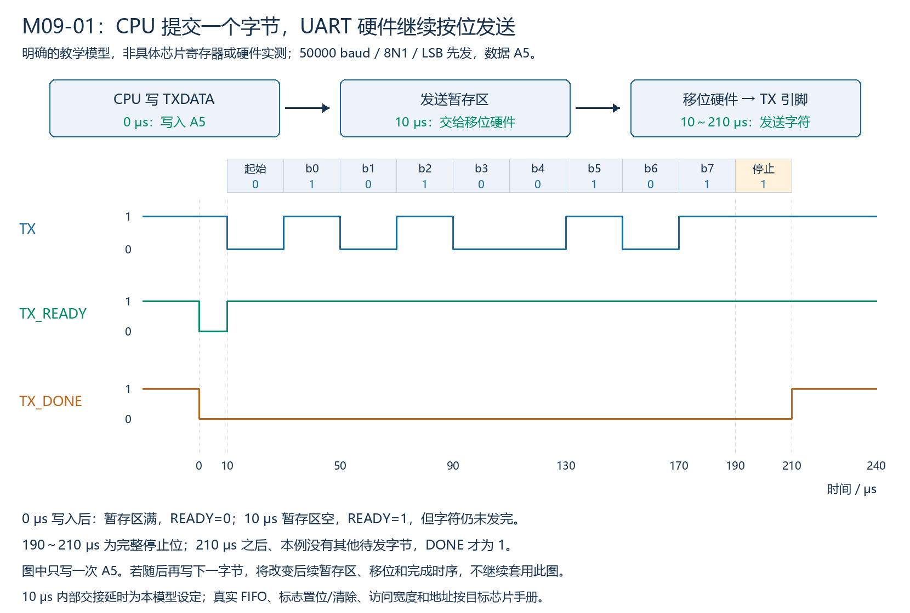

这是教学推演，未进行硬件测量。本例只提交一个`0xA5`，50000 baud、8N1，每位20μs：

| 时刻 | 硬件动作 | READY / DONE |
|---|---|---|
| 0μs | CPU写入A5，暂存区满 | 0 / 0 |
| 10μs | 数据交给移位部分，暂存区空出，开始发送字符 | 1 / 0 |
| 190～210μs | 正在发送最后停止位 | 1 / 0 |
| 210μs | 停止位完整结束，且无其他待发数据 | 1 / 1 |

10μs内部交接延时是题设，不是UART的固定延迟。若在READY=1时继续写入下一字节，之后的暂存、连续发送和DONE状态都会改变，不能再把原图210μs当作全部数据完成的时刻。

## 三、无超时单字节阻塞发送

### 3.1 函数承诺与完整实现

`uart_send_byte_blocking(uart, byte)`先等暂存区可写，提交一次字节，再等本次发送连同最后停止位完整结束，才返回。

Blocking（阻塞）表示调用者在函数返回前不能继续执行调用后的语句。本例通过轮询忙等实现，CPU仍在反复读取寄存器。

```c
void uart_send_byte_blocking(UART_Regs *uart, uint8_t byte)
{
    while ((uart->STATUS & UART_TX_READY) == 0u) {
        /* 等暂存区可写。 */
    }

    uart->TXDATA = byte;

    while ((uart->STATUS & UART_TX_DONE) == 0u) {
        /* 等本次发送连同最后停止位完整结束。 */
    }
}
```

执行顺序为：**等待READY → 写TXDATA一次 → 等待本次DONE → 返回。**

第一处循环仅确认“可以提交”；数据写入后，硬件按本模型清DONE，第二处循环等待它重新置位。因此，入口时前一次遗留的DONE=1不会直接当成本次完成。软件不自行写STATUS清除或伪造完成。

两处循环都没有超时：READY一直为0会停在第一处，提交后DONE一直为0会停在第二处。这也是下一节需要加入等待期限的原因。

### 3.2 为什么传入UART指针，为什么返回void

| 设计 | 含义 |
|---|---|
| `UART_Regs *uart` | 由调用者选择外设实例，同一份逻辑可用于符合本模型的不同UART |
| `uint8_t byte` | 本次提交的一个数据字节 |
| `void` | 在“状态最终前进”的简化前提下，等完成才返回，尚无失败结果需要报告 |

例如，在已经准备好的调用函数内可以这样使用：

```c
void send_example(void)
{
    uart_send_byte_blocking(UART1, 0xA5);
    /* 执行到这里，按本模型已确认本次发送完成。 */
}
```

函数名和返回类型本身不会实现等待，保证来自函数体的执行顺序。若加入超时或参数检查，就需要相应分支与明确的返回结果；只把返回类型改为整数并不能解决等待问题。

传指针使接口可复用，但真实芯片的寄存器规则仍须匹配，不能仅凭指针类型相同就认为不同型号兼容。

### 3.3 等待条件：比较0，不能用逐位取反

`uart->STATUS & mask`为0表示标志未置位，非0表示已置位。`while`在条件非0时继续循环，所以等待应写为“标志仍为0时继续”。

READY的掩码结果是0或1，DONE的掩码结果是0或2。**标志置位的判断应为非0，不能统一与1比较。**

`~`是逐位取反，`!`是逻辑非。以32位无符号值为例：

| 掩码结果x | `~x` | `!x` |
|---|---|---|
| 0x00000000 | 0xFFFFFFFF，非0 | 1 |
| 0x00000001 | 0xFFFFFFFE，非0 | 0 |
| 0x00000002 | 0xFFFFFFFD，非0 | 0 |

对这类掩码结果使用`~`，高位会被翻为1，条件始终非0，无法表达等待结束。完整函数使用`(uart->STATUS & mask) == 0u`，也可以对整个掩码表达式使用逻辑非，并保留清晰的括号。

## 四、带总超时的单字节发送

### 4.1 目标接口与返回结果

接口沿用章首的`uart_send_byte_timeout(uart, byte, timeout_us)`。它在同一个总预算内完成“等READY、提交字节、等DONE”，并返回结果。外设与字节参数含义不变，`timeout_us`的单位为微秒。

| 返回值 | 本接口承诺 |
|---|---|
| UART_OK | 已提交本字节，并按截止规则确认本次DONE=1 |
| UART_TIMEOUT | 总预算用尽，尚未按约定确认所需阶段完成；可能尚未提交，也可能已经提交 |

两种结果只描述本机函数，不证明对端已经收到、正确解析或执行。有效指针仍是前提，当前未加入空指针检查或参数错误返回。

### 4.2 时间源与两阶段共用预算

`now_us()`由题设提供，读取当前微秒计数。CPU忙等时，计数仍随独立时间源前进；调用只读时间，不是每调用一次手工加1。

在函数入口记录一次起点，之后反复读取当前时间，但不重置起点：

```c
uint32_t start_us = now_us();

/* 后续每次检查时，计算相对同一起点的已用时间。 */
uint32_t elapsed_us = (uint32_t)(now_us() - start_us);
```

例如，入口为100μs，总预算300μs，可写时当前时间280μs：

- 绝对截止：100 + 300 = **400μs**。
- 已用：280 − 100 = **180μs**；剩余：300 − 180 = **120μs**。
- 写入后继续用原起点等DONE，不能重新给第二阶段300μs。

当前例子不跨计数回绕，上述代码只说明时间差计算，不是完整超时函数。

### 4.3 截止时刻与轮询顺序

本接口采用以下明确规则：

1. 入口保存一次起点，两阶段共用总预算。
2. **每轮先检查时间**；若`elapsed_us >= timeout_us`，返回UART_TIMEOUT，不再在这一轮读取状态以取得成功或提交新数据。
3. 预算尚未用尽，才检查当前阶段的标志；不满足就继续轮询，满足才执行下一步。
4. `timeout_us=0`表示立即超时，不提交数据。
5. 恰好到截止时刻也按超时处理，即截止优先。

这是本教学接口的选择，不代表所有SDK的零超时或同刻事件规则。实际软件在轮询检查点判断，时间读取粒度与执行开销会影响返回时刻；不能把它理解为硬件在截止时刻精确停止发送。

### 4.4 软件返回超时与UART继续发送

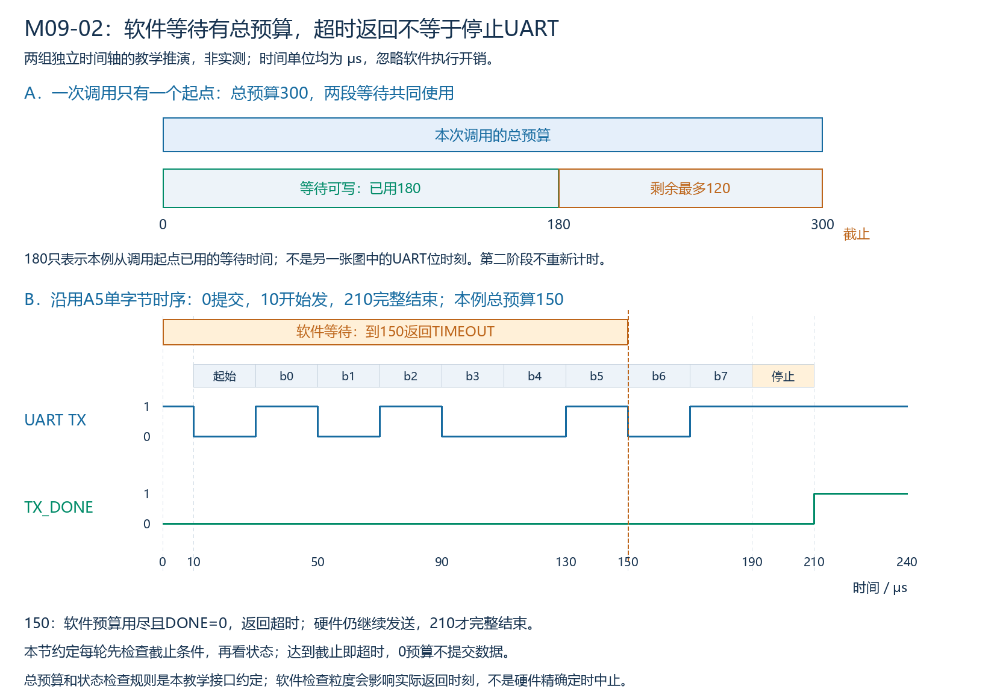

图中A、B是**两个独立例子，时间轴不能混用**，均为教学推演：

- **图A：软件总预算。**从调用起点已用180μs，总预算300μs，仅剩120μs；图A不规定内部UART的实际发送时刻。
- **图B：提交后超时。**0μs提交A5，10μs开始字符，210μs停止位完整结束。预算150μs，软件在150μs检查到预算用尽、DONE仍为0，返回UART_TIMEOUT；UART仍继续发送至210μs。

如果在等READY时超时，本函数尚未提交本字节；如果在写入后等DONE时超时，字节可能仍在暂存、正在发送，或随后完成。

**超时返回不自动撤回数据、不关闭UART，也不证明“没有发送”或“已经停止”。**它只结束本次软件等待，没有执行硬件取消。

### 4.5 将截止优先写进轮询

原无超时函数使用`while (标志未置位)`。若只在它的循环体里增加超时检查，入口时标志已经置位就会跳过整个循环，时间检查也随之跳过，不能满足本接口“0预算不提交、每轮先看时间”的约定。

可以使用`for (;;)`建立轮询入口，让每轮都先看预算，再看标志。以下只是返回类型为UART_Result的函数内部、等待READY的局部示范，不是完整发送函数：

```c
uint32_t start_us = now_us();  /* 整个函数入口只保存一次。 */

for (;;) {
    uint32_t elapsed_us = (uint32_t)(now_us() - start_us);

    if (elapsed_us >= timeout_us) {
        return UART_TIMEOUT;
    }

    if ((uart->STATUS & UART_TX_READY) != 0u) {
        break;
    }
}

/* 走到这里才可进入提交步骤；本片段尚未提交或等待DONE。 */
```

`for (;;)`不设置循环条件，靠函数体里的分支决定何时离开。预算未用尽且READY仍为0时，本轮结束后重新读取时间与状态；不能把elapsed_us只算一次放在循环外，否则等待期间不会更新判断。

- `return UART_TIMEOUT`结束整个函数，后续提交与完成等待均不执行。
- `break`只退出当前循环，继续执行循环后面的代码；READY满足只允许进入提交步骤，不能直接返回UART_OK。
- 后续等待DONE仍共用原start_us，只有按约定确认本次DONE后才能返回UART_OK。

这是现有时间语义的一种C表达方式；实际轮询仍有读取与执行开销，不承诺每次寄存器访问发生在精确的截止之前。

### 4.6 带总超时发送的完整参考实现

完整函数按以下顺序组合：入口记录一次起点 → 按4.5节的顺序等待READY → 向TXDATA提交一次字节 → 共用原起点、每轮先检查时间再等待DONE → 确认本次DONE后返回UART_OK。任一阶段预算用尽均返回UART_TIMEOUT；不能在进入第二阶段时重新计时。

两段等待应依次执行：先结束READY等待循环，再写入一次，随后进入DONE等待循环。若把写入放在第一个循环内、READY成立的break之后，就会在可写时跳过写入，不可写时反而落到写入。循环的大括号决定控制流，缩进用于帮助看清这种归属。

DONE等待也必须持续检查总预算。嵌套while中的continue仅开始该while的下一轮，不会跳回外层循环执行时间检查；若本层没有超时判断，DONE一直为0仍会永久等待。

下面的实现沿用章首全部定义与前提，两个for循环顺序执行，互不嵌套：

```c
UART_Result uart_send_byte_timeout(UART_Regs *uart,
                                   uint8_t byte,
                                   uint32_t timeout_us)
{
    uint32_t start_us = now_us();  /* 整个函数只记录一次起点 */

    /* 第一阶段：等待暂存区可写 */
    for (;;) {
        uint32_t elapsed_us = (uint32_t)(now_us() - start_us);

        if (elapsed_us >= timeout_us) {
            return UART_TIMEOUT;
        }

        if ((uart->STATUS & UART_TX_READY) != 0u) {
            break;
        }
    }

    /* 已退出第一个循环，现在提交一次字节 */
    uart->TXDATA = byte;

    /* 第二阶段：等待本次发送完整结束 */
    for (;;) {
        uint32_t elapsed_us = (uint32_t)(now_us() - start_us);

        if (elapsed_us >= timeout_us) {
            return UART_TIMEOUT;
        }

        if ((uart->STATUS & UART_TX_DONE) != 0u) {
            break;
        }
    }

    return UART_OK;
}
```

把函数分成三个连续区块来读：

1. **第一个for只负责等READY。**未到截止且READY=0，就开始下一轮；READY=1，break退出这个for，下一条执行的是TXDATA写入。超时则return结束整个函数，不会执行后面的提交。
2. **中间的一行只负责提交一次。**它在两个for的大括号之外。按本模型，写入后硬件清DONE，随后等待的是本次发送完成。
3. **第二个for只负责等DONE。**仍使用原start_us，每轮先检查时间再检查DONE；DONE满足后break退出第二个for，才执行最后的return UART_OK。

两个elapsed_us分别属于各自for体的局部作用域；每轮都会重新初始化、重新读时间，名字相同不表示共用同一局部变量。两个阶段共用的是函数作用域里的start_us。

timeout_us为0时，第一轮就会返回UART_TIMEOUT而不提交；等READY期间已用的时间也会计入第二阶段。提交后的超时仅结束软件等待，不撤销已写入的数据。完整参考代码和推演不代表实际硬件验证，也不等于学习者已独立写出或理解通过。

### 4.7 用同一时间轴推演两个循环

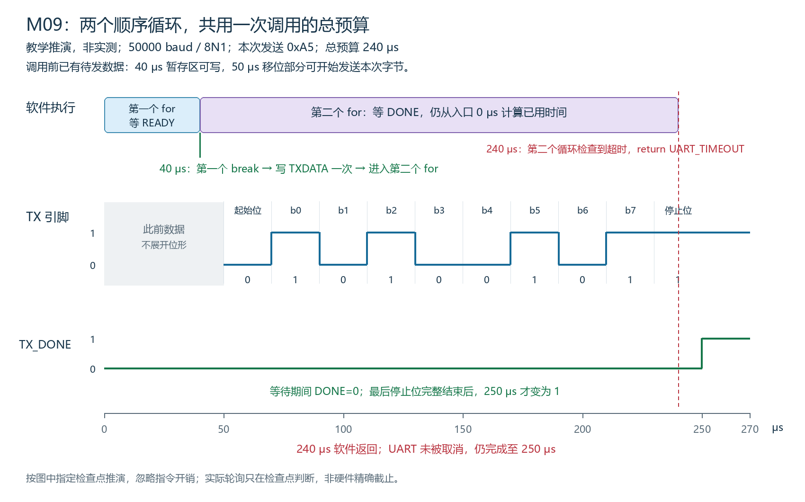

本例从0μs调用，总预算240μs。调用前已有待发数据，0～40μs暂存区不可写；40μs可写，本函数提交A5。50μs移位部分开始发送本次字符，每位20μs，最后停止位为230～250μs。此前数据来自调用前，不是另一个发送者与本函数并发提交；图只展开本次字节的波形。

按图中指定检查点推演，忽略指令开销：

| 检查点 | 软件正在执行什么 | 接下来去哪里 |
|---|---|---|
| 0μs | 保存start_us=0；第一循环预算未耗尽、READY=0 | 留在第一循环 |
| 40μs | 第一循环已用40μs，READY=1 | 第一个break后写TXDATA一次，再进入第二循环 |
| 100μs | 第二循环已用100μs，DONE=0 | 留在第二循环，不再执行TXDATA写入 |
| 240μs | 第二循环已用240μs，达到总预算 | return UART_TIMEOUT，结束函数，不执行末尾UART_OK |
| 250μs | UART硬件完成本次最后停止位，DONE变1 | 本次函数早已返回，不会在这一刻补返回成功 |

本次软件在第二阶段等了200μs，但整个调用从0μs算，已用240μs。超时发生时TX虽已为高电平，最后停止位仍未完整结束；函数没有取消硬件，UART继续到250μs。实际轮询只在检查点判断，不能由示意图声称精确返回时刻或精确硬件截止。

## 五、UART初始化：先准备资源，再设置外设

### 5.1 初始化与发送函数分别负责什么

前面的发送函数只检查状态、写入数据，并未建立UART运行条件。初始化负责准备时钟、引脚与外设配置：

```text
准备GPIO/UART所需时钟及UART实际输入时钟
→ 配置引脚复用，例如P接UART1_TX、Q接UART1_RX
→ 暂停UART并配置分频、收发方向
→ 启用UART
→ 后续调用发送/接收函数
```

引脚P/Q是教学名称。本节先明确两层工作：芯片资源准备负责时钟与引脚；UART内部配置负责分频和使能。下面代码以资源已准备、UART实际输入时钟为24MHz、暂无收发任务为前提，暂不编写时钟控制器或GPIO寄存器代码。

### 5.2 新增寄存器的精确规则

结构体与宏已统一补到章首。STATUS/TXDATA语义沿用原模型，新增CTRL与BAUD_DIV采用以下题设规则：

| 对象 | 本节教学定义 |
|---|---|
| CTRL bit0 / UART_CTRL_ENABLE | 1启用UART；0停用UART，但不等于关闭外设时钟 |
| CTRL bit1 / UART_CTRL_TX_ENABLE | 为1时允许发送；还需总使能为1 |
| CTRL bit2 / UART_CTRL_RX_ENABLE | 为1时允许接收；还需总使能为1 |
| CTRL其他位 | 保留原值，不在当前代码中修改 |
| BAUD_DIV | 保存整数分频数N，N≥1；本模型仅在总使能为0时接受写入，否则该次写入不生效 |

本模型停用后即可配置，不额外等待握手；只用于无收发任务的初始化。本节固定8N1，不增加帧格式配置字段。真实芯片的配置顺序、停用条件、访问规则和分频公式应按手册确定。

本节专用分频公式为：

```text
baud = f_UART / (16 × N)
```

其中f_UART为UART实际输入时钟，不因CPU主频改变就自动跟随。题设f_UART=24000000Hz，目标50000baud，得到N=30。该公式是本节条件，不代表所有UART。

### 5.3 配置50000baud、启用发送和接收

下面是初始化函数内部的局部示范，uart为有效外设指针：

```c
/* 资源已准备，暂无收发任务；本节固定8N1、f_UART=24MHz。 */
uart->CTRL &= ~UART_CTRL_ENABLE;
uart->BAUD_DIV = 30u;
uart->CTRL |= UART_CTRL_TX_ENABLE | UART_CTRL_RX_ENABLE;
uart->CTRL |= UART_CTRL_ENABLE;
```

第一行只清总使能位，保留其余位；第二行在停用时写分频；第三行置发送/接收使能；第四行最后开启UART。STATUS仍由硬件维护，不通过给READY/DONE赋值完成初始化。

`&= ~mask`用于清指定配置位，`|= mask`用于置指定配置位，两者保留其他位。这里的逐位取反用于构造清位掩码，与将`~(STATUS & mask)`直接作为while条件是不同用法。若直接给CTRL赋0x07，会同时覆盖其他位，不符合本节保留要求。

### 5.4 将配置封装为初始化函数

沿用24MHz实际输入、8N1及已准备好的时钟/引脚条件，将目标波特率作为参数传入章首的`uart_init(uart, baud)`。本段只支持50000或100000baud，题设保证传入其中之一，且uart有效、无收发任务、无其他代码同时配置该外设。

| 接口部分 | 约定 |
|---|---|
| uart | 待配置的UART寄存器指针 |
| baud | 目标波特率，只允许50000或100000；不是原始分频数 |
| UART_INPUT_CLOCK_HZ | 已准备好的实际UART输入时钟，固定24000000Hz；宏本身不配置时钟 |
| 返回void | 当前有效输入与教学硬件条件下没有错误分支；不包含参数检查或超时 |

先根据`N = UART_INPUT_CLOCK_HZ / (16 × baud)`计算分频数，再按5.3节顺序清总使能、写N、置TX/RX使能、最后置总使能。两个允许值均可得到精确的有效整数分频数，当前不扩展舍入、误差判断或其他波特率。

计算N是普通C算术，可以先将结果保存到局部变量；写BAUD_DIV则是外设操作，必须在清总使能之后。把计算表达式直接赋给BAUD_DIV，也会立即发起寄存器写入，不能视为只完成计算。后面才停用UART，不会使先前被忽略的写入补生效。暂无收发任务也不表示总使能已经为0，UART可以处于启用但空闲的状态。

函数保留CTRL其他位，不写只读STATUS，也不提交发送数据。资源准备由调用前完成，宏和参数只是描述现有时钟及目标，不会自动打开时钟或设置引脚。

完整参考实现如下：

```c
void uart_init(UART_Regs *uart, uint32_t baud)
{
    uart->CTRL &= ~UART_CTRL_ENABLE;
    uart->BAUD_DIV = UART_INPUT_CLOCK_HZ / (16u * baud);

    uart->CTRL |= UART_CTRL_TX_ENABLE | UART_CTRL_RX_ENABLE;
    uart->CTRL |= UART_CTRL_ENABLE;
}
```

执行第一行后总使能为0，所以第二行写分频满足本模型的生效条件；随后设置TX/RX和总使能，完成本节UART内部配置。若初始CTRL为0x85、baud为100000，则CTRL先成为0x84，分频写入15，置TX/RX后为0x86，最后总使能置位得到0x87。初始UART启用但空闲时，也能先停用再完成配置，bit7始终保留。

本函数只覆盖既定有效输入和资源已准备条件，不包含时钟控制器、GPIO初始化、参数错误处理或正在通信时的重配置。上述寄存器推演不是运行或硬件验证。

## 六、UART轮询接收：状态、取数与输出参数

### 6.1 接收硬件把字节交到哪里

接收路径为RX引脚→UART采样与恢复字符→接收暂存区/RXDATA→软件变量。软件不需要逐位读取RX引脚来拼字节，硬件完成字符接收后才向软件提供本模型的就绪标志。

章首新增RXDATA与STATUS中的UART_RX_READY，规则如下：

| 对象/动作 | 本节教学语义 |
|---|---|
| RX_READY=1 | 有一个完整且尚未取走的字节，可以读RXDATA |
| RX_READY=0 | 当前没有新字节可取；RXDATA仍可能保留旧内容 |
| 读STATUS | 只观察标志，不取走字节，不清RX_READY |
| 读RXDATA一次 | 取得本字节低8位，并由硬件清RX_READY，单字节缓冲变为空 |
| 软件写寄存器 | 不向RXDATA写值，不手工改只读STATUS清就绪 |

RX_READY是STATUS bit2；RX_ENABLE是CTRL bit2，属于不同寄存器，含义不同。只有就绪标志才能证明有未取字节，不能用RXDATA是否为0判断。0x00也是有效字节；读取后的旧内容不能当作又收到一个字节。

这些是明确给定的教学规则；真实芯片可能使用FIFO或不同的标志清除方式，按手册确认。普通C结构体不会自动实现读寄存器后的硬件副作用。

### 6.2 波形：硬件收到与软件取走

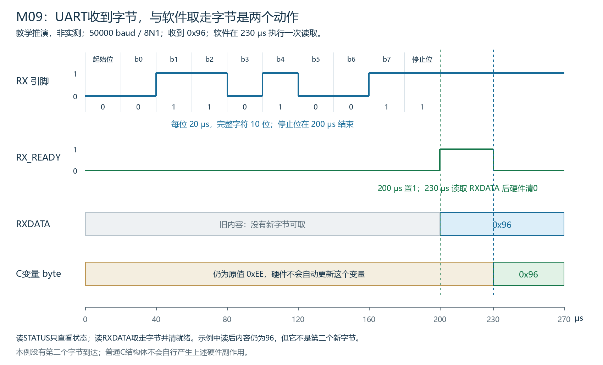

本例50000baud、8N1，RX从0μs开始接收0x96，每位20μs；本教学模型在200μs最后停止位完整结束后提供完整字节，RXDATA为0x96、RX_READY置1。软件变量byte原为0xEE，尚未执行赋值，因此不会自动更新。

题设软件在230μs才执行取数：读RXDATA取得0x96，硬件清RX_READY，软件把值写到byte中。图中RXDATA读后仍保留0x96，但就绪标志已为0，不代表第二个新字节。示例没有第二个字节到达，不推演溢出；该检查/取数时刻是题设，不是UART固定软件响应延迟，也不是实测。

### 6.3 同时交付状态与数据

章首目标接口返回UART_Result，通过out_byte输出接收字节：

| 接口部分 | 本节约定 |
|---|---|
| uart | 有效且已准备的UART指针，接收已启用 |
| out_byte | 指向调用者可写uint8_t变量的有效指针 |
| timeout_us | 从入口起计算的微秒等待预算，沿用每轮先时间后状态、截止优先、0预算立即超时规则 |
| UART_OK | 预算内观察RX_READY后读取一次RXDATA，并写入*out_byte；只表示本机取到一个字节 |
| UART_TIMEOUT | 未按约定完成取数，函数不读RXDATA、不修改*out_byte；不证明对端没有发送 |

例如，后续实现该函数后，可以在调用函数内这样使用：

```c
uint8_t byte = 0xEE;
UART_Result result = uart_receive_byte_timeout(UART1, &byte, 300u);
```

函数中的局部取数/交付动作可写为：

```c
/* 仅在已按截止规则确认RX_READY=1后执行。out_byte有效。 */
*out_byte = (uint8_t)uart->RXDATA;
```

右侧读取一次外设数据，左侧把值写入调用者变量。返回值描述成功/超时，输出指针交付数据，两者职责不同；不能把接收值0当作超时。超时时保留调用者变量原值，调用者仍须检查返回结果，不把原值视为本轮新数据。

接收一个字节只需等待RX_READY，取数后即可按约定返回，不等待发送标志TX_DONE。完整函数按“入口记一次起点→循环内每轮先查超时、再查RX_READY→就绪后退出等待循环→读取一次RXDATA并写入*out_byte→返回UART_OK”的顺序组合。预算用尽时直接返回UART_TIMEOUT，因此不会执行后面的取数和输出赋值。

### 6.4 带超时单字节接收的完整参考实现

```c
UART_Result uart_receive_byte_timeout(UART_Regs *uart,
                                      uint8_t *out_byte,
                                      uint32_t timeout_us)
{
    uint32_t start_us = now_us();

    for (;;) {
        uint32_t elapsed_us = (uint32_t)(now_us() - start_us);

        if (elapsed_us >= timeout_us) {
            return UART_TIMEOUT;
        }

        if ((uart->STATUS & UART_RX_READY) != 0u) {
            break;
        }
    }

    *out_byte = (uint8_t)uart->RXDATA;
    return UART_OK;
}
```

循环只查看时间和接收就绪；未就绪就继续等，超时则结束整个函数，后续RXDATA读取及输出赋值都不执行。预算未耗尽且RX_READY置位时退出循环，只读取一次RXDATA，交付后返回UART_OK。根据本模型，取数时由硬件清就绪，不手工改STATUS，也不等待TX_DONE。

RXDATA成员为uint32_t，输出对象为uint8_t；赋值会自动进行无符号窄化转换，得到低8位。因此`*out_byte = uart->RXDATA;`在本模型下同样正确，参考中的显式强转用于标明取低8位的意图。0x00也能成功输出，成功与否由返回结果区分。

timeout_us为0时第一轮先返回超时，即使入口已有字节就绪也不读RXDATA、不改输出；调用者可在后续调用中取数。沿用轮询时间采样的截止约定，实际指令有执行开销，不承诺硬件精确截止。有效指针、单读取者及无帧错/溢出条件不变，代码推演不等于硬件验证。

## 七、SPI前补充：GPIO模拟UART单字节发送

### 7.1 接口与前提

本节固定50000baud、8N1、最低位先发，位时间为1000000/50000=20μs。软件通过普通GPIO依次输出起始位、数据位、停止位；前面的硬件UART通过TXDATA自动移位，本节的后续位需要软件逐个输出。

章首已统一SOFT_UART_BAUD、SOFT_UART_BIT_US、写电平/延时接口和目标函数声明。本次选择固定的一个TX引脚，由soft_uart_tx_write内部对应到该引脚，因此目标函数只接收byte参数。

| 项目 | 明确约定 |
|---|---|
| TX引脚 | 已配置为普通推挽GPIO输出，初始高电平；未由UART外设复用功能控制，没有其他写入者 |
| soft_uart_tx_write(level) | level只取0或1，设置当前电平并保持，不会自动输出其余位；图中write(level)是这个接口的简写 |
| delay_us(us) | 题设提供的理想微秒延时，期间引脚保持当前电平，无需当前实现定时器或空循环 |
| 理想执行条件 | 无打断；忽略GPIO调用、取位和循环控制等开销，仅延时计入本例位宽 |
| soft_uart_send_byte(byte) | 阻塞输出一个完整8N1字符；停止位保持完后返回，TX继续为高 |

本节不访问UART_Regs、TXDATA或TX_DONE。当前不扩展软件UART接收，也不要求开发板验证。

### 7.2 波形对应到软件动作

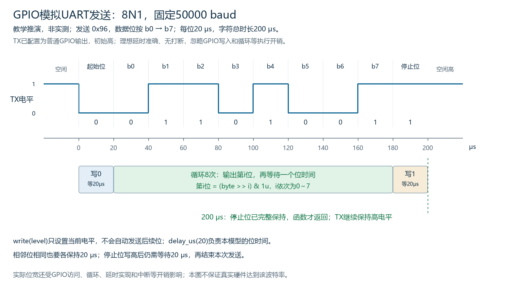

本图为教学推演，发送0x96（二进制10010110），按b0到b7输出的数据序列为0、1、1、0、1、0、0、1：

1. 0～20μs：写0并延时20μs，形成起始位。
2. 20～180μs：依次输出8个数据位，每次写电平后都延时20μs。
3. 180～200μs：写1并延时20μs，形成完整停止位。
4. 200μs：函数返回，GPIO继续保持高电平。

相邻位数值相同也各自占一个位时间，不要求每个位边界都翻转。起始位输出不依赖byte的最低位，停止位也不依赖最高位；它们是帧格式额外规定的两个位。仅把停止位写高就返回，还没有保证其持续时间。

### 7.3 取出第i位并输出

把byte右移i位，再与1相与，即得到归一化为0或1的第i位。下面只是循环内的局部示范，i取0～7：

```c
uint8_t level = (uint8_t)((byte >> i) & 1u);
soft_uart_tx_write(level);
delay_us(SOFT_UART_BIT_US);
```

i从0递增到7，对应LSB先发；这段只处理一个数据位，不包含起始位和停止位。也可以使用每次取最低位后右移byte的方法，只要恰好输出8位且顺序正确。

另一种方法是先用`byte & (1u << i)`检查原位置的位，但它的非0结果可能是2、4、128等数，不是接口约定的电平1。可以比较是否非0，归一化后输出：

```c
soft_uart_tx_write((byte & (1u << i)) != 0u);
```

例如byte=0x04、i=2时，掩码结果为4，表示该位已置位；比较非0后得到1，才符合本接口只接受0/1的约定。掩码方法能正确定位各位，不需要改变i从0到7的顺序。

### 7.4 完整参考实现与时序边界

使用章首接口void soft_uart_send_byte(uint8_t byte)，按“起始位写0/等一位→循环8次写第i位/等一位→停止位写1/等一位”的顺序组合。理想模型总时长为10×20=200μs，无失败分支，返回void。

```c
void soft_uart_send_byte(uint8_t byte)
{
    soft_uart_tx_write(0u);
    delay_us(SOFT_UART_BIT_US);

    for (uint8_t i = 0u; i < 8u; i++) {
        soft_uart_tx_write((byte & (1u << i)) != 0u);
        delay_us(SOFT_UART_BIT_US);
    }

    soft_uart_tx_write(1u);
    delay_us(SOFT_UART_BIT_US);
}
```

起始位先保持20μs；循环8次，i从0到7，每次掩码定位对应位，比较非0得到电平0/1，再保持20μs；最后停止位为高，保持20μs后才返回。总计10次位时间延时，返回后TX仍为高，相邻位相同也不会省略其位时间。

delay_us的参数单位为微秒，不是位数；`delay_us(1)`只表示1μs。起始位、每个数据位和停止位都应使用`delay_us(SOFT_UART_BIT_US)`，本题该宏值为20。

真实软件UART的位宽还包括GPIO访问、循环与延时实现等开销，若被中断打断还会产生额外偏差。因此调用delay_us(20)的教学代码不自动保证实机每位精确20μs。精确实现可在学习定时器后进一步讨论，本阶段仅按给定理想接口推演，不以空循环次数或一条C语句耗时固定作为依据，也不安排硬件验证。

## 八、GPIO模拟SPI：四种模式与单字节收发

### 8.1 模式0的操作接口与明确前提

本节规定模式0，即CPOL=0、CPHA=0，SCK空闲低，收发双方在上升沿采样，下降沿后准备下一位。本题按MSB先发；SPI位序依器件约定，本题选择不代表所有器件都固定如此。

章首新增SOFT_SPI_HALF_US、SCK/MOSI写入、MISO读取与目标函数声明，延时继续使用已有delay_us。引脚对应由题设提供的接口确定，无需猜测具体GPIO寄存器。

| 项目 | 本节约定 |
|---|---|
| 引脚 | SCK/MOSI已配置为普通GPIO输出，MISO为输入，没有其他代码同时控制 |
| 初始与结束SCK | 调用前为0，字节结束时回到0 |
| /CS | 调用前目标已选中且建立时间满足；首位MISO已准备。调用者负责片选与保持时序，字节函数全程不切换/CS |
| 写接口 | soft_spi_sck_write/soft_spi_mosi_write只接受0或1，设置电平后保持 |
| 读接口 | soft_spi_miso_read只返回0或1；目标按模式0在低电平阶段准备、在采样窗口保持MISO有效 |
| 时间模型 | 半周期1μs，理想SCK周期2μs、500kHz；无打断，忽略GPIO/循环开销 |
| 目标接口 | uint8_t soft_spi_transfer_mode0(uint8_t tx_byte)，发送一个字节并返回同时收到的一个字节 |

字节函数保持/CS不变，方便后续在同一事务中连续发送命令、地址和数据。当前先学习单字节位流，不编写完整器件命令或多设备管理，也不访问硬件UART寄存器。

### 8.2 每一位对应的GPIO操作

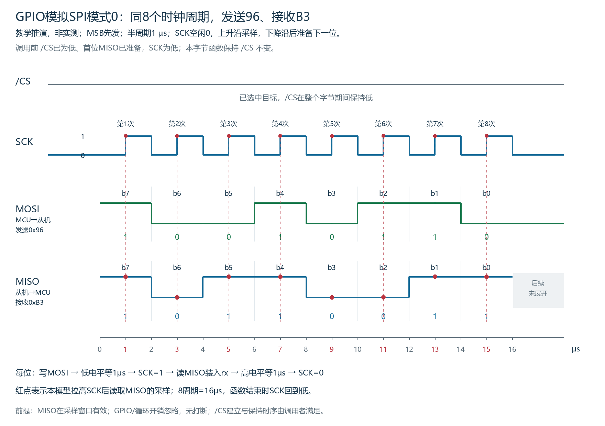

图为教学推演：MOSI发送0x96（10010110），MISO在本轮提供0xB3（10110011）。两条线各有独立数据，使用同8个时钟周期同时传输；本例只给定位流，不代表具体设备命令。

每一轮开始时SCK为低，依次执行：

1. 在MOSI输出本次发送位，第一轮为tx_byte的bit7。
2. 延时SOFT_SPI_HALF_US，让数据在低电平阶段准备好。
3. 把SCK拉高，形成上升沿。
4. 在SCK已高、MISO仍有效时读取一次电平，装入接收变量。
5. 保持高电平，延时SOFT_SPI_HALF_US。
6. 将SCK拉低，结束本轮；下一轮在低电平阶段准备下一位。

本模型用拉高SCK后立即读取GPIO来模拟上升沿采样，执行开销按题设忽略，MISO保证有效；这不等于改用下降沿采样。真实器件应结合GPIO访问、数据有效时间与采样窗口安排动作，图示不作实机时序保证。

8轮共8个周期，理想16μs；第8轮也要完整保持高电平并拉低SCK后结束。SPI本字节不添加UART的起始/停止位，也不先发送8周期再另收8周期。

本题低/高阶段都使用delay_us(SOFT_SPI_HALF_US)。若低阶段等1μs、高阶段等3μs，则理想周期变为4μs、频率250kHz、8周期32μs；这改变了时钟宽度和频率，不符合本题两个半周期各1μs的条件，并不据此把所有非对称时钟都判为SPI模式错误。

### 8.3 从发送字节取位，从MISO逐位拼接

若循环计数i取0～7，本题的第i次发送位为bit(7-i)：

```c
uint8_t tx_bit = (uint8_t)((tx_byte >> (7u - i)) & 1u);
```

也可保留掩码定位方法，使用`(tx_byte & (1u << (7u - i))) != 0u`得到电平。循环i从0到7时，测试位位置依次为7到0；若用1u<<i，则从bit0开始，会按LSB发送，不满足本题MSB约定。对发送取位的调整不要求改变下面的接收累积方式。

在循环外先声明并初始化`uint8_t rx = 0u;`，每读取一位，就将已有结果左移一位，再把新位装入最低位。下面仅为循环内采样点的局部示范：

```c
/* 前提：rx已初始化为0，SCK已拉高，MISO在当前窗口有效。 */
uint8_t bit = soft_spi_miso_read();
rx = (uint8_t)((rx << 1) | bit);
```

例如依次读到1、1、0，rx从0依次变为1、3、6，此时只有3个有效采样位。完成8次后，最先读到的位经过后续左移到bit7，得到完整接收字节。直接给rx赋bit会覆盖之前结果，无法累计8位。

目标函数的参数是MOSI要发送的字节，返回值是从MISO拼出的接收字节；两者不要求相同。本节无错误返回分支，不使用UART_Result或输出指针。

完整函数的组合顺序为：循环外将rx初始化为0；循环8次，每次输出bit(7-i)、等待低半周期、拉高SCK、读取并累计一位、等待高半周期、拉低SCK；循环结束后返回rx。第8次也要完成拉低动作，函数内不切换/CS。

### 8.4 模式0单字节收发的完整参考实现

```c
uint8_t soft_spi_transfer_mode0(uint8_t tx_byte)
{
    uint8_t rx = 0u;

    for (uint8_t i = 0u; i < 8u; i++) {
        soft_spi_mosi_write((tx_byte & (1u << (7u - i))) != 0u);
        delay_us(SOFT_SPI_HALF_US);

        soft_spi_sck_write(1u);
        uint8_t bit = soft_spi_miso_read();
        rx = (uint8_t)((rx << 1) | bit);

        delay_us(SOFT_SPI_HALF_US);
        soft_spi_sck_write(0u);
    }

    return rx;
}
```

循环共输出8个MOSI位，位位置依次7～0，GPIO实参均为0或1。每轮先保持低半周期，再拉高采样并保持高半周期，最后拉低；共8个上升沿和8个下降沿，结束时SCK为0，/CS仍由调用者保持。

每轮读取一次MISO，将旧rx左移一位再装入新位，8轮后返回完整接收值。若采样位依次为1、0、1、1、0、0、1、1，返回0xB3；这与MOSI发送的0x96是两条独立位流。返回值只表示本轮采样结果，不替代器件命令语义。

半周期延时共16次，每次1μs，理想字节时长16μs、SCK频率500kHz。时间结论仍以已准备GPIO、/CS时序满足、MISO有效、无打断并忽略执行开销为前提，不等于实机测量或硬件保证。

### 8.5 模式1：在下降沿采样

模式1为CPOL=0、CPHA=1，SCK空闲低，上升沿用于推出/准备数据，下降沿用于采样。模式0与模式1的边沿关系可查阅[Microchip官方SPI模式说明](https://onlinedocs.microchip.com/oxy/GUID-D1D9CFB7-99CD-47B6-A15F-EF7DD17F80A7-en-US-6/GUID-8A5B8750-B99E-4176-834E-E44E98F4A098.html)。

| 项目 | 模式0 | 模式1 |
|---|---|---|
| CPOL、CPHA | 0、0 | 0、1 |
| SCK空闲 | 低 | 低 |
| 数据采样 | 上升沿 | 下降沿 |
| 准备下一采样位 | 首位在第一个上升沿前就绪；随后在下降沿准备 | 在上升沿准备，包括首位 |

模式1沿用章首GPIO接口、SOFT_SPI_HALF_US=1u、MSB先发及无打断/忽略执行开销的理想条件。目标接口为`uint8_t soft_spi_transfer_mode1(uint8_t tx_byte)`，参数是发送字节，返回值是本轮接收字节。调用前SCK为低，/CS已选中且建立时间满足，函数不改变/CS。

与8.1的模式0前提不同，模式1不要求第一个上升沿前MISO首位已经有效：从机可以在第一个上升沿推出首位，随后在下降沿采样窗口内保证有效。

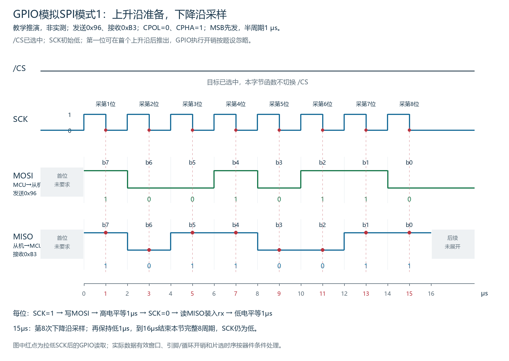

本图发送0x96、接收0xB3。每轮开始SCK为低，**本节选择以下GPIO操作顺序**：

1. 拉高SCK，形成上升沿。
2. 向MOSI写本轮发送位bit(7-i)；从机也在这一上升沿准备MISO。
3. 保持高电平，延时SOFT_SPI_HALF_US。
4. 拉低SCK，形成下降沿。
5. 在MISO有效窗口读取一次，将该位装入rx。
6. 保持低电平，延时SOFT_SPI_HALF_US，再进入下一轮。

第一轮上升沿在0μs，下降沿采样在1μs；之后在3、5、7、9、11、13、15μs采样。第8次采样后，本节仍保持低半周期，到16μs结束，SCK保持低。这是本例“每轮完整高、低半周期”的函数约定，不把最后一次采样后的1μs等待解释为所有SPI器件统一规定的固定延时。片选保持时间仍由调用者按器件要求保证。

发送取位继续用`(tx_byte & (1u << (7u - i))) != 0u`；rx仍在循环外初始化为0，每次采样后用`rx = (uint8_t)((rx << 1) | bit);`累积，不需要因为模式改变而改变位序。8轮共有8次发送与8次采样，理想时长16μs、频率500kHz。

本节在拉低SCK后读取GPIO模拟下降沿采样；忽略GPIO访问开销，题设保证此时MISO有效。真实实现需要考虑数据建立/保持时间、GPIO访问顺序和执行开销；上述软件顺序是本节采用的一种实现安排。

### 8.6 模式1单字节收发的完整参考实现

```c
uint8_t soft_spi_transfer_mode1(uint8_t tx_byte)
{
    uint8_t rx = 0u;

    for (uint8_t i = 0u; i < 8u; i++) {
        soft_spi_sck_write(1u);
        soft_spi_mosi_write((tx_byte & (1u << (7u - i))) != 0u);
        delay_us(SOFT_SPI_HALF_US);

        soft_spi_sck_write(0u);
        uint8_t bit = soft_spi_miso_read();
        rx = (uint8_t)((rx << 1) | bit);
        delay_us(SOFT_SPI_HALF_US);
    }

    return rx;
}
```

每轮拉高SCK后立即准备MOSI，保持高半周期；随后拉低SCK，在题设有效窗口读取MISO、累计到rx，再保持低半周期。循环i从0到7，对应发送位bit7到bit0；接收也按MSB顺序拼接。发送0x96且MISO依图提供0xB3时，返回0xB3。

每轮仅两次半周期延时，高、低各1μs，8轮共16次延时，理想时长16μs。最后一次下降沿采样在15μs，再保持低1μs后返回；SCK为0，/CS不变。该函数无UART状态等待，也没有错误返回分支；返回值表示本轮MISO采样结果。

不要在拉高后、写MOSI前，以及拉低后、读MISO前再各加一次半周期延时：若保留已有两次等待，每轮就变为高2μs、低2μs，8轮32μs。下降沿后再等1μs才读取也偏离本节采样安排；是否仍可读对取决于器件数据有效窗口，不能仅凭额外等待就断言所有SPI设备必然读错。

### 8.7 模式2与模式3：SCK空闲为高

CPOL决定SCK空闲电平：0为低，1为高。每周期从空闲电平离开的边沿称为第一个边沿，回到空闲电平的称为第二个边沿。CPHA=0在第一个边沿采样，CPHA=1在第二个边沿采样；准备/移出数据与采样使用相反的边沿。参见[Microchip官方SPI模式表](https://onlinedocs.microchip.com/oxy/GUID-D1D9CFB7-99CD-47B6-A15F-EF7DD17F80A7-en-US-6/GUID-8A5B8750-B99E-4176-834E-E44E98F4A098.html)。

| 模式 | CPOL | CPHA | 空闲SCK | 第一个边沿 | 第二个边沿 |
|---|---|---|---|---|---|
| 0 | 0 | 0 | 低 | 上升，采样 | 下降，准备 |
| 1 | 0 | 1 | 低 | 上升，准备 | 下降，采样 |
| 2 | 1 | 0 | 高 | 下降，采样 | 上升，准备 |
| 3 | 1 | 1 | 高 | 下降，准备 | 上升，采样 |

CPHA不直接表示“上升沿还是下降沿”，须结合CPOL判断。CPOL=1时，第一个边沿是下降沿，第二个是上升沿。

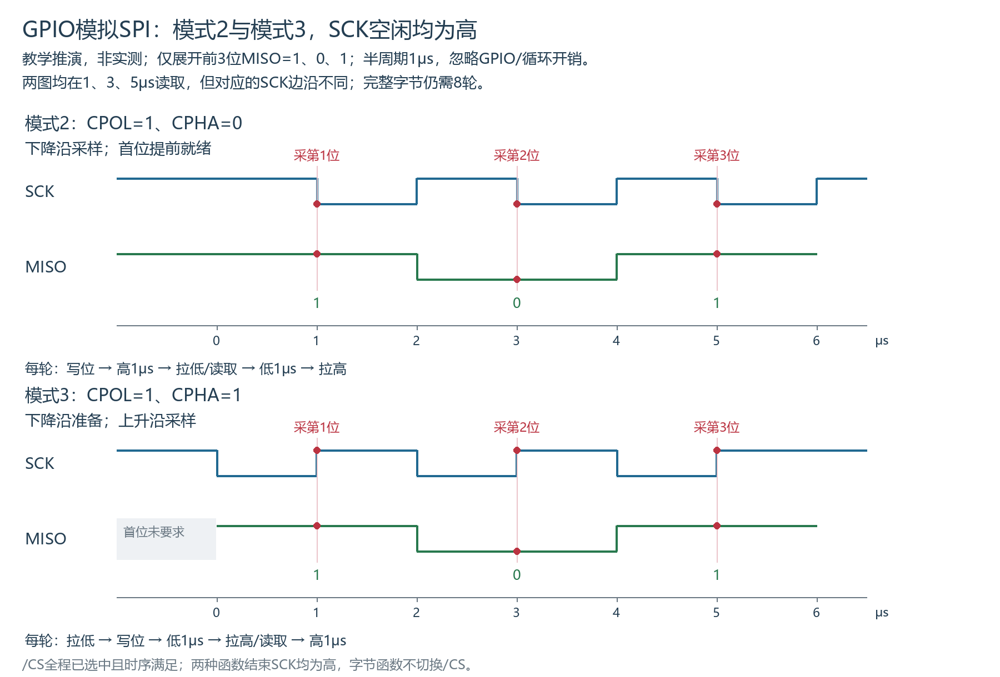

两图仅展开前3个接收位1、0、1，不代表字节已收齐。模式2在1、3、5μs的下降沿采样，模式3在同样时刻的上升沿采样；虽然采样时间数值相同，时钟波形和采样边沿不同。

沿用章首GPIO接口、MSB先发、SOFT_SPI_HALF_US=1u、无打断且忽略执行开销的理想模型。两种函数调用前SCK都应为1，目标已选中且/CS建立时间满足；函数不切换/CS，最后SCK回到1。目标接口为章首的soft_spi_transfer_mode2和soft_spi_transfer_mode3，均发送参数tx_byte、返回同时收到的字节，不新增结构体或寄存器。

**模式2对应模式0的步骤安排：**每轮先在SCK为高时输出MOSI，等待高半周期；拉低SCK并在有效窗口读取MISO、拼入rx；等待低半周期；最后拉高SCK。由于第一个下降沿就采样，MISO首位应在该边沿之前准备好；本题调用前即已就绪。

```text
写MOSI → 高1μs → 拉低/读取并累计 → 低1μs → 拉高
```

**模式3对应模式1的步骤安排：**每轮先拉低SCK，再准备MOSI；等待低半周期；拉高SCK并在有效窗口读取MISO、拼入rx；等待高半周期。MISO首位可在第一个下降沿后由从机推出，不要求在该下降沿之前已经有效。

```text
拉低 → 写MOSI → 低1μs → 拉高/读取并累计 → 高1μs
```

对8.4与8.6这两份具体实现，分别交换SCK写入的0和1，即得到上述模式2与模式3的操作顺序；同时必须把调用前SCK条件改为高。MOSI取位、MISO逻辑值、MSB位序以及rx左移拼接均不反转；每轮仍只有两次半周期延时。

本题两种模式完整8轮都为理想16μs，采样时刻1、3…15μs。模式2最后在16μs拉高后返回；模式3在15μs最后一次上升沿采样后，再保持高1μs返回。真实GPIO读取发生在相应SCK写入后，数据须在该读取窗口有效；这些软件步骤及忽略开销的时间结论不替代器件时序手册。完整函数见8.8与8.9节。

### 8.8 模式2单字节收发的完整参考实现

```c
uint8_t soft_spi_transfer_mode2(uint8_t tx_byte)
{
    uint8_t rx = 0u;

    for (uint8_t i = 0u; i < 8u; i++) {
        soft_spi_mosi_write((tx_byte & (1u << (7u - i))) != 0u);
        delay_us(SOFT_SPI_HALF_US);

        soft_spi_sck_write(0u);
        uint8_t bit = soft_spi_miso_read();
        rx = (uint8_t)((rx << 1) | bit);

        delay_us(SOFT_SPI_HALF_US);
        soft_spi_sck_write(1u);
    }

    return rx;
}
```

调用前SCK已经为1，上一轮也以拉高结束，因此每轮可直接准备MOSI，再保持高半周期。随后拉低SCK，在有效窗口读取并累计MISO；保持低半周期后拉高，结束本轮。MSB取位和rx拼接不变，每轮仅两次延时，8轮理想16μs，返回接收字节，SCK保持高，/CS不变。

如果在写MOSI后、第一次延时前又调用一次`soft_spi_sck_write(1u)`，按本章“设置并保持电平”的接口语义，此时SCK已经为高，重复写高不产生新边沿，不改变本题忽略执行开销的时序结果；可以省略这次重复操作。真实GPIO调用开销不在本例时间计算范围内。

### 8.9 模式3单字节收发的完整参考实现

```c
uint8_t soft_spi_transfer_mode3(uint8_t tx_byte)
{
    uint8_t rx = 0u;

    for (uint8_t i = 0u; i < 8u; i++) {
        soft_spi_sck_write(0u);
        soft_spi_mosi_write((tx_byte & (1u << (7u - i))) != 0u);
        delay_us(SOFT_SPI_HALF_US);

        soft_spi_sck_write(1u);
        uint8_t bit = soft_spi_miso_read();
        rx = (uint8_t)((rx << 1) | bit);
        delay_us(SOFT_SPI_HALF_US);
    }

    return rx;
}
```

调用前SCK为高。每轮先拉低，形成用于准备数据的第一个边沿，然后输出MOSI当前位并保持低半周期；再拉高形成第二个边沿，在MISO有效窗口读取一次，左移累计到rx，最后保持高半周期。i从0到7，发送位依次bit7到bit0；8轮后返回完整接收字节，/CS保持不变。

每轮低、高各1μs，理想周期2μs、频率500kHz，完整字节16μs。最后一次上升沿采样在15μs，再保持高1μs，到16μs返回且SCK仍为1。模式3的位序和接收拼接与其他模式相同；CPOL/CPHA改变时钟与数据的相位关系，不将数据位取反。时间结论仍采用8.7的理想GPIO条件，不作实机时序保证。

### 8.10 片选与连续字节：组合一次地址读取

单字节函数负责交换8位，读取事务函数负责把命令、地址与数据阶段按器件约定连接起来。一次事务是本题/CS从拉低选中到拉高结束的整个过程，不等于一次单字节函数调用。

本节使用**假设教学器件**，不对应特定芯片；命令、地址长度、时序和占位值都由下表给定，不把它们推广为所有SPI器件的规则。

| 项目 | 本题器件约定 |
|---|---|
| 模式、位序 | 模式0、MSB先发，复用soft_spi_transfer_mode0 |
| 初始状态 | /CS=1、SCK=0；本次调用前已满足器件所需取消选中间隔，无其他总线访问者 |
| 读命令 | 0x03，章首宏SOFT_SPI_READ_CMD |
| 地址 | 16位，先发高8位，再发低8位；每个字节内部仍MSB先发 |
| 返回数据 | 命令和两个地址字节期间的三个返回值均忽略；地址发完后，接下来8个时钟输出该地址的一个数据字节 |
| 占位发送 | 读数据的8个时钟中，控制器同时发送0x00；本题无额外等待字节或等待时钟 |
| /CS边界 | 所有4次字节交换期间保持0；若中途拉高，结束本条读取，下次选中重新从命令开始 |
| 建立、保持 | 拉低/CS后先延时SOFT_SPI_CS_SETUP_US再调用字节函数；最后字节函数返回后，延时SOFT_SPI_CS_HOLD_US再拉高/CS；均为本题1μs约定 |

章首已集中新增三个宏、soft_spi_cs_write接口与目标函数原型。新函数`uint8_t soft_spi_read_byte(uint16_t address)`传入地址，返回读取的数据字节；无状态码，不承诺验证器件存在或数据语义。GPIO和延时沿用已有理想模型，不增加UART寄存器或SPI硬件寄存器。

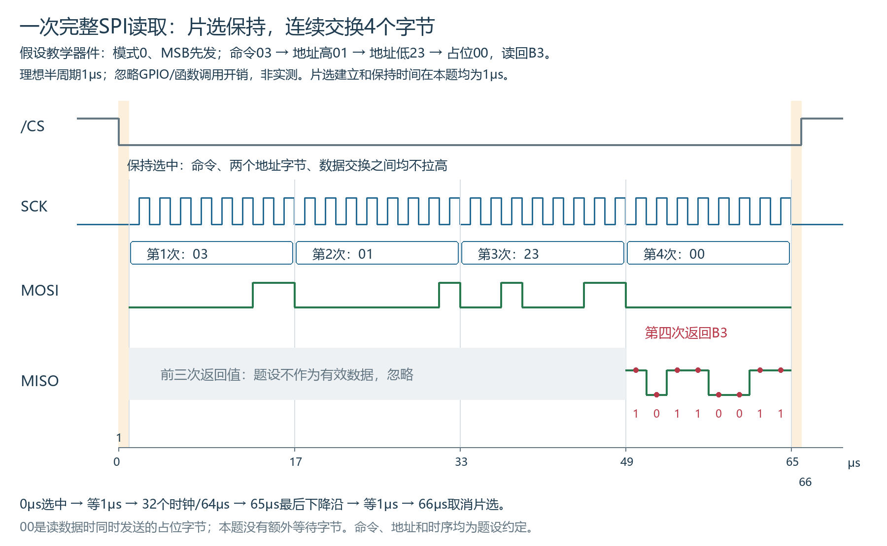

例：读取地址0x0123，本题该位置数据为0xB3。

| 调用次序 | 传给soft_spi_transfer_mode0的字节 | 同时收到的字节如何处理 |
|---|---|---|
| 第1次 | 0x03，读命令 | 忽略 |
| 第2次 | 0x01，地址高字节 | 忽略 |
| 第3次 | 0x23，地址低字节 | 忽略 |
| 第4次 | 0x00，占位发送 | 保存返回的0xB3，作为目标数据 |

SPI每次交换同时发送与接收。前三次调用也会读MISO，但按本题器件约定，这些返回值不是目标地址的数据。第四次的0x00是MOSI的占位值，0xB3是MISO数据；二者不要求相同。占位字节本身就提供读取数据所需的8个时钟，本题不在它之后再调用一次才取数，也不把0x00当成向存储地址写入零。

地址高、低字节可用以下表达式得到；它们决定字节发送顺序，与CPU在RAM中的大小端存储布局无关：

```c
uint8_t address_hi = (uint8_t)(address >> 8);
uint8_t address_lo = (uint8_t)(address & 0xFFu);
```

忽略一次返回值可直接调用函数，或显式写成下面的局部示例。函数仍完整执行8位交换，`(void)`只是表达调用者不使用该返回值：

```c
(void)soft_spi_transfer_mode0(SOFT_SPI_READ_CMD);
```

完整流程：SCK保持初始低电平，拉低/CS → 建立延时 → 连续交换命令、地址高、地址低、占位四个字节 → 保存第4次返回值 → 保持延时 → 拉高/CS → 将保存的数据返回。单字节函数本身不切换片选，事务函数才控制事务边界；不在每个字节之间拉高/CS。

本例半周期1μs，每个字节16μs，共32个SCK周期、64μs纯交换时长。若拉低/CS时刻为0μs，建立延时后在1μs开始调用，四次调用分别占1～17、17～33、33～49、49～65μs；模式0最后一个下降沿在65μs，保持1μs后在66μs拉高/CS并返回。实际首个上升沿在2μs，图中1μs是开始准备首位的时刻。以上忽略GPIO/循环/函数调用开销，不要求用开发板验证。

完整函数见8.11节；后续再讨论把数据阶段扩展为连续读取多个字节。

### 8.11 单地址数据读取事务的完整参考实现

```c
uint8_t soft_spi_read_byte(uint16_t address)
{
    soft_spi_cs_write(0u);
    delay_us(SOFT_SPI_CS_SETUP_US);

    (void)soft_spi_transfer_mode0(SOFT_SPI_READ_CMD);
    (void)soft_spi_transfer_mode0((uint8_t)((address >> 8u) & 0xFFu));
    (void)soft_spi_transfer_mode0((uint8_t)(address & 0xFFu));

    uint8_t byte = soft_spi_transfer_mode0(0x00u);

    delay_us(SOFT_SPI_CS_HOLD_US);
    soft_spi_cs_write(1u);
    return byte;
}
```

函数沿用8.10的假设器件及初始条件：/CS高、SCK低，GPIO已准备且独占总线。先拉低片选并等待建立时间，再调用三次完整字节交换发送读命令和地址，忽略对应返回值；第4次发送占位0x00，将同时收到的目标数据保存到byte。等待保持时间、拉高片选之后才返回保存的数据，避免提前return漏掉片选收尾。

地址的两个表达式各自得到0～255范围的值，传给uint8_t参数时可以正确隐式转换；参考实现显式转为uint8_t并统一使用0xFFu，只是明确字节边界，不表示未写强制转换的同等表达式有错。读取0x0123时依次发送03、01、23、00，第4次返回值才是本次数据。

本函数不再手工调用MOSI/SCK接口：soft_spi_mosi_write只设置0/1电平、不生成时钟；soft_spi_transfer_mode0才执行8轮位交换与相应延时。把一个地址字节传给单电平接口不能替代发送字节，也不满足其仅接受0/1的约定。连续两次把已低的SCK写为0同样不会生成时钟周期。

保持延时位于最后交换之后、片选拉高之前；若先取消选中再等，等待发生在事务结束后，不满足本题的片选保持约定。四次交换的纯时长64μs，加建立/保持各1μs，理想事务66μs；返回时/CS高、SCK低。函数返回采样得到的数据，不验证器件存在或返回数据的业务含义，不将教学时间当作实测保证。

### 8.12 连续多个数据字节：命令与起始地址只发送一次

在8.10假设器件上明确增加以下约定：读命令与16位起始地址发完后，目标在随后的数据交换中自动递增内部读取地址。第1次数据交换返回address处内容，第2次返回address+1，依此类推；/CS保持低，取消选中结束本次读取。这是本题器件行为，不是SPI接口保证所有设备都具备的功能。模式0、MSB、00占位、无额外等待字节及片选建立/保持规则均沿用。

章首新增接口：

```c
void soft_spi_read_bytes(uint16_t address, uint8_t *buffer, uint16_t length);
```

| 参数/边界 | 本题约定 |
|---|---|
| address | 起始地址；不跨0xFFFF结尾，即length>0时最后地址address+length-1不超过0xFFFF，调用者保证 |
| buffer | length>0时指向至少length字节的有效可写空间；函数不分配内存，不负责推测数组容量 |
| length | 读取并写入buffer的字节数，类型uint16_t；length=0时立即返回，不切换/CS、不产生时钟、不访问buffer，此时允许空指针 |
| 返回 | void，读取结果通过buffer交给调用者；本题不增加错误状态或非法参数处理分支，非零长度时的指针/容量/地址范围由调用者保证 |
| 其他初始条件 | /CS高、SCK低、所需取消选中间隔满足，GPIO准备且独占总线，沿用理想模型 |

例如假设器件的0x0123、0x0124、0x0125处分别为B3、6C、A5，调用者准备3字节数组：

```c
uint8_t data[3];
soft_spi_read_bytes(0x0123u, data, 3u);
/* 按本题器件内容，完成后data[0..2]依次为B3、6C、A5。 */
```

这只是接口使用与预期结果，不表示已经编译或运行；完整函数见8.13节。

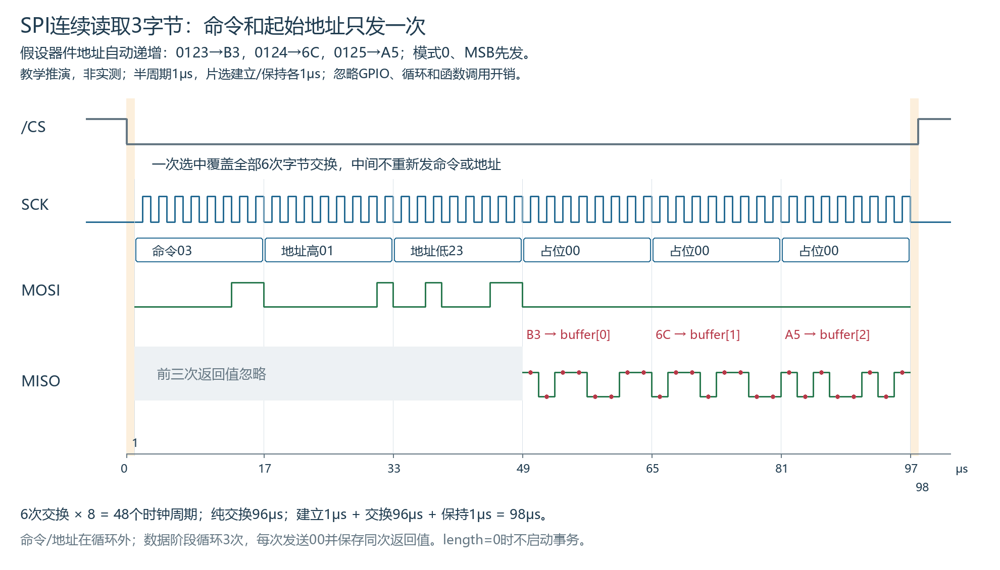

这次一共6次字节交换：03、01、23、00、00、00。前三次返回忽略，后三次分别保存到buffer[0]、buffer[1]、buffer[2]。每个00都在本次调用中提供8个数据时钟并返回一个字节，不是把所有00先发完再另行接收。

与单地址读取相比，命令/地址发送与片选收尾部分均保留；把原来“交换00并保存一个byte”改为循环length次。下面仅是数据循环内的局部动作，i为0～length-1的有效下标：

```c
buffer[i] = soft_spi_transfer_mode0(0x00u);
```

完整步骤：先处理length=0 → 拉低/CS并等待建立时间 → 发送一次读命令和起始地址高/低字节 → 循环length次交换00并写入buffer[i] → 等待保持时间 → 拉高/CS后结束。命令和地址在循环外，片选建立/保持延时各只执行一次；片选在所有交换期间持续为低。

这里的“地址递增”发生在目标器件内部；MCU循环递增的是数组下标，不需要每次发送address+i。也不在循环中调用soft_spi_read_byte：它每次都会重新发命令/地址并切换片选，不能组成此题要求的一次连续事务。多次独立读取是另一种访问安排，不能与本接口的单事务约定混为一谈。

当length>0，总字节交换数=3+length，时钟周期数=8×(3+length)，纯交换时间=16×(3+length)μs，理想选中时长再加建立/保持共2μs。例中length=3：6次交换、48时钟、96μs纯交换、98μs选中时长。图中1μs开始交换，97μs最后一个下降沿，98μs取消选中。length=0直接返回，不能套公式产生3次交换或固定延时。完整连续读取函数见8.13节。

### 8.13 连续多个数据字节读取的完整参考实现

```c
void soft_spi_read_bytes(uint16_t address, uint8_t *buffer, uint16_t length)
{
    if (length == 0u) {
        return;
    }

    soft_spi_cs_write(0u);
    delay_us(SOFT_SPI_CS_SETUP_US);

    (void)soft_spi_transfer_mode0(SOFT_SPI_READ_CMD);
    (void)soft_spi_transfer_mode0((uint8_t)((address >> 8u) & 0xFFu));
    (void)soft_spi_transfer_mode0((uint8_t)(address & 0xFFu));

    for (uint16_t i = 0u; i < length; i++) {
        buffer[i] = soft_spi_transfer_mode0(0x00u);
    }

    delay_us(SOFT_SPI_CS_HOLD_US);
    soft_spi_cs_write(1u);
}
```

入口先判断零长度，保证此时不选中器件、不产生时钟，也不访问buffer。非零长度时，调用者保证可写空间和读取地址范围，函数按8.12的假设器件约定工作：选中并建立后，仅发送一次命令和起始地址；循环恰好length次，每次发送00提供8个时钟，并将同时收到的字节写入buffer[i]。循环结束后等待保持时间，取消片选。返回void，数据通过调用者的数组输出。

例如读取0x0123起的3字节，控制器发送03、01、23、00、00、00，数组依次得到B3、6C、A5。器件内部地址递增，软件仅递增数组下标；命令、地址、建立与保持延时均不放入数据循环。uint16_t循环计数与length范围一致，i从0到length-1，不访问buffer[length]。地址字段的显式uint8_t转换与8.11同理，省略转换但表达式值仍在0～255内也正确。

当前事务复用的是soft_spi_transfer_mode0，不是soft_spi_read_byte。后者的参数是地址，而且自带片选和完整命令/地址阶段；例如soft_spi_read_byte(SOFT_SPI_READ_CMD)是读取地址0x0003，并非只发送命令03。在已开始的连续事务中嵌套它，会重复命令/地址并切换片选，也不符合它的正常入口条件，不能替代循环中的单字节交换。这里由soft_spi_read_bytes统一拥有片选边界，各次transfer只负责8位时序。

length=3的理想总选中时长为98μs，length=0不启动事务；时间和数据结论依赖给定GPIO与假设器件约定，不验证实机时序、器件存在或业务数据正确性。当前不增加非法指针、容量不足或跨地址结尾的检查分支，这些仍由调用者保证。

## 九、GPIO模拟IIC：从开漏动作到通信时序

### 9.1 下拉、释放与读取实际电平

本节把M05的普通双向开漏IIC原理对应到GPIO接口。SDA是共享数据线，SCL是共享时钟线，两条线各有上拉。输出只做两件事：下拉或释放；释放是断开本机下拉通路，让线路由其他下拉者、上拉和线路负载共同决定，不能理解为本机主动输出高电平。普通开漏/线与连接和时钟拉伸机制见[NXP UM10204的3.1.1与3.1.9节](https://www.nxp.com/docs/en/user-guide/UM10204.pdf)。

本阶段以一个控制器、目标器件可按题设拉低共享线为范围，不编写多控制器仲裁。两条线已配置为可下拉/释放的GPIO，上拉、电压兼容性与连接已准备好，没有其他本机代码同时操作；题设接口负责具体引脚映射，不要求猜测寄存器或当前编写GPIO底层实现。

| 接口后缀 | 本机动作 | 是否证明实际线路为高 |
|---|---|---|
| drive_low() | 接通本机到地的下拉通路，保持低输出 | 否，正常连接下使线低 |
| release() | 断开本机下拉，输出高阻，输入仍可读 | 否，其他端可能仍拉低，上升也需时间 |
| read() | 读取实际总线输入，返回0或1，不改变输出控制 | 读到1才说明当前输入被识别为高；不保证未来始终高 |

章首为SDA和SCL各提供这三种接口，不引入新结构体。它们只完成单次引脚动作或读取，不自动发送字节、产生8个时钟、切换START/STOP或等待线路升高。read必须读实际输入，而不是“最后一次输出控制值”。

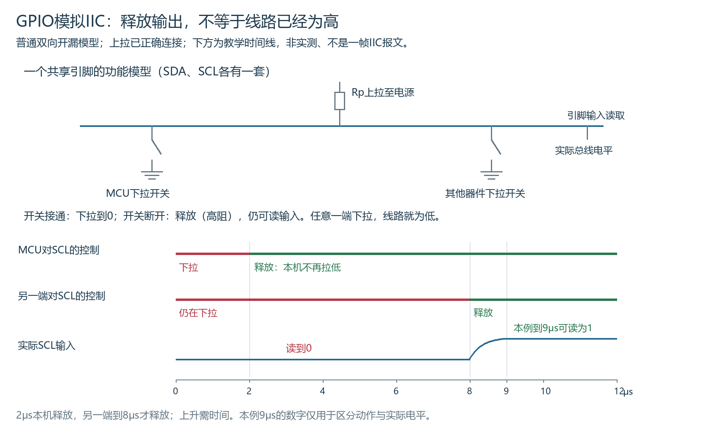

图中功能开关代表输出到地的通路。只要任何一端仍接通下拉，共享线就为低；所有端释放后，上拉才让线路逐渐升高。本例本机在2μs释放SCL，另一端到8μs才释放，图示9μs达到可读高电平：2～8μs不能因为本机已释放就把SCL当高；上升时间也不能忽略成“释放后立刻有效”。图中1μs上升过程仅用于教学，不是所有IIC线路的固定数值，也不是器件时序设计建议。

例如下面两句是单次释放后观察SCL的局部示例，不构成完整通信函数：

```c
soft_iic_scl_release();
uint8_t level = soft_iic_scl_read();
```

level可能仍为0。第二行不会再次释放或改变引脚，也不等待线路变高；如果后续时序需要SCL已经为高，必须在明确题设下确认实际输入。如何安排等待和超时随后讲解，不根据这一局部示例推断无限等待是可靠实现。

发送数据位0时调用soft_iic_sda_drive_low；发送数据位1时调用soft_iic_sda_release，在允许的数据准备阶段操作。发送1是释放动作，不保证共享线最终为1；还需没有其他端下拉且上拉/上升时间满足。本节不定义推挽写高接口，也不通过读取动作代替输出动作。

与已完成的SPI代码联系：SPI练习的SCK写1在给定推挽模型中直接驱动高；这里的scl_release仅停止本机下拉，能否进入SCL高电平阶段要看实际输入。后续START、STOP、字节收发和应答都建立在这一接口语义上，本节暂不布置完整时序函数。

### 9.2 有超时地等待实际SCL为高

后续的时序函数在释放SCL后，需要确认实际线路已经为高，才开始安排相应高电平阶段。将这个等待独立成函数，可以复用已学过的“入口计时、先判断超时、再观察硬件条件”思路，不必为每个时序函数复制无限等待。

章首新增IIC_Result与soft_iic_wait_scl_high原型。它只等待一个条件，不发送位，不释放或下拉任何引脚：

| 项目 | 本节约定 |
|---|---|
| 调用前 | 调用者已经释放SCL，输入可读取；没有其他本机代码改动输出 |
| 成功 | 某次轮询时预算未到期，soft_iic_scl_read()读到1，返回IIC_OK |
| 超时 | 入口起累计时间达到timeout_us，返回IIC_TIMEOUT |
| 判断顺序 | 每轮先判断elapsed>=timeout_us，再读取SCL；时间到期优先 |
| 零预算 | timeout_us=0直接按超时结束，即使实际SCL已高也不返回IIC_OK |
| 引脚状态 | 函数全程不改变SDA/SCL输出；超时不强制拉高，也不自动拉低、产生STOP或复位目标 |
| 时间源 | 沿用章首now_us()，微秒uint32_t计数能在轮询时持续前进；当前例子不跨计数回绕，不要求实现时基 |

调用者与等待函数各自职责如下。此例只是调用方式，完整等待函数见9.3节：

```c
soft_iic_scl_release();
IIC_Result result = soft_iic_wait_scl_high(10u);
```

result为IIC_OK，说明函数在预算内观察到了实际高电平；不是“输出了高电平”，也不保证以后不会再变低。返回IIC_TIMEOUT只说明本次等待未在预算内确认高，不能单凭这个结果断言目标已损坏或线路永远不会升高；此处不展开故障定位或总线恢复。

沿用9.1的教学波形：假设2μs释放后立即进入函数，实际SCL到9μs可读高。若预算10μs，截止为12μs，在9μs执行轮询时elapsed=7μs，返回IIC_OK；若预算5μs，截止为7μs，在7μs检查时就返回IIC_TIMEOUT，线路此时仍为低。两例明确给定检查时刻，不假定轮询能无延迟检测任意边沿，不将示例升高时间当固定硬件参数。

函数组织顺序：入口记录start_us一次 → 重复计算elapsed → 若预算已用尽则返回IIC_TIMEOUT → 否则若实际SCL为1则返回IIC_OK → 否则继续轮询。单次轮询中判断高电平的局部代码可写为：

```c
if (soft_iic_scl_read() != 0u) {
    return IIC_OK;
}
```

这段须放在本轮超时判断之后。入口起点不在循环内重设，循环内不再次释放/下拉SCL，不用固定delay_us替代实际输入确认；当前函数只等待一个条件，无UART的提交数据阶段。超时预算和判断顺序是本章函数接口选择，不是IIC规范统一规定的固定超时。

### 9.3 SCL高电平超时等待的完整参考实现

```c
IIC_Result soft_iic_wait_scl_high(uint32_t timeout_us)
{
    uint32_t start_us = now_us();

    for (;;) {
        uint32_t elapsed_us = now_us() - start_us;

        if (elapsed_us >= timeout_us) {
            return IIC_TIMEOUT;
        }
        if (soft_iic_scl_read() != 0u) {
            return IIC_OK;
        }

        delay_us(1u);
    }
}
```

函数入口只记录一次start_us；循环内先计算累计时间，达到预算就返回IIC_TIMEOUT，未到期才读取实际SCL。读到1返回IIC_OK，仍为0则稍后再次检查。timeout_us=0在首轮时间判断返回超时，不因为入口SCL高而绕过本章的时间优先约定。函数全程没有SDA/SCL写入，成功或超时均不自动改变引脚输出。

参考实现保留每轮读低之后delay_us(1u)的轮询间隔。这不是等待SCL所必需的操作，也没有用固定延时替代实际输入确认；它使相邻检查之间额外相隔约1μs，加上实际调用开销，可能比更频繁的轮询稍晚发现高电平。也可省略此延时；两者都按每次轮询时的累计时间作判断，不承诺精确边沿检测或在截止瞬间中断执行。循环末尾无需显式continue，运行到末尾自然进入下一轮。

elapsed_us接收两个uint32_t时间值的差，在当前不跨回绕的题设中无需另加显式转换。时间源应持续前进，单次GPIO读取和延时也应返回；本例沿用9.2的硬件准备前提，不要求当前实现这些底层接口。完整等待函数已具备，后续START/STOP时序可在需要确认SCL高时调用它。

### 9.4 首次START：SCL为高时，让SDA从高变低

START的定义是：实际SCL为高期间，SDA出现高到低的变化。拉低SCL不是START本身，它是生成START并保持一段时间之后，为后续数据阶段作的准备。定义见[NXP UM10204的3.1.4节](https://www.nxp.com/docs/en/user-guide/UM10204.pdf)。

本节先写首次START，明确以下前提：单控制器、没有其他未结束通信；调用前SDA已释放并稳定为高，没有目标器件下拉SDA。调用者保证这些条件；本函数不检测SDA占用或执行总线恢复。SCL释放后若暂时仍低，使用已完成的等待函数确认它实际升高。确认高之后，本题假设直到本机拉低SCL之前，其他端不再拉低SCL；GPIO开销忽略。

章首新增SOFT_IIC_HALF_US=5u与目标接口`IIC_Result soft_iic_start(uint32_t scl_timeout_us)`。该宏用于本题的高电平准备和START保持等待，不将5μs推广为所有器件固定时序，也不据此保证真实软件IIC的精确速率。

| 项目 | 本节函数约定 |
|---|---|
| scl_timeout_us | 仅传给soft_iic_wait_scl_high，限制本次确认SCL高的等待，不是整个START函数总预算 |
| 成功 | 先释放SDA/SCL并确认SCL高；高电平准备延时5μs；拉低SDA形成START；保持5μs；拉低SCL后返回IIC_OK |
| 超时 | 等待函数返回IIC_TIMEOUT时立即返回该结果，不执行SDA下拉或后续固定延时，不生成START |
| 成功后的状态 | 本机下拉SDA和SCL，两线为低，准备后续数据位；此处尚未发送设备地址或收到ACK |
| 超时后的状态 | 本机SDA/SCL输出均已释放，不等于两条实际线路必然为高；不自动生成STOP |
| 零等待预算 | 两个释放动作后，等待函数按既有时间优先约定返回IIC_TIMEOUT，无后续START动作 |

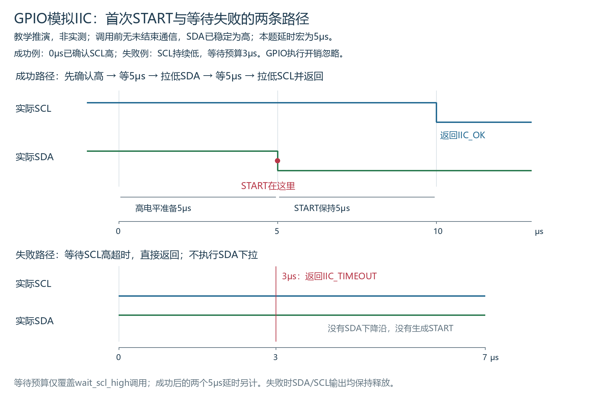

成功例在0μs完成释放并确认SCL高，先保持SDA/SCL高5μs；5μs拉低SDA，此刻产生START；再保持SCL高、SDA低5μs；10μs拉低SCL并返回IIC_OK。SDA从未主动驱动高：前面的高由释放、上拉和本题初始条件保证。

失败例SCL持续低，假设等待预算3μs、在3μs执行到期检查，函数返回IIC_TIMEOUT。不能在失败后继续执行SDA下拉并假称产生了START，因为没有确认实际SCL高。已经释放的SDA/SCL输出不自动改为下拉。

把步骤对应到已有GPIO接口：

1. 调用soft_iic_sda_release，然后调用soft_iic_scl_release。
2. 用soft_iic_wait_scl_high(scl_timeout_us)取得结果；若不是IIC_OK，立即返回该结果。
3. 延时SOFT_IIC_HALF_US，让本题的高电平准备时间满足。
4. 调用soft_iic_sda_drive_low，在实际SCL仍高时形成START。
5. 再延时SOFT_IIC_HALF_US，保持START。
6. 调用soft_iic_scl_drive_low，再返回IIC_OK。

如果先拉低SCL再拉低SDA，SDA下降发生在SCL低期间，不能据此生成START。也不能在等待失败后忽略返回值继续后面的动作。本节不额外调用SDA读取来判断是否空闲，因为SDA高及无其他通信是明确的调用前提；重复START、SDA占用检测和恢复不在当前函数中混用。

成功耗时为实际等待耗时加两个5μs固定延时，忽略GPIO/轮询开销；预算仅约束等待阶段。固定延时结束后即使时间超过scl_timeout_us，也不据此判整个START超时，因为接口未定义总预算。完整函数见9.5节。

### 9.5 首次START的完整参考实现

```c
IIC_Result soft_iic_start(uint32_t scl_timeout_us)
{
    soft_iic_sda_release();
    soft_iic_scl_release();

    IIC_Result result = soft_iic_wait_scl_high(scl_timeout_us);
    if (result != IIC_OK) {
        return result;
    }

    delay_us(SOFT_IIC_HALF_US);
    soft_iic_sda_drive_low();
    delay_us(SOFT_IIC_HALF_US);
    soft_iic_scl_drive_low();
    return IIC_OK;
}
```

函数沿用9.4的首次START前提，不是任意总线状态下的恢复函数。先释放两线，复用已完成的SCL等待函数；如果等待返回失败，立即把失败结果交给调用者，后面的延时和下拉都不会执行。本机输出仍保持释放，实际SCL是否为高由共享线路决定。

等待成功后，先保持本题5μs的高电平准备，再在实际SCL仍高时下拉SDA形成START；保持5μs后拉低SCL，为后续数据位准备低电平阶段，最后返回IIC_OK。若等待立即成功，START在5μs产生，10μs返回，SDA/SCL均低；这里只产生起始条件，尚未发送设备地址或获得ACK。

两个drive_low接口的声明均为`void function(void)`，调用时使用空参数列表，不传0u；“下拉”已经由接口名称和实现规定。不要与SPI的write(level)参数接口混用，也不要在没有声明和实现的情况下自行改用sda_write/scl_write名称。

参考实现仅保留高电平准备和START保持两次延时。在本节前提下，若在释放SDA后、释放SCL前以及拉低SCL后各再加5μs，并不破坏START，但会改变波形时间：等待立即成功时START在10μs、SCL在15μs拉低、20μs返回。不能把这些额外等待误判为START定义错误，也不能继续沿用图中的5/10μs结论。当前完整参考与9.4波形一致，无需额外等待。

### 9.6 STOP：SCL为高时，让SDA从低升高

STOP的定义是在实际SCL为高期间，SDA从低变高。它不是单独把SCL释放，也不是仅执行一次SDA释放指令就必然完成；实际线路必须产生对应变化。定义见[NXP UM10204的3.1.4节](https://www.nxp.com/docs/en/user-guide/UM10204.pdf)。

本节先按正常结束通信的场景编写。调用前，本机已将SCL保持为低；目标器件已释放SDA，控制器可以准备并控制SDA；没有其他控制器并发。允许SDA初始高或低，先在SCL低时把它下拉。释放SCL后可使用已完成的等待函数；确认高之后，本题保证SCL直到结束都保持高。SDA释放后有正常上拉，本题保证5μs内达到稳定高电平。这些是调用前提，函数不作为任意线路异常下的恢复流程。

章首新增目标接口`IIC_Result soft_iic_stop(uint32_t scl_timeout_us)`，复用SOFT_IIC_HALF_US=5u、已有GPIO接口和SCL等待函数，不新增结构体或状态码。

| 阶段 | 本节动作 |
|---|---|
| 低电平准备 | 调用scl_drive_low确保本机保持SCL低，再调用sda_drive_low，等待5μs |
| 确认SCL高 | 调用scl_release，再用wait_scl_high(scl_timeout_us)等待实际高 |
| 等待失败 | 立即返回该失败结果，不继续释放SDA；本机SDA仍下拉、SCL输出已释放，没有生成STOP |
| 高电平建立 | 等待成功后保持SCL高、SDA低5μs |
| 产生STOP | 调用sda_release，上拉使SDA升高，在SCL高时形成STOP |
| 结束 | 再等待5μs，按题设确保SDA已稳定高，返回IIC_OK；两线输出均释放、实际为高，不再把SCL拉低 |

这里的drive_low/release都不接收参数；等待结果必须检查，成功分支与START一样不能忽略超时。

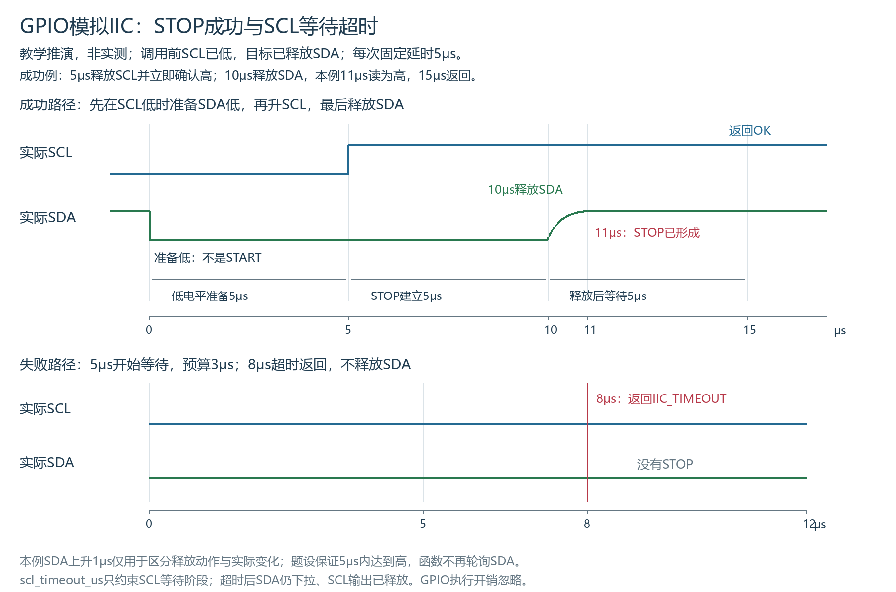

成功例在0μs的SCL低阶段准备SDA低，先等5μs；5μs释放SCL并假设立即确认高；再等5μs，到10μs释放SDA。本例线路经1μs上升过程，11μs识别为高，STOP已经形成；15μs固定延时结束，返回IIC_OK，两条实际线路均为高。1μs上升只为教学示例，不是所有器件/线路固定值。

最开始的SDA下拉不构成START，因为它发生在SCL低期间。后续SCL升高也不是STOP；在SCL高期间发生的SDA低到高变化才是STOP。若SDA初始已低，准备下拉甚至不会新增下降沿，但后续流程相同。

失败例5μs开始调用SCL等待，预算3μs、在8μs检查到期后返回IIC_TIMEOUT；参数只覆盖此等待阶段，不包括开头的5μs准备。此时本机SCL已释放，但实际SCL仍低；SDA保持下拉，不执行成功路径的SDA释放及后续延时，不能将失败结果解释为STOP已完成。当前不另行定义超时恢复动作。

完整动作顺序为：SCL下拉 → SDA下拉 → 低电平准备延时 → 释放SCL → 等待并检查结果 → 成功后高电平建立延时 → 释放SDA → 释放后延时 → 返回OK。失败时立即返回已有结果，停止后续成功动作；正常结束时不再拉低SCL。

忽略执行开销，成功总耗时为实际SCL等待耗时加三个5μs延时。释放SDA后的5μs从软件释放动作计时，不等于从真实STOP边沿起已完整空闲5μs；后续发起新事务仍须满足器件总线空闲时间，不能将本教学宏视为所有速率/线路的通用时序保证。本题保证释放后5μs内SDA可高，故不在本函数新增SDA轮询或新错误码。完整STOP函数见9.7节。

### 9.7 STOP的完整参考实现

```c
IIC_Result soft_iic_stop(uint32_t scl_timeout_us)
{
    soft_iic_scl_drive_low();
    soft_iic_sda_drive_low();
    delay_us(SOFT_IIC_HALF_US);

    soft_iic_scl_release();
    IIC_Result result = soft_iic_wait_scl_high(scl_timeout_us);
    if (result != IIC_OK) {
        return result;
    }

    delay_us(SOFT_IIC_HALF_US);
    soft_iic_sda_release();
    delay_us(SOFT_IIC_HALF_US);
    return IIC_OK;
}
```

函数沿用9.6的正常结束前提：调用前本机SCL已低，目标已释放SDA；SDA释放后能在本题5μs等待内升到稳定高。首先确保SCL低，再下拉SDA并等待；这一阶段不产生START，因为SDA变化时SCL为低。随后释放SCL并复用等待函数，只有确认实际SCL高才执行成功路径。

等待成功后，保持SCL高、SDA低5μs，再释放SDA；实际SDA在高SCL期间升高形成STOP。最后再等5μs，按题设确保SDA已经稳定高，返回IIC_OK。所有下拉/释放接口均无参数，末尾不再下拉SCL；成功后本机两条输出均释放，实际SDA/SCL均高。

等待失败时立即返回原结果，不执行后续延时和SDA释放。本机SDA仍下拉，SCL输出已释放但实际可能仍低，没有生成STOP；这个函数不附带额外恢复动作。scl_timeout_us只传给等待阶段，开头准备与成功后的固定延时不计入该预算。

等待立即成功时，三个5μs延时共15μs；对应9.6例图，5μs确认SCL高，10μs释放SDA，本例11μs识别SDA高，15μs返回。此例上升时间是给定条件，函数未额外检测SDA，因此不能脱离前提把返回OK解释为任意线路状态下STOP必然成功。代码按本章模型静态推演，不将时间或线路结果写成实测。

### 9.8 发送一个字节，再读取第9个时钟的ACK/NACK

IIC每字节按MSB先发送8位，然后用第9个时钟读取接收方应答。此时控制器仍产生SCL，但发送方必须释放SDA，让接收方在第9时钟高阶段提供应答：实际SDA低是ACK，高是NACK。见[NXP UM10204的3.1.5与3.1.6节](https://www.nxp.com/docs/en/user-guide/UM10204.pdf)。

本节控制器为发送方，目标为接收方，先学习一个独立字节的函数，不把设备地址、寄存器地址或数据字节含义写死在函数中。调用前已在有效通信中、处于应发送字节的阶段，本机SCL保持低。只有本机控制器生成时钟，前8位目标释放SDA；在第9位，目标按题设及时准备并在高阶段保持ACK/NACK。GPIO和上拉已准备，SDA释放为1时在低阶段5μs内升到有效高；每次实际SCL高确认后，其他端在本次高阶段不再次拉低SCL。当前不实现多控制器仲裁。

章首新增soft_iic_write_byte原型，并在IIC_Result末尾增加IIC_NACK，保留原有IIC_OK/IIC_TIMEOUT值。等待、START和STOP函数的已有返回约定不变，不因为枚举新增成员而开始返回NACK。

| 接口要素 | 本节约定 |
|---|---|
| byte | 要按bit7到bit0发送的原始字节，0下拉SDA、1释放SDA |
| scl_timeout_us | 每次调用wait_scl_high分别使用的上限，最多9次等待；不是整个字节共用总预算 |
| IIC_OK | 9个时钟完成，第9个高阶段读到SDA=0，即ACK |
| IIC_NACK | 9个时钟完成，第9个高阶段读到SDA=1，即NACK |
| IIC_TIMEOUT | 某次SCL高等待失败，立即返回该结果，不把它当作NACK |
| 正常结束 | ACK/NACK两条路径均完成第9高阶段、拉低SCL，本机SDA保持释放；不承诺目标此刻已经释放SDA |
| 超时结束 | 不再执行后续时钟或自动STOP；SCL输出已释放，SDA保持本次动作状态（数据位0时下拉，数据位1或应答阶段释放） |
| 事务边界 | 函数不产生START/STOP，不自动重发字节，事务由调用者安排 |

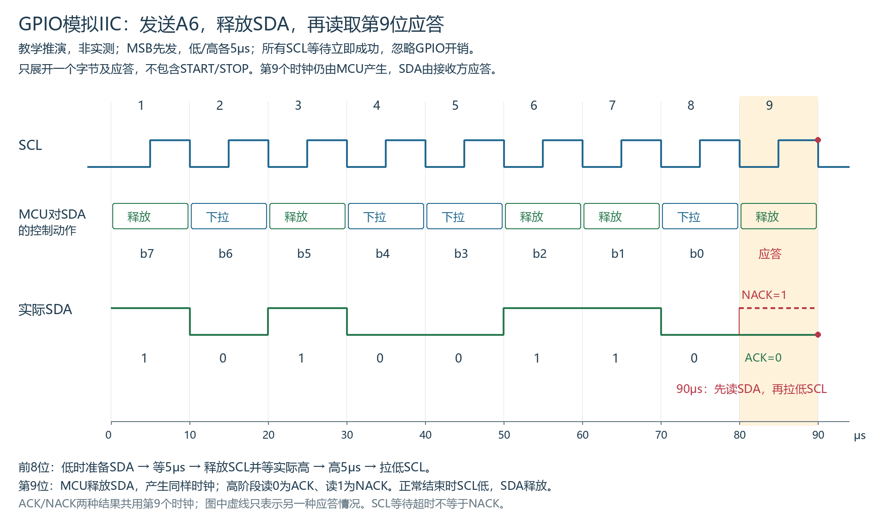

图中发送0xA6，即按顺序发送1、0、1、0、0、1、1、0。前8个时钟由MCU在SCL低时准备SDA：取到0就下拉，取到1就释放；高阶段保持数据不变，不能按普通数据位随意改变SDA而意外生成START/STOP。

每个数据位采用以下顺序：

1. SCL已经为低，准备byte的bit(7-i)。
2. 等待SOFT_IIC_HALF_US，满足本题低电平准备时间。
3. 释放SCL，调用wait_scl_high(scl_timeout_us)并检查；失败直接返回。
4. 已确认实际SCL高，保持SOFT_IIC_HALF_US。
5. 下拉SCL，结束这一位，下一轮才准备下一位SDA。

发送取位可沿用SPI的MSB表达式，但输出要选择开漏接口。下面仅是循环内SCL已低时的局部动作，i取0～7：

```c
if ((byte & (1u << (7u - i))) != 0u) {
    soft_iic_sda_release();
} else {
    soft_iic_sda_drive_low();
}
```

8轮结束后SCL已低。第8位若为0（本例bit0=0），MCU仍下拉SDA；必须在第9时钟前释放，才能把应答交给接收方。若MCU保持下拉再读0，这个0可能是自己造成的，不能证明目标给了ACK。

第9位操作顺序：MCU释放SDA → 低阶段延时5μs → 释放SCL并等待实际高、检查失败 → 高阶段延时5μs → 读取SDA并保存ack_level → 下拉SCL → 按保存结果返回IIC_OK或IIC_NACK。先完成时钟收尾，再根据应答返回；不能读到NACK就直接返回而漏掉第9次SCL下拉。MCU在此阶段一直释放SDA，不主动下拉来“制造ACK”。

本节选择在第9高阶段末、下拉SCL之前读取，题设保证目标在整个高阶段保持应答有效；GPIO执行开销按题设忽略。图中所有SCL等待立即成功：前8位共80μs，80μs后开始应答低阶段，85μs升SCL，90μs先采样再下拉，完整9周期90μs。实机读取位置必须位于有效高窗口，不能把理想同一时刻的语句顺序当成零耗时保证。

NACK和超时是两种结果：NACK已经完成有效第9时钟并读取为高；超时是某次SCL高等待未成功，可能连8位都没有完成。即使收到ACK，也只说明这个字节阶段观察到应答，不等于完整业务数据已经生效。图示和宏不作所有器件/线路的通用时序保证。完整字节发送函数见9.9节。

### 9.9 单字节发送与应答读取的完整参考实现

```c
IIC_Result soft_iic_write_byte(uint8_t byte, uint32_t scl_timeout_us)
{
    for (uint8_t i = 0u; i < 8u; i++) {
        if ((byte & (1u << (7u - i))) != 0u) {
            soft_iic_sda_release();
        } else {
            soft_iic_sda_drive_low();
        }

        delay_us(SOFT_IIC_HALF_US);
        soft_iic_scl_release();
        IIC_Result result = soft_iic_wait_scl_high(scl_timeout_us);
        if (result != IIC_OK) {
            return result;
        }
        delay_us(SOFT_IIC_HALF_US);
        soft_iic_scl_drive_low();
    }

    soft_iic_sda_release();
    delay_us(SOFT_IIC_HALF_US);
    soft_iic_scl_release();
    IIC_Result result = soft_iic_wait_scl_high(scl_timeout_us);
    if (result != IIC_OK) {
        return result;
    }

    delay_us(SOFT_IIC_HALF_US);
    uint8_t ack = soft_iic_sda_read();
    soft_iic_scl_drive_low();
    return ack == 0u ? IIC_OK : IIC_NACK;
}
```

前8轮按bit7到bit0准备SDA：1释放、0下拉。每轮先保证低阶段准备时间，再释放SCL并等待实际高；等待失败立即返回，否则保持高半周期后下拉SCL，下一轮才允许修改SDA。函数依赖9.8给定的有效通信阶段、初始SCL低和数据有效窗口前提，不负责START或STOP。

第8轮结束时SCL已低，先释放SDA，把第9位控制交给接收方，再产生一个完整时钟。高阶段结束前读取并保存ack，随后下拉SCL，最后按0返回IIC_OK、按1返回IIC_NACK。正常两条路径都完成9周期，本机SDA输出保持释放；不因为NACK提前遗漏时钟收尾。

每次wait_scl_high都单独使用scl_timeout_us上限，等待失败返回原结果，不自动恢复或产生STOP。超时可能发生在任一数据位或应答位，不能当作有效第9时钟的NACK。所有等待立即成功时，两次半周期延时各执行9次，理想总时长90μs。

循环体内的result只在该块中可见；循环外第9位阶段需重新声明自己的result。上面两份同名变量处于不同块作用域，使用符合本章C接口约定；也可以在循环前声明一个函数块内变量、在两阶段赋值复用，但不能在未声明的作用域直接使用循环体里的变量。这里保留两阶段分别声明的写法。

### 9.10 接收一个字节，再由控制器发送ACK/NACK

读取时，前8位由目标器件在SDA上发送，控制器释放SDA并采样；第9位接收方是控制器，因此改由控制器给ACK/NACK，而SCL仍由控制器产生。通常继续读取下一个字节时给ACK，结束本轮数据读取前给NACK；后续STOP或重复START由事务层另行安排。见[NXP UM10204的3.1.6与3.1.10节](https://www.nxp.com/docs/en/user-guide/UM10204.pdf)。

本节沿用普通开漏、一个控制器、5μs教学半周期与实际SCL等待。调用前已完成所需寻址和方向设置，处于目标即将发送一个字节的有效读阶段，本机SCL保持低；目标按MSB先发，在每个低阶段准备数据、在高阶段保持有效。前8位由目标控制SDA，第9低阶段目标释放SDA交给控制器。释放为1时的上升时间满足本题低半周期准备条件，每次确认SCL高后本次高阶段不被其他端再次拉低。不在该函数中发送设备地址、START或STOP。

章首新增IIC_Ack枚举以及read_byte原型：

```c
IIC_Result soft_iic_read_byte(uint8_t *out_byte, IIC_Ack reply,
                              uint32_t scl_timeout_us);
```

| 接口要素 | 本节约定 |
|---|---|
| out_byte | 有效可写的单字节输出指针，调用者保证；仅完整8位接收和第9位应答均完成后写入 |
| reply | 只能是IIC_SEND_ACK或IIC_SEND_NACK，调用者决定读完本字节是否继续读取 |
| IIC_SEND_ACK | 第9低阶段下拉SDA，表示ACK |
| IIC_SEND_NACK | 第9低阶段释放SDA，表示NACK；这是主动发送的控制动作，不是本函数失败 |
| scl_timeout_us | 每次等待实际SCL高各自使用的上限，最多9次，不是整字节总预算 |
| IIC_OK | 全部9周期完成，写入*out_byte；不论主动发送ACK还是NACK，都返回OK |
| IIC_TIMEOUT | 任一次SCL等待失败就返回，输出变量保持原值，即使本地已经拼出8位也不提交 |
| IIC_NACK | 本接收函数不返回此结果；它在write_byte中表示读到了接收方的NACK |
| 正常结束 | 先拉低SCL，再释放本机SDA，随后提交输出并返回OK；不自动生成STOP |
| 超时结束 | 不写输出、不自动收尾；SCL输出已释放，SDA保持本阶段动作，前8位为释放，第9位依reply下拉或释放 |

示例调用仅表示接口使用，不代表当前已运行：

```c
uint8_t value = 0xAAu;
IIC_Result result = soft_iic_read_byte(&value, IIC_SEND_NACK, 20u);
```

若完整接收到本例0xD2并发送完NACK，result为IIC_OK，value变为0xD2；若任一次等待超时，result为IIC_TIMEOUT，value仍为0xAA。返回状态与输出字节分开，不把IIC_SEND_NACK参数误当作函数返回IIC_NACK。

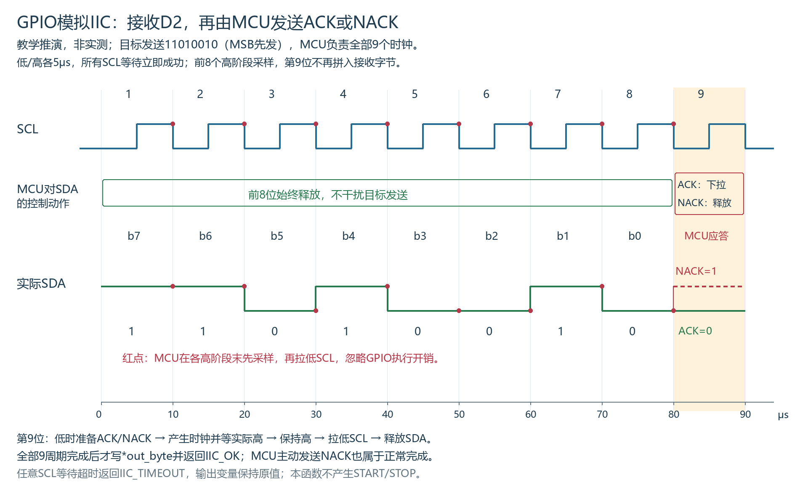

**前8位接收：**循环外先将本地rx初始化为0，并在SCL低时释放SDA。8轮期间始终不下拉SDA，每轮低半周期延时 → 释放SCL并等待实际高、检查失败 → 高半周期延时 → 读取SDA并拼接 → 下拉SCL。控制器只观察目标的数据，不用MOSI式写电平替代读取。

采样点的局部拼接仍可沿用SPI，i从0到7，一共读取8次：

```c
uint8_t bit = soft_iic_sda_read();
rx = (uint8_t)((rx << 1) | bit);
```

本例依次读到1、1、0、1、0、0、1、0，最后rx为0xD2。暂存在本地rx，不能在尚未完成第9时钟时先写*out_byte，因为后续仍可能超时。

**第9位发送应答：**8轮后SCL已低；reply为IIC_SEND_ACK则下拉SDA，为IIC_SEND_NACK则保持释放。低半周期延时 → 释放SCL并等待实际高、检查失败 → 高半周期延时 → 下拉SCL → 释放SDA → 写*out_byte=rx → 返回IIC_OK。这里不再把SDA采样值拼入rx，第9位不是数据的第9个bit。

先下拉SCL、再释放SDA很关键：若本机正给ACK而仍在SCL高时释放SDA，其上升可能变成STOP，改变事务边界。无论给ACK还是NACK，正常结束都回到SCL低、本机SDA释放的约定状态；下一字节或STOP由调用者决定。

图中所有等待立即成功：数据采样在10、20…80μs（每次先采样后拉低SCL，执行开销忽略），80μs在低阶段准备应答，85μs升SCL，90μs高阶段完成后拉低SCL再释放SDA、提交输出。总9周期、理想90μs；实际采样必须处于目标保证的数据有效窗口，不把图示语句顺序视为零耗时实机保证。完整接收函数见9.11节。

### 9.11 字节接收与控制器应答的完整参考实现

```c
IIC_Result soft_iic_read_byte(uint8_t *out_byte, IIC_Ack reply,
                              uint32_t scl_timeout_us)
{
    uint8_t rx = 0u;
    soft_iic_sda_release();

    for (uint8_t i = 0u; i < 8u; i++) {
        delay_us(SOFT_IIC_HALF_US);
        soft_iic_scl_release();
        IIC_Result result = soft_iic_wait_scl_high(scl_timeout_us);
        if (result != IIC_OK) {
            return result;
        }

        delay_us(SOFT_IIC_HALF_US);
        rx |= (soft_iic_sda_read() << (7u - i));
        soft_iic_scl_drive_low();
    }

    if (reply == IIC_SEND_ACK) {
        soft_iic_sda_drive_low();
    } else {
        soft_iic_sda_release();
    }

    delay_us(SOFT_IIC_HALF_US);
    soft_iic_scl_release();
    IIC_Result result = soft_iic_wait_scl_high(scl_timeout_us);
    if (result != IIC_OK) {
        return result;
    }

    delay_us(SOFT_IIC_HALF_US);
    soft_iic_scl_drive_low();
    soft_iic_sda_release();
    *out_byte = rx;
    return IIC_OK;
}
```

本实现沿用9.10的有效读阶段、初始SCL低、目标数据/应答交接、输出指针有效及reply合法等前提。前8轮MCU保持SDA释放，低半周期后释放SCL并等待实际高，失败直接返回；成功则保持高半周期后采样，随后下拉SCL。循环外rx先清零，每次把输入0或1左移到bit(7-i)并按位或入rx，依次填bit7到bit0，完成8次后得到MSB先发的完整字节。

这种按位定位的方法与9.10的“每次将rx左移一位再并入bit”都是正确拼接方式，不能混用两种移位策略。这里read只返回0/1、每个位置只填一次且rx初值为0，所以无需先清对应位；移位范围0～7，结果不超过0x80，复合赋值存入uint8_t正确，不要求额外强制转换。循环内外两份result各自声明，作用域正确。

第9位在SCL低时按reply准备应答，目标在此阶段释放SDA。ACK下拉、NACK释放；低延时后释放SCL并等待，成功才继续高阶段。随后先拉低SCL再释放SDA，避免给ACK后在高SCL期间释放数据线而意外形成STOP。

所有9周期完成后才执行*out_byte=rx并返回IIC_OK。主动发送IIC_SEND_NACK不属于本函数失败，正常完成仍返回OK；任一次等待失败都在输出赋值前返回，旧输出保持不变。即使前8位本地rx已经收齐，只要第9次等待超时，也不提交。函数不返回IIC_NACK，不自动产生START/STOP，事务由调用者安排。

所有SCL等待立即成功时理想总时长90μs；读到本例11010010后，成功输出0xD2。正常结束SCL低、本机SDA输出释放，实际SDA后续状态仍取决于目标与线路；不将给定前提下的静态推演冒充实机验证。

### 9.12 重复START：先在低SCL时准备SDA高

重复START仍是在实际SCL高时，SDA从高变低；区别在于它发生在尚未通过STOP结束的通信中。英文Repeated START，常用Sr表示；它不是STOP后再START。总线在重复START后仍保持忙状态，后续可以重新发送地址及方向。见[NXP UM10204的3.1.4与3.1.10节](https://www.nxp.com/docs/en/user-guide/UM10204.pdf)。

本节用于本机控制的有效事务内，初始SCL由本机保持低、尚未产生STOP，目标已释放SDA；例如完成一个发送字节及其应答，接下来准备换方向。SDA初始可以低或高，题设保证本机释放后在5μs低阶段准备时间内达到稳定高。每次确认SCL高之后，本次建立/保持期间不被其他端再次拉低，GPIO开销按题设忽略。若处于接收数据阶段并决定结束接收，前一数据字节应按协议给NACK，之后再安排重复START；此函数本身不补发应答。

章首新增`IIC_Result soft_iic_restart(uint32_t scl_timeout_us)`，复用已有GPIO、SCL等待和SOFT_IIC_HALF_US=5u。参数仍只限制本次等待实际SCL高的阶段，固定延时另计。

| 阶段 | 动作与含义 |
|---|---|
| 低阶段准备 | 确保SCL下拉，释放SDA，等待5μs；实际SDA此时升高不是STOP |
| 升高SCL | 释放SCL，调用wait_scl_high并检查结果 |
| 等待失败 | 立即返回失败结果，不继续下拉SDA；本机SDA/SCL输出均已释放，不自动生成STOP |
| 建立 | 确认实际SCL高后再等待5μs，SDA保持高 |
| 形成重复START | 下拉SDA，在实际SCL高时出现高到低变化 |
| 保持及结束 | 保持5μs，再下拉SCL，返回IIC_OK，两线均低，准备下一地址字节 |

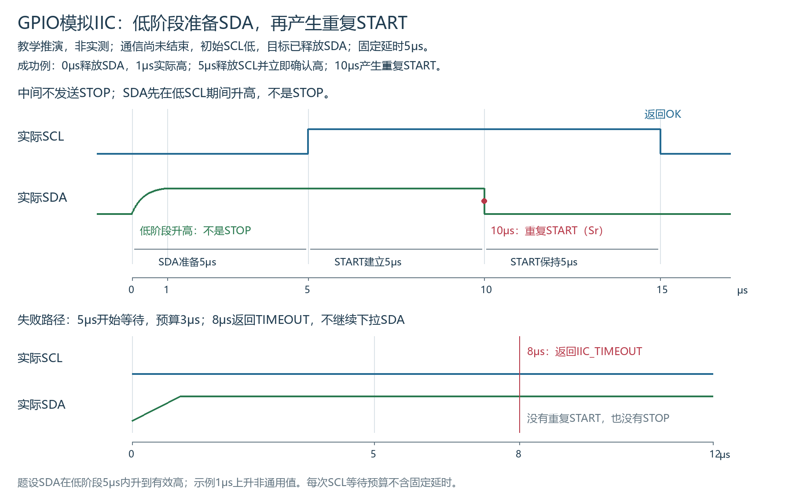

成功图中0μs在SCL低阶段释放SDA，本例1μs实际SDA为高；低阶段等待满5μs后释放SCL，并假设立即确认高。再等5μs，到10μs下拉SDA形成重复START；保持5μs后15μs下拉SCL并返回OK。图中的1μs上升只作教学示例，不是所有线路固定值。过程中没有SCL高时SDA的低到高变化，因此没有STOP。

失败图在5μs进入SCL等待，预算3μs，在8μs检查到期返回IIC_TIMEOUT；SDA已释放，实际SCL仍低，没有产生重复START。不能在等待失败后继续拉低SDA并报告成功，也不把输出都释放解释为STOP已经产生。

与本章首次START函数比较：首次START的调用前提已保证SDA稳定高；重复START从有效事务内的SCL低阶段开始，必须先给SDA足够的低阶段释放/上升时间。不能忽略这个前提差别，直接照搬首次START中连续释放SDA/SCL而省略低阶段准备；如果SCL先高、SDA随后才升高，就可能意外产生STOP。此处分别提供两个教学接口，不要求真实驱动必须拆成相同函数结构。

完整操作顺序：调用scl_drive_low确保低 → sda_release → 延时5μs → scl_release → 等待并检查实际SCL高 → 成功后延时5μs → sda_drive_low → 保持5μs → scl_drive_low → 返回OK。所有下拉/释放接口无参数，等待失败返回原结果，不自动恢复或结束事务。

成功理想耗时为实际等待耗时加三个5μs固定延时；若等待立即成功，共15μs。scl_timeout_us=0仍先完成低阶段准备和SCL释放，等待函数按时间优先约定返回TIMEOUT，后续重复START动作不执行。总线占用及具体器件的寄存器指针规则留到完整事务结合题设说明，完整重复START函数见9.13节。

### 9.13 重复START的完整参考实现

```c
IIC_Result soft_iic_restart(uint32_t scl_timeout_us)
{
    soft_iic_scl_drive_low();
    soft_iic_sda_release();
    delay_us(SOFT_IIC_HALF_US);

    soft_iic_scl_release();
    IIC_Result result = soft_iic_wait_scl_high(scl_timeout_us);
    if (result != IIC_OK) {
        return result;
    }

    delay_us(SOFT_IIC_HALF_US);
    soft_iic_sda_drive_low();
    delay_us(SOFT_IIC_HALF_US);
    soft_iic_scl_drive_low();
    return IIC_OK;
}
```

调用前沿用9.12：当前是尚未结束的有效通信，本机SCL低，目标已释放SDA，线路在本题低阶段准备时间内可升高。先保持SCL低并释放SDA，等5μs让SDA准备高；因为SCL此时低，SDA上升不产生STOP。随后释放SCL，用已完成的等待函数确认实际高；失败立即返回原结果，不执行后面的SDA下拉，也不自动产生STOP。

等待成功后，保持高电平准备5μs，再下拉SDA形成重复START；保持5μs后拉低SCL并返回IIC_OK。若等待立即成功，对应图示在10μs产生重复START，15μs返回，两线均低，准备后续地址字节。函数中没有插入STOP，原通信未因此结束。

三个固定延时和本次SCL等待分别计时，scl_timeout_us只限制等待阶段；不能将15μs总耗时与参数直接比较而追加整个函数超时语义。失败时本机SDA/SCL输出都已释放，实际SCL仍可能低；返回超时不意味着重复START或STOP已经完成。GPIO下拉/释放均为无参数接口，当前函数不重复实现底层等待、应答或器件寻址。

### 9.14 完整寄存器读取：寻址、返回检查与收尾

已有函数分别负责条件或一个字节；现在由事务函数安排调用次序，读取指定器件的一个寄存器。这里不再逐位控制GPIO，而是组合start、write_byte、restart、read_byte和stop。

**本例假设器件的访问约定：**7位地址为0x2D，寄存器位置为8位；先在写方向发送寄存器位置，器件保存这个位置，重复START切换到读方向后返回该位置的数据。本例寄存器0x10的值为0xC7。发送0x10的作用是选位置，并未写入一个新的寄存器数据值。寄存器位置宽度、指针保存和数据解释均以具体器件手册为准，不能视为所有IIC设备的固定规则。

调用前沿用已有函数的单控制器、有效开漏接口与时序前提；总线空闲，两线已稳定高。addr7是合法的7位设备地址，out_byte是有效输出指针。目标的每段数据/应答交接满足9.8、9.10、9.12的约定；三个发送字节完成ACK或NACK后，目标释放SDA，允许后续写字节、重复START或STOP准备；读完单字节并收到MCU的NACK后，目标释放SDA，允许STOP。SDA上升及SCL高阶段的稳定性满足已有各函数要求。这里暂不增加非法参数结果、多控制器仲裁或总线恢复功能。

**地址与方向：**第一个地址字节由7位地址和最低位R/W组成，0表示写、1表示读；重复START后重新发送地址及方向。这是IIC寻址规则。先写寄存器位置再换方向读是本假设器件采用的组合访问方式。参见[NXP UM10204的3.1.10节](https://www.nxp.com/docs/en/user-guide/UM10204.pdf)。

```c
uint8_t write_addr = (uint8_t)(addr7 << 1);
uint8_t read_addr  = (uint8_t)((addr7 << 1) | 1u);
```

传入addr7=0x2D，构造得到写地址字节0x5A、读地址字节0x5B；不能将已经带方向的0x5A或0x5B作为addr7再左移一次。事务接口已放在章首，完整实现见9.15。

正常过程为：

```text
START
→ MCU发送0x5A → 目标ACK
→ MCU发送0x10 → 目标ACK
→ 重复START
→ MCU发送0x5B → 目标ACK
→ 目标发送0xC7 → MCU发送NACK
→ STOP
→ 向调用者提交0xC7，返回IIC_OK
```

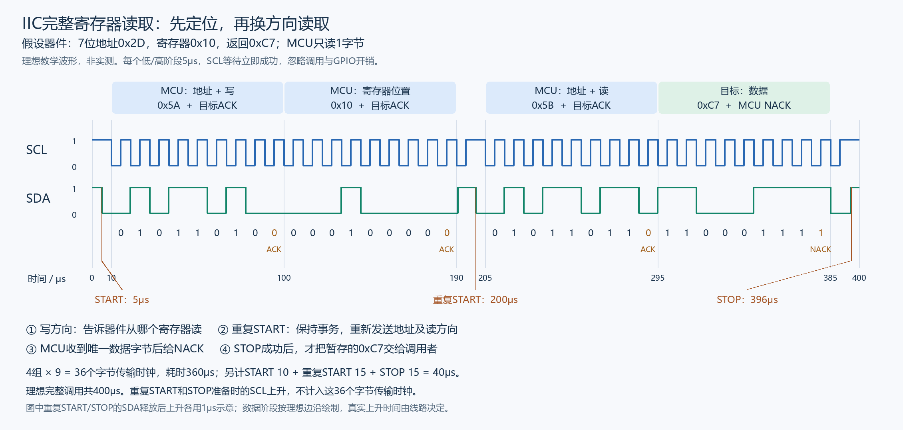

图为理想教学推演，非硬件测量。每个字节函数产生8位及1位应答，共9个传输时钟；四组共36个，纯字节传输耗时360μs。所有SCL等待立即成功、忽略调用与GPIO开销时，另计首次START的10μs、重复START的15μs、STOP的15μs，完整调用共400μs。重复START与STOP准备中的SCL上升不算入这36个字节传输时钟。

图中首次START在5μs，四组字节分别占10～100、100～190、205～295、295～385μs。重复START在200μs；STOP准备从385μs开始，390μs确认SCL高、395μs释放SDA，本例396μs实际SDA升高形成STOP，400μs返回。释放后1μs升高仅作图示，不是普遍固定值。

| 顺序 | 调用与数据 | 成功后下一步 |
|---|---|---|
| 1 | start(scl_timeout_us) | 发送写方向地址 |
| 2 | write_byte(write_addr, scl_timeout_us) | 目标ACK后发送寄存器位置 |
| 3 | write_byte(reg, scl_timeout_us) | 目标ACK后重复START |
| 4 | restart(scl_timeout_us) | 发送读方向地址 |
| 5 | write_byte(read_addr, scl_timeout_us) | 目标ACK后读取数据 |
| 6 | read_byte(&value, IIC_SEND_NACK, scl_timeout_us) | 单字节及第9时钟完成后STOP |
| 7 | stop(scl_timeout_us) | STOP成功后提交value并返回OK |

表内为省略soft_iic_前缀的调用示意。前三次write_byte的ACK由目标给；read_byte最后的NACK由MCU给，表示本次不再接收更多数据。正常完成read_byte仍返回IIC_OK，不能把主动发送的IIC_SEND_NACK当成错误返回IIC_NACK。

**先暂存，最后提交。**事务函数先定义局部uint8_t value，接收时传&value，不能直接把out_byte传给read_byte。read_byte只承诺自己的9周期完成，它并不知道后面的STOP能否成功；事务函数承诺更完整的过程。因此只有最后stop也返回OK，才执行*out_byte=value。任一阶段失败，调用者原变量都保持不变；调用者仍须检查返回值，旧值不能当作本轮新数据。

**每次调用都检查返回值，本练习采用以下失败策略：**

| 情况 | 事务动作与返回 |
|---|---|
| START或后续任一步返回IIC_TIMEOUT | 立即返回TIMEOUT，不继续访问，不自动补STOP |
| 三次write_byte中任一次返回IIC_NACK | 不再进入后续数据步骤；尝试调用STOP收尾 |
| NACK后的STOP成功 | 返回原来的IIC_NACK，不提交输出 |
| NACK后的STOP返回TIMEOUT | 返回IIC_TIMEOUT，表示收尾也未完成；不提交输出 |
| 正常读取后的STOP返回TIMEOUT | 返回TIMEOUT，不提交已经暂存的数据 |
| 正常读取且STOP成功 | 更新*out_byte，返回IIC_OK |

上述超时与收尾返回优先级是本教学接口的明确约定，不是IIC标准规定所有驱动必须采用同一策略。NACK发生在完整第9时钟结束、SCL已低且目标随后释放SDA的已知阶段，满足本题STOP准备前提；等待SCL超时则不能假定已回到同样状态，所以本题立即返回，不擅自补发STOP。返回超时不保证总线已空闲，也不保证目标未看到此前已经发送的内容。

scl_timeout_us继续传给每次底层调用，每次等待实际SCL高都重新计时；它不是整次寄存器读取的总预算。固定延时、多个等待和其他步骤会累计，因此即使每个等待都没超时，整次调用也可能明显长于该参数。

将流程转为C时，可以复用一个函数内声明的IIC_Result result保存每一步结果；每次重新赋值后立即检查。start、restart、read_byte和正常结束的stop只有OK/TIMEOUT两种结果，非OK直接返回。三次write_byte还可能返回NACK，需要区分“立即返回的超时”和“尝试STOP收尾的NACK”。下面仅示范其中一次发送的返回处理，省略soft_iic_read_register的其他部分：

```c
result = soft_iic_write_byte(write_addr, scl_timeout_us);
if (result == IIC_TIMEOUT) {
    return result;
}
if (result == IIC_NACK) {
    IIC_Result stop_result = soft_iic_stop(scl_timeout_us);
    return (stop_result == IIC_OK) ? IIC_NACK : stop_result;
}
/* 只有发送返回IIC_OK，才继续后面的寄存器选择。 */
```

stop_result单独保存清理结果，避免STOP成功返回的OK覆盖原先的NACK错误。该分支中STOP成功仍返回NACK；STOP超时则返回TIMEOUT。发送reg和read_addr后采用同一处理规则，初学组合时可以直接写清三个检查块，不强制提取新辅助函数或使用goto。

不能对三次write_byte都只写if (result != IIC_OK) return result：这种写法虽然能返回NACK，却跳过了本题规定的STOP收尾。正常调用顺序正确、最终成功路径有STOP，也不能补上提前return跳过的操作。只需针对三处发送检查分别处理TIMEOUT和NACK；其他只返回OK/TIMEOUT的底层步骤仍可保留非OK立即返回的写法。

局部uint8_t value只需在接收成功后使用；接收失败立即返回，不访问未完成的value。正常尾部先检查STOP，再写*out_byte=value，最后返回OK。完整组合实现见9.15。

### 9.15 完整寄存器读取的参考实现

本函数沿用9.14的假设器件与有效参数前提，复用已完成的底层IIC函数。

```c
IIC_Result soft_iic_read_register(uint8_t addr7, uint8_t reg,
                                  uint8_t *out_byte,
                                  uint32_t scl_timeout_us)
{
    uint8_t write_addr = (uint8_t)(addr7 << 1);
    uint8_t read_addr = (uint8_t)((addr7 << 1) | 1u);
    uint8_t value;
    IIC_Result result;

    /* 1. 首次START。 */
    result = soft_iic_start(scl_timeout_us);
    if (result != IIC_OK) {
        return result;
    }

    /* 2. 发送写方向地址，目标NACK时尝试STOP收尾。 */
    result = soft_iic_write_byte(write_addr, scl_timeout_us);
    if (result == IIC_TIMEOUT) {
        return result;
    }
    if (result == IIC_NACK) {
        IIC_Result stop_result = soft_iic_stop(scl_timeout_us);
        return (stop_result == IIC_OK) ? IIC_NACK : stop_result;
    }

    /* 3. 发送寄存器位置。 */
    result = soft_iic_write_byte(reg, scl_timeout_us);
    if (result == IIC_TIMEOUT) {
        return result;
    }
    if (result == IIC_NACK) {
        IIC_Result stop_result = soft_iic_stop(scl_timeout_us);
        return (stop_result == IIC_OK) ? IIC_NACK : stop_result;
    }

    /* 4. 重复START，准备重新寻址。 */
    result = soft_iic_restart(scl_timeout_us);
    if (result != IIC_OK) {
        return result;
    }

    /* 5. 发送读方向地址。 */
    result = soft_iic_write_byte(read_addr, scl_timeout_us);
    if (result == IIC_TIMEOUT) {
        return result;
    }
    if (result == IIC_NACK) {
        IIC_Result stop_result = soft_iic_stop(scl_timeout_us);
        return (stop_result == IIC_OK) ? IIC_NACK : stop_result;
    }

    /* 6. 接收到局部变量，MCU给NACK结束本次单字节接收。 */
    result = soft_iic_read_byte(&value, IIC_SEND_NACK, scl_timeout_us);
    if (result != IIC_OK) {
        return result;
    }

    /* 7. 正常STOP也必须检查。 */
    result = soft_iic_stop(scl_timeout_us);
    if (result != IIC_OK) {
        return result;
    }

    /* 8. 整个事务成功，才提交输出。 */
    *out_byte = value;
    return IIC_OK;
}
```

正常路径按9.14波形执行：发送0x5A、0x10、0x5B，前三个第9位均由目标给ACK；随后接收0xC7，MCU给NACK，最后STOP成功才提交0xC7并返回IIC_OK。只要任何阶段返回错误，都在唯一的*out_byte赋值之前退出，调用者旧值保持不变。value不要求初始化，因为只有接收成功已写入它，且STOP成功后才会使用。

三次发送分别检查TIMEOUT与NACK：超时直接返回；NACK调用STOP，收尾成功仍返回原NACK，收尾超时返回TIMEOUT。三个stop_result分别声明在各自if块内，作用域独立且合法；result在函数体声明，供所有步骤依次赋值。这里有意保留三个明确的发送检查块，不要求为减少重复另增辅助接口。

START、重复START、接收及正常STOP在本章模型中只有OK/TIMEOUT两种结果，非OK直接返回即可。接收时传入IIC_SEND_NACK属于正常应答动作，完成后返回OK；它与目标在地址或寄存器发送阶段返回的NACK不是同一件事。最终STOP超时，即使value已收到0xC7也不交付；发送阶段NACK后STOP成功，也不能被当作读取成功。

本函数的scl_timeout_us仍是每次底层SCL等待的预算，非整个事务总预算。它不补做非法参数检查、总线恢复、自动重试或多控制器仲裁；调用者按9.14满足有效地址、输出指针、总线及器件交接前提。上述结果为给定模型下的静态推演，未作实机时序验证。

## 十、UART配合RS485的方向控制

### 10.1 接口、初始状态与硬件延时

本节使用一颗DE与/RE分别由GPIO控制的两线半双工收发器。UART TX接收发器数据输入D，收发器接收输出R接UART RX；DE决定本端是否驱动差分对，/RE决定接收器是否向本机UART提供接收信号。

DE是Driver Enable（驱动器使能），高有效；/RE是Receiver Enable（接收器使能），低有效。名字中的n与斜杠一样表示低有效：rs485_re_n_write(1u)输出物理高电平，关闭本端接收；传0u才开启。真实器件的接口语义与使能、关断延时可对照[TI SNx5HVD308xE手册的5、6.9、6.10与8.4节](https://www.ti.com/lit/ds/symlink/sn65hvd3082e.pdf)。本节下面的2/1/1μs只是假设器件的题设，不是该TI芯片参数。

```text
UART TX ──→ 收发器D ──→ A/B共享差分对
UART RX ←── 收发器R ←── A/B共享差分对
GPIO    ──→ DE：驱动器开启/关闭
GPIO    ──→ /RE：接收器开启/关闭，低有效
```

GPIO接口仅改变控制引脚，不能把“引脚已经写0/1”直接等同于“芯片内部功能已切换完”。本题给定的三个等待预算已覆盖相应状态转换，按最晚生效时刻作保守时间推演：

| 动作 | 等待与成功条件 |
|---|---|
| DE从0改1 | 等RS485_DRIVER_SETUP_US=2μs后，允许提交UART字节 |
| DE从1改0 | 等RS485_DRIVER_RELEASE_US=1μs后，保证本端驱动输出高阻 |
| /RE从1改0 | 等RS485_RECEIVER_SETUP_US=1μs后，保证接收器准备完成 |

真实器件需按相应工作状态核对使能、关断和必要唤醒时间；这里给定预算，不要求实现延时或配置GPIO。教学图忽略GPIO调用、轮询和数据传播开销，不表示实机波形。

调用前：UART按本章50000 baud、8N1配置并启用TX/RX，TX空闲高，暂存和移位部分均空、READY/DONE均1；无其他代码或DMA写入该UART。DE=0、/RE=0且已稳定，本端驱动高阻、接收器就绪。上层已安排本端这次发送权限，对端在交接完成前不驱动，不会在本端接收准备完成前开始回复；初始无待处理接收字节。发送期间关闭本端接收以避免本题中的本机回读，UART RX外设本身仍保持启用。

### 10.2 先等本次UART完成，再释放驱动和准备接收

已有uart_send_byte_blocking先等READY、提交一次字节，再等本次DONE才返回。本节复用它；DE在完整字符的停止位结束前必须保持有效。READY只说明暂存区可接收下一字节，即使它已经为1，也不能据此提前关闭收发器驱动。

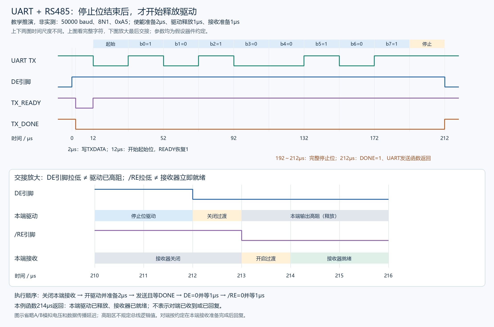

图中0μs先将/RE设为1关闭本端接收，再将DE设为1开启驱动，等待2μs。2μs调用已有阻塞UART发送函数，因初始READY=1立即写入0xA5；沿用2.2节的教学交接延时，10μs后即12μs开始起始位，READY恢复1。8N1每位20μs，完整字符占12～212μs，最后停止位为192～212μs。

212μs时DONE变1，UART发送函数返回，才将DE设为0；再等1μs，到213μs确认本端输出高阻。随后将/RE设为0，等接收准备1μs，到214μs才允许组合函数返回。图中三个转换均按预算用满绘制，真实生效可能更早，本题代码仍等待规定预算。

| 状态 | 本端驱动 | 本端接收 |
|---|---|---|
| 初始DE=0、/RE=0且已稳定 | 释放 | 已开启 |
| 发送中DE=1、/RE=1且驱动已准备 | 有效驱动 | 关闭 |
| DE刚改0、/RE仍1 | 正在等待关断保证 | 关闭 |
| DE改0已满1μs、/RE仍1 | 已释放 | 仍关闭 |
| /RE改0又满1μs | 已释放 | 已准备 |

驱动释放不表示本端已经可以接收；接收器开启也不表示软件已经读到一字节。UART TX在停止位后持续高，不代表外部收发器已经高阻；高阻本身也不是输出逻辑0或1。本图不指定无人驱动时A/B电压。

本题执行顺序为：关闭本端接收 → 开驱动并等待准备 → 调用阻塞UART发送，等其返回 → 关闭驱动并等待释放 → 开接收并等待准备 → 返回。前两项接口调用示例如下，完整组合见10.4：

```c
rs485_re_n_write(1u); /* 物理高：关闭本端接收 */
rs485_de_write(1u);   /* 物理高：开启驱动 */
```

### 10.3 单字节组合函数的返回承诺

目标接口为章首的void rs485_send_byte_blocking(UART_Regs *uart, uint8_t byte)。uart选择符合本章模型的UART实例，byte是待发数据；GPIO接口控制固定的那一颗RS485收发器，题设保证它与所传UART正确连接。这里先做无超时版本，硬件最终会前进；若READY或DONE一直不满足，已有阻塞UART函数仍会一直等待。

正常返回承诺：本次单字节已按UART模型发完，包括完整停止位；本端驱动已释放，接收器已准备好。它不承诺对端收到、校验成功、已经回复，也没有替调用者读取UART RXDATA。发送函数与读取回复是后续不同动作。

完整组合实现见10.4。将来加入发送超时，必须另外规定“字节已提交但尚未发完”时的DE与UART处置，不能将超时返回直接当作线路发送完成；该分支尚未展开，不改变当前无超时函数约定。

### 10.4 单字节发送并切回接收准备的完整实现

```c
void rs485_send_byte_blocking(UART_Regs *uart, uint8_t byte)
{
    /* 关闭本端接收，避免本题中的本机回读。 */
    rs485_re_n_write(1u);

    /* 开启驱动，等待准备完成。 */
    rs485_de_write(1u);
    delay_us(RS485_DRIVER_SETUP_US);

    /* 本次完整停止位结束后，该函数才返回。 */
    uart_send_byte_blocking(uart, byte);

    /* 关闭驱动，等待输出进入高阻。 */
    rs485_de_write(0u);
    delay_us(RS485_DRIVER_RELEASE_US);

    /* 开启接收，等待接收器准备完成。 */
    rs485_re_n_write(0u);
    delay_us(RS485_RECEIVER_SETUP_US);
}
```

调用前满足10.1的UART、收发器和总线调度前提。开始关闭本端接收，然后开驱动并等2μs，再调用已有UART阻塞发送；UART函数内部负责READY等待、一次提交和本次DONE等待，组合函数不重复实现这些循环。UART函数正常返回后，关闭驱动等1μs，再开启接收等1μs，顺序与10.2波形一致。

正常返回时DE=0、/RE=0，而且两项硬件转换均已等待规定预算，因此可以承诺本端驱动已释放、接收器已就绪。函数返回void，当前无超时版本假设硬件最终前进；不返回对端确认或回复数据。它控制固定收发器，所传uart与其连接的前提仍由调用者保证。

三个延时宏分别对应驱动开启、驱动关断和接收开启，应按动作使用，不能仅因数值足够就混用。若最后误用RS485_DRIVER_SETUP_US=2u，接收开启后会多等1μs，在当前前提下没有等待不足或过早释放的问题，但本例返回从214μs变成215μs，且后续修改驱动准备宏会意外影响接收阶段。规范实现应使用RS485_RECEIVER_SETUP_US。延时保证与本题预算有关，真实硬件仍按具体器件条件选取。

本实现为给定接口下的静态推演，未作开发板测量。后续扩展多字节时，应由外层安排整段的驱动保持与最后切回接收，而不是默认逐字节调用此完整方向切换函数。

### 10.5 多字节发送：由外层保持整段方向

一次要发送多个字节时，外层函数应在开头关闭接收、开启驱动，在全部字节完成后才释放驱动、恢复接收。循环只负责按数组顺序调用已有UART单字节发送，不在字节之间改变DE或/RE。

章首新增接口如下，没有新增GPIO、宏或寄存器定义：

```c
void rs485_send_bytes_blocking(UART_Regs *uart, const uint8_t *buffer,
                               uint16_t length);
```

buffer指向待发字节数组，length是要发送的字节数，const表示本函数不通过此指针改动数组内容。length>0时，调用者保证buffer起始至少length个字节可读，且在发送过程中数据保持稳定；UART、固定收发器、独占发送权限和初始DE=0、/RE=0已稳定等前提沿用10.1，对端在本端完成整段交接前不驱动。当前假设器件允许下图的字节间隔，没有要求零间隔发送。

**零长度约定：length=0立即返回，不调用GPIO、UART或延时函数，也不访问buffer。**此时buffer允许为空指针，因为没有字节需要读取；零长度不承担将任意初始状态恢复成接收的职责。length>0时buffer仍须有效，本节不引入新的非法参数结果。

本题是按长度发送二进制字节数组。例如数组{0xA5, 0x5A, 0x00}、length=3，要完整发送三字节，末尾0x00不是结束标记。与C字符串的零终止约定不同，发送范围只由length确定。

| 层次 | 职责 |
|---|---|
| rs485_send_bytes_blocking | 检查零长度，负责整段的方向控制及三个阶段预算 |
| 循环中的uart_send_byte_blocking | 发送buffer[i]，等待这个字符完整结束，不操作DE或/RE |
| rs485_send_byte_blocking | 自带单字节方向切换，不能作为本题循环内的字节发送层 |

若循环调用rs485_send_byte_blocking，每个字节都会关闭驱动、恢复接收，下次再开启驱动；外层即使已经DE=1，也会被内层取消，违反本题整段保持驱动的约定。这不代表逐字节切换在任何应用都必然丢数据，而是该接口不满足这里的分层职责和总线占用要求。

正常动作顺序为：零长度先返回 → 关闭接收 → 开驱动并等准备2μs → 按buffer[0]至buffer[length-1]逐个调用uart_send_byte_blocking → 最后一轮返回后关闭驱动并等释放1μs → 开接收并等准备1μs → 返回。最后一次UART调用已经等待本次最后字符的DONE，不需再写一份等待循环；每个字节结束时仍不能提前把DE改0。

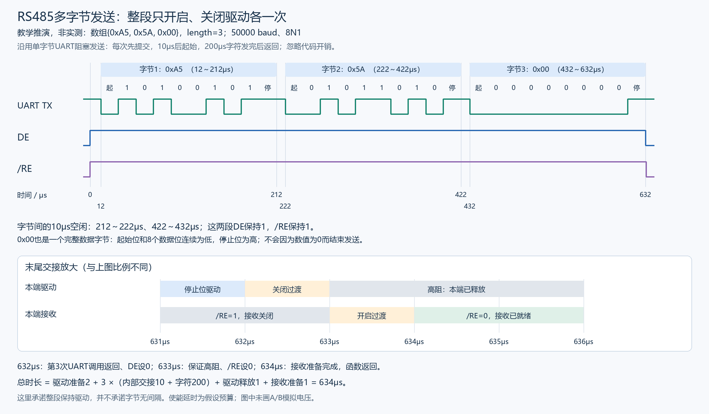

图为沿用本章模型的静态教学推演，非实测。0μs开始关闭接收和开启驱动，2μs准备完成后提交第一个字节；本例每次提交后内部交接10μs，字符按50000 baud、8N1发送200μs。三个UART调用分别在2、212、422μs提交字节，在12～212、222～422、432～632μs发送对应字符。每轮调用返回后才进行下一次提交，因此212～222和422～432μs有高电平空闲，期间DE仍保持1、/RE仍保持1。

**整段保持驱动不等于字节无间隔。**已有UART阻塞函数逐字节等DONE，当前复用方式不承诺相邻字符首尾无缝连接。若实际目标要求严格的字节间隔，还需依据硬件及对端约定重新设计提交策略；不能仅将DE保持1就宣称已满足。10μs内部交接是本章明确的教学设定，不是UART或RS485固定时序。

最后第三个字符在632μs完整结束，外层将DE设0；等1μs，到633μs保证本端驱动高阻，再将/RE设0；等接收准备1μs，634μs返回。忽略循环、GPIO等开销时，三字节总时长为2+3×(10+200)+1+1=634μs；其中纯字符位时间600μs。图中0x00的起始位和八个0数据位连续低，仍有完整高电平停止位。

函数返回承诺：length>0时所有指定字节按顺序完成UART发送，本端驱动已释放、接收已准备；length=0时没有本次发送与方向操作。仍不承诺对端已收到或回复。完整实现见10.6。

### 10.6 多字节发送并统一切回接收的完整实现

```c
void rs485_send_bytes_blocking(UART_Regs *uart,
                               const uint8_t *buffer,
                               uint16_t length)
{
    /* 零长度不操作引脚、UART、延时或数组。 */
    if (length == 0u) {
        return;
    }

    /* 整段开始前关闭接收、开启驱动并等待准备。 */
    rs485_re_n_write(1u);
    rs485_de_write(1u);
    delay_us(RS485_DRIVER_SETUP_US);

    /* UART字节函数不改变方向，DE在整段期间保持有效。 */
    for (uint16_t i = 0u; i < length; i++) {
        uart_send_byte_blocking(uart, buffer[i]);
    }

    /* 最后一轮已等待本次DONE，再统一释放驱动。 */
    rs485_de_write(0u);
    delay_us(RS485_DRIVER_RELEASE_US);

    /* 开启接收并等待准备完成。 */
    rs485_re_n_write(0u);
    delay_us(RS485_RECEIVER_SETUP_US);
}
```

本函数沿用10.5的有效UART/收发器连接、数组有效性、无其他发送者、硬件最终前进和允许题设字节间隔等前提。length为0时，入口return早于全部GPIO调用及buffer访问，所以空buffer在零长度情况下不会被解引用，也不会发生无数据却切换方向的副作用。

非零长度时，关闭接收、开启驱动和驱动准备只执行一次；循环按i从0至length-1读取并发送每个字节，不检查字节是否为0。循环内调用UART层，其正常返回已承诺对应字符完整结束；整个循环期间没有DE或/RE写入。循环退出意味着最后一次UART发送也已完成，可以统一关闭驱动并等待释放，再开启接收并等待准备。三个阶段预算都在循环外，并分别采用正确用途的宏。

按10.5的三字节教学图，buffer内容A5、5A、00依次发送；最后UART调用在632μs返回，驱动在633μs保证高阻，接收在634μs准备完成，随后函数返回。零长度则不产生这条发送时间线。以上为给定模型的静态推演，未进行编译、运行或开发板测量。

相比10.4，方向控制仍由当前事务函数拥有，循环只复用不操作收发器的UART字节层；不能把单字节的完整RS485事务再次放入循环，否则会在字节间切换方向。当前写法逐字节等待DONE，因此仍保留本题允许的交接间隔；它不是零间隔发送、高性能流水发送或对端收件确认的实现。

## 十一、自测与参考答案

本节用于以后自查；教材有答案不等于已经完成相应练习。下面均采用本章模型和前提。

### 11.1 自测题

1. 单字节波形图中50μs时STATUS=0x01，即READY=1、DONE=0。能否提交下一字节？能否据此认定前一字符已发完？
2. 如果代码只等READY、写TXDATA后就返回，能否把返回当作线路已发完？若要求本次发送完成后才返回，还需观察什么？
3. 调用无超时函数前STATUS=0x03。会不会因为入口DONE已经为1，在提交新字节后立即返回？写TXDATA后由谁清DONE？
4. 调用时STATUS=0x00，随后硬件变为0x01；提交后稍后READY=1而DONE仍为0。分别在哪处循环等待？后一个状态能否让函数返回？
5. 带超时函数入口时间100μs，总预算300μs，可写时当前280μs。绝对截止及剩余预算是多少？第二阶段是否重新记录起点？
6. 本字节已写入TXDATA，之后预算用尽、DONE仍为0，应返回什么？能否据此认定字节未发出或UART已停止？
7. 如果保留`while ((uart->STATUS & UART_TX_READY) == 0u)`，只在循环体里检查超时，入口READY=1、timeout_us=0时会进入循环吗？这种写法能否保证0预算不提交？
8. 沿用4.7节硬件时序，将总预算改为300μs，并在40μs、250μs执行相应检查。40μs第一个break之后执行哪条语句？250μs第二个break之后执行哪条语句，最终返回什么？
9. 若总预算改为30μs，调用前条件与4.7节相同，30μs执行检查时，会在哪个循环以什么结果返回？本次byte写入TXDATA几次？此时不能沿用“本次A5在50μs开始发送”的后续波形。
10. 采用第五节模型，f_UART为24MHz，目标改为100000baud，应向BAUD_DIV写多少？如果总使能仍为1就写入，会生效吗？
11. CTRL初值0x80，其中bit7另有用途、必须保留。按5.3节的清总使能、配置、置TX/RX使能、最后置总使能的顺序操作后，CTRL应为多少？能否直接用CTRL=0x07替代？
12. RXDATA为0x00且RX_READY=1，能否把它作为有效字节读取？读RXDATA一次后，由谁清RX_READY？
13. out_byte指向的变量原值为0xAA，接收函数等待超时且尚未读取RXDATA，应返回什么，变量应保持什么值？
14. 本节软件UART发送0x96时，8个数据位的输出顺序是什么？50000baud、8N1的理想字符时长是多少？
15. 停止位写高后立即返回，是否满足本节完整发送契约？给每位调用delay_us(20)是否自动保证真实硬件每位恰好20μs？
16. 本节SPI模式0中，SCK为低且MOSI已经准备并等待低半周期，接下来应先读MISO还是先拉高SCK？读完后应立即拉低还是先保持高半周期？
17. rx从0开始，依次采到1、0、1，每次按(rx<<1)|bit累积，结果是多少？此时是否已收齐完整字节？
18. 本节模式1是在拉高后立即读MISO，还是拉低后读？按8.5的操作顺序，第一轮MOSI在拉高之前还是之后准备？
19. 图中第8次下降沿在15μs，采样后按本节完整周期约定还要做什么？何时返回，SCK是什么电平？
20. 模式2中SCK当前为高，MOSI已经准备并等待了高半周期。接下来应拉高还是拉低SCK再读取？读完后应怎样结束本轮？
21. 模式3每轮开始的第一个下降沿用于准备还是采样？应在哪个边沿后读取MISO？8轮结束时SCK应为多少？
22. 按8.10节器件约定，前三次调用的返回值能否当作目标地址数据？每交换完一个字节都拉高/CS可以吗？
23. 第4次调用发送0x00，返回0xB3，应交给读取函数调用者哪个值？4次交换共多少时钟周期、纯交换耗时多久？
24. 按8.12器件约定，从0x0123读取3个数据字节，命令和起始地址各发送几次？buffer[0]、buffer[1]、buffer[2]分别得到什么？
25. 读取3个数据字节共调用几次字节交换函数、产生多少时钟周期？length=0时还应拉低片选或调用字节交换吗？
26. 在本章普通开漏模型中，发送数据位1应释放SDA还是主动输出高？若目标器件仍拉低SDA，soft_iic_sda_read()返回多少？
27. 图中本机2μs释放SCL，能否立即认定高电平阶段已开始？应调用哪个接口确认实际SCL是否为高？
28. 按9.2约定，调用前SCL已释放，函数2μs进入、实际9μs可读高。预算10μs并在9μs轮询，应返回什么？预算5μs并在7μs轮询，应返回什么？
29. timeout_us=0而实际SCL已经高，按本章时间优先约定返回什么？等待函数超时后是否会自动拉低SCL或产生STOP？
30. 9.4成功图中，START发生在5μs还是10μs？函数成功返回时SDA、SCL各为多少？
31. 等待SCL高返回IIC_TIMEOUT后，能否继续拉低SDA来生成START？首次START函数应返回什么？
32. STOP准备阶段在SCL低时把SDA拉低，是否产生START？成功路径中，SCL升高与SDA随后升高，哪个变化形成STOP？成功返回时两线各是什么？
33. 按9.6约定等待SCL高超时，能否继续执行释放SDA的成功动作？函数返回什么，本机SDA输出保持什么状态？
34. 本例第8位为0，发送完后MCU若继续下拉SDA，第9时钟读到0能证明接收方ACK吗？在第9时钟前MCU应执行什么动作？
35. 第9时钟实际为高、MCU已释放SDA，读取SDA=1应返回什么？若某次SCL始终低直到等待预算用尽，应返回什么？
36. 接收前8位时，MCU应保持释放SDA还是按数据位主动输出？若要继续读取下一个字节，第9位应做什么？
37. reply选择IIC_SEND_NACK且9周期正常完成，本函数应返回IIC_NACK还是IIC_OK？若第9次SCL等待超时，输出变量原值0xAA是否应改为已拼出的rx？
38. 9.12图中SDA在低SCL阶段升高，会不会产生STOP？重复START发生在5μs还是10μs？
39. 重复START等待SCL高超时后，能否继续下拉SDA并返回成功？函数应返回什么，是否自动生成STOP？
40. 按9.14的假设器件约定，addr7=0x2D、reg=0x10，MCU依次发送的三个字节是什么？收到唯一的数据字节后，MCU应给ACK还是NACK？
41. 已收到数据0xC7，但最后STOP返回IIC_TIMEOUT。完整寄存器读取函数应返回什么？调用者变量原值为0xAA，应否更新为0xC7？
42. 10.2图中202μs时READY=1、DONE=0，能否据此提前将DE设0？如果212μs才将DE设0，按本题预算最早何时能保证本端驱动高阻？
43. 图中213μs将/RE设0，能否立即返回并承诺接收准备完成？按本题预算最早何时可以返回？返回是否证明对端已收到本字节？
44. 10.5的多字节循环应调用uart_send_byte_blocking还是rs485_send_byte_blocking？第1、2个字节完成后，是否应将DE改0？
45. length=0且buffer为空指针时，本题函数是否应改变DE或/RE、调用UART或访问buffer？

### 11.2 参考答案

1. **可以提交，不能认定已发完。**暂存区空与移位发送结束不同；新增写入会改变后续时序，原图210μs不再代表全部数据完成。
2. **不能。**还需等待本次DONE=1。不能用旧完成状态或软件改写只读STATUS伪造完成，真实芯片按手册确认标志规则。
3. **不会；硬件清DONE。**本模型规定新写入后硬件清DONE，第二处循环等待本次完成后重新置位。
4. **先在第一处等READY，再在第二处等DONE；不能返回。**00时不可写，01时可提交；写入后即使READY恢复1，只要DONE=0仍未确认发送完成。
5. **截止400μs，剩余120μs，不能重设起点。**已用180μs，两阶段共用入口起点；本例不跨计数回绕。
6. **UART_TIMEOUT；两种结论都不能推出。**已提交数据可能继续发送，函数没有执行硬件取消；该结果也不证明对端收到或未收到。
7. **不会进入，不能保证。**READY已为1，while条件为假，循环体里的时间判断被跳过；若随后直接写TXDATA，就违反0预算不提交。4.5节的轮询入口保证先检查时间，再检查READY。
8. **先执行uart->TXDATA = byte；后执行return UART_OK，最终返回UART_OK。**40μs预算未耗尽且READY=1，第一个break只退出READY循环；250μs仍未到300μs截止且DONE=1，第二个break后执行成功返回。
9. **在第一个循环返回UART_TIMEOUT，本次写入0次。**预算在READY可写之前用尽，return结束整个函数，未到提交语句。调用前已有的数据可能继续发送，不能把未提交的本次字节也画成已经发出。
10. **写15；总使能为1时写入不生效。**N=24000000/(16×100000)=15，应先清总使能位，再写分频。
11. **0x87；不能直接赋0x07。**清bit0保留0x80，置TX/RX得0x86，最后置总使能得0x87；直接赋0x07会清掉必须保留的bit7。
12. **可以；由硬件清RX_READY。**0也是有效数据，就绪与数据数值无关；软件通过读RXDATA取走字节，不写只读STATUS清标志。
13. **返回UART_TIMEOUT，变量仍为0xAA。**本接口超时不取数、不修改输出；旧值不能当作本轮收到的数据，须检查返回结果。
14. **0、1、1、0、1、0、0、1；200μs。**从最低位b0先发，8N1包含起始1位、数据8位、停止1位，每位20μs。
15. **不满足；也不自动保证。**停止位写高后还需保持一个位时间，本模型为20μs；真实位宽还受GPIO、循环、延时实现和中断等开销影响，图示理想条件不等于实测保证。
16. **先拉高SCK，再在有效窗口读MISO；读取后保持高半周期，再拉低。**本模型在上升沿后读GPIO模拟模式0采样，并保留每个高/低半周期，保证理想完整时钟。
17. **结果为5（0x05），尚未收齐。**变化0→1→2→5，只完成3次采样；还需5次才有本题完整8位接收值。
18. **拉低后读；拉高后准备MOSI。**模式1在上升沿准备数据、下降沿采样，本节在高半周期留出准备时间。
19. **保持低电平再延时1μs，到16μs返回，SCK为0。**这是本例每轮高、低各半周期的约定；字节函数不改变/CS。
20. **拉低后读取；随后保持低半周期，再拉高SCK结束本轮。**模式2在第一个边沿即下降沿采样，循环结束回到高电平。
21. **用于准备；在上升沿后读取；结束时SCK=1。**模式3在第二个边沿即上升沿采样，本题采样后保持高半周期。
22. **都不能。**前三个返回值按器件约定忽略，数据在第4次交换时返回；中间拉高/CS会结束当前读取，下一次选中重新从命令开始。
23. **返回0xB3；32个时钟周期，64μs纯交换时长。**0x00只是MOSI占位字节；若另计本题建立/保持各1μs，选中到取消选中的理想时长为66μs。
24. **读命令一次，起始地址一次（拆成高/低两个字节）；依次得到0xB3、0x6C、0xA5。**目标器件内部地址自动递增，MCU将同次返回数据写入递增的数组下标。
25. **6次字节交换、48个时钟周期；length=0不启动这些操作。**3个命令/地址字节加3个数据占位字节；零长度在片选前返回，不访问buffer。
26. **调用soft_iic_sda_release()释放；仍被其他端拉低时读到0。**释放只改变本机下拉状态，不强制共享线路为高；read读取实际输入。
27. **不能；调用soft_iic_scl_read()确认。**本例2～8μs另一端仍下拉，释放不等于线路高；还需考虑上升至有效高电平的时间。
28. **分别为IIC_OK、IIC_TIMEOUT。**前者elapsed=7μs<10μs且输入高；后者elapsed=5μs达到预算，先返回超时。
29. **返回IIC_TIMEOUT；不会自动操作引脚或产生STOP。**本节先检查时间，零预算到期优先；函数只有读输入和计时，没有收尾电平操作。
30. **5μs；SDA=0、SCL=0。**5μs时实际SCL高且SDA下降产生START，10μs拉低SCL是进入后续数据阶段的准备。
31. **不能；应立即返回IIC_TIMEOUT。**没有确认SCL高，不能继续假称START成功；本机两条输出保持释放，不自动产生STOP。
32. **不产生START；实际SCL高时的SDA低到高变化形成STOP；成功返回SDA/SCL均高。**SCL升高本身不是STOP，末尾不再拉低SCL。
33. **不能；返回IIC_TIMEOUT，SDA保持下拉。**SCL输出已释放但实际仍可能为低，没有完成STOP；本函数未定义额外恢复动作。
34. **不能；应在SCL低时先释放SDA。**自己下拉造成的0无法证明接收方应答，第9位需让接收方控制SDA。
35. **分别返回IIC_NACK、IIC_TIMEOUT。**前者在有效应答高阶段读到1，后者未在预算内确认SCL高，不能把它解释为NACK。
36. **前8位保持释放；继续读时在第9低阶段下拉SDA给ACK。**目标负责数据位，控制器负责时钟和接收后的应答。
37. **返回IIC_OK；超时时不改输出，保持0xAA。**主动发送NACK是本次正常控制动作；只有8位接收和第9位应答都完成，才提交本地rx。
38. **不会；重复START发生在10μs。**低SCL期间SDA升高不满足STOP定义；10μs时实际SCL高而SDA下降产生重复START。
39. **不能；返回IIC_TIMEOUT，不自动生成STOP。**失败后不继续SDA下拉，本机两线输出保持释放，实际SCL仍可能低。
40. **0x5A、0x10、0x5B；MCU给NACK。**两次地址字节使用同一个7位地址，最低位分别为写0和读1；中间的0x10是寄存器位置。
41. **返回IIC_TIMEOUT，调用者变量保持0xAA。**接收函数先写事务局部变量，只有STOP也成功才提交到*out_byte，不能把暂存成功等同完整事务成功。
42. **不能；213μs。**202μs仍在最后停止位中，READY不是完成标志。212μs确认本次DONE并将DE设0后，还需等待关断预算1μs，才保证本端输出高阻。
43. **不能立即返回；214μs；不能证明。**/RE低有效，但本题还规定接收器准备预算1μs。函数只承诺本端发送与交接完成，不等同对端收件或回复确认。
44. **调用uart_send_byte_blocking；不应。**它只负责一个UART字符，方向由外层保持；rs485_send_byte_blocking自带方向切换，会在字节间释放驱动并开启接收。
45. **都不应。**零长度在任何GPIO/UART/延时和数组访问之前返回，所以此时允许buffer为空；这不是在非零长度时忽略指针有效性的理由。

## 十二、资料与后续内容

[ST官方STM32F4 UART驱动](https://github.com/STMicroelectronics/stm32f4xx-hal-driver/blob/master/Src/stm32f4xx_hal_uart.c)可作真实驱动对照：初始化准备时钟、引脚和UART参数，轮询发送先等数据寄存器可写，提交后还确认发送完成。这里只联系等待层次，不将本教学模型的位定义、结构体、内部延时或截止规则直接套到STM32，也不要求现在通读HAL源码。

本章当前约定的UART、软件UART、软件SPI、软件IIC及UART配合RS485范围已覆盖；10.5说明多字节事务与波形，10.6提供完整实现。后续按学习者明确需求开展集中复习或扩展，不将资料齐全等同于独立实现或实机验证。

章节随实际学习补全；不自动启动集中复习、模拟面试、接口选型、仪器操作或通信故障定位专项。
